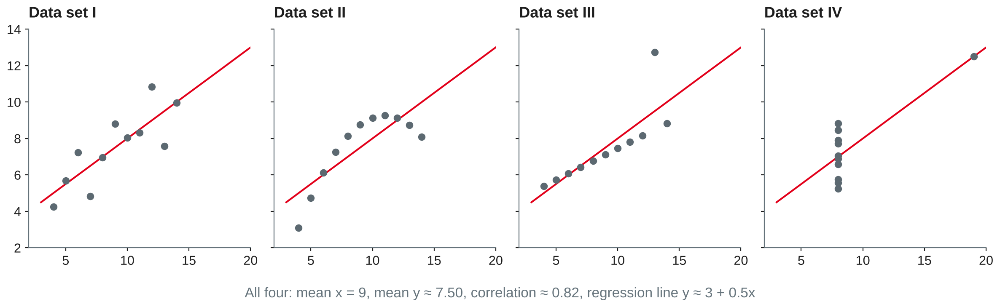
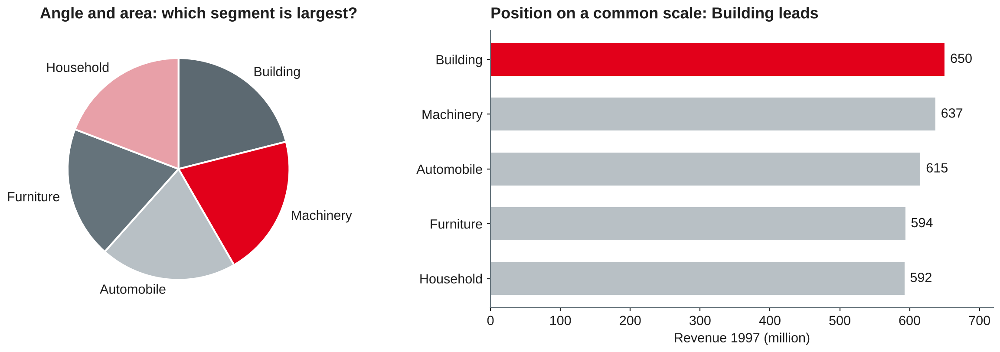
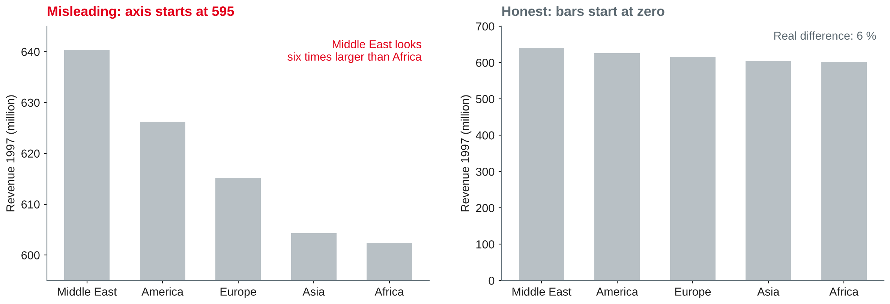
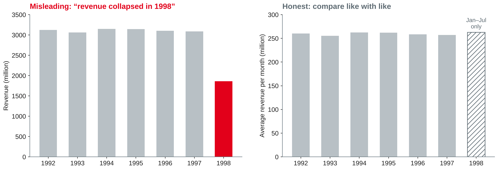

# Data Visualisation {.title}

::: notes
Time plan for today (3 h): recap and chart gallery 10 min · choosing the right chart 15 min · perception and visual encoding 20 min · break 10 min · misleading charts 15 min · storytelling and KPI design 15 min · lab 80 min · wrap-up 5 min · ~10 min buffer.
Students need tpch.duckdb with the star schema from session 3 and matplotlib (installed in the session 1 setup). Students were asked to bring one chart from their company or the news that they find good or misleading — collect them at the start (shared folder or screen).
:::

---

# Today's Agenda

1. Recap: from result tables to charts — your examples
2. Choosing the right chart for the question
3. Perception and visual encoding
4. Misleading charts — and how to spot them
5. Storytelling with data and KPI design
6. Lab: redesign bad charts and visualise your lab results

::: notes
Time and format guide (not shown to students):
0:00 Recap and gallery of the brought charts (plenary) · 0:10 Chart choice (input + quick check) · 0:25 Perception and encoding (input + discussion) · 0:45 Break · 0:55 Misleading charts (input + exercise) · 1:10 Storytelling and KPIs (input) · 1:25 Lab (pairs) · 2:45 Wrap-up · ~10 min buffer.
If the gallery discussion runs long, keep it: the brought charts are the best material of the day. Shorten the KPI part instead (the KPI definition sheet is optional).
:::

---

# Recap: From Result Table to Chart

- In session 4 you produced **result tables**: rankings, running totals, shares, year-on-year growth, cohorts, a funnel
- A manager rarely reads a table with 36 rows — the result has to be **shown**
- Today's question: **which picture** makes the result clear, honest and actionable?

::: callout
**Your examples:** which chart did you bring — and is it good or misleading? Why?
:::

::: notes
Show 3–4 of the brought charts. For each, ask: what is the message, which chart type, what would you change? Keep a list of the problems students name (truncated axis, too many colours, 3D, missing units …) and come back to it in the misleading-charts part.
:::

---

# Choosing the Right Chart {.section}

Start from the question, not from the chart menu

---

# Why Visualise? Anscombe's Quartet

{width=100%}

- Same means, same correlation, same regression line — four completely different stories
- Summary statistics alone can hide **non-linearity, outliers** and **leverage points**

::: source
Own illustration of the data published by Anscombe (1973).
:::

::: notes
Anscombe constructed the four data sets to show that graphs are essential for statistical analysis. Ask before revealing: "which data set would you trust a linear model for?" Only data set I. II is a curve, III has one outlier that tilts the line, IV is determined by a single point. Link to sessions 11–14: always plot a time series before modelling it.
:::

---

# Explore or Explain?

::: columns
**Exploratory analysis**

- You look for what is interesting in the data
- Many quick charts, most of them thrown away
- Audience: yourself and your team
|||
**Explanatory analysis**

- You show **one** finding to a specific audience
- Few, carefully designed charts
- Audience: decision makers — they need to know **what to do**
:::

::: callout
Before designing an explanatory chart, answer: **who** is the audience, **what** should they know or do, and **how** will data support it?
:::

::: source
Knaflic (2015, Chapter 1).
:::

::: notes
Knaflic's main point: most bad business charts are exploratory charts shown in an explanatory setting — "here are all the numbers, you find the message". In the portfolio notebooks both are needed: exploratory charts in the analysis, explanatory charts in the written assessment.
:::

---

# Which Chart for Which Question?

| Question | Typical chart | Avoid |
|---|---|---|
| Compare categories | Bar chart, sorted; horizontal for long labels | Pie with many slices, 3D bars |
| Change over time | Line chart; bars for few periods | Unequal time steps on an even axis |
| Part of a whole | Stacked or 100 % bar; pie only for 2–3 parts | Pie with similar slices |
| Distribution | Histogram, box plot | Average only |
| Relationship | Scatter plot | Two lines on two y-axes |
| Look up exact values | Table, heatmap | Chart with 50 data labels |

::: source
Own compilation based on Knaflic (2015, Chapter 2) and Munzner (2014).
:::

::: notes
This is a starting point, not a rulebook. Knaflic recommends a small set of chart types for most business purposes: simple text for one or two numbers, tables, heatmaps, lines, bars (vertical, horizontal, stacked), waterfall, scatter plot, slopegraph. A single important number is often best shown as big text, not as a chart.
:::

---

# Quick Check: Which Chart? {.exercise}

For each result from the TPC-H warehouse, choose a chart and say why.

1. Revenue 1997 for the five regions
2. Monthly revenue 1997 compared with 1996
3. Share of the five market segments in total revenue 1997
4. Number of line items per order (1 to 7)
5. Discount vs. quantity of each line item
6. Revenue by region and year 1992–1997, for a controller who needs exact figures

::: notes
Expected answers: 1 sorted bar chart (5 categories, comparison) · 2 line chart with two lines, months on the x-axis (change over time, same months aligned) · 3 100 % stacked bar or a sorted bar chart of shares; a pie works badly because all shares are 19–21 % · 4 histogram / bar chart of counts (distribution of a discrete variable) · 5 scatter plot — with 600,000 points use transparency or a sample, or a heatmap of binned counts · 6 table, possibly with a colour scale (heatmap) — the controller wants to look up values, not see a pattern.
:::

---

# Perception and Visual Encoding {.section}

How the eye reads a chart

---

# Marks and Channels

- A chart **encodes** data with **marks** (points, lines, areas) and **channels** (position, length, angle, area, colour, shape …)
- **Magnitude channels** show *how much*: position, length, angle, area, colour lightness
- **Identity channels** show *what* or *where*: colour hue, shape, spatial region
- **Expressiveness:** use magnitude channels only for ordered data, identity channels for categories
- **Effectiveness:** encode the most important attribute with the most effective channel — usually position

::: source
Munzner (2014, Chapter 5).
:::

::: notes
Munzner's framework makes chart critique systematic: list the attributes, the channel each one uses, and ask whether the most important attribute got the best channel. Typical expressiveness error: a rainbow colour scale for ordered values (hue is not ordered), or a line connecting unordered categories.
:::

---

# How Accurately We Read Encodings

Ranking of elementary perceptual tasks, from most to least accurate:

1. **Position** along a common scale
2. Position along non-aligned scales
3. Length, direction, angle
4. Area
5. Volume, curvature
6. Shading, colour saturation

::: source
Based on Cleveland and McGill (1984).
:::

::: notes
Cleveland and McGill ranked elementary perceptual tasks by how accurately people judge quantities with them, partly from experiments (position vs. length vs. angle). Consequences: bar and dot charts (position) beat pie charts (angle, area); a heatmap (shading) is good for spotting patterns but bad for exact comparison; 3D adds volume and perspective distortion.
:::

---

# Angle vs. Position

{width=92%}

::: source
Own illustration with TPC-H data (Transaction Processing Performance Council, n.d.), based on Cleveland and McGill (1984).
:::

::: notes
Revenue 1997 per market segment (DuckDB 1.5.5, sf 0.1): Building 650.0, Machinery 636.8, Automobile 615.4, Furniture 593.8, Household 592.5 million — shares between 19.2 % and 21.1 %. Ask the room which slice is largest before showing the bar chart. Most cannot tell. Note also the colours: the pie needs five colours, the bar chart uses one grey plus one highlight.
:::

---

# Colour and Attention

- **Preattentive attributes** (colour, size, position, intensity) are noticed before we consciously look — use them to point to **the one thing** that matters
- Use grey for context and **one** accent colour for the message
- **Sequential** palettes for ordered values, **diverging** palettes around a meaningful midpoint, **categorical** palettes for a few groups
- Never rely on red vs. green alone: colour vision deficiency is common — add labels, position or lightness differences

::: source
Knaflic (2015, Chapter 4); Munzner (2014, Chapter 10).
:::

::: notes
Knaflic's point in paraphrase: if you highlight everything, nothing stands out. Demonstrate with the bar chart on the previous slide: the single red bar draws the eye immediately. Munzner discusses colour maps in detail (sequential, diverging, categorical; a limited number of distinguishable hues). Rainbow scales are a common anti-pattern for ordered data.
:::

---

# Less Clutter, More Data

- **Data-ink ratio:** the share of ink that shows data — erase what does not
- **Chartjunk:** decoration that adds no information (3D effects, heavy grids, background images)
- Practical declutter steps: remove borders and heavy gridlines, label data directly instead of a legend, round numbers, left-align titles, use plain language

::: callout
Decluttering is not minimalism for its own sake: every element that stays must help the reader.
:::

::: source
Tufte (2001); Knaflic (2015, Chapter 3).
:::

::: notes
Tufte introduced data-ink and chartjunk; Knaflic turns them into a practical checklist (cognitive load, Gestalt principles of proximity, similarity, enclosure, closure, continuity, connection). Caveat for discussion: embellishment can make a chart more memorable — the rule is "no decoration that distorts or distracts", not "no design".
:::

---

# Misleading Charts {.section}

When the picture says more than the data

---

# Truncated Axis

{width=92%}

::: source
Own illustration with TPC-H data (Transaction Processing Performance Council, n.d.), based on Tufte (2001).
:::

::: notes
Revenue 1997 per region: Middle East 640.4, Africa 602.4 million — a 6 % difference. With the axis starting at 595, the bar heights are 45.4 vs. 7.4, so the Middle East bar looks about six times as tall. Rule: bar charts must start at zero, because we read the length. Line charts may use a narrower axis range, because we read position and slope — but label the axis clearly. Tufte's lie factor: size of the effect shown in the graphic divided by the size of the effect in the data; here (45.4/7.4 − 1) / (640.4/602.4 − 1) ≈ 5.1 / 0.063 ≈ 81.
:::

---

# The Incomplete Year

{width=92%}

::: source
Own illustration with TPC-H data (Transaction Processing Performance Council, n.d.).
:::

::: notes
Callback to sessions 2 and 4: orders end on 1998-08-02, so 1998 contains seven full months and two days. Total revenue 1998 is 1,859 million vs. about 3,100 million in earlier years — a "collapse" that is purely an artefact. Average revenue per complete month (Jan–Jul 1998: about 263 million) is in line with earlier years (255–263 million). Honest options: exclude 1998, compare year-to-date periods, or show per-month averages and mark the partial period.
:::

---

# More Ways to Mislead

| Technique | Why it misleads | Honest alternative |
|---|---|---|
| Dual y-axes | Scales are arbitrary, so any two lines can be made to "move together" | Two aligned charts, or index both series (e.g. 2020 = 100) |
| 3D charts | Perspective distorts angles, areas and heights | 2D chart |
| Area or icon scaling | Doubling width and height quadruples the area | Scale length only, or use bars |
| Cherry-picked time window | A short window can turn a flat trend into growth | Show the full period, mark the selection |
| Missing denominator | Totals grow with population or customers | Rates per customer, per capita, per month |

::: source
Own compilation based on Tufte (2001) and Knaflic (2015).
:::

::: notes
Most misleading charts are not intentional — they come from defaults and from not checking the data (like the 1998 example). Ask students to map the problems they named in the gallery at the start to this table.
:::

---

# Spot the Problem {.exercise}

What is misleading, and how would you fix it?

1. A line chart shows website visits and revenue on two y-axes; the lines run in parallel, the title says "Visits drive revenue"
2. A 3D pie chart shows the market share of six competitors
3. A bar chart compares "Revenue 2025" with "Revenue 2026 (until June)"
4. A bubble map shows sales per city; Berlin's bubble has twice the diameter of Munich's
5. A KPI tile shows "Returns: 1,250" in green — with no comparison

::: notes
Expected answers: 1 dual axis — scaling is arbitrary and correlation is not causation (session 9); use two aligned panels or index both series · 2 3D and pie — angles of six similar slices cannot be compared and perspective enlarges front slices; sorted bar chart · 3 incomplete period — compare January–June 2025 with January–June 2026 · 4 area grows with the square of the diameter: twice the diameter reads as four times the sales; scale area, not diameter, or use bars · 5 no context — is 1,250 good? Add target, previous period and a rate (returns per 100 orders); the colour should depend on the comparison.
:::

---

# Storytelling and KPIs {.section}

From chart to message to decision

---

# Storytelling with Data

1. Understand the **context**: audience, decision, the "big idea" in one sentence
2. Choose an appropriate **visual display**
3. Eliminate **clutter**
4. Focus **attention** where you want it
5. Think like a **designer**: form follows function
6. Tell a **story**: beginning (context), middle (finding, tension), end (what to do)

::: callout
Use **action titles**: "Revenue is flat across all regions — 1998 only looks lower because it is incomplete" instead of "Revenue by year".
:::

::: source
Knaflic (2015).
:::

::: notes
These are Knaflic's six lessons, which structure her book. The "big idea" must be a complete sentence that states a point of view and what is at stake. A good test: if the audience reads only the slide titles, do they get the story? This is the standard for the portfolio presentations in session 17.
:::

---

# KPI Design

A **key performance indicator** is only useful if it is clearly defined and connected to a decision.

- **Definition:** formula, data source, grain, filters, unit — written down once
- **Purpose:** which goal does it measure, who **owns** it, what action follows if it moves?
- **Context:** target, previous period, benchmark — a number alone means nothing
- **Frequency:** how often it is measured and reported
- **Lagging vs. leading:** revenue tells you what happened; open orders or on-time delivery tell you what will happen

::: source
Based on Parmenter (2015) and Baars and Kemper (2021).
:::

::: notes
Parmenter distinguishes result indicators from performance indicators and reserves "KPI" for the few measures that drive action; for the course the practical message is enough: few KPIs, each with a definition and an owner. Link to session 2: two departments reporting different "revenue" is a KPI definition problem, not a data problem.
:::

---

# A KPI Definition Sheet {.optional}

| Field | Example: net revenue |
|---|---|
| Formula | `sum(l_extendedprice * (1 - l_discount))` |
| Source and grain | `fact_sales`, one row per order line |
| Time reference | Order date (not ship date) |
| Filters | Only complete months |
| Comparison | Same period previous year |
| Owner, frequency | Head of sales, monthly |

::: source
Own example with TPC-H data (Transaction Processing Performance Council, n.d.), based on Parmenter (2015).
:::

::: notes
Self-study. The time reference matters: by ship date, revenue 1998 is 2,367 million, by order date 1,859 million (TPC-H sf 0.1). Gross revenue incl. tax (the definition of o_totalprice) is about 4 % higher than net revenue. Each choice is legitimate — but it must be written down.
:::

---

# Lab: Better Charts {.section}

matplotlib on the star schema from session 3

---

# Lab Setup: From DuckDB to a Chart

```python
import duckdb, matplotlib.pyplot as plt
con = duckdb.connect("tpch.duckdb")
df = con.sql("""
  SELECT region, sum(revenue) / 1e6 AS revenue_m
  FROM fact_sales JOIN dim_customer USING (customer_key)
                  JOIN dim_date USING (date_key)
  WHERE year = 1997 GROUP BY region ORDER BY revenue_m
""").df()
fig, ax = plt.subplots(figsize=(8, 4))
ax.barh(df["region"], df["revenue_m"], color="#B8C0C5")
ax.set_xlabel("Revenue 1997 (million)")
ax.set_title("Revenue 1997 is almost equal across regions", loc="left")
ax.spines[["top", "right"]].set_visible(False)
```

::: notes
.df() returns a pandas DataFrame (pandas and matplotlib are part of the session 1 setup). Ordering ascending makes barh show the largest bar on top. Show how few lines a clean chart needs: sorted, one colour, axis label with unit, action title, no box.
:::

---

# Lab Tasks {.exercise}

Work in pairs. Put each chart with a two-sentence interpretation in your notebook.

1. **Redesign:** plot revenue 1997 per **nation** as a pie chart with 25 slices — then redesign it so the top and bottom nations are visible at a glance
2. **Time:** monthly revenue 1997 vs. 1996 as one chart; write an action title that the data supports
3. **Trap:** plot revenue per year 1992–1998; make the 1998 problem visible instead of hiding it
4. **Your lab results:** pick one result from session 4 (shares, top N, cohorts or funnel) and choose the best chart for it
5. **KPI:** define one KPI for the TPC-H wholesaler with the fields from the KPI slide and compute it

::: notes
Expected results (DuckDB 1.5.5, sf 0.1): 1 nations range from Saudi Arabia 112.8 to Iran 140.9 million (3.65–4.56 %); the pie is unreadable; a sorted horizontal bar chart with Iran highlighted works · 2 two lines between about 240 and 271 million per month; honest title: "Monthly revenue in 1997 moves within the same range as 1996" — not "1997 decline", the yearly total is only 0.5 % lower · 3 see the incomplete-year slide; either exclude 1998, average per complete month or show year-to-date · 4 shares: 100 % stacked bar or sorted bars; top N: horizontal bars; funnel: horizontal bars by step with conversion labels; cohorts: heatmap table · 5 e.g. on-time delivery rate = share of line items with l_receiptdate <= l_commitdate: about 36.8 % overall, flat over years and ship modes — a good discussion of targets and of synthetic data. The charts feed into portfolio notebook 1.
:::

---

# Key Takeaways

- Start from the **question and the audience**: explore with many charts, explain with few
- **Position on a common scale** is read most accurately — prefer bars, dots and lines over pies, areas and 3D
- Use **colour sparingly**: grey for context, one accent for the message
- Charts mislead through **truncated axes, dual axes, area scaling, incomplete periods** and missing denominators
- Tell a story with **action titles**; define every **KPI** with formula, source, context and owner

---

# Next Session: Analytics Portals

- BI tools, semantic layer and self-service BI
- Dashboards and embedded analytics
- Access and governance
- **Lab:** build a small dashboard on the warehouse with Streamlit

::: callout
**Preparation:** keep your charts from today — they become the first tiles of your dashboard. Check that `streamlit hello` runs on your laptop.
:::

---

# References {.references}

- Anscombe, F. J. (1973). Graphs in statistical analysis. *The American Statistician, 27*(1), 17–21.
- Baars, H., & Kemper, H.-G. (2021). *Business Intelligence & Analytics – Grundlagen und praktische Anwendungen: Ansätze der IT-basierten Entscheidungsunterstützung* (4th ed.). Springer Vieweg. https://doi.org/10.1007/978-3-8348-2344-1
- Cleveland, W. S., & McGill, R. (1984). Graphical perception: Theory, experimentation, and application to the development of graphical methods. *Journal of the American Statistical Association, 79*(387), 531–554.
- Knaflic, C. N. (2015). *Storytelling with data: A data visualization guide for business professionals*. Wiley.
- Munzner, T. (2014). *Visualization analysis and design*. CRC Press.
- Parmenter, D. (2015). *Key performance indicators: Developing, implementing, and using winning KPIs* (3rd ed.). Wiley.
- Transaction Processing Performance Council. (n.d.). *TPC-H*. Retrieved October 20, 2026, from https://www.tpc.org/tpch/
- Tufte, E. R. (2001). *The visual display of quantitative information* (2nd ed.). Graphics Press.
