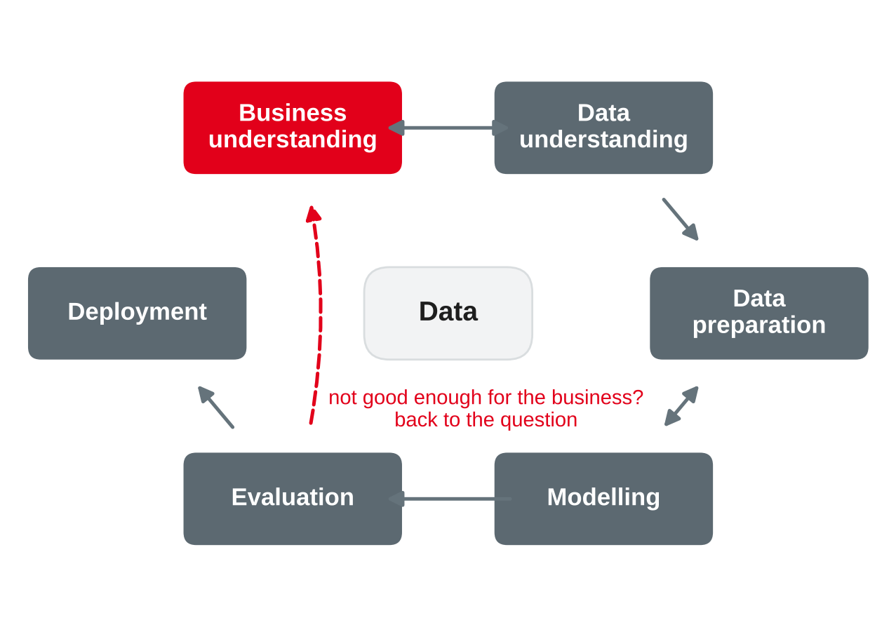
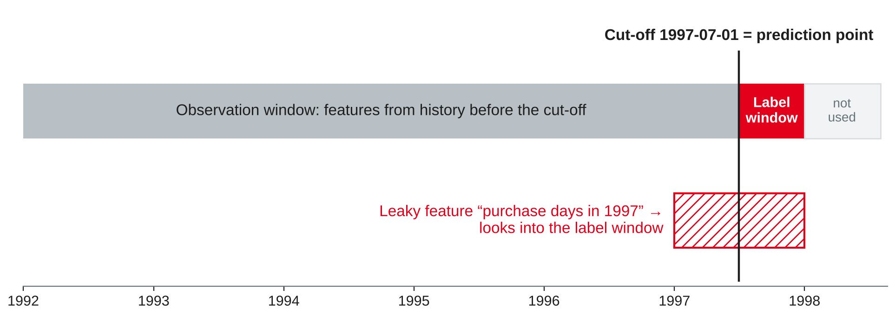

# From Business Question to ML Use Case {.title}

::: notes
Time plan for today (3 h): recap and preparation task 10 min · ML recap 10 min · CRISP-DM 15 min · framing 20 min · break 10 min · features from the warehouse 15 min · baselines and leakage 15 min · business cost and suitability 15 min · lab 65 min · wrap-up 5 min · ~10 min buffer.
Students need tpch.duckdb with the star schema from session 3 (fact_sales, dim_customer, dim_date). No scikit-learn today: everything runs in DuckDB, so nobody loses time on installation. scikit-learn is needed in session 8 (installed in the session 1 setup; ask students to check `import sklearn`). Tested with DuckDB 1.5.5, sf 0.1; the model comparison in the notes was run with scikit-learn 1.9.1.
:::

---

# Today's Agenda

1. Recap: which decision could a prediction improve?
2. Machine learning in one slide: tasks you already know
3. The analytics process: CRISP-DM
4. Framing a business problem as an ML task
5. Features from the warehouse, baselines and data leakage
6. Judging a model by business cost and assessing suitability
7. Lab: frame three business cases and build a feature table

::: notes
Time and format guide (not shown to students):
0:00 Recap of the preparation task (plenary) · 0:10 ML recap (input, quick questions) · 0:20 CRISP-DM (input) · 0:35 Framing (input + quick check) · 0:55 Break · 1:05 Features, baselines, leakage (input + live demo in DuckDB) · 1:35 Business cost, lift, suitability (input + discussion) · 1:50 Lab (pairs) · 2:55 Wrap-up.
If the framing discussion runs long, keep it: framing is the core of today. Lab part 2 tasks 5 and 6 can be finished at home; they are repeated in the worksheet in a different form.
:::

---

# Recap: From Dashboards to Decisions

- Sessions 2–6: the warehouse tells us **what happened** — reports, OLAP, dashboards
- Today we move to **what will happen** — and what to **do** about it
- Your preparation: one decision at the TPC-H wholesaler that a prediction could improve

::: callout
**Today's question:** how do we turn "we should use AI for our customers" into a precise ML task whose value we can measure **before** we build it?
:::

::: notes
Collect 4–6 decisions from the preparation task on the board, e.g. which customers to call before they stop ordering, which orders will be late, how much of a part to stock, which customers to group for offers, which orders look unusual. Keep the list: the lab uses three of them. Link to session 1: predictive and prescriptive analytics build on the descriptive layer we built in Part A.
:::

---

# Recap: Business Questions and ML Task Types

| Task type | Business question | TPC-H example |
|---|---|---|
| Classification | Will it happen — yes or no? | Will this customer stop ordering in the next 6 months? |
| Regression | How much? | How much will this customer spend next year? |
| Clustering | Which groups exist? | Which customer groups buy alike? |
| Anomaly detection | What is unusual? | Which orders have unusual prices or quantities? |
| Co-occurrence | What goes together? | Which parts are ordered together? |
| Forecasting | How much, when, over time? | Monthly revenue per region next year (sessions 11–14) |

::: source
Based on Provost and Fawcett (2013, Chapter 2).
:::

::: notes
Provost and Fawcett list typical data mining tasks: classification and class probability estimation, regression, similarity matching, clustering, co-occurrence grouping, profiling, link prediction, data reduction and causal modelling. We do not teach the methods: students know logistic regression, trees, ensembles, kNN, k-means, hierarchical clustering, isolation forest and cross-validation from W4DSKI_101 and W4DSKI_201. Ask quickly for each row: which method would you try first? Supervised = classification, regression, forecasting (labels from the past); unsupervised = clustering, anomaly detection, co-occurrence. Causal questions ("does the discount cause more orders?") are not a prediction task — that is session 9.
:::

---

# The Analytics Process {.section}

CRISP-DM

---

# CRISP-DM: Six Phases

{width=56%}

::: source
Own illustration based on Chapman et al. (2000).
:::

::: notes
CRISP-DM (Cross-Industry Standard Process for Data Mining) was developed by a consortium (NCR, DaimlerChrysler, SPSS, OHRA) and published as version 1.0 in 2000. Phases: business understanding, data understanding, data preparation, modelling, evaluation, deployment. The arrows show the most important dependencies; the order is not strict — moving back and forth is normal. The outer cycle stands for the fact that a deployed solution raises new business questions. Our drawing simplifies the original figure. In practice, most of the effort goes into business understanding and data preparation — exactly the parts that are not "machine learning".
:::

---

# Business Understanding Comes First

| CRISP-DM task | Output | TPC-H example |
|---|---|---|
| Determine business objectives | Business objective and business success criteria | Keep more customers ordering; fewer customers lost per half-year |
| Assess situation | Resources, requirements, risks, costs and benefits | Sales has capacity for 2,000 calls per half-year |
| Determine data mining goals | Data mining goal and data mining success criteria | Rank customers by their risk of no order in the next 6 months; better than a simple rule |
| Produce project plan | Plan, initial tool and technique assessment | Feature table in DuckDB, models in scikit-learn |

::: source
Based on Chapman et al. (2000).
:::

::: notes
CRISP-DM separates the business objective (in business terms) from the data mining goal (in technical terms) — each with its own success criteria. Students often skip straight to "train a model". Ask: what is the business success criterion here, and what is the data mining success criterion? Business: fewer lost customers, more profit from the retention campaign. Technical: e.g. the top 20 % of the ranking contain clearly more churners than a random 20 %. The capacity number is an assumption for the example.
:::

---

# Framing the Problem {.section}

From a business wish to a precise ML task

---

# Six Framing Questions

1. **Decision:** which action will change because of the prediction — and who takes it?
2. **Unit:** what is one row — customer, order, order line, product, day?
3. **Target:** what exactly do we predict, defined so that it can be computed from data?
4. **Prediction point and horizon:** when do we predict, and how far ahead?
5. **Features:** which information is **available at the prediction point**?
6. **Success:** which metric, which baseline, and what is a good result worth?

::: callout
If you cannot name the **action**, the prediction has no business value — however accurate it is.
:::

::: source
Own compilation based on Provost and Fawcett (2013) and Chapman et al. (2000).
:::

::: notes
Provost and Fawcett stress that a business problem must be decomposed into data mining tasks and that the definition of the target and of the population is a key design decision. The six questions are our checklist for today's lab and for portfolio notebook 2. The questions are not independent: the unit and the prediction point determine which features are allowed.
:::

---

# Example: "Which Customers Will We Lose?"

| Question | Framing for the TPC-H wholesaler |
|---|---|
| Decision | Sales calls the customers with the highest risk and offers a discount |
| Unit | One active customer (at least one purchase before the cut-off) |
| Target | `churned = 1` if the customer has **no** purchase in the 6 months after the cut-off |
| Prediction point and horizon | Cut-off 1 July 1997; horizon 6 months |
| Features | Recency, number of purchase days, revenue, tenure, segment, region — all **before** the cut-off |
| Success | More churners in the called group than with a simple rule; positive profit of the campaign |

::: source
Own example with TPC-H data (Transaction Processing Performance Council, n.d.), based on Provost and Fawcett (2013).
:::

::: notes
TPC-H has no contracts, so "churn" must be defined from behaviour — a definition choice students must make explicit. 6 months is a choice: a shorter window gives more churners and more noise. Real companies define churn with the business (e.g. contract cancellation, or no purchase in 90 days for a web shop). In TPC-H, a third of all customers never order (session 3); they are not part of the population — you cannot lose a customer you never had.
:::

---

# Observation Window, Cut-off and Label Window

{width=100%}

- **Features** use only data **before** the cut-off; the **label** uses only the window **after** it
- In production, the cut-off is "today" — the label window has not happened yet

::: source
Own illustration with TPC-H data (Transaction Processing Performance Council, n.d.), based on Kaufman et al. (2012).
:::

::: notes
This picture is the most important one today. Orders run from 1992-01-01 to 1998-08-02. The second half of 1998 is incomplete, so we choose a label window that is complete (July–December 1997). The hatched bar is a leaky feature that looks into the label window; we test it later. For training, you can use several cut-offs (e.g. 1997-01-01 for training, 1997-07-01 for testing) — this is a time-based split and the honest way to evaluate (worksheet task 6).
:::

---

# Quick Check: ML Task or Not? {.exercise}

For each request, decide: ML task (which type?), a query or report, or a different kind of question?

1. "How many customers did we lose in Asia last year?"
2. "Which of our current orders will arrive after the committed date?"
3. "Did the 5 % discount campaign increase the order volume?"
4. "Group our 10,000 active customers for tailored offers."
5. "Find order lines with suspicious prices for the audit."

::: notes
Expected answers: 1 descriptive query on the warehouse — no ML needed · 2 classification per order line at order time (lab case B) · 3 causal question: needs an experiment or a careful causal analysis, not a prediction model (session 9) · 4 clustering (unsupervised); success is measured by whether marketing can use the groups, not by an accuracy · 5 anomaly detection (unsupervised), or rules if the audit has clear criteria; the result is a ranked list for human review. Discuss: requests often come as "use AI for X" — the analyst's job is to find out which of these kinds it really is.
:::

---

# Features from the Warehouse {.section}

From the star schema to a feature table

---

# From Fact Rows to One Row per Unit

- The fact table has one row per **order line**; the model needs one row per **customer**
- Feature engineering on a warehouse is mostly **aggregation along a dimension, up to a cut-off**

| Feature family | Example | SQL idea |
|---|---|---|
| Recency | Days since the last purchase | `cutoff - max(date_key)` |
| Frequency | Number of purchase days | `count(DISTINCT date_key)` |
| Monetary | Revenue in the last 12 months | `sum(revenue) FILTER (…)` |
| Tenure | Days since the first purchase | `cutoff - min(date_key)` |
| Dimension attributes | Segment, region | Join `dim_customer` |
| Trends and ratios | Revenue last 6 vs. previous 6 months | Two filtered sums, then divide |

::: source
Own compilation based on Provost and Fawcett (2013) and Kimball and Ross (2013).
:::

::: notes
Recency, frequency and monetary value (RFM) are classic customer features in marketing analytics. Link to session 3: the grain changes from order line to customer — so we aggregate, and additive measures (revenue) can be summed while distinct counts cannot. The star schema makes this easy: one join per dimension. `fact_sales` has no order key, so we count purchase days (distinct order dates) as a proxy for the number of orders; a customer rarely orders twice on the same day.
:::

---

# The Feature Table in SQL

```sql
CREATE OR REPLACE TABLE churn_features AS
WITH hist AS (                       -- only data BEFORE the cut-off
  SELECT customer_key,
         DATE '1997-07-01' - max(date_key) AS recency_days,
         count(DISTINCT date_key)          AS purchase_days,
         coalesce(sum(revenue) FILTER (date_key >= DATE '1996-07-01'), 0)
                                           AS revenue_12m,
         DATE '1997-07-01' - min(date_key) AS tenure_days
  FROM fact_sales WHERE date_key < DATE '1997-07-01'
  GROUP BY customer_key),
future AS (                          -- label window: next 6 months
  SELECT DISTINCT customer_key FROM fact_sales
  WHERE date_key >= DATE '1997-07-01' AND date_key < DATE '1998-01-01')
SELECT h.*, c.segment, c.region,
       (future.customer_key IS NULL)::INT AS churned
FROM hist h JOIN dim_customer c USING (customer_key)
LEFT JOIN future USING (customer_key);
```

::: source
Own example with TPC-H data (Transaction Processing Performance Council, n.d.).
:::

::: notes
Tested with DuckDB 1.5.5, sf 0.1: 10,000 customers, 3,446 churners (34.5 %). 1,397 customers have no purchase in the last 12 months before the cut-off: without coalesce their revenue_12m would be NULL — "no revenue" is a value (0), not a missing value. Averages: recency 182.7 days, 12.46 purchase days. Live-code this query and show the first rows. Point out the two filters on date_key: the WHERE clause in hist and the window in future are what makes the table point-in-time correct.
:::

---

# Baselines, Leakage and Business Cost {.section}

What is "good" — and what is too good to be true?

---

# Baselines: Set the Bar Before Modelling

| Approach | Accuracy | Churners found (of 3,446) | Precision |
|---|---|---|---|
| "Nobody churns" (majority class) | 65.5 % | 0 | — |
| Rule: "churn if 9 or fewer purchase days" | 62.5 % | 1,611 (46.8 %) | 45.7 % |

- The majority baseline is **more accurate** than the rule — and completely **useless**: it finds no churner
- With unequal classes and unequal costs, accuracy is the wrong yardstick
- A model must beat the **simple rule**, not only the majority class

::: source
Own analysis with TPC-H data (Transaction Processing Performance Council, n.d.); based on Provost and Fawcett (2013, Chapter 7).
:::

::: notes
Computed on churn_features (cut-off 1997-07-01): rule confusion matrix TP 1,611, FP 1,916, FN 1,835, TN 4,638. Provost and Fawcett discuss plain accuracy and its problems with unbalanced classes and unequal costs, and recommend comparing against baselines such as the majority class and a simple model. Outlook to session 8: a logistic regression with all six features, trained on cut-off 1997-01-01 and tested on 1997-07-01, reaches an AUC of 0.627 — the purchase-days rule alone has 0.626, and the model's accuracy (65.3 %) is below the majority baseline. A model that does not beat a one-line rule is not worth deploying. In scikit-learn, DummyClassifier gives the majority baseline.
:::

---

# Data Leakage

**Leakage** is information about the target in the training data that would **not be legitimately available** when the model is used.

| Type | Example |
|---|---|
| Features from the future | "Purchase days in 1997" for a cut-off in July 1997 |
| Features caused by the target | "Retention discount granted" — only given to customers who announced to leave |
| Training rows that see the test period | Random split of time-ordered data; scaling or feature selection on all data before the split |

::: callout
Rule of thumb: **learn–predict separation** — build every feature as if the future did not exist yet.
:::

::: source
Based on Kaufman et al. (2012).
:::

::: notes
Kaufman et al. define leakage as the introduction of information about the target that should not legitimately be available to mine from, and distinguish leaking features from leakage in training examples. Their recommended avoidance strategy is a strict learn–predict separation, e.g. using time stamps to cut off all data after the prediction point. They also describe detection: results that are "too good to be true" and features that are suspiciously predictive. Ask for examples from the students' companies (typical: status fields that are updated later, like "contract terminated on").
:::

---

# Leakage in Our Example

| Feature | Churn rate in the top 10 % of the score | Lift |
|---|---|---|
| Purchase days before the cut-off (legitimate) | 46.5 % | 1.35 |
| Purchase days in 1997 (leaky) | 100 % | 2.90 |

- All **1,360** customers without a purchase in 1997 churned — of course: half of 1997 **is** the label window
- The leaky feature looks brilliant in the notebook and fails in production, where the future is unknown

::: source
Own analysis with TPC-H data (Transaction Processing Performance Council, n.d.); leakage concept from Kaufman et al. (2012).
:::

::: notes
Tested (DuckDB 1.5.5): top decile by fewest purchase days before the cut-off: 465 of 1,000 churned; by fewest purchase days in 1997: 1,000 of 1,000. Base rate 34.46 %, so lift = 0.465 / 0.3446 = 1.35 and 1.0 / 0.3446 = 2.90. With scikit-learn, the leaky feature alone reaches an AUC of 0.856 on the test cut-off vs. 0.626 for the legitimate one. Detection tip from Kaufman et al.: if one feature is suspiciously strong, ask how and when its value is created.
:::

---

# Cost Matrix and Expected Value

Assumptions for the retention campaign: a call with discount costs **2,000**; 30 % of the called churners stay; a kept customer is worth **15,000** margin.

| | Actual churner | Actual non-churner |
|---|---|---|
| **Called** (predicted churner) | TP: 0.3 × 15,000 − 2,000 = **+2,500** | FP: **−2,000** |
| **Not called** | FN: 0 | TN: 0 |

- Expected value of calling a customer with churn probability *p*: *p* × 2,500 − (1 − *p*) × 2,000
- Calling pays off only if *p* > 2,000 / 4,500 = **44.4 %**

::: source
Based on Provost and Fawcett (2013, Chapter 7) and Elkan (2001).
:::

::: notes
The values are assumptions that must come from the business (finance, sales) — part of "assess situation" in CRISP-DM. Costs and benefits are measured relative to doing nothing, so FN and TN are 0 here; the lost margin of a missed churner is an opportunity cost that would also have been lost without a model. Provost and Fawcett's expected value framework: expected profit = sum over outcomes of probability × value. Elkan shows that the optimal decision threshold follows from the cost matrix: here, call if p ≥ cost of an FP / (cost of an FP + net benefit of a TP) = 2,000 / (2,000 + 2,500). The base rate (34.5 %) is below the break-even point — calling everybody loses money.
:::

---

# Lift and Profit by Decile

| Customers called (fewest purchase days first) | Churn rate of the last decile added | Cumulative lift | Cumulative profit |
|---|---|---|---|
| Top 10 % | 46.5 % | 1.35 | 92,500 |
| Top 20 % | 48.1 % | 1.37 | **257,000** |
| Top 30 % | 42.9 % | 1.33 | 187,500 |
| Top 50 % | 36.8 % | 1.27 | −176,500 |
| All 10,000 | 19.8 % | 1.00 | −4,493,000 |

- **Lift** = churn rate in the called group ÷ overall churn rate (34.5 %)
- Best decision under these costs: call the top 20 % — about **2,000 calls**, which fits the sales capacity

::: source
Own analysis with TPC-H data (Transaction Processing Performance Council, n.d.); method based on Provost and Fawcett (2013, Chapter 8).
:::

::: notes
The churn rate column is marginal (only the last decile added), so you see when it falls below the break-even 44.4 %; the cumulative churn rate is cumulative lift × 34.5 %, e.g. 43.7 % for the top 50 %. Profit per decile = 2,500 × churners − 2,000 × non-churners. Decile 2 is slightly better than decile 1 because many customers tie on purchase days. The rule from the baseline slide (≤ 9 purchase days, 3,527 calls) makes 195,500 — less than the top-20 % policy but far better than "nobody churns" (0), although its accuracy is lower. Provost and Fawcett show cumulative response, lift and profit curves for exactly this kind of decision. The lab query computes this table.
:::

---

# Lift Table in SQL

```sql
WITH ranked AS (
  SELECT churned,
         ntile(10) OVER (ORDER BY purchase_days, recency_days DESC,
                                  customer_key) AS decile
  FROM churn_features),
d AS (SELECT decile, count(*) AS n, sum(churned) AS c
      FROM ranked GROUP BY decile)
SELECT decile, n, c, round(c / n, 3) AS churn_rate,
       round(sum(c) OVER w / sum(n) OVER w
             / (SELECT avg(churned) FROM churn_features), 2) AS cum_lift,
       sum(2500 * c - 2000 * (n - c)) OVER w AS cum_profit
FROM d WINDOW w AS (ORDER BY decile)
ORDER BY decile;
```

::: source
Own example with TPC-H data (Transaction Processing Performance Council, n.d.).
:::

::: notes
Window functions from session 4. The tie-breakers in ORDER BY (recency_days DESC, customer_key) make the deciles reproducible: without them, ntile splits ties arbitrarily and two students get different numbers. In session 8 the score comes from a model (predict_proba) instead of a rule — the evaluation query stays the same.
:::

---

# Is ML Suitable Here?

- **Value:** does the model beat the simple rule by enough to pay for building and running it?
- **Signal:** here AUC about 0.63 — weak; TPC-H is synthetic and has little real customer behaviour
- **Availability:** can every feature be computed at prediction time in production, with the same definitions?
- **Stability:** does the result hold for another cut-off (time-based validation)?
- **Action and capacity:** can the business act on the top of the list?
- **Risks:** errors, fairness, explainability, data protection, maintenance

::: source
Own compilation based on Chapman et al. (2000) and Provost and Fawcett (2013).
:::

::: notes
This is the "assess suitability" competence in the module description: a short written assessment of method suitability is part of each portfolio notebook. For our example the honest answer is: a simple rule captures almost all the signal; a model is only worth it if it adds clear profit over the rule. That is a valid result — and a good portfolio answer. CRISP-DM's evaluation phase explicitly asks whether the results meet the business objectives before deployment.
:::

---

# Lab: From Case to Feature Table {.section}

Framing on paper, features in DuckDB

---

# Lab Part 1: Frame Three Business Cases {.exercise}

Work in pairs. For each case, answer the **six framing questions** and name one leakage risk.

1. **Retention:** the head of sales wants to know which customers will stop ordering
2. **Delivery:** logistics wants to warn customers early when an order line will arrive after the committed date
3. **Offers:** marketing wants customer groups for tailored offers

::: notes
Expected answers:
A Retention — decision: call/offer; unit: active customer; target: no purchase in the next 6 months; prediction point: e.g. the first day of each half-year; features: RFM, tenure, segment, region before the cut-off; success: lift and campaign profit vs. the rule. Leakage risk: features computed over a period that overlaps the label window.
B Delivery — decision: inform customer, prioritise shipping; unit: order line; target: l_receiptdate > l_commitdate; prediction point: when the order is placed; features: order date, commit lead time (l_commitdate − o_orderdate), ship mode, priority, quantity, part, supplier, customer history; success: recall of late lines at an acceptable false-alarm rate, cost of a warning vs. cost of an angry customer. Leakage risk: l_shipdate and l_receiptdate are only known later (worksheet task 5); order status fields are updated after the order date. Note: the label needs base tables (lineitem, orders), because fact_sales has no delivery dates.
C Offers — decision: which offer goes to which group; unit: customer; no target (clustering); "prediction point" = date of the snapshot; features as in A plus segment mix and part types bought; success: groups are stable, distinct and usable by marketing (can they name and target them?), then a test of the offers (session 9). Leakage hardly an issue, but data protection and explainability are.
:::

---

# Lab Part 2: Tasks {.exercise}

Work in pairs. Write queries and a short interpretation in your notebook.

1. **Build:** run the feature query and check it: rows, churn rate, NULLs, value ranges
2. **Add features:** revenue trend (last 6 vs. previous 6 months) and number of distinct parts bought
3. **Baseline:** majority class and one rule of your own — confusion matrix, accuracy, precision, recall
4. **Lift:** the lift table for your rule's score
5. **Leakage check:** add one deliberately leaky feature and compare its top-decile lift
6. **Decide:** with your own cost assumptions — how many customers would you call?

::: notes
Expected results (DuckDB 1.5.5, sf 0.1): 1 10,000 rows, 3,446 churners (34.46 %), no NULLs after coalesce; recency 1–2,004 days. 2 trend: coalesce(sum(revenue) FILTER (date_key >= DATE '1997-01-01'), 0) / nullif(sum(revenue) FILTER (date_key >= DATE '1996-07-01' AND date_key < DATE '1997-01-01'), 0) — 3,470 customers get NULL (no purchase in the previous half-year: the ratio is undefined, not 0) and 2,072 get 0; median 0.509. Without coalesce in the numerator, 5,542 would be NULL — a good discussion of NULL vs. 0. Distinct parts: count(DISTINCT part_key), on average 50.0 (1 to 151). 3 majority 65.5 %; e.g. rule purchase_days ≤ 9: 62.5 % accuracy, precision 45.7 %, recall 46.8 %. 4 top-decile lift 1.35 for the purchase-days score; recency alone has almost the same top-decile lift (1.34) but is weaker beyond it (calling the top 20 % by recency loses 224,500; AUC 0.55 vs. 0.63). 5 purchase days in 1997: top-decile lift 2.90. 6 with the slide's costs: top 20 %, profit 257,000. Save churn_features: it is the starting point for session 8 (portfolio notebook 2).
:::

---

# Key Takeaways

- **CRISP-DM:** start with the business objective and success criteria; iterate between phases
- **Framing:** decision, unit, target, prediction point and horizon, available features, success metric
- **Features from the warehouse** are aggregations up to a **cut-off**; the label comes from the window after it
- **Baselines** set the bar; accuracy alone misleads with unequal classes and costs
- **Leakage:** anything not known at the prediction point must not be a feature — too good is suspicious
- Judge models by **business value**: cost matrix, expected value, lift and profit — and say honestly when a simple rule is enough

---

# Next Session: ML Use-Case Lab

- Choose a use case: **churn prediction**, **customer segmentation** or **anomaly detection**
- scikit-learn pipelines and hyperparameter tuning in applied form
- Interpreting and communicating results — portfolio notebook 2

::: callout
**Preparation:** keep `churn_features` in `tpch.duckdb`, check that `import sklearn` works, and choose your use case with your partner.
:::

---

# References {.references}

- Chapman, P., Clinton, J., Kerber, R., Khabaza, T., Reinartz, T., Shearer, C., & Wirth, R. (2000). *CRISP-DM 1.0: Step-by-step data mining guide*. SPSS.
- Elkan, C. (2001). The foundations of cost-sensitive learning. In B. Nebel (Ed.), *Proceedings of the Seventeenth International Joint Conference on Artificial Intelligence (IJCAI 2001)* (pp. 973–978). Morgan Kaufmann.
- Kaufman, S., Rosset, S., Perlich, C., & Stitelman, O. (2012). Leakage in data mining: Formulation, detection, and avoidance. *ACM Transactions on Knowledge Discovery from Data, 6*(4), Article 15. https://doi.org/10.1145/2382577.2382579
- Kimball, R., & Ross, M. (2013). *The data warehouse toolkit: The definitive guide to dimensional modeling* (3rd ed.). Wiley.
- Provost, F., & Fawcett, T. (2013). *Data science for business: What you need to know about data mining and data-analytic thinking*. O'Reilly Media.
- Transaction Processing Performance Council. (n.d.). *TPC-H*. Retrieved October 20, 2026, from https://www.tpc.org/tpch/
