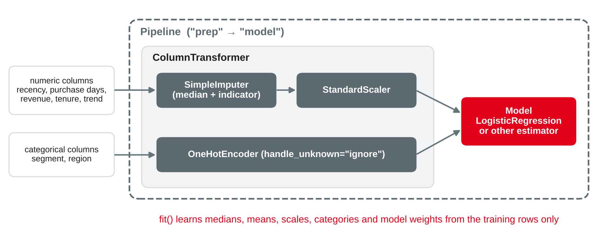
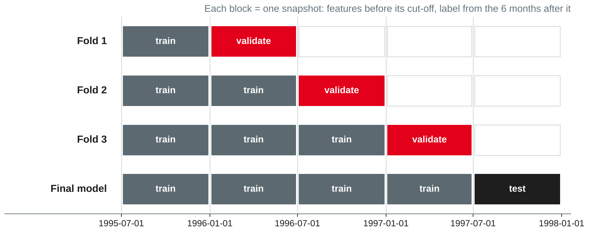

# ML Use-Case Lab {.title}

::: notes
Time plan for today (3 h): recap 5 min · lab brief and tracks 10 min · pipelines, tuning and time-aware validation with the churn starter 25 min · break 10 min · segmentation and anomaly detection starters 15 min · interpreting and communicating 10 min · good notebook and assessment 5 min · lab 85 min · wrap-up 5 min · ~10 min buffer.
Today is mostly lab: keep the input short and let pairs start early. Students need tpch.duckdb with the star schema from session 3 (fact_sales, dim_customer, dim_date, dim_part) and scikit-learn (installed in the session 1 setup; the preparation task was `import sklearn`). Track C anomaly variant on order level uses the base tables (worksheet). All numbers on the slides were run with DuckDB 1.5.5 (tpch extension, sf 0.1), scikit-learn 1.9.1, pandas 3.0 and NumPy 2.5, random_state = 42 everywhere. Check at the start who has no working scikit-learn and pair them with someone who has.
:::

---

# Today's Agenda

1. Recap: from a feature table to a model
2. The lab brief: portfolio notebook 2 and three tracks
3. Pipelines and tuning in applied form — churn starter
4. Segmentation and anomaly detection starters
5. Interpreting and communicating results
6. What a good notebook contains — and how it is assessed
7. Lab: your use case

::: notes
Time and format guide (not shown to students):
0:00 Recap (plenary) · 0:05 Lab brief and choice of track (input, pairs confirm their track) · 0:15 Pipelines, tuning, time-aware validation (input + live demo of the churn starter) · 0:40 Break · 0:50 Starters B and C (input, short demo) · 1:05 Interpreting and communicating (input + discussion) · 1:15 Good notebook and suggested rubric (input, questions) · 1:20 Lab (pairs, consultations at the tables) · 2:45 Wrap-up: two pairs report one finding each · ~10 min buffer.
If the discussion of the track results runs long, keep it and shorten the rubric part: the rubric is on the slides for self-study.
:::

---

# Recap: Where Session 7 Left Us

- `churn_features`: 10,000 active customers, cut-off 1 July 1997, **34.5 %** churners in the next 6 months
- Rule "fewest purchase days first": top-decile lift **1.35**; calling the top 20 % made the best profit
- A first logistic regression reached AUC **0.627** — the rule alone **0.626**

::: callout
**Today's question:** can a tuned pipeline beat the simple rule — and how do you show the result honestly, whatever it is?
:::

::: notes
Ask two pairs which use case they chose (preparation task) and why. Remind: the session 7 model used one training cut-off and no tuning. Today we add more training snapshots, a pipeline, tuning with time-aware validation, and two more use cases. Keep the honest message from session 7: "a simple rule is enough" can be the correct result of a notebook.
:::

---

# The Lab Brief {.section}

Portfolio notebook 2: one ML use case, end to end

---

# Portfolio Notebook 2: The Brief

- **Work in pairs** on **one** use case: churn prediction, customer segmentation or anomaly detection
- Data: the TPC-H star schema in DuckDB — or a public dataset of your choice with the same depth
- **Apply** methods you know from earlier modules; today adds pipelines, tuning and validation in applied form
- Go from the business question to a **recommendation**: framing, features, baseline, model, evaluation, interpretation
- End with a short written **assessment of method suitability**

::: callout
The question is not "which algorithm is best?" but "**does ML improve this decision — and how sure are we?**"
:::

::: source
Own compilation based on Chapman et al. (2000) and Provost and Fawcett (2013).
:::

::: notes
The portfolio table in the session plan: three lab notebooks in pairs (DWH/OLAP/SQL, ML use case, time series), each with a short written assessment of method suitability — together 45 % of the portfolio. The official brief (deadline, format, rubric) is published separately on the course platform; today's slides give the content expectations and a suggested rubric only. Session 7's worksheet task 7 is the first part of this notebook (framing, feature table, baseline, leakage audit, cost matrix).
:::

---

# Three Tracks

| | A Churn prediction | B Customer segmentation | C Anomaly detection |
|---|---|---|---|
| Decision | Whom to call or send an offer | Which offer for which group | Which order lines to audit |
| Unit | Customer at a cut-off | Customer at a snapshot date | Order line |
| Task type | Classification (supervised) | Clustering (unsupervised) | Anomaly scoring (unsupervised) |
| Methods you know | Logistic regression, trees, ensembles | k-means, hierarchical clustering | Isolation forest, distance-based scores |
| Baseline | Rule: fewest purchase days | Existing market segments | z-score rule |
| Judged by | Lift and profit on a later cut-off | Distinct, stable, usable groups | Hits in the top *k* = audit capacity |

::: source
Own compilation based on Provost and Fawcett (2013) and scikit-learn developers (n.d.-a, n.d.-e).
:::

::: notes
The methods come from W4DSKI_101 and W4DSKI_201; no method teaching today. Track A is the most guided (it continues session 7 directly). Track B is the most open: there is no accuracy to optimise, so students must argue with profiles, stability and usefulness. Track C has no labels: we create known anomalies to test the detector. All three tracks are equally valued; a pair that finds that ML adds nothing over the baseline and shows it convincingly can do very well.
:::

---

# Pipelines and Tuning {.section}

Applied with the churn starter

---

# Why Pipelines?

{width=86%}

- **Safety:** preprocessing is fitted on the training rows only — also inside every cross-validation fold
- **One object** to fit, tune, evaluate and later apply to new cut-offs

::: source
Own illustration based on scikit-learn developers (n.d.-g).
:::

::: notes
The scikit-learn user guide names three purposes of a Pipeline: convenience (one fit and predict), joint parameter selection (grid search over all steps at once) and safety (avoid leaking statistics from the test data into the trained model in cross-validation). ColumnTransformer applies different transformations to different columns within such a pipeline. Link to session 7: scaling or imputing on all data before the split was one of the leakage examples ("training rows that see the test period"). The missing indicator matters here: revenue_trend is undefined (NULL) for customers without a purchase in the previous half-year — the indicator keeps that information for the model.
:::

---

# Starter A (1/3): One Query, Many Cut-offs

```sql
WITH hist AS (
  SELECT customer_key,
         $cutoff - max(date_key)  AS recency_days,
         count(DISTINCT date_key) AS purchase_days,
         coalesce(sum(revenue) FILTER (date_key >= $cutoff - INTERVAL 12 MONTH), 0)
                                  AS revenue_12m,
         $cutoff - min(date_key)  AS tenure_days,
         coalesce(sum(revenue) FILTER (date_key >= $cutoff - INTERVAL 6 MONTH), 0)
           / nullif(sum(revenue) FILTER (date_key >= $cutoff - INTERVAL 12 MONTH
                    AND date_key < $cutoff - INTERVAL 6 MONTH), 0) AS revenue_trend
  FROM fact_sales WHERE date_key < $cutoff GROUP BY customer_key),
future AS (
  SELECT DISTINCT customer_key FROM fact_sales
  WHERE date_key >= $cutoff AND date_key < $cutoff + INTERVAL 6 MONTH)
SELECT $cutoff AS cutoff, h.*, c.segment, c.region,
       (future.customer_key IS NULL)::INT AS churned
FROM hist h JOIN dim_customer c USING (customer_key)
LEFT JOIN future USING (customer_key) ORDER BY customer_key
```

::: source
Own example with TPC-H data (Transaction Processing Performance Council, n.d.).
:::

::: notes
This is the session 7 feature query with a $cutoff parameter (worksheet 7, task 6) plus the cut-off column and the revenue trend from lab part 2. Save it as the string FEATURES_SQL in Python. Tested: snapshots 1995-07-01 (9,981 customers, 34.2 % churners), 1996-01-01 (9,989; 34.5 %), 1996-07-01 (9,996; 34.7 %), 1997-01-01 (10,000; 34.7 %), test 1997-07-01 (10,000; 34.5 %). revenue_trend is NULL for 3,470 test customers, median 0.509 — the same values as in the session 7 lab.
:::

---

# Starter A (2/3): Snapshots and Pipeline

```python
from datetime import date
import duckdb, numpy as np, pandas as pd
from sklearn.compose import ColumnTransformer
from sklearn.impute import SimpleImputer
from sklearn.linear_model import LogisticRegression
from sklearn.pipeline import Pipeline
from sklearn.preprocessing import OneHotEncoder, StandardScaler

con = duckdb.connect("tpch.duckdb", read_only=True)
def features(cutoff):
    return con.execute(FEATURES_SQL, {"cutoff": cutoff}).df()
cutoffs = [date(1995, 7, 1), date(1996, 1, 1), date(1996, 7, 1), date(1997, 1, 1)]
train = pd.concat([features(c) for c in cutoffs], ignore_index=True)
test = features(date(1997, 7, 1))

num = ["recency_days", "purchase_days", "revenue_12m", "tenure_days", "revenue_trend"]
cat = ["segment", "region"]
prep = ColumnTransformer([
    ("num", Pipeline([("impute", SimpleImputer(strategy="median", add_indicator=True)),
                      ("scale", StandardScaler())]), num),
    ("cat", OneHotEncoder(handle_unknown="ignore"), cat)])
pipe = Pipeline([("prep", prep), ("model", LogisticRegression(max_iter=1000))])
```

::: source
Own example based on Pedregosa et al. (2011) and scikit-learn developers (n.d.-g).
:::

::: notes
Four training snapshots give about 40,000 rows; the same customer appears up to four times, at different points in time. The label windows of the training snapshots end on or before 1997-07-01, so no training label looks into the test period. After fitting, pipe[:-1].get_feature_names_out() shows the 16 model inputs: five scaled numeric columns, the missing indicator for revenue_trend, five segment and five region columns.
:::

---

# Hyperparameter Tuning in Applied Form

| | `GridSearchCV` | `RandomizedSearchCV` |
|---|---|---|
| Candidates | Every combination of the listed values | `n_iter` samples from lists or distributions |
| Good for | Few parameters, few values | Many parameters, continuous ranges |
| Our use | `model__C` of the logistic regression | Four parameters of gradient boosting |

- Parameters inside a pipeline: **`step__parameter`**, e.g. `model__C`
- **`scoring`** decides what "best" means — e.g. `"roc_auc"`, `"average_precision"` or your own scorer
- **`cv`** decides how honest the estimate is: next slide

::: source
Based on scikit-learn developers (n.d.-d, n.d.-h) and Bergstra and Bengio (2012).
:::

::: notes
Bergstra and Bengio show that random search is more efficient than grid search when only a few hyperparameters matter, because a grid wastes trials on unimportant dimensions. The scikit-learn guide adds: with RandomizedSearchCV the budget is independent of the number of parameters, and use loguniform for parameters on a log scale. A custom scorer (make_scorer) can encode a business metric such as the top-decile lift — worksheet task 3. Remember: tuning chooses among models; it does not create signal that is not in the features.
:::

---

# Time-Aware Validation

{width=92%}

- Random K-fold assumes independent rows — snapshots of the same customers over time are not
- Validate on a **later** cut-off than you train on, as the model will be used

::: source
Own illustration based on scikit-learn developers (n.d.-b) and Kaufman et al. (2012).
:::

::: notes
The scikit-learn guide warns that KFold and ShuffleSplit assume independent and identically distributed samples and recommends evaluating time-dependent data on "future" observations; TimeSeriesSplit does this for one series of rows at fixed time intervals. Our rows are snapshots, so we build the folds ourselves: cv accepts an iterable of (train, test) index arrays. This is the learn–predict separation of Kaufman et al. applied to model selection. The final model is refitted on all four snapshots and tested once on 1997-07-01 — the test set is never used for tuning.
:::

---

# Starter A (3/3): Tuning with Snapshot Folds

```python
from sklearn.model_selection import GridSearchCV

def snapshot_folds(cutoff):     # train on all earlier snapshots, validate on the next
    dates = sorted(cutoff.unique())
    return [(np.where(cutoff < d)[0], np.where(cutoff == d)[0]) for d in dates[1:]]

search = GridSearchCV(pipe, {"model__C": [0.001, 0.01, 0.1, 1, 10]},
                      cv=snapshot_folds(train.cutoff), scoring="roc_auc")
search.fit(train[num + cat], train.churned)
print(search.best_params_, round(search.best_score_, 3))
p_test = search.predict_proba(test[num + cat])[:, 1]    # test cut-off 1997-07-01
```

::: source
Own example based on scikit-learn developers (n.d.-b, n.d.-h).
:::

::: notes
Output: {'model__C': 0.01} 0.615. Folds: 9,981 → 9,989 rows, 19,970 → 9,996, 29,966 → 10,000. The validation AUC hardly depends on C (0.614 for C = 0.001, 0.615 for all others). GridSearchCV refits the best pipeline on all training rows (refit=True by default), so search.predict_proba uses that refitted model. For gradient boosting, swap the model step for HistGradientBoostingClassifier(random_state=42) and use RandomizedSearchCV with n_iter=20, random_state=42 over learning_rate (loguniform 0.01–0.3), max_leaf_nodes (4–31), min_samples_leaf (20–199) and l2_regularization (loguniform 0.001–10).
:::

---

# Track A: What Did Tuning Buy Us?

| Score | Validation AUC (3 folds) | Test AUC | Top-10 % lift | Profit, top 20 % called |
|---|---|---|---|---|
| Rule: fewest purchase days | 0.615 | 0.627 | 1.35 | 257,000 |
| Logistic regression, tuned C | 0.615 | 0.627 | 1.37 | 248,000 |
| Gradient boosting, 20 random candidates | 0.611 | 0.625 | 1.36 | 266,000 |

- All three are **within noise** of each other — tuning cannot create signal the features do not have
- Accuracy at threshold 0.5: logistic regression **65.35 %**, majority baseline **65.54 %**
- Honest conclusion: the **rule** is enough here; a model must earn its running costs

::: source
Own analysis with TPC-H data (Transaction Processing Performance Council, n.d.); profit with the cost matrix of session 7, based on Provost and Fawcett (2013, Chapter 7).
:::

::: notes
Test cut-off 1997-07-01, 10,000 customers, 3,446 churners. Top decile: rule 465, LR 471, HGB 470 churners; top 20 %: 946, 944, 948. Profit = 2,500 × churners − 2,000 × non-churners among the called (session 7). Best HGB candidate: learning_rate 0.031, max_leaf_nodes 11, min_samples_leaf 171, l2_regularization 0.069. Rule ties broken by longer recency (AUC 0.627; without tie-break 0.626 as in session 7). Calling everyone with p ≥ 0.444 (break-even from session 7) calls 1,259 customers with the LR and makes 182,000 — less than the top-20 % policy, because the profit curve is flat around the top 20 % and small differences are noise. Random 5-fold CV on the stacked snapshots gives the same AUC (0.614) here: TPC-H is stationary. On real data with trends, random folds are usually optimistic — the time-aware design is still the right default.
:::

---

# Starter B: Customer Segments with k-means

```python
from sklearn.cluster import KMeans
from sklearn.metrics import silhouette_score
from sklearn.preprocessing import FunctionTransformer

cust = con.sql("""
  SELECT f.customer_key,
         DATE '1997-07-01' - max(f.date_key)        AS recency_days,
         count(DISTINCT f.date_key)                  AS purchase_days,
         sum(f.revenue) / count(DISTINCT f.date_key) AS revenue_per_day,
         avg((p.part_type LIKE 'PROMO%')::INT)       AS promo_share
  FROM fact_sales f JOIN dim_part p USING (part_key)
  WHERE f.date_key < DATE '1997-07-01'
  GROUP BY f.customer_key ORDER BY f.customer_key""").df()
feats = ["recency_days", "purchase_days", "revenue_per_day", "promo_share"]
prep = ColumnTransformer([
    ("log", Pipeline([("log", FunctionTransformer(np.log1p)),
                      ("scale", StandardScaler())]), ["recency_days"]),
    ("scale", StandardScaler(), ["purchase_days", "revenue_per_day", "promo_share"])])
for k in range(2, 9):
    km = Pipeline([("prep", prep), ("kmeans", KMeans(n_clusters=k, n_init=10, random_state=42))])
    labels = km.fit_predict(cust[feats])
    print(k, round(silhouette_score(km[:-1].transform(cust[feats]), labels), 3))
```

::: source
Own example with TPC-H data (Transaction Processing Performance Council, n.d.), based on scikit-learn developers (n.d.-a).
:::

::: notes
k-means uses Euclidean distances, so scaling decides which feature dominates; recency is strongly skewed (median 117 days, maximum 2,004), hence the log. The silhouette is computed on the transformed features, i.e. the space k-means actually sees. Output: k = 2: 0.217 · 3: 0.210 · 4: 0.214 · 5: 0.213 · 6: 0.199 · 7: 0.189 · 8: 0.193. n_init=10 runs k-means ten times from different starts and keeps the best (k-means can converge to a local minimum).
:::

---

# Track B: Choosing k and Naming the Groups

| Cluster (k = 4) | Customers | Revenue share | Median recency | Purchase days | Revenue per day | Promo share | Churn next 6 months |
|---|---|---|---|---|---|---|---|
| Regulars | 36 % | 51 % | 45.5 days | 17.7 | 136,800 | 16.5 % | 24.6 % |
| Big baskets | 22 % | 21 % | 177 days | 9.8 | 168,800 | 15.6 % | 40.2 % |
| Promo buyers | 19 % | 13 % | 177 days | 9.4 | 124,900 | 24.1 % | 40.5 % |
| Small occasional | 23 % | 15 % | 193 days | 9.2 | 119,100 | 11.3 % | 39.5 % |

- Silhouette is low for every *k* (0.19–0.22): **no natural clusters** — choose *k* for usability and stability
- **Stable:** adjusted Rand index of at least 0.93 between runs on random halves of the data
- **Baseline:** market segments do not match the clusters (ARI 0.000) and barely differ in churn (33–36 %)

::: source
Own analysis with TPC-H data (Transaction Processing Performance Council, n.d.); metrics from scikit-learn developers (n.d.-a); profiling based on Provost and Fawcett (2013, Chapter 6).
:::

::: notes
Overall means: purchase days 12.5, revenue per purchase day 137,500, promo share 16.6 %. The names are ours — naming is part of the analyst's job and should be checked with marketing. ARI corrects for chance: about 0 for random labellings, 1 for identical ones. Stability: refitting on five random halves and predicting all customers gives ARI 0.936–0.973 against the full fit; different random_state values give 0.969–0.986. The churn column uses the label window after the snapshot — this is an external check of whether the groups behave differently later, not a feature. Silhouette is highest for k = 2 (0.217), but the curve is almost flat, so the silhouette cannot decide: k = 4 gives groups marketing can act on (keep regulars, re-activate the three occasional groups with different offers). Provost and Fawcett discuss that understanding the clusters (profiles, characteristic descriptions) is the main work after clustering.
:::

---

# Starter C (1/2): Order Lines and Planted Anomalies

```python
lines = con.sql("""
  WITH ref AS (             -- reference unit price per part, before 1997
    SELECT part_key, median(revenue / quantity) AS ref_price
    FROM fact_sales WHERE date_key < DATE '1997-01-01' GROUP BY part_key)
  SELECT f.date_key, f.customer_key, f.part_key,
         f.quantity::DOUBLE AS quantity,
         (f.revenue / f.quantity) / r.ref_price AS price_ratio
  FROM fact_sales f JOIN ref r USING (part_key)
  WHERE year(f.date_key) = 1997
  ORDER BY f.date_key, f.customer_key, f.part_key""").df()

rng = np.random.default_rng(42)            # plant 180 known anomalies in a copy
audit = lines.copy(); audit["kind"] = "normal"
idx = rng.choice(len(audit), 180, replace=False)
a, b, c = idx[:60], idx[60:120], idx[120:]
audit.loc[a, "price_ratio"] *= rng.uniform(1.3, 2.0, 60)
audit.loc[b, "price_ratio"] = rng.uniform(1.12, 1.20, 60)
audit.loc[c, "quantity"] = rng.integers(51, 101, 60).astype(float)
audit.loc[a, "kind"], audit.loc[b, "kind"], audit.loc[c, "kind"] = "gross price", "subtle price", "quantity"
```

::: source
Own example with TPC-H data (Transaction Processing Performance Council, n.d.).
:::

::: notes
90,435 order lines in 1997. Normal ranges: quantity 1–50, price_ratio 0.909–1.099 (the discount of 0–10 % around the part's reference price). Without labels, we cannot measure how good a detector is — so we plant known anomalies in a copy (never in the warehouse): gross price errors, subtle overcharging just outside the normal range, and impossible quantities. This tests only the anomalies we imagined; in a real project, also let experts review the top of the list. The reference price uses only data before 1997 (point-in-time, as in session 7).
:::

---

# Starter C (2/2): Isolation Forest vs. a Simple Rule

```python
from sklearn.ensemble import IsolationForest

feats = ["quantity", "price_ratio"]
z = (audit[feats] - audit[feats].mean()) / audit[feats].std()
audit["z_score"] = z.abs().max(axis=1)                  # baseline: largest |z|
iso = IsolationForest(n_estimators=200, random_state=42).fit(audit[feats])
audit["iso_score"] = -iso.score_samples(audit[feats])   # higher = more unusual
audit["iso_flag"] = iso.predict(audit[feats]) == -1

for score in ["z_score", "iso_score"]:                  # audit capacity: 180 lines
    top = audit.nlargest(180, score)
    print(score, (top.kind != "normal").mean().round(3), top.kind.value_counts().to_dict())
print("flagged with contamination='auto':", audit.iso_flag.sum())
```

::: source
Own example based on Liu et al. (2008) and scikit-learn developers (n.d.-c).
:::

::: notes
Recap of the method (known from W4DSKI_201): an isolation forest isolates points with random splits; anomalies are few and different, so they need fewer splits — a short average path length means a high anomaly score (Liu et al., 2008). score_samples returns the opposite of the anomaly score, hence the minus sign. The default subsample per tree is max_samples = min(256, n). The audit team's capacity (here 180 lines per year) sets k — not the contamination parameter.
:::

---

# Track C: Results

| Detector (top 180 = audit capacity) | Hits | Gross price | Subtle price | Quantity |
|---|---|---|---|---|
| Rule: largest absolute z-score | **97.8 %** | 60 of 60 | 60 of 60 | 56 of 60 |
| Isolation forest, defaults | 48.3 % | 60 | 26 | 1 |
| Isolation forest, `max_samples=2048` | 88.3 % | 60 | 60 | 39 |
| Isolation forest, `max_samples=4096` | 93.3 % | 60 | 60 | 48 |

- With the default `contamination="auto"` the forest flags **37,444** of 90,435 lines — set *k* from capacity
- A hyperparameter changes the result a lot — but we tuned on the anomalies **we** planted
- If you can **describe** an anomaly, write a rule; use a detector for patterns you cannot describe

::: source
Own analysis with TPC-H data (Transaction Processing Performance Council, n.d.), based on Liu et al. (2008) and scikit-learn developers (n.d.-c).
:::

::: notes
The planted anomalies each break one feature, which is exactly what the z rule checks — so the rule wins. The worksheet (task 5) contains a joint anomaly (many lines with a tiny total quantity) where every single value is normal: there the z rule finds none and the forest finds some. Average precision: z rule 0.990, forest with defaults 0.491. Discuss the risk of tuning max_samples on planted anomalies: you optimise for the anomalies you imagined. Report the result with that limitation, and let experts review a sample of the top list.
:::

---

# Interpreting and Communicating {.section}

From scores to a recommendation

---

# Interpreting Results per Track

| Track | Show | Example from the starters |
|---|---|---|
| A Churn | Permutation importance on the **test** cut-off; lift and profit by decile | Shuffling purchase days lowers the AUC by 0.125; every other feature by about 0.001 or less |
| B Segments | Profiles in business units, names, size and revenue share; later behaviour | Regulars: 36 % of customers, 51 % of revenue, 24.6 % churn |
| C Anomalies | A review list with the reason per line; hits by type | Top line: price 2.02 × the reference price |

- Importance describes **the model**, not the world — a weak model has weak importances
- Correlated features share importance: shuffling one, the model can still use the other

::: source
Based on scikit-learn developers (n.d.-a, n.d.-f) and Provost and Fawcett (2013).
:::

::: notes
Permutation importance (LR, scoring roc_auc, n_repeats=10, random_state=42): purchase_days 0.125 (± 0.005), tenure_days 0.001, all others ≤ 0.001 or slightly negative; gradient boosting: purchase_days 0.120. This explains why the model equals the rule: it is the rule. The scikit-learn guide recommends computing importances on held-out data and warns that importances of a model with poor predictive performance are not meaningful, and that correlated features understate each other. Track C review list: the reason per line comes from the feature values (e.g. "price ratio 2.02, quantity 48"), which an auditor can check in seconds.
:::

---

# Communicating the Result

1. **Answer first:** the recommendation in one sentence
2. **Evidence against the baseline:** lift, profit or hits — with the test period
3. **What it means for the decision:** how many customers, groups or lines, and the expected value
4. **Limits and uncertainty:** data, one test period, planted anomalies, assumptions
5. **Next step:** what would make the result more reliable or more valuable

::: callout
"Use the rule 'fewest purchase days' to choose the 2,000 customers to call. A tuned model found no more churners on the second half of 1997 (946 vs. 944 in the top 20 %), so it does not justify its operating cost."
:::

::: source
Own compilation based on Provost and Fawcett (2013) and Chapman et al. (2000).
:::

::: notes
Link to session 5 (storytelling, action titles): the same principle applies to model results. CRISP-DM's evaluation phase asks whether the results meet the business objectives and what to do next — deploy, iterate or stop. Ask students to write the callout for their own track at the end of the lab. Avoid "the model is 65 % accurate" — accuracy is meaningless here (session 7).
:::

---

# What a Good Notebook Contains

| Part | Content |
|---|---|
| Business understanding | Decision, owner, business and data mining success criteria |
| Framing | The six framing questions; cut-off and label window or snapshot date |
| Data and features | Point-in-time SQL, sanity checks, leakage audit |
| Baseline | Majority class, a rule, existing segments or a z-score rule |
| Modelling | One pipeline, tuning with an appropriate validation, fixed `random_state` |
| Evaluation | Test period or planted anomalies; business metric; comparison with the baseline |
| Interpretation | Importances, profiles or review list — in business terms |
| Suitability | Is ML worth it here? Limits, risks and next steps |

::: notes
Reproducibility counts: the notebook runs top to bottom on a fresh tpch.duckdb, prints library versions, and fixes random_state wherever randomness is involved (KMeans, IsolationForest, RandomizedSearchCV, gradient boosting, planted anomalies). Markdown cells explain each decision; code cells stay short. A good notebook is also short: one well-argued model beats ten untuned ones.
:::

---

# Assessment: A Suggested Rubric

| Criterion | Suggested weight |
|---|---|
| Business framing and success criteria | 15 % |
| Data preparation and point-in-time correctness | 20 % |
| Baseline, pipeline and validation design | 25 % |
| Evaluation and interpretation in business terms | 20 % |
| Suitability assessment and communication | 15 % |
| Reproducibility and code quality | 5 % |

::: callout
Notebook 2 is one of three lab notebooks (in pairs), which together make up **45 %** of the portfolio. This rubric is a **suggestion** for orientation; the official brief and rubric are published separately.
:::

::: notes
Source of the 45 %: portfolio table in the session plan (agreed 2026-10-07). The weights above are the lecturer's suggestion for orientation only and must be confirmed in the official portfolio brief; the DHBW study and examination regulations on portfolios are still being checked. Say explicitly that a negative result (no gain over the baseline) is not penalised if it is shown and argued well.
:::

---

# Lab Tasks {.exercise}

Work in pairs on **your** track; all tasks go into portfolio notebook 2.

- **A Churn:** run the starter · add gradient boosting with `RandomizedSearchCV` · compare with the rule by lift and profit · choose the number of calls · permutation importance
- **B Segments:** run the starter · try one other feature set or *k* · profile and name the groups · stability over halves · compare with market segments
- **C Anomalies:** run the starter · add one anomaly type of your own · tune `max_samples` and discuss the risk · build a review list for the top 180
- **All:** write the five-part result summary and a first suitability assessment

::: notes
Expected results (tested, see the notes of the result slides): A — HGB best validation AUC 0.611, test AUC 0.625, top-20 % profit 266,000 vs. 257,000 for the rule; differences within noise; importance dominated by purchase_days (0.12). B — silhouette 0.19–0.22 for k = 2–8; k = 4 profiles as on the slide; ARI on halves at least 0.93; ARI with market segments 0.000. Typical alternative: adding avg quantity correlates with revenue per day (0.48) and adds little. C — defaults: 48.3 % hits; max_samples 2,048: 88.3 %; z rule 97.8 %; a self-made joint anomaly (e.g. high quantity at an unusually low price that is still in range) is what the forest can find and the z rule cannot. Consult each pair at least once; check point-in-time correctness first, then the baseline, then the model. Pairs that finish early: worksheet tasks 3–5 (other contexts).
:::

---

# Key Takeaways

- **Pipelines** bundle preprocessing and model: fitted on training rows only, tuned as one object
- **Tuning** with `GridSearchCV` or `RandomizedSearchCV` chooses among models — it cannot add missing signal
- **Validation must match time:** train on earlier cut-offs, validate and test on later ones
- **Segmentation** is judged by profiles, stability and usefulness, not by one score
- **Anomaly detection** without labels: test with planted anomalies, set *k* from capacity, prefer rules for known patterns
- Communicate **answer first**, against the baseline, with limits — "the rule is enough" is a valid result

---

# Next Session: Experiments and A/B Testing

- Correlation vs. causation: when a prediction is not enough
- Designing an A/B test: hypothesis, metric, sample size
- Analysing results and common pitfalls

::: callout
**Preparation:** refresh hypothesis tests and confidence intervals from Stochastics, and bring one example of a decision that was based on a test or pilot in your company.
:::

---

# References (1/2) {.references}

- Bergstra, J., & Bengio, Y. (2012). Random search for hyper-parameter optimization. *Journal of Machine Learning Research, 13*(10), 281–305. https://jmlr.org/papers/v13/bergstra12a.html
- Chapman, P., Clinton, J., Kerber, R., Khabaza, T., Reinartz, T., Shearer, C., & Wirth, R. (2000). *CRISP-DM 1.0: Step-by-step data mining guide*. SPSS.
- Kaufman, S., Rosset, S., Perlich, C., & Stitelman, O. (2012). Leakage in data mining: Formulation, detection, and avoidance. *ACM Transactions on Knowledge Discovery from Data, 6*(4), Article 15. https://doi.org/10.1145/2382577.2382579
- Liu, F. T., Ting, K. M., & Zhou, Z.-H. (2008). Isolation forest. In *2008 Eighth IEEE International Conference on Data Mining* (pp. 413–422). IEEE. https://doi.org/10.1109/ICDM.2008.17
- Pedregosa, F., Varoquaux, G., Gramfort, A., Michel, V., Thirion, B., Grisel, O., Blondel, M., Prettenhofer, P., Weiss, R., Dubourg, V., Vanderplas, J., Passos, A., Cournapeau, D., Brucher, M., Perrot, M., & Duchesnay, É. (2011). Scikit-learn: Machine learning in Python. *Journal of Machine Learning Research, 12*(85), 2825–2830. https://jmlr.org/papers/v12/pedregosa11a.html
- Provost, F., & Fawcett, T. (2013). *Data science for business: What you need to know about data mining and data-analytic thinking*. O'Reilly Media.
---

# References (2/2) {.references}

- scikit-learn developers. (n.d.-a). *Clustering* (scikit-learn 1.9.1 documentation, Section 2.3). Retrieved October 20, 2026, from https://scikit-learn.org/stable/modules/clustering.html
- scikit-learn developers. (n.d.-b). *Cross-validation: Evaluating estimator performance* (scikit-learn 1.9.1 documentation, Section 3.1). Retrieved October 20, 2026, from https://scikit-learn.org/stable/modules/cross_validation.html
- scikit-learn developers. (n.d.-c). *IsolationForest* (scikit-learn 1.9.1 documentation, API reference). Retrieved October 20, 2026, from https://scikit-learn.org/stable/modules/generated/sklearn.ensemble.IsolationForest.html
- scikit-learn developers. (n.d.-d). *Metrics and scoring: Quantifying the quality of predictions* (scikit-learn 1.9.1 documentation, Section 3.4). Retrieved October 20, 2026, from https://scikit-learn.org/stable/modules/model_evaluation.html
- scikit-learn developers. (n.d.-e). *Novelty and outlier detection* (scikit-learn 1.9.1 documentation, Section 2.7). Retrieved October 20, 2026, from https://scikit-learn.org/stable/modules/outlier_detection.html
- scikit-learn developers. (n.d.-f). *Permutation feature importance* (scikit-learn 1.9.1 documentation, Section 5.2). Retrieved October 20, 2026, from https://scikit-learn.org/stable/modules/permutation_importance.html
- scikit-learn developers. (n.d.-g). *Pipelines and composite estimators* (scikit-learn 1.9.1 documentation, Section 8.1). Retrieved October 20, 2026, from https://scikit-learn.org/stable/modules/compose.html
- scikit-learn developers. (n.d.-h). *Tuning the hyper-parameters of an estimator* (scikit-learn 1.9.1 documentation, Section 3.2). Retrieved October 20, 2026, from https://scikit-learn.org/stable/modules/grid_search.html
- Transaction Processing Performance Council. (n.d.). *TPC-H*. Retrieved October 20, 2026, from https://www.tpc.org/tpch/
