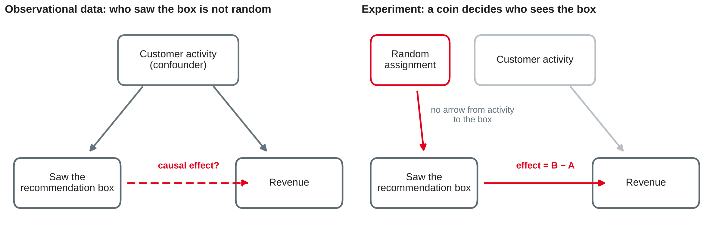
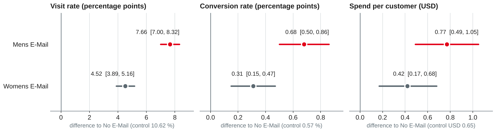
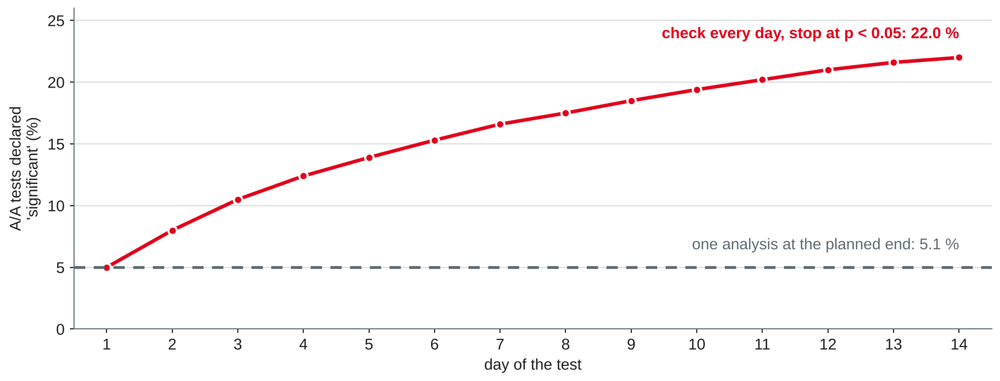

# Experiments and A/B Testing {.title}

::: notes
Time plan for today (3 h): recap 5 min · causal questions 12 min · exercise 1 10 min · designing an A/B test 20 min · exercise 2 15 min · break 10 min · analysing results 12 min · pitfalls 18 min · outlook: no experiment possible 5 min · lab 55 min · wrap-up 5 min · ~13 min buffer.
Input about 72 min, hands-on about 80 min (two exercises and the lab). Students need Python with pandas, SciPy and statsmodels (statsmodels was installed in the session 1 setup; SciPy comes with it). The lab dataset is downloaded directly in the notebook, no login. All numbers on the slides were run with pandas 3.0.6, SciPy 1.18.1, statsmodels 0.15.0 and NumPy 2.5.4; random seeds are given where randomness is involved. Hypothesis tests and confidence intervals are known from Stochastics (W4DSKI_206): recap only, no derivations.
:::

---

# Today's Agenda

1. Recap: from prediction to decision
2. Causal questions: correlation vs. causation
3. Designing an A/B test: hypothesis, metrics, randomisation unit, sample size
4. Analysing results: difference, confidence interval, p-value
5. Pitfalls: sample ratio mismatch, peeking, multiple testing, novelty effects
6. When you cannot experiment: an outlook
7. Lab: a real e-mail experiment

::: notes
Time and format guide (not shown to students):
0:00 Recap and preparation round (plenary) · 0:05 Causal questions (input) · 0:17 Exercise 1 (pairs, then plenary) · 0:27 Designing an A/B test (input) · 0:47 Exercise 2 (pairs) · 1:02 Break · 1:12 Analysing results (input + live demo of the lab starter) · 1:24 Pitfalls (input + discussion) · 1:42 Outlook: difference-in-differences (input) · 1:47 Lab (pairs, consultations) · 2:42 Wrap-up: two pairs present their recommendation · ~13 min buffer.
If the preparation round (examples from the companies) runs long, keep it: these examples are the best motivation for the rest of the session. Shorten the outlook instead; it is on the slides for self-study.
:::

---

# Recap: Where Session 8 Left Us

- Churn: a tuned model found **no more churners** than the rule "fewest purchase days" (946 vs. 944 in the top 20 %)
- Segments and anomalies: judged by usefulness and planted cases, not by one score
- Every track ended with a **decision**: whom to call, which offer, which lines to audit

::: callout
**Today's question:** a model tells us *who* is likely to churn. Does **calling** them actually keep them? That is a causal question — and it needs a different method.
:::

::: notes
Preparation round: ask three or four students for their example of a decision based on a test or pilot in their company (preparation task of session 8). Collect on the whiteboard: what was changed, what was measured, was there a comparison group, how was it assigned? Typical answers: a pilot in one region or one store (no random assignment), a before/after comparison, a real A/B test of a web page or e-mail. Come back to the list at the pitfalls and the outlook: most "pilots" are quasi-experiments.
:::

---

# Causal Questions {.section}

When a prediction is not enough

---

# Prediction vs. Causal Question

| | Prediction (sessions 7–8) | Causal question (today) |
|---|---|---|
| Question | Who will churn? | Does a call **reduce** churn? |
| Compares | Customers with each other | The same customers **with** and **without** the action |
| Data | Historical records | Ideally an **experiment** |
| Typical method | Classification, regression | Randomised controlled experiment (A/B test) |
| Typical mistake | Leakage | Mistaking correlation for causation |

::: source
Own compilation based on Kohavi et al. (2020, Chapter 1) and Provost and Fawcett (2013).
:::

::: notes
Provost and Fawcett list causal modelling as its own data mining task, distinct from classification (session 7). Example: the churn model ranks customers by risk; but the business decision is whether to spend money on calls. If the call has no effect on the top-ranked customers (or even reminds them to cancel), the model ranking does not help. The causal question "what happens if we act?" compares two worlds for the same unit — of which we can only observe one. Randomisation lets us compare groups that differ only by chance.
:::

---

# Correlation Is Not Causation

{width=92%}

- A **confounder** influences both the "treatment" and the outcome
- **Random assignment** breaks every arrow into the treatment — known and unknown confounders are balanced on average
- The difference between the groups then estimates the **causal effect**

::: source
Own illustration based on Kohavi et al. (2020, Chapters 1 and 11).
:::

::: notes
The example is from worksheet 7 (task 1, request 3): "customers who see the recommendation box spend more". Active customers visit more pages, see the box more often and spend more anyway. Other non-causal explanations to name: reverse causality (high spenders get shown more recommendations), selection (only logged-in users see the box), chance. Randomisation does not make groups identical; it makes differences random, and statistics quantifies random differences. Kohavi et al. put randomised controlled experiments at the top of the hierarchy of evidence for causality and discuss observational studies as complements (Chapter 11).
:::

---

# Exercise 1: Causal or Not? {.exercise}

For each claim: is the causal conclusion justified? If not, name an **alternative explanation** and say how you would test the claim.

1. "Customers with our loyalty card buy 30 % more. Let's give the card to everyone."
2. "Pages that load faster convert better. Speed sells."
3. "Since we launched dark mode in November, session length has risen by 10 %."
4. "Users who switched on push notifications have twice the retention. Let's switch them on by default."

::: notes
Pairs 5 min, plenary 5 min. Expected answers:
1 Not justified — selection/reverse causality: frequent buyers apply for the card. Test: offer the card to a random half of non-members; compare spend.
2 Not justified as stated — confounders: simple pages (e.g. a short checkout) are fast and convert well; fast devices and good connections belong to different users. Test: randomly add a delay to a page (slow-down experiment) — Kohavi et al. (Chapter 5) describe such speed experiments.
3 Not justified — before/after comparison: seasonality (November evenings are long), other releases, marketing. Test: A/B test with dark mode offered to a random half, or at least a comparison group (outlook: difference-in-differences).
4 Not justified — self-selection: engaged users opt in. Test: randomise the default (on vs. off) for new users and measure retention and opt-outs (guardrail: uninstall rate).
:::

---

# Designing an A/B Test {.section}

Decide before you look at the data

---

# Anatomy of a Test Plan

| Element | Example: confirmation e-mail of the sign-up funnel (session 4) |
|---|---|
| Hypothesis | Sending a shorter e-mail immediately raises the confirmation rate |
| Variants | A: current e-mail (control) · B: short e-mail, sent at once |
| Randomisation unit | User who completed the form |
| Primary metric | Confirmation rate within 7 days |
| Guardrail metrics | Spam complaints, unsubscribe rate, support tickets |
| Sample size and duration | From baseline, minimum effect, α and power — next slides |
| Decision rule | Ship B if the primary metric improves significantly and no guardrail is harmed |

::: source
Own example based on Kohavi et al. (2020, Chapters 2 and 7).
:::

::: notes
Kohavi et al. (Chapter 2) walk through an end-to-end example in the same order: hypothesis, metric, randomisation unit, target population, size and duration, then the analysis. The test plan is written down before the start ("pre-registration"): it protects against changing the metric or the stopping rule after seeing the data. Link to session 4: in the funnel worksheet, form → confirm was the weakest step (37.5 % never confirm). The funnel shows where users leave, the experiment shows whether a change helps.
:::

---

# Metrics: Primary, Guardrail, Diagnostic

::: cards
### Primary metric (OEC)
The one metric the decision is based on. Measurable in the test period, sensitive to the change, aligned with the long-term goal. Kohavi et al. call it the **overall evaluation criterion**.
### Guardrail metrics
Must **not** get worse: business guardrails (unsubscribes, latency, crashes) and **trust** guardrails that check the experiment itself (sample ratio).
### Diagnostic metrics
Explain *why* the primary metric moved: opens, clicks, steps of the funnel. Not the basis of the decision.
:::

::: source
Based on Kohavi et al. (2020, Chapters 6, 7 and 21).
:::

::: notes
OEC: Kohavi et al. define it as the quantitative measure of the experiment's objective; it should be measurable in the short term and believed to drive long-term goals. Chapter 6 discusses organisational guardrail metrics. Classic mistake: optimising a short-term metric (clicks on an e-mail subject line) that hurts a long-term one (unsubscribes). Ask: for the confirmation e-mail, why is "open rate" a bad primary metric? (It measures the e-mail, not the funnel; it is also unreliable because of mail clients blocking tracking pixels.) Chapter 21 covers trust-related guardrails, starting with the sample ratio mismatch (later today).
:::

---

# Choosing the Randomisation Unit

| Unit | Good for | Watch out |
|---|---|---|
| User (account, customer) | Most product and marketing tests | Users must be identifiable across visits |
| Cookie or device | Anonymous visitors | One person, several devices: mixed experience |
| Session or page view | Invisible back-end changes | Inconsistent experience; users are not independent |
| Cluster (store, city, team) | Interference between users | Few units: low power |

- Analyse at the **unit you randomised** — otherwise standard errors are too small
- **Interference:** if treated users affect control users (shared stock, riders, social networks), randomise clusters

::: source
Based on Kohavi et al. (2020, Chapters 14 and 22).
:::

::: notes
Chapter 14 discusses the choice of randomisation unit: the unit should be at least as coarse as the unit of the metric, and a user-level unit gives a consistent experience. If you randomise by user but analyse click-through per page view, page views of the same user are correlated and a naive test underestimates the variance (Chapter 18 discusses the delta method; out of scope here). Chapter 22 covers leakage and interference, e.g. marketplaces where treatment and control compete for the same supply. Example: a food delivery platform cannot test a new rider dispatch rule per customer, because riders serve both groups — randomise by city and time slot instead (switchback).
:::

---

# Sample Size and Power

Per variant, with α = 0.05 (two-sided) and power 80 %:

::: callout
**n ≈ 16 σ² / δ²** — σ² variance of the metric (for a rate: p(1 − p)), δ the smallest effect worth detecting
:::

| Metric (lab data) | Baseline | Minimum effect δ | n per variant (rule) | n (statsmodels) |
|---|---|---|---|---|
| Visit rate | 10.6 % | +1.0 pp | 15,162 | 15,483 |
| Visit rate | 10.6 % | +0.5 pp | 60,649 | 60,729 |
| Conversion rate | 0.57 % | +0.2 pp | 22,670 | 25,972 |
| Spend per customer | σ = USD 11.59 | +USD 0.20 | 53,715 | 52,701 |

- **Halving** the minimum effect needs **four times** the sample

::: source
Rule of thumb from Kohavi et al. (2020, Chapter 17); own calculation with statsmodels (Seabold & Perktold, 2010).
:::

::: notes
The 16 comes from 2·(1.96 + 0.84)² ≈ 15.7 for two groups of equal size. statsmodels uses Cohen's h (arcsine transformation) for proportions, so its numbers differ slightly, most for small rates such as the conversion rate. Power = probability of detecting the effect if it really has size δ; 80 % means that one in five real effects of that size is missed. Duration: divide the total sample by the eligible traffic per day and round up to whole weeks, so that every weekday is included (Kohavi et al. recommend running at least a week to cover day-of-week effects). Important: δ is a business decision ("what is the smallest effect worth shipping?"), not the effect you hope for. Spend is skewed with many zeros (σ = 11.59 at a mean of 0.65), which makes revenue metrics expensive to test.
:::

---

# Sample Size in Python

```python
from statsmodels.stats.power import NormalIndPower
from statsmodels.stats.proportion import proportion_effectsize

h = proportion_effectsize(0.116, 0.106)      # Cohen's h: 10.6 % -> 11.6 %
n = NormalIndPower().solve_power(effect_size=h, alpha=0.05, power=0.8)
print(round(n))                              # 15483 per variant

p, d = 0.106, 0.01                           # rule of thumb
print(round(16 * p * (1 - p) / d**2))        # 15162 per variant
```

- `solve_power` solves for whichever argument you leave out — also **power** for a given *n*
- For means: `TTestIndPower` with `effect_size = δ / σ`

::: source
Own example based on Seabold and Perktold (2010) and Kohavi et al. (2020, Chapter 17).
:::

::: notes
Example of the reverse question: with 21,306 customers per arm (the lab data), the design detects with 80 % power a difference of about 0.85 pp in the visit rate, 0.22 pp in the conversion rate and USD 0.31 in spend per customer. Computed with NormalIndPower().solve_power(nobs1=21306, alpha=0.05, power=0.8) → h = 0.0271, converted back to rates; for spend 2.8 · 11.59 · √(2/21306). So the lab experiment was large enough for the visit rate, and borderline for spend.
:::

---

# Exercise 2: Plan the Test {.exercise}

Complete the test plan for the confirmation e-mail from the "Anatomy" slide.

1. Write the hypothesis as H₀ and H₁ for the primary metric.
2. Today, **62.5 %** of users confirm. Marketing only cares if the rate rises by **3 percentage points** or more. How many users per variant do you need?
3. About **800 users per day** complete the form. How long must the test run?
4. Name two guardrail metrics and one diagnostic metric — and one thing that could go wrong with the randomisation unit.

::: notes
Pairs 10 min, plenary 5 min. Expected answers:
1 H₀: confirmation rate B = rate A; H₁: rate B ≠ rate A (two-sided — the new e-mail could also be worse).
2 Rule of thumb: 16 · 0.625 · 0.375 / 0.03² = 4,167 per variant; statsmodels (Cohen's h, 0.625 → 0.655): 4,017. Total about 8,300 users.
3 8,333 / 800 ≈ 10.4 days → run **two full weeks** (whole weeks, day-of-week effects; users need up to 7 days to confirm, so the last cohort is complete only 7 days after the end of enrolment).
4 Guardrails: spam complaints, unsubscribes, support tickets, delivery failures; diagnostic: open rate, click rate on the link, time to confirmation. Randomisation unit: if the user can request the e-mail again or sign up twice with the same address, assign by e-mail address (or account) so that the same person does not see both variants.
:::

---

# Analysing Results {.section}

A recap from Stochastics — and a real experiment

---

# The Statistics in One Slide

For two rates p̂_A (control) and p̂_B (treatment) with n_A and n_B units:

- **Effect:** Δ = p̂_B − p̂_A (absolute, in percentage points) — relative lift Δ / p̂_A
- **Standard error:** SE = √( p̂_A(1 − p̂_A)/n_A + p̂_B(1 − p̂_B)/n_B )
- **95 % confidence interval:** Δ ± 1.96 · SE
- **p-value:** probability of a difference at least this large **if there were no effect** — not the probability that there is no effect
- Means (e.g. spend): **Welch t-test** and its interval; large samples make skewed metrics workable

::: callout
Report the **effect with its interval** first; the p-value only says whether the interval excludes zero.
:::

::: source
Based on Kohavi et al. (2020, Chapter 17).
:::

::: notes
Students know z-tests, t-tests and confidence intervals from Stochastics; only the vocabulary of online experiments is new. proportions_ztest in statsmodels uses the pooled standard error for the test; confint_proportions_2indep(method="wald") gives the unpooled Wald interval shown here. For large samples both agree closely. Typical misinterpretation (Kohavi et al. list several in Chapter 3): "p = 0.03 means there is a 97 % chance that B is better" — wrong. Also: a non-significant result does not show that there is no effect; look at the interval — it may include effects that matter.
:::

---

# The Lab Case: An E-Mail Experiment

- An online retailer randomly split **64,000 customers** (last purchase within 12 months) into three groups
- **Mens E-Mail** · **Womens E-Mail** · **No E-Mail** (control), about a third each
- Outcomes in the **two weeks** after the campaign: website **visit**, **conversion** (purchase) and **spend** in USD
- Pre-treatment data: recency, spend in the past year, men's or women's merchandise bought, new customer, area, channel
- Public dataset, download without login

::: source
Hillstrom (2008).
:::

::: notes
The dataset was published by Kevin Hillstrom on his MineThatData blog in March 2008 for an analytics challenge; it is widely used in teaching and in uplift modelling (e.g. the fetch_hillstrom loader in scikit-uplift, which downloads a copy from a public S3 bucket, and TensorFlow Datasets). The blog post does not name the retailer or the dates. The data are an e-mail marketing experiment, not a website test, but the analysis is identical. Note: the zip_code value "Surburban" is misspelt in the original file — a nice reminder to look at the data. The blog does not state a licence; we use the data only for teaching and do not redistribute them — every student downloads them directly.
:::

---

# Lab Starter (1/2): Load and Check Trust

```python
import pandas as pd
from scipy import stats

URL = ("https://hillstorm1.s3.us-east-2.amazonaws.com/"
       "hillstorm_no_indices.csv.gz")    # copy of Hillstrom (2008)
df = pd.read_csv(URL)                    # 64,000 rows, 12 columns
counts = df.segment.value_counts()
print(counts)                            # 21,387 / 21,307 / 21,306
print(stats.chisquare(counts))           # SRM check, expected 1/3 each
cols = ["recency", "history", "newbie", "visit", "conversion", "spend"]
print(df.groupby("segment")[cols].mean())
```

::: source
Own example based on Hillstrom (2008), The SciPy community (n.d.-a) and Kohavi et al. (2020, Chapter 21).
:::

::: notes
Output: Womens E-Mail 21,387, Mens E-Mail 21,307, No E-Mail 21,306; chi-square 0.203, p = 0.904 — no sample ratio mismatch. Balance of pre-treatment variables (a second trust check): mean recency 5.77 / 5.75 / 5.77 months, past-year spend USD 242.8 / 240.9 / 242.5, share of new customers 50.2–50.3 % — as expected after randomisation. If the URL is blocked in a network, the original file is linked on the blog post (Hillstrom, 2008). pd.read_csv detects the gzip compression from the file extension.
:::

---

# Lab Starter (2/2): Effects with Intervals

```python
from statsmodels.stats.proportion import (proportions_ztest,
                                          confint_proportions_2indep)
ctrl = df[df.segment == "No E-Mail"]
for arm in ["Mens E-Mail", "Womens E-Mail"]:
    t = df[df.segment == arm]
    for m in ["visit", "conversion"]:
        x, n = [t[m].sum(), ctrl[m].sum()], [len(t), len(ctrl)]
        p = proportions_ztest(x, n)[1]
        ci = confint_proportions_2indep(x[0], n[0], x[1], n[1], method="wald")
        print(arm, m, t[m].mean() - ctrl[m].mean(), ci, p)
    r = stats.ttest_ind(t.spend, ctrl.spend, equal_var=False)   # Welch
    print(arm, "spend", t.spend.mean() - ctrl.spend.mean(),
          r.confidence_interval(), r.pvalue)
```

::: source
Own example based on Seabold and Perktold (2010) and The SciPy community (n.d.-b).
:::

::: notes
confint_proportions_2indep computes the interval for p1 − p2 with the first group as treatment. ttest_ind(..., equal_var=False) is Welch's test; its result has a confidence_interval() method (SciPy ≥ 1.11). Visits and conversions: Mens 3,894 and 267 of 21,307; Womens 3,238 and 189 of 21,387; control 2,262 and 122 of 21,306. Every converter has spend > 0, and spend is capped at USD 499 in the data.
:::

---

# Result: Both E-Mails Work — the Men's E-Mail More

{width=94%}

- All six intervals exclude zero; the largest p-value is 0.0011 (Womens, spend)
- Per 1,000 e-mails: about **77** extra visits and **USD 770** extra spend (Mens) vs. **45** and **USD 424** (Womens)
- Mens vs. Womens on spend: USD +0.35, p = 0.030 — a smaller, less certain difference

::: source
Own analysis with data from Hillstrom (2008).
:::

::: notes
Exact values: visit 18.28 % / 15.14 % vs. 10.62 %; conversion 1.25 % / 0.88 % vs. 0.57 %; spend USD 1.42 / 1.08 vs. 0.65. p-values: visit 5.7e-112 and 3.2e-44; conversion 1.5e-13 and 1.6e-4; spend 1.2e-7 and 0.0011. With Holm's correction for six tests, all remain significant (largest adjusted p 0.0011). Relative lift in spend: +118 % (Mens), +65 % (Womens) — relative numbers sound impressive on a small base; always give the absolute effect too. Decision discussion: the spend difference is an increase in revenue, not profit — the cost of an e-mail is small, but margin and returns are unknown. Practical significance: is USD 0.77 per customer per campaign worth it? The answer depends on margin and how often the customer can be mailed without unsubscribing (guardrail not in the data).
:::

---

# Pitfalls and Limits {.section}

Why many A/B test results cannot be trusted

---

# Sample Ratio Mismatch (SRM)

- Planned split 50/50, observed **50,421 vs. 48,977** users → χ² = 21.0, **p = 0.000005**
- An SRM is a **symptom**: something removed or added users unevenly — bot filters, redirects, crashes, logging
- With an SRM, **do not interpret** the effects: the groups are no longer comparable
- Check it in every experiment, with a strict threshold (e.g. p < 0.001), before looking at any metric

```python
stats.chisquare([50421, 48977])        # expected: equal counts
```

::: source
Based on Fabijan et al. (2019) and Kohavi et al. (2020, Chapter 21).
:::

::: notes
Fabijan et al. derive a taxonomy of SRM causes from experience at four companies, across more than 25 products: assignment problems, execution problems (e.g. the treatment crashes more and loses users), log processing, analysis (e.g. wrong filters), and interference by users or bots. Their key point: an SRM is a symptom of a data quality issue, and ignoring it can make bad changes look good. The 0.001 threshold is our convention for this course; because the check runs on every experiment, a strict threshold keeps false alarms rare. A ratio of 50.7 % vs. 49.3 % looks harmless — the test shows it is not chance at this sample size. Lab data: p = 0.904, no SRM.
:::

---

# Peeking: Checking Every Day Until It Is Significant

{width=80%}

- 10,000 simulated **A/A tests** (no real effect): stopping at the first p < 0.05 gives **22.0 %** false positives
- Fix: fix the sample size in advance and analyse **once** — or use a method designed for continuous monitoring (sequential tests)

::: source
Own simulation based on Johari et al. (2017) and Kohavi et al. (2020, Chapter 3).
:::

::: notes
Simulation: 14 days, 1,000 users per arm and day, true rate 10 % in both arms, two-proportion z-test on the cumulative data each day, numpy seed 42 (worksheet task 5 contains the code). Peeking only once a week (days 7 and 14) already gives 8.4 %. Johari et al. show that classical p-values are invalid under continuous monitoring and propose always-valid p-values (sequential testing), which some commercial platforms use. Looking at the dashboard is fine — stopping or deciding because of what you see is the problem. Twyman's law (Kohavi et al., Chapter 3): any figure that looks interesting or different is usually wrong — be most sceptical of surprising wins.
:::

---

# Multiple Testing: Look Long Enough and You Will Find Something

- 20 metrics or segments with no real effect: P(at least one p < 0.05) = 1 − 0.95²⁰ = **64 %**
- Lab demo: split the **No E-Mail** group at random (A/A) and test the visit rate in 19 subgroups — in **48.3 %** of 1,000 random splits at least one subgroup is "significant"
- Fixes: **one primary metric**, segments planned in advance, corrections such as **Bonferroni** (α / k) or **Holm**
- Treat surprising segment results as **hypotheses for the next test**

```python
from statsmodels.stats.multitest import multipletests
reject, p_adj, _, _ = multipletests(p_values, alpha=0.05, method="holm")
```

::: source
Based on Kohavi et al. (2020, Chapter 3), Holm (1979) and Seabold and Perktold (2010).
:::

::: notes
The 19 subgroups: seven history segments, three zip-code areas, three channels, newbie 0/1, mens 0/1, womens 0/1. They overlap, so the share (48.3 %) is lower than 1 − 0.95¹⁹ = 62 % for independent tests. With seed 42 (numpy default_rng) the first split happens to give none — that is why we repeat the split. Holm's procedure: sort the p-values, compare the smallest with α/k, the next with α/(k − 1) and so on, stop at the first that fails; it is uniformly more powerful than Bonferroni and also controls the family-wise error rate. Multiple variants (our two e-mails) are a multiple testing problem too.
:::

---

# Novelty, Primacy and Other Traps

| Trap | What happens | What to do |
|---|---|---|
| Novelty effect | Users click a new feature because it is new; the effect fades | Run longer, plot the effect by day, compare new vs. returning users |
| Primacy effect | Users need time to get used to a change; the effect grows | Same: look at the trend, not one number |
| No A/A test | The platform itself produces false differences | Run A/A tests: about 5 % should be significant |
| Short-term metric | Clicks up, satisfaction or retention down | Primary metric aligned with the long-term goal; guardrails |

::: source
Based on Kohavi et al. (2020, Chapters 3, 19 and 23).
:::

::: notes
Kohavi et al. discuss primacy and novelty effects as threats to validity in Chapter 3 (detection: plot the treatment effect over time, or compare users first exposed at different times) and how to measure long-term treatment effects in Chapter 23. Chapter 19: A/A tests split users into two groups with identical experiences; if far more than 5 % of A/A tests are significant, the variance calculation or the platform is broken. E-mail campaigns are short (two weeks in the lab data), so we cannot see novelty effects there — mention this as a limitation in the lab.
:::

---

# When You Cannot Experiment: Difference-in-Differences

A retailer raises delivery fees in **Austria** only. Germany is unchanged.

| Orders per 1,000 customers per week | Before | After | Change |
|---|---|---|---|
| Austria (treated) | 52.0 | 47.5 | −4.5 |
| Germany (comparison) | 50.0 | 48.5 | −1.5 |
| **Difference-in-differences** | | | **−3.0** |

- Before/after alone (−4.5) mixes the fee with seasonality and market trends
- Key assumption: **parallel trends** — without the fee, Austria would have changed like Germany; check earlier periods
- Other quasi-experiments: interrupted time series, regression discontinuity, matching

::: source
Own example based on Kohavi et al. (2020, Chapter 11).
:::

::: notes
Outlook only — causal inference with observational data is a course of its own. Experiments are not possible when the change cannot be assigned at random (law, price in one country, a new store), when randomisation would be unethical or illegal, or when the change has already happened. Kohavi et al. (Chapter 11) describe interrupted time series, interleaved designs, regression discontinuity, instrumental variables, propensity score matching and difference in differences, and warn that observational causal studies often fail to reproduce experimental results. The numbers on the slide are invented for illustration. Ask: what could break parallel trends here? (A competitor entering Austria, a public holiday in one country, a currency effect.) Link to time series (sessions 11–14): interrupted time series uses a forecast as the counterfactual.
:::

---

# Lab Tasks {.exercise}

Work in pairs on the e-mail experiment (Hillstrom, 2008).

1. **Trust first:** row counts, SRM check, balance of recency, past spend and new customers across the arms
2. **Effects:** difference, 95 % interval and p-value for visit, conversion and spend — both e-mails against no e-mail
3. **Multiple testing:** adjust the six p-values with Holm; then split the control group at random (A/A) and test 19 subgroups — what do you find?
4. **Power:** which effect could this design detect with 80 % power? Was it large enough for spend?
5. **Decision:** which e-mail would you send, to whom, and what is your evidence? Write a five-part summary (session 8)

::: notes
Expected results (tested, see the notes of the earlier slides): 1 counts 21,387 / 21,307 / 21,306, χ² p = 0.904; means balanced. 2 Mens: visit +7.66 pp [7.00, 8.32], conversion +0.68 pp [0.50, 0.86], spend +USD 0.77 [0.49, 1.05]; Womens: +4.52 pp [3.89, 5.16], +0.31 pp [0.15, 0.47], +USD 0.42 [0.17, 0.68]; all p ≤ 0.0011. 3 Holm: all six stay significant (largest adjusted p 0.0011). A/A: with rng = np.random.default_rng(42) and a permutation of half the control group, no subgroup is significant (smallest p 0.142); repeating 1,000 splits, 48.3 % contain at least one significant subgroup, on average 0.89 per split. 4 About 0.85 pp visit, 0.22 pp conversion, USD 0.31 spend → enough for all observed effects, but only just for the Womens spend effect. 5 Example: "Send the men's e-mail: it raised spend by USD 0.77 per customer [0.49, 1.05], about USD 770 per 1,000 e-mails, compared with USD 424 for the women's e-mail. Limits: revenue, not profit; two weeks only; unsubscribes not measured." Pairs that finish early: worksheet task 7 (targeting by past purchases).
:::

---

# Key Takeaways

- **Causal questions** ask what happens *if we act* — correlations in historical data cannot answer them reliably
- **Randomisation** balances known and unknown confounders; the difference between groups estimates the effect
- **Plan first:** hypothesis, randomisation unit, one primary metric, guardrails, sample size — n ≈ 16σ²/δ² per variant
- Report the **effect with its confidence interval**, in absolute and business terms
- **Trust checks before results:** SRM, balance, A/A tests; no peeking, no fishing in segments
- If you cannot randomise: **quasi-experiments** such as difference-in-differences — with strong assumptions

---

# Next Session: Lab Workshop and Catch-Up

- No new content: catch up on sessions 1–9
- Work on your portfolio notebooks, with consultations
- Project teams: first findings for the semester-6 projects

::: callout
**Preparation:** bring your current notebook and a list of open questions. If you finished the lab today, try worksheet 9, task 7.
:::

---

# References {.references}

- Fabijan, A., Gupchup, J., Gupta, S., Omhover, J., Qin, W., Vermeer, L., & Dmitriev, P. (2019). Diagnosing sample ratio mismatch in online controlled experiments: A taxonomy and rules of thumb for practitioners. In *Proceedings of the 25th ACM SIGKDD International Conference on Knowledge Discovery & Data Mining* (pp. 2156–2164). ACM. https://doi.org/10.1145/3292500.3330722
- Hillstrom, K. (2008, March 20). *The MineThatData e-mail analytics and data mining challenge* [Blog post and dataset]. MineThatData. https://blog.minethatdata.com/2008/03/minethatdata-e-mail-analytics-and-data.html
- Holm, S. (1979). A simple sequentially rejective multiple test procedure. *Scandinavian Journal of Statistics, 6*(2), 65–70.
- Johari, R., Koomen, P., Pekelis, L., & Walsh, D. (2017). Peeking at A/B tests: Why it matters, and what to do about it. In *Proceedings of the 23rd ACM SIGKDD International Conference on Knowledge Discovery and Data Mining* (pp. 1517–1525). ACM. https://doi.org/10.1145/3097983.3097992
- Kohavi, R., Tang, D., & Xu, Y. (2020). *Trustworthy online controlled experiments: A practical guide to A/B testing*. Cambridge University Press. https://doi.org/10.1017/9781108653985
- Provost, F., & Fawcett, T. (2013). *Data science for business: What you need to know about data mining and data-analytic thinking*. O'Reilly Media.
- Seabold, S., & Perktold, J. (2010). Statsmodels: Econometric and statistical modeling with Python. In S. van der Walt & J. Millman (Eds.), *Proceedings of the 9th Python in Science Conference* (pp. 92–96). https://doi.org/10.25080/Majora-92bf1922-011
- The SciPy community. (n.d.-a). *scipy.stats.chisquare* (SciPy v1.18.0 manual). Retrieved October 21, 2026, from https://docs.scipy.org/doc/scipy/reference/generated/scipy.stats.chisquare.html
- The SciPy community. (n.d.-b). *scipy.stats.ttest_ind* (SciPy v1.18.0 manual). Retrieved October 21, 2026, from https://docs.scipy.org/doc/scipy/reference/generated/scipy.stats.ttest_ind.html
