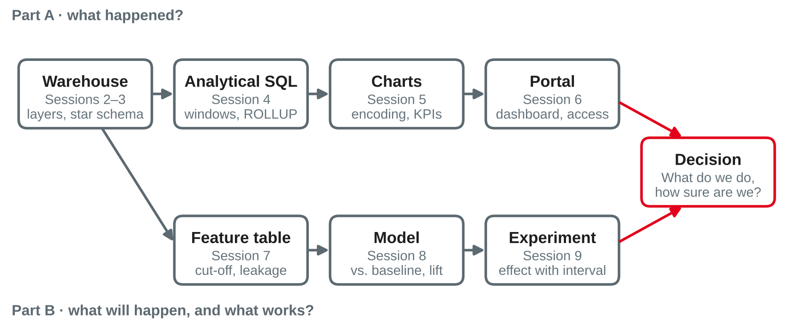

# Lab Workshop and Catch-Up {.title}

::: notes
Buffer block: no new content. Time plan for today (3 h): recap and open-question round 10 min · Parts A–B in review 20 min · self-check exercise 15 min · checklists and workshop rules 10 min · break 10 min · portfolio lab with consultations 60 min · peer feedback round 20 min · partner projects: first findings 25 min · wrap-up 5 min · ~5 min buffer.
Input about 40 min, hands-on about 120 min. If earlier sessions overran (e.g. the session 9 lab was not finished), this block absorbs it: let pairs finish the session 9 lab in the first part of the portfolio lab and skip the optional catch-up slides. Students need their notebooks, tpch.duckdb with the star schema from session 3, and the Python setup from session 1. Nothing new is installed today.
:::

---

# Today's Agenda

1. Recap: your open questions
2. Parts A–B in review: what connects sessions 2–9
3. Self-check: one question per session
4. Portfolio checklists and how consultations work
5. Portfolio lab with consultations
6. Peer feedback on a notebook
7. Partner projects: first findings of the two teams

::: notes
Time and format guide (not shown to students):
0:00 Open-question round (plenary, collect on the whiteboard) · 0:10 Parts A–B in review (input) · 0:30 Self-check (pairs, then plenary) · 0:45 Checklists and consultation rules (input) · 0:55 Break · 1:05 Portfolio lab (pairs; consultations at the tables, 10 minutes per pair) · 2:05 Peer feedback (two pairs swap notebooks) · 2:25 Partner projects: first findings (each team about 8 min + 4 min questions) · 2:50 Wrap-up · ~5 min buffer.
Order is flexible: if the partner teams prefer to present first (e.g. because a company contact joins online), swap the partner round and the peer feedback.
:::

---

# Recap: Where Session 9 Left Us

- A model says **who** is at risk; an experiment shows **whether acting helps**
- Randomise, plan the sample size, report the **effect with its interval** — and check trust first
- Parts A and B are complete: today there is **no new content**

::: callout
**Your preparation:** your current notebook and a list of open questions. Which question would you ask first?
:::

::: notes
Open-question round: ask each pair for its most important open question and cluster them on the whiteboard by session (2–4 SQL and warehouse, 5–6 visualisation and portal, 7–8 ML, 9 experiments). Use the clusters to decide which optional catch-up slides to show after the self-check and whom to consult first in the lab. Typical clusters from experience: point-in-time features (session 7), time-aware validation (session 8), and the difference between pooled test and unpooled interval (session 9).
:::

---

# Parts A–B in Review {.section}

What connects sessions 2–9

---

# From Data to Decision

{width=90%}

::: source
Own illustration based on Kimball and Ross (2013), Chapman et al. (2000) and Kohavi et al. (2020).
:::

::: notes
Walk through the map once, from left to right. Part A describes what happened: the warehouse (sessions 2–3) gives integrated, historised data at a declared grain; analytical SQL (4) turns it into rankings, shares and comparisons; charts (5) and the portal (6) deliver them to decision makers. Part B uses the same warehouse: the feature table (7) aggregates facts up to a cut-off, a model (8) is compared with a baseline, and an experiment (9) checks whether the action works. Both paths end in a decision — that is the yardstick of every portfolio notebook.
:::

---

# Part A at a Glance

| Session | Core idea | Typical mistake |
|---|---|---|
| 2 Warehouse architectures | Know the layer and the definitions of your data | Trusting a mart figure without checking how it is defined |
| 3 Dimensional data and OLAP | Grain first; facts at that grain, dimensions for context | Mixing grains; type 1 overwrite where history matters |
| 4 Analytical SQL | Windows keep rows; ROLLUP and CUBE add subtotals | `WHERE` filters before the window function runs |
| 5 Visualisation | Position on a common scale; one message per chart | Truncated axes, incomplete periods |
| 6 Analytics portals | Define metrics once; authorise where the data is queried | Averaging ratios; security only in the user interface |

::: source
Own summary of sessions 2–6, based on Kimball and Ross (2013) and Knaflic (2015).
:::

::: notes
For each row, ask the class for a concrete example from their own notebook 1 before showing the "typical mistake" column (reveal it row by row if the projector allows). The mistakes listed are the ones that appeared most often in the lab consultations of sessions 2–6 and in the worksheets (e.g. worksheet 4, "Find and Fix the Bug").
:::

---

# Part B at a Glance

| Session | Core idea | Typical mistake |
|---|---|---|
| 7 From business question to ML use case | Frame the decision; features only from before the cut-off | Leaky features; accuracy as the yardstick |
| 8 ML use-case lab | Pipeline, time-aware validation, comparison with a baseline | Random split of time-ordered data; tuning on the test set |
| 9 Experiments and A/B testing | Randomise; effect with interval; trust checks first | Peeking, fishing in segments, ignoring an SRM |

::: callout
One thread runs through all three: **would this result hold in production — and would it change the decision?**
:::

::: source
Own summary of sessions 7–9, based on Chapman et al. (2000), Kaufman et al. (2012) and Kohavi et al. (2020).
:::

::: notes
Link the three sessions: session 7 makes sure the model could be used (point-in-time correctness), session 8 makes sure the evaluation is honest (later test period, baseline), session 9 makes sure the effect of the action is real (randomisation). A strong notebook 2 says explicitly which of these it can and cannot show — e.g. "the model ranks churners better than chance, but whether a call keeps them is untested".
:::

---

# Self-Check: One Question per Session {.exercise}

Answer briefly in pairs — without your notes.

1. **S2:** Why does an analyst need to know from which **layer** a revenue figure comes?
2. **S3:** A fact table holds order lines and, in the same table, one row per order with the shipping fee. What goes wrong?
3. **S4:** `rank()` and `dense_rank()` give 1, 2, 2, ? — what comes next in each?
4. **S5:** Which chart for the change of monthly revenue over two years — and which one not?
5. **S6:** Why is "revenue per active customer" not the average of the regional values?
6. **S7:** The churn label covers July–December 1997. May "orders in 1997" be a feature?
7. **S8:** Why validate on a **later cut-off** instead of a random split?
8. **S9:** p = 0.03 for B vs. A. What does this number **not** tell you?

::: notes
Pairs 8 min, plenary 7 min. Expected answers:
1 Staging, core and marts differ in cleaning and definitions; a mart figure may be filtered or defined differently (e.g. gross vs. net revenue), so the same name can mean different numbers.
2 Mixed grain: summing revenue or counting rows double counts; shipping fees appear only on order rows, so any GROUP BY over part attributes is wrong. Fix: separate fact tables (order lines, orders) or allocate the fee to lines.
3 rank(): 4 (gap after the tie); dense_rank(): 3.
4 Line chart (one line per year or one continuous line); not a pie and not two y-axes; mark incomplete months.
5 It is a non-additive ratio: compute sum of revenue ÷ count of distinct active customers over the whole set; the average of regional ratios weights small and large regions equally (session 6, semantic layer).
6 No — half of 1997 is the label window: leakage from the future (session 7 showed a lift of 2.90 for this leaky feature).
7 In production the model predicts the future from the past; a random split lets training rows "see" the test period and overstates performance.
8 Not the probability that B is better, not the size of the effect, not whether the effect matters for the business; report the interval.
:::

---

# Today's Workshop {.section}

Portfolio work, consultations and feedback

---

# How Today Works

::: cards
### Portfolio lab
Work in pairs on notebook 1 or 2 — or finish the lab of session 9. Use the checklists on the next slides.
### Consultations
Every pair gets a slot at their table. Bring **one** concrete question and the cell where you are stuck.
### Peer feedback
Two pairs swap notebooks and give structured feedback against the checklist.
### Partner projects
Each team shares its **first findings** and open questions for the semester-6 project.
:::

::: notes
Consultation order: pairs that named a blocking problem in the open-question round first, then the others in table order. Ten minutes per pair is enough for one question; if a problem needs more, give the pair a concrete next step and come back later. Keep a short list of recurring problems; if three pairs have the same one, explain it to the whole room (the optional catch-up slides help).
:::

---

# Preparing a Consultation Question

- **What do you want to find out?** The business question of the cell, in one sentence
- **What did you do?** The query or code — the smallest version that shows the problem
- **What did you expect, and what did you get?** Numbers, error message, chart
- **What have you tried?** Documentation, a simpler case, a sanity check

::: callout
A good question often answers itself while you write it down. If it does — even better: note it in your notebook as a decision.
:::

::: notes
This is the classic "minimal reproducible example" format. It saves consultation time and trains a skill students need in the partner projects: asking a precise question to a stakeholder or a colleague. Encourage pairs to write the question in a Markdown cell above the problematic code.
:::

---

# Portfolio Checklists {.section}

What a good notebook shows

---

# Checklist: Notebook 1 — Warehouse, OLAP, SQL

- **Question first:** each analysis starts with a business question and ends with an answer
- **Model and grain:** star schema described; grain of each fact table stated
- **Definitions:** every measure defined — formula, filters, time reference (KPI sheet)
- **Completeness:** date range checked; incomplete periods excluded or marked
- **Analytical SQL:** CTEs for readability; window functions and ROLLUP/CUBE where they fit
- **Charts:** chosen for the question, honest axes, action titles
- **Assessment:** what the data and method can and cannot tell — with a short suitability statement

::: source
Own compilation based on Kimball and Ross (2013) and Knaflic (2015).
:::

::: notes
The checklist mirrors the key takeaways of sessions 2–6; it is guidance, not the official rubric (the portfolio brief with deadlines and the rubric is published separately on the course platform). Typical gap in notebook 1: queries without interpretation. Every result table needs at least one sentence: what does it mean, and how sure are we? Remind students that TPC-H is synthetic and almost flat: "there is no trend" is a valid, well-founded finding.
:::

---

# Checklist: Notebook 2 — ML Use Case

- **Framing:** decision, unit, target, prediction point and horizon, features, success metric
- **Point-in-time:** features only from before the cut-off; leakage audit written down
- **Baseline:** majority class and a simple rule, measured like the model
- **Validation:** later cut-off or snapshot folds; the test period used **once**
- **Business evaluation:** lift, profit, hits at capacity — not accuracy alone
- **Interpretation:** importances, profiles or a review list in business terms
- **Communication:** answer first, evidence, decision, limits, next step

::: source
Own compilation based on Chapman et al. (2000), Kaufman et al. (2012) and Provost and Fawcett (2013).
:::

::: notes
This is the content of the "What a Good Notebook Contains" slide of session 8, turned into a checklist. Remind pairs of the suggested rubric from session 8 (orientation only) and that a negative result — "the rule is enough" — is fine if it is shown and argued well. For pairs who also tested a campaign idea: an experiment design (session 9) is a strong "next step" in the summary.
:::

---

# Checklist: Reproducible and Ready to Hand In

- Runs **top to bottom** on a fresh kernel and a fresh `tpch.duckdb` (or a downloadable public dataset)
- Prints library **versions**; fixes `random_state` or seeds wherever randomness is involved
- No manual steps: every number in the text comes from a cell above it
- Data are **not** copied into the notebook folder if their licence or size forbids it — load them by URL or script
- Markdown cells explain **decisions**; code cells stay short
- Names of both partners and the date at the top

::: source
Based on Sandve et al. (2013).
:::

::: notes
Sandve et al. give ten rules for reproducible computational research, among them: keep track of how every result was produced, avoid manual data manipulation, record versions of all external programs, record random seeds, and store raw data behind plots. Practical test before hand-in: "Restart kernel and run all", then compare the numbers in the text with the outputs. A notebook that fails on a fresh kernel is the most common avoidable loss of points.
:::

---

# Writing the Suitability Assessment

1. **Fit:** does the method answer the business question — or a different one?
2. **Evidence:** how much better than the baseline, on which test period, with what uncertainty?
3. **Data:** which limits of the data affect the result (synthetic, incomplete, one period)?
4. **Use:** can the result be produced and acted on in practice — data available, capacity, cost?
5. **Verdict:** use it, use a simpler alternative, or collect more evidence first

::: callout
"Suitable" is a **judgement with reasons**, not a score. "A simple rule is enough" can be the best-argued verdict.
:::

::: source
Own compilation based on Chapman et al. (2000, evaluation phase) and Provost and Fawcett (2013).
:::

::: notes
The module description asks students to "assess the suitability" of methods (methodological competence); every portfolio notebook ends with this short written assessment. Five to ten sentences are enough. Point to the "Is ML Suitable Here?" slide of session 7 for the ML-specific questions (value, signal, availability, stability, action, risks).
:::

---

# Peer Feedback on a Notebook {.exercise}

Swap notebooks with another pair. Read the notebook first, then give feedback using the checklist.

- **Two strengths:** what works well — be specific (which cell, which decision)
- **Three suggestions:** the most important improvements, each with a concrete next step
- **One question:** something you did not understand or would challenge

::: callout
Feedback is about the **work**, not the people — and it is useful only if the receiving pair can act on it.
:::

::: source
Based on Hattie and Timperley (2007).
:::

::: notes
Hattie and Timperley describe effective feedback as answering three questions — where am I going, how am I going, where to next — and show that feedback on the task and on the process is more effective than praise of the person. The format "two strengths, three suggestions, one question" makes this concrete. Pairs 10 min reading, 5 min feedback per direction. Walk around and check that suggestions are concrete ("add the date range check before the yearly chart") rather than vague ("more analysis"). Worksheet 10, task 6, practises the same format on a fictional notebook.
:::

---

# Partner Projects: First Findings {.section}

Preparing the semester-6 projects

---

# First Findings: What Each Team Shares

Each team presents briefly, following the project brief from session 1:

1. **Business goal** and how success will be measured — as far as known
2. **Stakeholders** you have spoken to, and what they need
3. **As-is process** in one picture
4. **Data inventory so far:** sources, volume, quality, access status
5. **Open questions and risks** — and what you need from the partner next

::: callout
Information from the partner companies is **confidential**: no names, no data, no screenshots in public repositories, chats or the course website.
:::

::: notes
The five points are the structure of the project brief introduced in session 1 (due at the end of semester 5; not graded in this module). Today's round is a progress check, not an assessment. The partner companies are referred to only by placeholders in the public material. Ask the other team for one question per presentation; note open points for the lecturer's next contact with the companies (in the lecturer's private notes for the project module, not here).
:::

---

# Project A: {{private:partner_a|Partner Company A}}

**Topic:** {{private:partner_a_topic|Presented by the partner company in session 1}}

- Business goal and success criteria
- Stakeholders and their needs
- As-is process
- Data inventory: sources, volume, quality, access
- Open questions, risks and next steps

::: notes
Team A presents first findings. Company name and topic are filled in only in the offline PPTX (from tools/local.json); the public web version shows a placeholder. Do not write any findings into this file — notes are public. Typical questions to ask: which decision will the result support? Who owns the data, and has access been requested formally? Which part of the data would fit a first analysis with the methods of Parts A–B?
:::

---

# Project B: {{private:partner_b|Partner Company B}}

**Topic:** {{private:partner_b_topic|Presented by the partner company in session 1}}

- Business goal and success criteria
- Stakeholders and their needs
- As-is process
- Data inventory: sources, volume, quality, access
- Open questions, risks and next steps

::: notes
Team B presents first findings — same structure as team A so the two teams can compare progress. Same confidentiality rule: no findings in this public file. If a team has had no contact with its partner yet, use the time to plan the first contact: who, which questions (session 1, "Questions to Ask the Partners"), by when.
:::

---

# From Parts A–B to the Partner Projects {.exercise}

In your project team, discuss and note:

1. Which **decision** at your partner could analytics support — descriptive, predictive or causal?
2. Which methods from **Parts A–B** could help first: a warehouse query, a dashboard, a model, an experiment?
3. What would be the **simplest useful result** — and what would you need for it?
4. Which **leakage, definition or trust** problems could you expect in the partner data?

::: notes
Teams 10 min, only if time allows after the presentations; otherwise as homework for the project brief. Expected kind of answers (generic, since the projects differ): most first results are descriptive (a clean data inventory, a KPI definition, a dashboard prototype); predictive ideas need a clear decision and a cut-off; causal questions ("did the new process help?") need a comparison group — often a quasi-experiment. Typical risks: different definitions of the same KPI across departments, missing history because systems overwrite values (type 1), and access delays.
:::

---

# Catch-Up {.section}

Optional slides for common questions

---

# Catch-Up: Rebuild the Star Schema {.optional}

```python
import duckdb
con = duckdb.connect("tpch.duckdb")
con.sql("INSTALL tpch; LOAD tpch; CALL dbgen(sf = 0.1)")   # session 2
# then run the CREATE TABLE statements of session 3, lab step 1:
# dim_customer, dim_date, fact_sales — and dim_part (lab task 1)
for t in ["fact_sales", "dim_customer", "dim_date", "dim_part"]:
    print(t, con.sql(f"SELECT count(*) FROM {t}").fetchone()[0])
```

- Expected rows: `fact_sales` 600,572 · `dim_customer` 15,000 · `dim_date` 2,406 · `dim_part` 20,000
- `churn_features` (session 7): 10,000 rows, 3,446 churners

::: source
Own example based on TPC-H data (Transaction Processing Performance Council, n.d.).
:::

::: notes
For anyone who lost the file or whose notebook fails on a fresh kernel. Row counts checked with DuckDB 1.5.5 (tpch extension, sf 0.1). If the extension download fails in the university network, hand out tpch.duckdb from the course platform. Do not re-run dbgen on an existing file: with DuckDB 1.5.5 it runs without an error but appends a second copy of the data (tested at sf 0.01: 30,000 instead of 15,000 orders), and all counts double. Delete the file first or use a new name — the row counts on the slide are the check.
:::

---

# Catch-Up: Four SQL Traps from the Labs {.optional}

| Trap | Symptom | Fix |
|---|---|---|
| `WHERE` before the window | `lag()` returns only NULLs | Filter in an outer query or with `QUALIFY` |
| Wrong denominator | "Revenue per customer" is a third lower than expected | Say: per **active** customer — 10,000 of 15,000 have orders |
| Incomplete period | 1998 "collapses" | Orders end on 2 August 1998: compare complete periods |
| NULL vs. 0 | Ratios of customers without history become 0 | `nullif` in the denominator; NULL means "undefined" |

::: source
Own compilation based on TPC-H data (Transaction Processing Performance Council, n.d.).
:::

::: notes
All four traps appeared in sessions 2–7 (session 2 lab task 4, session 3 lab task 5, session 4 lab task 3, session 7 lab part 2 task 2). Show the slide if the open-question round produced SQL questions.
:::

---

# Catch-Up: Four Evaluation Traps from Part B {.optional}

| Trap | Symptom | Fix |
|---|---|---|
| Leaky feature | Lift or AUC "too good to be true" | Rebuild every feature with data before the cut-off only |
| Preprocessing outside the pipeline | Validation score slightly too high | Put imputing and scaling into the `Pipeline` |
| Accuracy with unequal classes | "Nobody churns" scores 65.5 % | Lift, profit, precision at capacity |
| Peeking at an experiment | "Significant" on day 4 | Planned sample size, one analysis — or a sequential method |

::: source
Own compilation based on Kaufman et al. (2012), Provost and Fawcett (2013) and Kohavi et al. (2020).
:::

::: notes
Numbers from the session decks: 65.5 % accuracy of the majority baseline (session 7); 22.0 % false positives with daily peeking in the A/A simulation (session 9). Show if the open-question round produced ML or experiment questions.
:::

---

# Key Takeaways

- Parts A–B form one path: **warehouse → query → chart and portal**, and **features → model → experiment** — both end in a **decision**
- The recurring checks: **grain and definitions**, **completeness**, **point-in-time correctness**, **baseline**, **uncertainty**
- A good notebook is **reproducible**, explains its **decisions** and ends with a reasoned **suitability assessment**
- Useful feedback is **specific and actionable**: two strengths, three suggestions, one question
- Partner projects: start from the **decision** and the **data inventory** — and keep partner information confidential

---

# Next Session: Temporal Data and Time Series Fundamentals

- Characteristics of temporal data; time in the warehouse (time dimension, validity periods, bitemporal data)
- Trend, seasonality, autocorrelation and stationarity
- Resampling and decomposition
- **Lab:** explore and decompose a real time series

::: callout
**Preparation:** check that `import statsmodels` works, and think of one time series from your company: what is measured, how often, and since when?
:::

---

# References {.references}

- Chapman, P., Clinton, J., Kerber, R., Khabaza, T., Reinartz, T., Shearer, C., & Wirth, R. (2000). *CRISP-DM 1.0: Step-by-step data mining guide*. SPSS.
- Hattie, J., & Timperley, H. (2007). The power of feedback. *Review of Educational Research, 77*(1), 81–112. https://doi.org/10.3102/003465430298487
- Kaufman, S., Rosset, S., Perlich, C., & Stitelman, O. (2012). Leakage in data mining: Formulation, detection, and avoidance. *ACM Transactions on Knowledge Discovery from Data, 6*(4), Article 15. https://doi.org/10.1145/2382577.2382579
- Kimball, R., & Ross, M. (2013). *The data warehouse toolkit: The definitive guide to dimensional modeling* (3rd ed.). Wiley.
- Knaflic, C. N. (2015). *Storytelling with data: A data visualization guide for business professionals*. Wiley.
- Kohavi, R., Tang, D., & Xu, Y. (2020). *Trustworthy online controlled experiments: A practical guide to A/B testing*. Cambridge University Press. https://doi.org/10.1017/9781108653985
- Provost, F., & Fawcett, T. (2013). *Data science for business: What you need to know about data mining and data-analytic thinking*. O'Reilly Media.
- Sandve, G. K., Nekrutenko, A., Taylor, J., & Hovig, E. (2013). Ten simple rules for reproducible computational research. *PLoS Computational Biology, 9*(10), Article e1003285. https://doi.org/10.1371/journal.pcbi.1003285
- Transaction Processing Performance Council. (n.d.). *TPC-H*. Retrieved October 21, 2026, from https://www.tpc.org/tpch/
