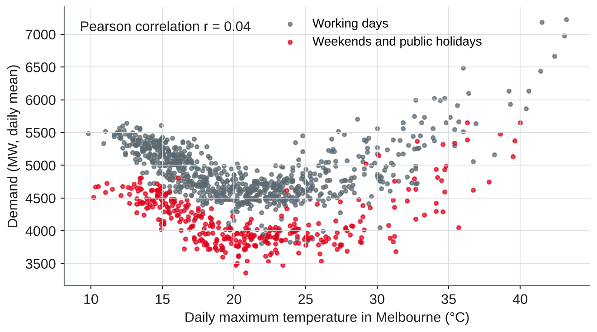
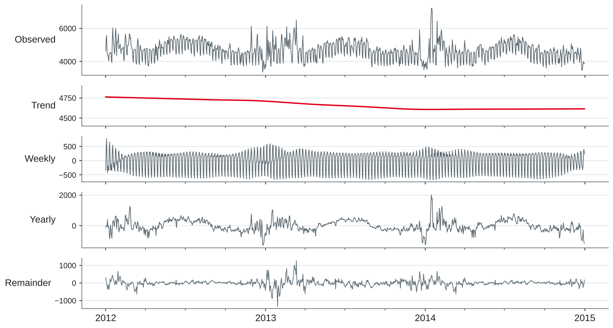

# Temporal Data and Time Series Fundamentals {.title}

::: notes
Time plan for today (3 h): recap and preparation round 5 min · temporal data 12 min · exercise 1 8 min · time in the warehouse 18 min · exercise 2 10 min · break 10 min · time series components 22 min · resampling and decomposition 13 min · lab 65 min · wrap-up 5 min · ~12 min buffer.
Input about 70 min, hands-on about 83 min (two exercises and the lab). Part C starts today and uses one dataset for sessions 11–14: half-hourly electricity demand in Victoria, Australia, 2012–2014, with temperature and a public holiday flag (vic_elec from the R package tsibbledata). It is downloaded in the notebook from a pinned GitHub copy, no login. Students need Python with pandas, statsmodels and matplotlib (session 1 setup), and DuckDB for exercise 2. All numbers on the slides were run with pandas 3.0.6, statsmodels 0.15.0, NumPy 2.5.4 and DuckDB 1.5.6.
:::

---

# Today's Agenda

1. Recap: your time series from practice
2. What makes temporal data special
3. Time in the warehouse: date dimension, validity periods, bitemporal data
4. Time series components: trend, seasonality, autocorrelation, stationarity
5. Resampling and decomposition
6. Lab: explore and decompose electricity demand

::: notes
Time and format guide (not shown to students):
0:00 Recap and preparation round (plenary) · 0:05 Temporal data (input) · 0:17 Exercise 1 (pairs, then plenary) · 0:25 Time in the warehouse (input + live query) · 0:43 Exercise 2 (pairs) · 0:53 Break · 1:03 Time series components (input, figures from the lab data) · 1:25 Resampling and decomposition (input + live demo of the lab starter) · 1:38 Lab (pairs, consultations) · 2:43 Wrap-up: two pairs show their decomposition · ~12 min buffer.
If the warehouse part raises many questions (bitemporal data is new for most), keep the discussion and shorten the live demo: the lab starter is on the slides.
:::

---

# Recap: Where Session 10 Left Us

- Parts A–B are complete: warehouse → query → chart, and features → model → experiment
- Session 9 ended with an outlook: **interrupted time series** use a forecast as the comparison
- Part C: **temporal data and forecasting** — four sessions, one dataset, portfolio notebook 3 in session 14

::: callout
**Your preparation:** one time series from your company. What is measured, how often, since when — and who uses it for which decision?
:::

::: notes
Preparation round: ask four or five students for their series and write them on the whiteboard in three columns: what is measured, granularity (every second, hour, day, month), history. Typical answers from DSKI companies: sales per store and day, call volume per 15 minutes, energy consumption of a plant, server load, sensor values from production, website visits. Keep the list: at the end of the components part, ask which of them have a daily, weekly or yearly pattern, and in session 14 which method would suit each.
:::

---

# Temporal Data {.section}

Why time is more than another column

---

# What Makes Temporal Data Special

- **Order matters:** shuffling rows destroys information — and random splits leak the future (session 8)
- **Dependence:** today's value is close to yesterday's; observations are not independent
- **Granularity:** the same process looks different per second, hour, day or month
- **Calendar:** weekdays, holidays, daylight saving, leap years, fiscal periods
- **Time zones:** a timestamp without a zone is ambiguous
- **Two clocks:** when something **happened** and when it was **recorded** may differ

::: source
Own compilation based on Hyndman and Athanasopoulos (2021, Chapters 1–2) and Snodgrass (1999).
:::

::: notes
Link each bullet to earlier sessions: order and leakage (sessions 7–8: features before the cut-off, later test period), granularity (session 3: grain of the fact table), calendar (session 3: date dimension; session 5: the incomplete year 1998 in TPC-H). The last bullet leads to bitemporal data later today. Ask: which of these problems did you meet in your company series? Typical answer: data recorded late (bookings entered on Monday for the weekend), corrected values, changes of the measurement interval.
:::

---

# Events, Series and States

| Kind | Example | Aggregate with | Typical question |
|---|---|---|---|
| **Events** (irregular timestamps) | Orders, clicks, machine alarms | Count, sum | How many per hour? |
| **Regular series, flow** | Energy in kWh per half hour, sales per day | Sum | Total per day or month? |
| **Regular series, rate or level** | Load in MW, temperature, stock level | Mean, max, last value | Average or peak per day? |
| **States with validity** | Customer address, price, contract | Value **as of** a date | What was true on 1 March? |

- Event data become a time series by **counting per interval** — empty intervals are **zero**, not missing

::: source
Own compilation based on Hyndman and Athanasopoulos (2021, Chapter 2) and Kimball and Ross (2013).
:::

::: notes
The aggregation column is the core of resampling later today: summing a level (temperature, stock) or averaging a flow (sales) gives wrong numbers. Stock levels are "semi-additive" in Kimball's terms: they add across products but not across time. Events: when counting orders per hour, hours without orders must appear as zero; a GROUP BY alone drops them — generate the full time grid (in DuckDB e.g. with range() or generate_series()) and left join. States with validity are the bridge to the warehouse part.
:::

---

# Time Zones and Daylight Saving in the Lab Data

- The lab data store **52,608 half-hours in UTC**; Melbourne is UTC+10, or UTC+11 in summer
- Converted to local time, most days have 48 half-hours — but six days do not:

| Local day | Half-hours | Sum of demand | Mean demand (MW) |
|---|---|---|---|
| 7 April 2013 (clocks back) | 50 | 195,253 | 3,905 |
| 6 October 2013 (clocks forward) | 46 | 171,519 | 3,729 |
| 8 April 2013 (normal Monday) | 48 | 220,856 | 4,601 |

- Lesson: store timestamps in **UTC**, convert for analysis, and choose an aggregate that is fair to 23- and 25-hour days

::: source
Own analysis with data from O'Hara-Wild et al. (2022).
:::

::: notes
Hyndman and Athanasopoulos (2021, Section 2.4) show the same effect in the seasonal plot of vic_elec: daylight saving days have extra or missing half-hours. In the local "wall clock", 2:00–2:30 occurs twice in April and does not exist in October; a naive local timestamp column therefore has six duplicates and six gaps — a classic source of failed joins. The sum of a 25-hour day is about 4 % too high compared with a 24-hour day at the same load; the mean is not affected. Demand values: the documentation of the dataset says "MWh"; values of 3,000–9,000 per half hour match the average load of a state in MW, so we treat Demand as average load in MW and use daily means. Ask the data owner when a unit looks implausible — a habit worth more than any model.
:::

---

# Exercise 1: Temporal Traps {.exercise}

What goes wrong — and how would you fix it?

1. A dashboard shows **orders per hour**. The chart has no bar at 03:00–05:00 on most nights.
2. A stock level is recorded every evening. The monthly report shows the **sum** of the 31 values for January.
3. A German company combines web logs (UTC) with shop orders (local time) **per hour**. The peak of orders seems to come one or two hours before the peak of visits.
4. Daily sales are compared year on year: **Monday, 3 March 2025** vs. **Sunday, 3 March 2024**.

::: notes
Pairs 4 min, plenary 4 min. Expected answers:
1 Hours without orders are missing rows, not zeros: the chart hides them and averages per hour are too high. Fix: complete time grid and left join, fill counts with 0.
2 A stock level is a state: summing over time is meaningless. Use the end-of-month value, the average or the minimum, depending on the question.
3 Time zone mismatch: Germany is UTC+1 in winter and UTC+2 in summer, so the shift changes with daylight saving. Fix: convert both to UTC (or both to local time with zone) before joining.
4 Weekday effect: Mondays and Sundays differ systematically. Compare the same weekday 52 weeks (364 days) earlier, or whole weeks — this is why lag 364, not 365, is useful for daily data (see the ACF later today).
:::

---

# Time in the Warehouse {.section}

Date dimension, validity periods and bitemporal data

---

# The Date Dimension

- One row **per day**, prepared once — no date logic in every query
- Typical attributes: day of week, week, month, quarter, year, **holiday flag**, working day, fiscal period, season
- Time of day goes into a **separate** small dimension (e.g. 48 half-hours), not into the date dimension
- Facts store the **date key** — and, if needed, a full timestamp in UTC

```sql
CREATE TABLE dim_date AS
SELECT d::DATE AS date_key, dayofweek(d) AS weekday, month(d) AS month,
       year(d) AS year, dayofweek(d) IN (0, 6) AS weekend
FROM range(DATE '2012-01-01', DATE '2015-01-01', INTERVAL 1 DAY) t(d);
```

::: source
Based on Kimball and Ross (2013); own example in DuckDB.
:::

::: notes
In session 3, dim_date was built from the order dates (2,406 distinct days) — fine for TPC-H, but a real date dimension is generated for every day, so that days without sales exist (see "Events" slide). The query above returns 1,096 rows; in DuckDB dayofweek() returns 0 for Sunday and 6 for Saturday. A holiday flag cannot be computed; it comes from a calendar table (in Python e.g. the holidays package) and differs by country and state — the lab data have their own flag for Victoria. Why a separate time-of-day dimension? A combined date-and-minute dimension would have 525,600 rows per year; two small dimensions are easier to maintain and to filter.
:::

---

# Validity Periods

Recap of session 3: a **type 2 slowly changing dimension** keeps history with validity dates.

| customer_id | city | valid_from | valid_to |
|---|---|---|---|
| C-102 | Mannheim | 2021-03-01 | 2025-07-01 |
| C-102 | Hamburg | 2025-07-01 | 9999-12-31 |

- Use **half-open** intervals `[valid_from, valid_to)`: no gaps, no overlaps, no "23:59:59"
- **Point-in-time** question: "Where did the customer live on date *d*?"

```sql
WHERE d >= valid_from AND d < valid_to
```

::: source
Own example based on Kimball and Ross (2013, Chapter 5) and Snodgrass (1999).
:::

::: notes
Session 3 used a closed interval (valid_to = 2025-06-30). Both conventions work; the half-open one avoids two problems: with timestamps there is no last instant of a day, and a consecutive row can start exactly where the previous one ends. BETWEEN is inclusive on both sides, so BETWEEN valid_from AND valid_to would return two rows on 1 July. The same logic gives point-in-time correct features (session 7): join each fact to the version of the dimension that was valid at the time of the fact. SQL:2011 calls this application time (Kulkarni & Michels, 2012), Snodgrass calls it valid time.
:::

---

# Bitemporal Data: Two Kinds of Time

::: cards
### Valid time
When a fact is **true in the real world**: the new price applies from 1 March.
### Transaction time
When the fact was **recorded** in the database: the price change was entered on 15 March.
:::

- **Bitemporal** tables store both: corrections never overwrite what we knew earlier
- They answer: "What was the price on 20 March — **as we knew it on 5 April**?"
- Needed for audit, regulatory reporting, re-running a model "as of" a past date
- SQL:2011: application-time period tables, **system-versioned** tables and both combined

::: source
Based on Snodgrass (1999) and Kulkarni and Michels (2012).
:::

::: notes
Snodgrass distinguishes valid time (when the fact holds in reality) from transaction time (when it is current in the database) and covers transaction-time and bitemporal tables in separate chapters. SQL:2011 standardised application-time periods (PERIOD FOR), system-versioned tables (WITH SYSTEM VERSIONING, queried with FOR SYSTEM_TIME AS OF) and their combination, the bitemporal table. Support for these features differs between database products; DuckDB has no built-in temporal tables, so we use explicit columns. For forecasting this matters a lot: if past demand values are later corrected, a backtest on corrected data uses information that the forecaster did not have at the time. Energy data are a typical case — meter readings are revised weeks later.
:::

---

# An As-Of Query in SQL

A price is changed from 1 April (recorded 15 March); on 10 April it is corrected to apply from 1 March.

```sql
SELECT price FROM price_history          -- 5 rows, see notes
WHERE tariff = 'Green'
  AND DATE '2025-03-20' >= valid_from    AND DATE '2025-03-20' < valid_to
  AND DATE '2025-04-05' >= recorded_from AND DATE '2025-04-05' < recorded_to;
```

| Known as of | Price valid on 20 March |
|---|---|
| 1 March 2025 | 0.30 |
| 5 April 2025 | 0.30 |
| 20 April 2025 | **0.32** (after the correction) |

- An invoice run on 5 April and a rerun on 20 April **legitimately differ** — both are reproducible

::: source
Own example in DuckDB, based on Snodgrass (1999).
:::

::: notes
The table price_history(tariff, price, valid_from, valid_to, recorded_from, recorded_to) has five rows: (0.30, 2025-01-01, 9999-12-31, recorded 2024-12-01 to 2025-03-15); (0.30, 2025-01-01, 2025-04-01, recorded 2025-03-15 to 2025-04-10); (0.32, 2025-04-01, 9999-12-31, recorded 2025-03-15 to 2025-04-10); (0.30, 2025-01-01, 2025-03-01, recorded from 2025-04-10); (0.32, 2025-03-01, 9999-12-31, recorded from 2025-04-10). Rows are never updated in place: a correction closes the recorded period of the old rows and inserts new ones. Results tested with DuckDB 1.5.6. Worksheet task 3 practises the same pattern on a different case.
:::

---

# Exercise 2: Which Time Do You Need? {.exercise}

For each question: valid time, transaction time, or both? Which columns would you need?

1. "How many customers lived in Bavaria on 31 December 2024?"
2. "Which address did we use for the dunning letter we sent on 3 February?"
3. "Re-run last year's demand forecast exactly as it was produced on 1 October."
4. "Since when has this machine been assigned to cost centre 4711?"
5. "The auditor asks which revenue figure we reported for Q1 — before the late credit notes were booked."

::: notes
Pairs 6 min, plenary 4 min. Expected answers:
1 Valid time: customer address with valid_from/valid_to (type 2 dimension); filter on 31 December 2024.
2 Transaction time (and valid time): what the database said on 3 February, even if a move was recorded later with an earlier valid date. Needs recorded_from/recorded_to.
3 Transaction time: the input data as recorded on 1 October; corrections after that date must be excluded — otherwise the backtest is too optimistic. Both times if the data also have validity periods.
4 Valid time: the assignment period in the real world.
5 Both: Q1 is a valid-time period; "as reported" is a transaction-time question. Bitemporal data or at least frozen report snapshots.
:::

---

# Time Series Components {.section}

What a time series is made of

---

# The Lab Series: Electricity Demand in Victoria

{width=88%}

- Half-hourly operational demand, 2012–2014, with Melbourne temperature and public holidays

::: source
Own illustration with data from O'Hara-Wild et al. (2022), source: Australian Energy Market Operator.
:::

::: notes
The dataset vic_elec comes with the R package tsibbledata (O'Hara-Wild et al., 2022), which accompanies the textbook by Hyndman and Athanasopoulos (2021); the book uses it, for example, in Sections 2.4 and 10.3, so students can compare their results. We load a CSV copy from the Rdatasets collection (Arel-Bundock, n.d.) on GitHub, pinned to one commit. Licence: the package is GPL-3; the original data come from the Australian Energy Market Operator (demand) and the Bureau of Meteorology (temperature, Melbourne site 086071). We use it for teaching and load it from the URL; students do not redistribute it. Ask the class what they see before explaining: weekly zig-zag, higher level in winter (June–August in Australia!), spikes in summer heat waves (16 January 2014: 7,223 MW at 43.2 °C), lowest day on Christmas Day 2012 (3,356 MW). Why this dataset: real, several seasonal patterns, and external drivers (temperature, holidays) for session 13.
:::

---

# Trend, Seasonality, Cycle and Remainder

::: cards
### Trend
A long-term increase or decrease — not necessarily linear.
### Seasonality
A pattern of **fixed, known period** tied to the calendar: time of day, day of week, month.
### Cycle
Rises and falls **without** a fixed period, e.g. business cycles.
### Remainder
What is left: noise, outliers, effects not modelled (holidays, weather).
:::

- **Additive:** y = T + S + R — seasonal swings of constant size
- **Multiplicative:** y = T × S × R — swings grow with the level; a log transform makes it additive

::: source
Based on Hyndman and Athanasopoulos (2021, Sections 2.3 and 3.2).
:::

::: notes
Hyndman and Athanasopoulos combine trend and cycle into one "trend-cycle" component in decompositions. Common confusion: seasonality vs. cycle. Seasonality has a known period (7 days, 12 months); a cycle has not (recessions, the pig cycle). In our data the trend is weak — demand falls slightly from 4,736 MW (2012 mean) to 4,610 MW (2014) — and seasonality is strong. Multiplicative patterns are typical for growing sales (December peak grows with the business). For electricity demand over three years, the level hardly changes, so additive is fine.
:::

---

# Several Seasonal Patterns at Once

{width=96%}

- **Daily** (48 half-hours), **weekly** (7 days) and **yearly** (365.25 days) — each with its own period

::: source
Own illustration with data from O'Hara-Wild et al. (2022), based on Hyndman and Athanasopoulos (2021, Section 2.4).
:::

::: notes
Numbers: night minimum around 04:00 (about 3,480 MW averaged over all days), evening peak around 18:00 (about 5,490 MW). Weekday means 4,789–4,923 MW, Saturday 4,252, Sunday 4,097. Public holidays average 4,061 MW — like a Sunday. Monthly means: July highest (5,042 MW, heating), February second (4,902 MW, cooling), December lowest (4,321 MW, summer holidays). The yearly shape differs between years: February 2013 and January 2014 were hot. Ask: which of the company series on the whiteboard have more than one seasonal period? Call centres and retail usually have daily and weekly patterns; sub-daily data almost always have several.
:::

---

# Demand and Temperature: Not a Straight Line

{width=64%}

- Heating on cold days, cooling on hot days: correlation **0.04** — yet temperature is the strongest driver
- Weekends and holidays form a **second band**: calendar and weather interact

::: source
Own illustration with data from O'Hara-Wild et al. (2022).
:::

::: notes
Mean demand by daily maximum temperature: up to 15 °C 5,033 MW, 20–25 °C 4,377 MW, above 35 °C 5,738 MW (30 days). The correlation coefficient measures only linear association, so it is close to zero for a U shape — a reminder from Anscombe's quartet (session 5): always plot. This slide previews session 13: temperature as an external regressor needs a non-linear form (e.g. two terms for heating and cooling, or a spline), and the calendar effect must be in the model too. Hyndman and Athanasopoulos (2021, Section 10.3) model the daily vic_elec demand with a linear and a squared temperature term, a working-day indicator and ARIMA errors.
:::

---

# Autocorrelation

{width=96%}

- **ACF:** correlation of the series with itself, shifted by *k* steps
- Seasonality shows as **peaks at multiples of the period**; trend as slowly decreasing values
- Shaded band ±1.96/√T: what white noise would give

::: source
Own illustration with data from O'Hara-Wild et al. (2022), based on Hyndman and Athanasopoulos (2021, Section 2.8).
:::

::: notes
Daily series: lag 1: 0.64, lag 7: 0.60, lag 14: 0.54, lag 28: 0.52; lag 364 (52 weeks, same weekday): 0.41, lag 365: 0.24 — the weekday matters more than the calendar date. Half-hourly: lag 1 (30 minutes) 0.985, lag 48 (one day) 0.79, lag 336 (one week) 0.78. The band for T = 1,096 days is ±0.059 — almost every lag is "significant", which is why one looks at the pattern, not single bars. Practical use: high autocorrelation at lag 7 means "same day last week" is a strong baseline (seasonal naive, session 12); lag features for ML forecasting (session 13) are chosen from the ACF.
:::

---

# Stationarity

- **Stationary:** statistical properties do not depend on time — no trend, no seasonality, constant variance
- Many forecasting models (ARIMA, session 12) need a stationary series → **differencing**
- Seasonal difference: y′ₜ = yₜ − yₜ₋₇ for daily data with a weekly pattern

| Daily demand | ADF p-value (H₀: unit root) | KPSS p-value (H₀: stationary) |
|---|---|---|
| Original series | 0.010 | 0.015 |
| After seasonal difference (lag 7) | < 0.001 | > 0.10 |

- The two tests disagree on the original series: no unit root, but a **seasonal level** that moves through the year

::: source
Based on Hyndman and Athanasopoulos (2021, Section 9.1); own analysis with statsmodels (Seabold & Perktold, 2010).
:::

::: notes
ADF (augmented Dickey–Fuller) and KPSS have opposite null hypotheses: ADF rejects "unit root" (p = 0.010), KPSS rejects "stationary" (p = 0.015). Reading: the series does not wander like a random walk, but its mean changes with the seasons, so it is not stationary in the strict sense. After the weekly difference, ADF p ≈ 0 and KPSS p > 0.10 (statsmodels reports 0.1 when the statistic is below the table range and warns). Hyndman and Athanasopoulos use the KPSS test to decide on differencing. Do not over-interpret tests: plot the series first. A series with cycles of no fixed length but no trend or seasonality can be stationary (their lynx example).
:::

---

# Resampling and Decomposition {.section}

Changing the granularity and taking a series apart

---

# Resampling: Choose the Aggregation

```python
daily = df.resample("D").agg({"Demand": "mean",        # rate (MW): mean
                              "Temperature": "max",    # level: max (or mean)
                              "Holiday": "max"})       # flag: any
weekly = daily["Demand"].resample("W-SUN").agg(["mean", "count"])
```

- **Down**sampling (half-hour → day → week): the aggregate must fit the measure (slide "Events, Series and States")
- **Up**sampling (month → day): needs a rule — repeat, interpolate or spread — and invents detail
- **Incomplete periods:** the first "week" holds **1** day (Sunday, 1 January 2012), the last **3** days — drop or mark them
- Resample in **local time** if the business day is local

::: source
Own example with pandas (The pandas development team, n.d.), based on Hyndman and Athanasopoulos (2021, Chapter 2).
:::

::: notes
With "W-SUN" each week ends on Sunday; 2012-01-01 was a Sunday, so the first bin contains one day; the last bin (ending 4 January 2015) contains 29–31 December 2014. 158 weekly bins in total, two of them incomplete. This is the same trap as the incomplete year 1998 in session 5 — and the count column is the cheapest check. Which temperature aggregate? For heating, the daily mean or minimum; for cooling, the maximum. Hyndman and Athanasopoulos use the daily maximum in their regression example; the lab keeps both. Resampling in UTC would cut the Melbourne day at 10 or 11 am local time.
:::

---

# Decomposition Methods

| Method | Idea | Strengths | Limits |
|---|---|---|---|
| Classical | Moving average for the trend, average per season | Simple, explainable | No trend at the ends, fixed seasonality, not robust |
| **STL** | Loess smoothing, iterated | Any period, seasonality may change, robust option | Additive only (log for multiplicative), one period |
| **MSTL** | STL repeated for several periods | Daily + weekly + yearly patterns | Needs several cycles of the longest period |

```python
from statsmodels.tsa.seasonal import STL, MSTL
res = MSTL(y, periods=(7, 365)).fit()   # y: daily demand, 1,096 days
res.trend, res.seasonal, res.resid
```

::: source
Based on Hyndman and Athanasopoulos (2021, Sections 3.4 and 3.6), Cleveland et al. (1990) and Bandara et al. (2025).
:::

::: notes
Classical decomposition with period 7 loses the first and last three days of the trend (six missing values). Hyndman and Athanasopoulos do not recommend it any more but it explains the idea. STL (seasonal and trend decomposition using loess) has two main parameters: the seasonal window (how fast the seasonal pattern may change) and the trend window (how smooth the trend is); robust=True down-weights outliers. MSTL (Bandara et al.) runs STL for each seasonal period in turn, from the shortest to the longest. With only three years, the yearly component is estimated from three values per calendar day — keep this in mind on the next slide.
:::

---

# MSTL on Daily Demand

{width=74%}

::: source
Own analysis with statsmodels (Seabold & Perktold, 2010) and data from O'Hara-Wild et al. (2022), based on Bandara et al. (2025).
:::

::: notes
Read from top to bottom. Trend: 4,762 MW at the start, 4,607 MW at the end — a small decline. Weekly component: roughly +120 to +250 MW on weekdays, −410 on Saturday, −568 on Sunday (averages). Yearly: winter hump and summer spikes. Remainder: standard deviation 180 MW. Ask: does the yearly component show "seasonality" only? (No — see next slide.)
:::

---

# Reading the Decomposition

- **Strength** of a component: F = max(0, 1 − Var(R) / Var(component + R))
- Weekly **0.77**, yearly **0.80**, trend **0.09**: strong seasonality, almost no trend
- The yearly component has absorbed the **heat wave** of January 2014 (+2,008 MW on 15 January) — weather, not season
- The largest remainders are **holidays** (28 January 2013, Australia Day holiday: −1,331 MW) and **hot days** (12 March 2013, 36 °C: +1,275 MW)

::: callout
A decomposition describes; it does not explain. What is left in the remainder points to the **external regressors** of session 13: temperature and holidays.
:::

::: source
Based on Hyndman and Athanasopoulos (2021, Section 4.3); own analysis with data from O'Hara-Wild et al. (2022).
:::

::: notes
The strength measures are from Hyndman and Athanasopoulos (Section 4.3, "STL features"); values near 1 mean the component dominates the remainder. With only three cycles, MSTL cannot separate a recurring summer pattern from three particular summers: the January 2014 heat wave (15 January: 7,183 MW, 42 °C) appears as "yearly seasonality". Lesson for forecasting: a yearly pattern estimated from three years will repeat last summer's heat wave next year — a reason to model temperature explicitly. The holiday on 28 January 2013 (Australia Day was a Saturday, so the Monday was the public holiday) is a weekday with Sunday-like demand: the weekly component does not know it is a holiday.
:::

---

# Lab Starter (1/2): Load, Localise, Resample

```python
import pandas as pd
URL = ("https://raw.githubusercontent.com/vincentarelbundock/Rdatasets/"
       "1dcc2bf5f955cc1224a3e1307256e1fe86b68dae/csv/tsibbledata/vic_elec.csv")
df = pd.read_csv(URL).drop(columns="rownames")       # 52,608 half-hours
df["Time"] = (pd.to_datetime(df["Time"], utc=True)   # stored in UTC
                .dt.tz_convert("Australia/Melbourne"))
df = df.set_index("Time")
n = df.groupby(df.index.date).size()
print(n[n != 48])                                    # daylight saving days
daily = df.resample("D").agg({"Demand": "mean",      # MW: mean, not sum
                              "Temperature": "max", "Holiday": "max"})
daily.index = daily.index.tz_localize(None)
y = daily["Demand"].asfreq("D")                      # 1,096 days
```

::: source
Own example with data from O'Hara-Wild et al. (2022), loaded from Arel-Bundock (n.d.).
:::

::: notes
The URL points to one fixed commit of the Rdatasets repository, so the data cannot change under our feet. If GitHub is blocked, statsmodels can fetch the current version: sm.datasets.get_rdataset("vic_elec", "tsibbledata").data (same data without the rownames column; tested: 52,608 rows). Output: six days with 46 or 50 half-hours; y has mean 4,665 MW, minimum 3,356 MW (25 December 2012), maximum 7,223 MW (16 January 2014). Dropping the time zone after resampling makes plotting and statsmodels easier; the day boundaries are already local.
:::

---

# Lab Starter (2/2): Autocorrelation, Tests, Decomposition

```python
from statsmodels.tsa.stattools import acf, adfuller, kpss
from statsmodels.tsa.seasonal import MSTL

print(acf(y, nlags=14).round(2))                 # peaks at lags 7 and 14
print(adfuller(y)[1], kpss(y, nlags="auto")[1])  # p-values
res = MSTL(y, periods=(7, 365)).fit()
res.plot()
R = res.resid
for c in res.seasonal.columns:                   # strength of seasonality
    S = res.seasonal[c]
    print(c, round(max(0, 1 - R.var() / (S + R).var()), 2))
```

::: source
Own example with statsmodels (Seabold & Perktold, 2010), based on Hyndman and Athanasopoulos (2021, Sections 2.8, 4.3 and 9.1).
:::

::: notes
Expected output: ACF lag 7 0.60, lag 14 0.54; ADF p = 0.010, KPSS p = 0.015 (on the lag-7 difference, kpss reports p = 0.1 with an InterpolationWarning: the true p-value is larger); strengths seasonal_7 0.77, seasonal_365 0.80. For the plot: from statsmodels.graphics.tsaplots import plot_acf gives the bar chart with the white-noise band.
:::

---

# Lab Tasks {.exercise}

Work in pairs on the electricity demand data (O'Hara-Wild et al., 2022).

1. **Check the data:** time range, gaps, duplicates, daylight saving days; compare the naive local timestamps with the converted ones
2. **Resample:** half-hourly → hourly, daily, weekly, monthly — choose and justify the aggregate for each column; flag incomplete periods
3. **Patterns:** plot the daily, weekly and yearly profile; how do holidays compare with Sundays?
4. **Autocorrelation and stationarity:** ACF of the daily series; ADF and KPSS before and after a lag-7 difference
5. **Decompose:** STL with period 7, then MSTL with (7, 365); compare the strength values and inspect the ten largest remainders
6. **Interpret:** three sentences for an energy planner — what drives demand, and what a forecast must include

::: notes
Expected results (tested): 1 52,608 rows, 2012-01-01 00:00 to 2014-12-31 23:30 local, no missing values, no duplicate UTC timestamps; naive local time has 6 duplicates and 6 gaps. 2 Hourly: demand mean, temperature mean; daily: demand mean (or energy = sum × 0.5 h, then MWh and DST days distorted), temperature max and min; weekly 158 bins, the first (1 day) and last (3 days) incomplete; monthly 36 bins, all complete. 3 Evening peak 18:00, night minimum 04:00; Sunday 4,097 MW, holidays 4,061 MW. 4 See slide "Stationarity". 5 STL period 7, robust: strength trend 0.53, seasonal 0.55 — the yearly pattern is then inside the "trend"; MSTL: weekly 0.77, yearly 0.80, trend 0.09. Ten largest remainders: holidays and hot days in early 2013. 6 Example: "Demand follows the working week (Sundays about 17 % below Thursdays) and the weather — heating in winter, air conditioning on hot days. A forecast needs the calendar (weekday, holidays) and a temperature forecast; a yearly pattern from three years alone is unreliable." Pairs that finish early: worksheet 11, task 6.
:::

---

# Key Takeaways

- Temporal data have **order, dependence, granularity and calendar effects** — store in UTC, analyse in local time
- Aggregate by the nature of the measure: **sum** flows, **average** rates and levels, **count** events — and check for incomplete periods
- The warehouse handles time with a **date dimension**, **validity periods** and, where corrections matter, **bitemporal** tables
- Components: **trend, seasonality, cycle, remainder**; the **ACF** shows seasonality as peaks at multiples of the period
- **Stationarity** is a requirement of many models; seasonal differencing often achieves it
- **STL/MSTL** describe a series — the remainder shows which external drivers are missing

---

# Next Session: Time Series Forecasting I

- Baselines: naive and seasonal naive
- Exponential smoothing and the ARIMA family
- Evaluating forecasts: time series cross-validation, MAE, MAPE
- **Lab:** forecast the electricity demand from today

::: callout
**Preparation:** finish the lab notebook from today and keep it — sessions 12–14 build on it. Try worksheet 11.
:::

---

# References {.references}

- Arel-Bundock, V. (n.d.). *Rdatasets: A collection of datasets originally distributed in R packages*. Retrieved October 21, 2026, from https://vincentarelbundock.github.io/Rdatasets/
- Bandara, K., Hyndman, R. J., & Bergmeir, C. (2025). MSTL: A seasonal-trend decomposition algorithm for time series with multiple seasonal patterns. *International Journal of Operational Research, 52*(1), 79–98. https://doi.org/10.1504/IJOR.2025.143957
- Cleveland, R. B., Cleveland, W. S., McRae, J. E., & Terpenning, I. (1990). STL: A seasonal-trend decomposition procedure based on loess. *Journal of Official Statistics, 6*, 3–73.
- Hyndman, R. J., & Athanasopoulos, G. (2021). *Forecasting: Principles and practice* (3rd ed.). OTexts. https://otexts.com/fpp3/
- Kimball, R., & Ross, M. (2013). *The data warehouse toolkit: The definitive guide to dimensional modeling* (3rd ed.). Wiley.
- Kulkarni, K., & Michels, J.-E. (2012). Temporal features in SQL:2011. *ACM SIGMOD Record, 41*(3), 34–43. https://doi.org/10.1145/2380776.2380786
- O'Hara-Wild, M., Hyndman, R., Wang, E., & Godahewa, R. (2022). *tsibbledata: Diverse datasets for 'tsibble'* (R package version 0.4.1) [Computer software]. https://CRAN.R-project.org/package=tsibbledata
- Seabold, S., & Perktold, J. (2010). Statsmodels: Econometric and statistical modeling with Python. In S. van der Walt & J. Millman (Eds.), *Proceedings of the 9th Python in Science Conference* (pp. 92–96). https://doi.org/10.25080/Majora-92bf1922-011
- Snodgrass, R. T. (1999). *Developing time-oriented database applications in SQL*. Morgan Kaufmann.
- The pandas development team. (n.d.). *pandas.DataFrame.resample* (pandas documentation). Retrieved October 21, 2026, from https://pandas.pydata.org/docs/reference/api/pandas.DataFrame.resample.html
