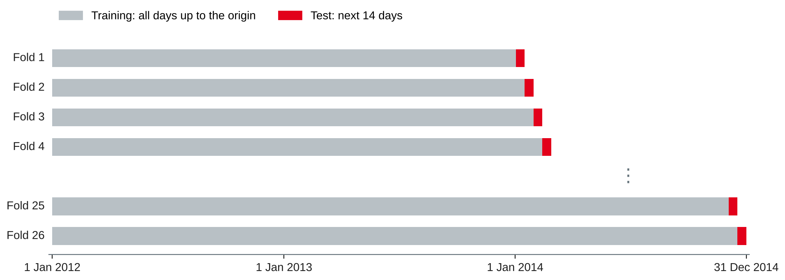
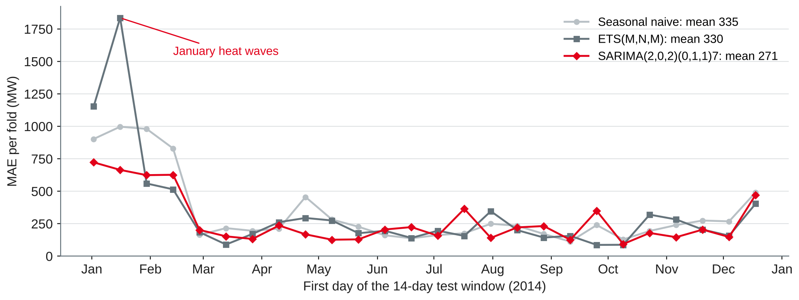

# Time Series Forecasting I {.title}

::: notes
Time plan for today (3 h): recap 5 min · the forecasting task and baselines 15 min · exercise 1 10 min · forecast accuracy and time series cross-validation 15 min · exercise 2 10 min · break 10 min · exponential smoothing 13 min · ARIMA 15 min · comparison of all methods 7 min · lab 60 min · wrap-up 5 min · ~15 min buffer.
Input about 70 min, hands-on about 80 min (two exercises and the lab). Same dataset as session 11: daily mean electricity demand in Victoria, 1,096 days (2012–2014), loaded with the session 11 lab starter. Students need pandas, statsmodels and scikit-learn (session 1 setup). All numbers on the slides were run with pandas 3.0.6, statsmodels 0.15.0, scikit-learn 1.9.1 and NumPy 2.5.4. The full cross-validation refits ETS and SARIMA 26 times each: about one minute on a laptop — start it before the break in the live demo.
:::

---

# Today's Agenda

1. Recap: what drives electricity demand
2. The forecasting task and simple baselines
3. Measuring forecast accuracy: MAE, RMSE, MAPE, MASE and time series cross-validation
4. Exponential smoothing
5. The ARIMA family
6. Lab: forecast electricity demand 14 days ahead

::: notes
Time and format guide (not shown to students):
0:00 Recap (plenary) · 0:05 Forecasting task and baselines (input) · 0:20 Exercise 1 (pairs, then plenary) · 0:30 Accuracy and cross-validation (input + live code) · 0:45 Exercise 2 (pairs) · 0:55 Break (start the cross-validation run) · 1:05 Exponential smoothing (input) · 1:18 ARIMA (input) · 1:33 Comparison of all methods (plenary discussion) · 1:40 Lab (pairs, consultations) · 2:40 Wrap-up: two pairs show their comparison table · ~15 min buffer.
If the discussion of metrics runs long, keep it: the metric decides which model "wins", and students will meet the question again in notebook 3. The ARIMA order selection can then be shortened; the lab starter contains the code.
:::

---

# Recap: Where Session 11 Left Us

- Daily demand: **1,096 days**, mean **4,665 MW**, almost no trend
- Strong **weekly** (strength 0.77) and **yearly** (0.80) patterns; ACF **0.60** at lag 7
- After a **lag-7 difference** the series is stationary (ADF and KPSS agree)
- The remainder points to **holidays** and **heat waves**

::: callout
**Today's question:** how well can we forecast the next **14 days** from the history alone — and how do we measure "well" honestly?
:::

::: notes
Ask two pairs for one sentence from their planner memo (session 11 lab task 6). Then make the link: everything in session 11 was description; today we predict. The history-only methods of today ignore temperature and holidays on purpose — session 13 adds them. Keep the January 2014 heat wave in mind: it will be the largest error source today.
:::

---

# The Forecasting Task {.section}

What, how far ahead, and compared with what

---

# Framing a Forecast

| Question | Lab answer |
|---|---|
| What is forecast? | Daily mean demand (MW) for Victoria |
| Forecast **origin** | The last day with known data |
| **Horizon** *h* | 1 to 14 days ahead |
| Who uses it, for what? | Energy planner: maintenance windows, contracts for the next two weeks |
| What is known at the origin? | Demand history only — no future temperature today |
| What counts as good? | Lower error than a simple baseline, over **many** origins |

- A **point forecast** today; ranges and prediction intervals follow in session 13

::: source
Own compilation based on Hyndman and Athanasopoulos (2021, Chapter 5).
:::

::: notes
Hyndman and Athanasopoulos describe the forecasting workflow as preparing the data, visualising, specifying a model, estimating, evaluating and forecasting. The framing questions repeat session 7 (decision, unit, timing): a forecast is useful only for a decision. The horizon follows from the decision: day-ahead trading needs h = 1, maintenance planning one or two weeks, network investment years. Information set: anything used as input must be known at the origin — the same leakage logic as in session 7. Temperature is known only as a forecast; using the observed temperature of the target day would be leakage.
:::

---

# Four Simple Forecasting Methods

| Method | Forecast for *h* days ahead | Idea |
|---|---|---|
| **Mean** | Average of all past values | Future looks like the past on average |
| **Naive** | Last observed value | Tomorrow like today |
| **Seasonal naive** | Value of the same season one period earlier (here: same weekday last week) | Next Monday like last Monday |
| **Drift** | Last value plus the average change per day so far | The trend continues |

- Cheap, transparent, often hard to beat — every other method must beat them
- Variant: same weekday **52 weeks** earlier (lag 364) uses the yearly pattern

::: source
Based on Hyndman and Athanasopoulos (2021, Section 5.2).
:::

::: notes
Formulas (T = origin, m = 7): mean ȳ; naive y_T; seasonal naive y_{T+h−m(k+1)} with k the number of complete periods in h−1, i.e. the last observed value of the same weekday; drift y_T + h(y_T − y_1)/(T − 1). Link to session 7: a baseline sets the bar before modelling; "the rule is enough" was a valid result there, and may be one here. The lag-364 variant follows from the session 11 ACF: 0.41 at lag 364 vs. 0.24 at lag 365 — the weekday matters more than the date.
:::

---

# Four Baselines from One Origin

{width=84%}

- Only **seasonal naive** follows the week — but it also repeats last week's level

::: source
Own illustration with data from O'Hara-Wild et al. (2022), based on Hyndman and Athanasopoulos (2021, Section 5.2).
:::

::: notes
Ask what students see before explaining. The second week (from 21 August) was milder and demand dropped by 300–400 MW; no history-only method could know that — a temperature forecast could (session 13). Mean beats naive here because the naive forecast copies a Wednesday, a high day, into the weekend. Drift is almost identical to naive because there is almost no trend (slope about +0.7 MW per day, from 1 January 2012 to the origin). One origin is one example: the next section shows why we need many.
:::

---

# Exercise 1: Baselines by Hand {.exercise}

Daily demand (MW) in Victoria, Monday 11 to Sunday 17 August 2014:

| Mon | Tue | Wed | Thu | Fri | Sat | Sun |
|---|---|---|---|---|---|---|
| 5,439 | 5,468 | 5,282 | 5,205 | 5,103 | 4,607 | 4,387 |

The next three days were: Mon **5,214**, Tue **5,172**, Wed **5,152**.

1. Forecast Mon–Wed with the **naive**, the **seasonal naive** and the **mean of the last seven days** method.
2. Compute the **MAE** and the **MAPE** of each method over the three days.
3. Which method wins? Would you trust this result for choosing a method?

::: notes
Pairs 6 min, plenary 4 min. Expected answers (computed from the rounded values):
1 Naive: 4,387 for all three days. Seasonal naive: 5,439, 5,468, 5,282. Mean of the last seven days: 35,491 / 7 = 5,070.1.
2 Naive: errors 827, 785, 765 → MAE 792.3, MAPE 15.3 %. Seasonal naive: −225, −296, −130 → MAE 217.0, MAPE 4.2 %. Mean of seven days: 143.9, 101.9, 81.9 → MAE 109.2, MAPE 2.1 %.
3 Here the seven-day mean wins — because Mon–Wed are weekdays and the week ahead was a little lower than the previous one. Three days from one origin say almost nothing: the weekend would favour seasonal naive (the mean would be 850 and 885 MW too high on Saturday 23 and Sunday 24 August). Lesson: evaluate over all weekdays and many origins. Point out the sign convention: error = actual − forecast, so negative means over-forecast.
:::

---

# Measuring Forecast Accuracy {.section}

Error measures and time series cross-validation

---

# Forecast Errors and Four Measures

Forecast error: *e* = *y* − *ŷ* (actual minus forecast) on data **not used** for fitting

| Measure | Formula | Strength | Weakness |
|---|---|---|---|
| **MAE** | mean(abs(*e*)) | Easy to explain, in MW | Scale-dependent |
| **RMSE** | √mean(*e*²) | Punishes large errors | Scale-dependent, dominated by outliers |
| **MAPE** | mean(abs(*e* / *y*)) × 100 % | Unit-free | Undefined at *y* = 0, extreme near 0, heavier penalty on negative errors |
| **MASE** | MAE / in-sample MAE of seasonal naive | Unit-free, works with zeros | Harder to explain |

- Minimising MAE leads to forecasts of the **median**, minimising RMSE to the **mean**
- MASE < 1: better than the seasonal naive method on the training data

::: source
Based on Hyndman and Athanasopoulos (2021, Section 5.8) and Hyndman and Koehler (2006).
:::

::: notes
Residuals (fitted values on the training data) are not forecast errors: a model can fit the past almost perfectly and forecast badly. MAPE also assumes a meaningful zero (not for temperatures in °C). The asymmetry: for the same actual value, over- and under-forecasting by the same amount give the same percentage; but with a fixed forecast, an actual of 50 vs. forecast 100 counts 100 %, an actual of 150 vs. 100 only 33 % — so MAPE favours methods that forecast low. Hyndman and Koehler (2006) proposed MASE as a scale-free measure that is defined for series with zeros; for seasonal data the scale is the in-sample MAE of the seasonal naive method. For our series, all four measures give the same ranking — that is not guaranteed.
:::

---

# Why One Test Period Is Not Enough

- One origin: the result depends on **which two weeks** happened to be in the test set
- **Rolling origin:** forecast from many origins, each time using only the data up to that origin
- **Expanding window:** the training set grows; **sliding window:** fixed length
- Average the errors over all origins — and per horizon *h*

::: callout
Never shuffle time series rows into random folds: the model would learn from the future it is supposed to forecast.
:::

::: source
Based on Tashman (2000) and Hyndman and Athanasopoulos (2021, Section 5.10).
:::

::: notes
Tashman (2000) reviews out-of-sample evaluation and distinguishes fixed-origin from rolling-origin evaluation; rolling origins give more forecast errors per horizon and do not depend on one particular period. Hyndman and Athanasopoulos call the procedure "evaluation on a rolling forecasting origin" or time series cross-validation. Link to session 8: the snapshot folds for churn were the same idea for customer data. With a sliding window (max_train_size in scikit-learn), old data are dropped — useful when the process has changed.
:::

---

# Time Series Cross-Validation in the Lab

{width=90%}

```python
from sklearn.model_selection import TimeSeriesSplit
tscv = TimeSeriesSplit(n_splits=26, test_size=14)   # 26 × 14 = 364 test days
```

::: source
Own illustration based on Hyndman and Athanasopoulos (2021, Section 5.10) and scikit-learn developers (n.d.).
:::

::: notes
TimeSeriesSplit returns index arrays: training = all rows before the test window, test = the next test_size rows; successive training sets are supersets of earlier ones. Fold 1 trains on 732 days (to 1 January 2014) and tests 2–15 January 2014; fold 26 tests 18–31 December 2014. The non-overlapping 14-day windows cover the whole of 2014 once, so every season and weekday counts equally. The gap parameter leaves out days between training and test — needed when a forecast is delivered some days before the period starts (worksheet task 5). All model choices (which ETS, which ARIMA order) are made on 2012–2013 only.
:::

---

# Exercise 2: Plan the Evaluation {.exercise}

For each case: which error measure, which horizon, and what is wrong or missing?

1. A bakery chain forecasts tomorrow's bread sales for **40 stores** of very different size and wants **one** accuracy figure for all stores.
2. A wholesaler forecasts daily sales of **spare parts**; most days have **zero** sales. The analyst reports the MAPE.
3. A call centre fixes staff rosters every **Thursday** for the week starting the **Monday after next**.
4. A colleague reports "MAPE **2.1 %**" for a model fitted to **all** data, measured on the same data.

::: notes
Pairs 6 min, plenary 4 min. Expected answers:
1 h = 1. MAE per store is fine for each store, but averaging MAEs across stores is dominated by the large stores; use a scale-free measure — MASE (or MAPE, if no zero sales) — to compare and combine. Optionally weight by business importance.
2 MAPE is undefined (division by zero) or extreme; use MAE or MASE. Intermittent demand needs special methods (session 14).
3 Horizon 11–17 days ahead: from Thursday, Friday to Sunday and the whole next week (10 days) pass before the roster week starts. Evaluate exactly these horizons; in cross-validation use a gap between training and test (TimeSeriesSplit gap). A good 1-day-ahead error says nothing about this use.
4 In-sample fit (residuals), not forecast accuracy: any flexible model fits the past well. Use a hold-out period or time series cross-validation and compare with a baseline.
:::

---

# Exponential Smoothing {.section}

Weighted averages that forget the past gradually

---

# The Idea: Recent Values Count More

- **Simple exponential smoothing (SES):** forecast = weighted average of all past values
- Weights fall geometrically: α, α(1−α), α(1−α)², …

| α | Weight of today | yesterday | 2 days ago | 3 days ago |
|---|---|---|---|---|
| 0.3 | 0.30 | 0.21 | 0.15 | 0.10 |
| 0.8 | 0.80 | 0.16 | 0.03 | 0.01 |

- Component form: level ℓₜ = α yₜ + (1 − α) ℓₜ₋₁; forecast for all *h*: ℓ_T
- **Holt** adds a **trend** (β), **Holt-Winters** a **seasonal** component (γ); a **damped** trend flattens out

::: source
Based on Hyndman and Athanasopoulos (2021, Sections 8.1–8.3).
:::

::: notes
α close to 1: the level follows the last value (naive); α close to 0: the level hardly moves (close to the mean). So SES lies between the two baselines — mean and naive are special cases. The parameters (α, β, γ, damping φ) and the initial states are estimated by minimising the squared one-step errors or maximising the likelihood. Holt-Winters additive: seasonal swings of constant size; multiplicative: swings proportional to the level (session 11). Hyndman and Athanasopoulos show a Holt-Winters example with daily data and a weekly period.
:::

---

# ETS: A Family of Models

| Component | Options |
|---|---|
| **E**rror | Additive (A) or multiplicative (M) |
| **T**rend | None (N), additive (A), additive damped (Ad) |
| **S**eason | None (N), additive (A), multiplicative (M) |

| ETS(·,·,·) | Known as |
|---|---|
| (A,N,N) | Simple exponential smoothing |
| (A,A,N) | Holt's linear method |
| (A,A,A), (M,A,M) | Holt-Winters additive, multiplicative |

- State space form: likelihood, **AIC** for model choice, prediction intervals

::: source
Based on Hyndman and Athanasopoulos (2021, Sections 8.4–8.6).
:::

::: notes
The error type does not change the point forecasts of a given method, but it changes the likelihood and the prediction intervals. Model choice within the ETS family by AIC (or AICc) is possible because all models are fitted to the same data. statsmodels: ETSModel(y, error=..., trend=..., damped_trend=..., seasonal=..., seasonal_periods=7). ExponentialSmoothing in statsmodels.tsa.holtwinters implements the same methods without the error specification. Multiplicative trends exist but are not recommended by the book.
:::

---

# ETS on Daily Demand

```python
from statsmodels.tsa.exponential_smoothing.ets import ETSModel
fit = ETSModel(train, error="mul", trend=None, seasonal="mul",
               seasonal_periods=7).fit(disp=False)
fc = fit.forecast(14)
```

| On 2012–2013 (731 days) | (A,N,A) | (A,A,A) | (A,Ad,A) | **(M,N,M)** |
|---|---|---|---|---|
| AIC | 10,299 | 10,455 | 10,451 | **10,254** |

- Selected: **ETS(M,N,M)** — no trend (as in session 11), weekly multiplicative season
- Estimated α = **1.00**, γ = **0.00**: level = yesterday, weekly pattern **fixed**
- Residuals still autocorrelated: Ljung–Box (lag 14) p **< 0.001**

::: source
Own analysis with statsmodels (Seabold & Perktold, 2010) and data from O'Hara-Wild et al. (2022), based on Hyndman and Athanasopoulos (2021, Section 8.6).
:::

::: notes
α at its upper bound means: the best level estimate is yesterday's value after removing the weekday effect — effectively a "seasonally adjusted naive" forecast. That explains the weakness seen later: after a heat-wave day, the model carries the high level forward for two weeks. γ = 0 means the weekly pattern does not change over the two years. Ljung–Box test (Ljung & Box, 1978): H₀ = no autocorrelation up to lag 14; Q = 94.8, p < 0.001 — there is information left in the residuals that ETS cannot use (short-term persistence of weather). AIC values of the trend models: the trend adds parameters but no fit. In the lab: check whether the selected model changes when the training data grow.
:::

---

# The ARIMA Family {.section}

Modelling the autocorrelation directly

---

# ARIMA: Three Building Blocks

::: cards
### AR(*p*): autoregression
Today depends on the last *p* values: yₜ = c + φ₁yₜ₋₁ + … + φₚyₜ₋ₚ + εₜ
### I(*d*): integrated
Difference *d* times until the series is stationary (session 11)
### MA(*q*): moving average
Today depends on the last *q* forecast errors: yₜ = c + εₜ + θ₁εₜ₋₁ + … (up to lag *q*)
:::

- **Seasonal ARIMA**(*p*,*d*,*q*)(*P*,*D*,*Q*)ₘ adds the same blocks at lags *m*, 2*m*, …
- Our case: *m* = 7, seasonal difference *D* = 1: yₜ − yₜ₋₇

::: source
Based on Hyndman and Athanasopoulos (2021, Sections 9.1–9.5 and 9.9) and Box et al. (2015).
:::

::: notes
The MA terms here are not the moving averages of decomposition: they are past forecast errors. Box and Jenkins introduced the iterative model-building approach (identification, estimation, diagnostic checking) — today's classic reference is the fifth edition (Box et al., 2015). Examples: ARIMA(0,1,0) is the random walk, whose forecast is the naive method; ARIMA(0,0,0)(0,1,0)₇ is the seasonal naive method. So the baselines are special cases of ARIMA too. Hyndman and Athanasopoulos (Section 9.10) note that linear ETS models are special cases of ARIMA models, while non-linear (multiplicative) ETS models have no ARIMA counterpart.
:::

---

# Choosing the Orders

1. **Differencing** from tests, not from the AIC: KPSS → seasonal difference *D* = 1, no further difference *d* = 0
2. **p, q, P, Q** by AIC on the training data: grid *p*, *q* ≤ 2, *P*, *Q* ≤ 1
3. **Check the residuals:** no autocorrelation left (Ljung–Box), no pattern in the plot

| On 2012–2013 | Result |
|---|---|
| Best model | **SARIMA(2,0,2)(0,1,1)₇**, AIC 10,099 |
| AR coefficients | φ₁ = 1.33, φ₂ = −0.33 |
| Seasonal MA | Θ₁ = −1.00: a fixed weekly pattern |
| Ljung–Box, lag 14 / 28 | p = **0.42** / **0.23**: residuals look like white noise |

::: source
Based on Hyndman and Athanasopoulos (2021, Sections 9.6 and 9.9) and Ljung and Box (1978); own analysis with statsmodels (Seabold & Perktold, 2010).
:::

::: notes
Hyndman and Athanasopoulos: the AIC cannot choose d, because differencing changes the data on which the likelihood is computed; choose d (and D) first, then p and q by AICc. Our trap, tested: with d = 1, SARIMA(1,1,2)(0,1,1)₇ has a lower AIC (10,076) — but the values are not comparable, and in cross-validation it is worse (MAE 305 vs. 271 MW). φ₁ + φ₂ = 1.00: the AR part is close to a unit root, i.e. the level wanders like a random walk in the short term but reacts smoothly. Θ₁ = −1 is at the boundary of invertibility — the seasonal MA then cancels the seasonal difference, which amounts to a deterministic weekly pattern. statsmodels warns about non-stationary or non-invertible starting values; this is common and not an error. There is no auto_arima in statsmodels; the grid takes about 30 s. The package pmdarima offers one, but we keep the search visible.
:::

---

# What About the Yearly Pattern?

- ETS and SARIMA here use only the **weekly** season (*m* = 7)
- A season of *m* = 365 is impractical for both: too many states, only three cycles of data
- With a 14-day horizon, the **level** adapts — but heat-wave days remain unforeseeable
- Options: **seasonal naive with lag 364**, forecasting a **seasonally adjusted** series (STL/MSTL), or **Fourier terms** and **temperature** as regressors (session 13)

::: source
Based on Hyndman and Athanasopoulos (2021, Sections 5.7 and 9.10).
:::

::: notes
Forecasting with decomposition (Section 5.7): decompose, forecast the seasonally adjusted series with a non-seasonal method, add the seasonal component (seasonal naive) back. statsmodels has STLForecast for one seasonal period; with MSTL the yearly component can be removed first. With three years only, the yearly component carries the weather of 2012–2014 (session 11), so do not expect much. The lag-364 seasonal naive surprises many students on the next slide.
:::

---

# Comparison: 26 Origins in 2014

| Method | MAE (MW) | RMSE (MW) | MAPE | MASE |
|---|---|---|---|---|
| Mean | 417 | 557 | 9.3 % | 1.35 |
| Naive | 457 | 715 | 10.4 % | 1.48 |
| Drift | 459 | 720 | 10.4 % | 1.49 |
| Seasonal naive (lag 7) | 335 | 559 | 7.1 % | 1.08 |
| Seasonal naive (lag 364) | 316 | 487 | 6.8 % | 1.02 |
| ETS(M,N,M) | 330 | 582 | 7.1 % | 1.08 |
| **SARIMA(2,0,2)(0,1,1)₇** | **271** | **418** | **5.8 %** | **0.88** |

::: source
Own analysis with statsmodels (Seabold & Perktold, 2010) and scikit-learn (Pedregosa et al., 2011); data from O'Hara-Wild et al. (2022).
:::

::: notes
Horizons 1–14, 26 folds × 14 days = 364 forecasts per method. MAPE and MASE are averaged over folds. Two further ETS variants: ETS(A,N,A) MAE 337, ETS(A,Ad,A) 341. Discussion questions: Why does ETS hardly beat seasonal naive? (α = 1: it is almost a seasonal naive forecast on yesterday's level, and it carries extreme days forward.) Why does lag 364 beat lag 7? (Last year's same weekday knows the season, last week does not know that next week may be warmer.) SARIMA is best on every measure — but by how much, and is it stable? Next slide.
:::

---

# Errors Vary More Between Origins Than Between Methods

{width=90%}

- The four summer folds (January–February) account for about **40 %** of the total error of seasonal naive
- SARIMA beats seasonal naive in **18 of 26** folds — not in all

::: source
Own illustration with data from O'Hara-Wild et al. (2022), based on Hyndman and Athanasopoulos (2021, Section 5.10).
:::

::: notes
The share: for seasonal naive, folds 1–4 have MAEs 902, 997, 980, 830 (sum 3,709) of a total of 8,698 over 26 folds, i.e. 43 %; for SARIMA 2,637 of 7,044 = 37 %. ETS fold 2 (origin 15 January 2014, in the middle of the heat wave: 41–43 °C for four days): with α = 1, the heat-wave level is carried forward for 14 days — MAE 1,835 MW. The Christmas fold (18–31 December) is bad for all methods: holidays are not in the model. The conclusion for the planner: in summer, a history-only forecast is not good enough — temperature forecasts and the holiday calendar are needed (session 13). Median fold MAE: SARIMA 203, ETS 198, seasonal naive 230 — by the median, ETS and SARIMA are close.
:::

---

# Lab: Forecast Electricity Demand {.section}

Baselines, ETS and SARIMA with time series cross-validation

---

# Lab Starter (1/2): Cross-Validation Loop

```python
import numpy as np, pandas as pd
from sklearn.model_selection import TimeSeriesSplit
# y = daily["Demand"].asfreq("D")  — from the session 11 lab starter (1,096 days)

def snaive(train, h, m=7):
    return np.array([train.iloc[-m + i % m] for i in range(h)])

def evaluate(method, y, h=14, n_splits=26):
    rows = []
    for k, (tr, te) in enumerate(TimeSeriesSplit(n_splits=n_splits, test_size=h).split(y)):
        train, test = y.iloc[tr], y.iloc[te]
        e = test.to_numpy() - method(train, h)
        scale = np.mean(np.abs(train.diff(7).dropna()))        # for MASE
        rows.append({"fold": k, "MAE": np.mean(np.abs(e)),
                     "RMSE": np.sqrt(np.mean(e**2)),
                     "MAPE": 100 * np.mean(np.abs(e / test.to_numpy())),
                     "MASE": np.mean(np.abs(e)) / scale})
    return pd.DataFrame(rows)

print(evaluate(snaive, y).mean().round(2))   # MAE 334.53, MASE 1.08
```

::: source
Own example based on Hyndman and Athanasopoulos (2021, Sections 5.8 and 5.10) and scikit-learn developers (n.d.).
:::

::: notes
The RMSE on the comparison slide pools all 364 errors; the mean of the fold RMSEs is smaller (for seasonal naive 429 instead of 559) — say which one you report. MAE is the same either way because all folds have 14 days. The scale for MASE is recomputed per fold from that fold's training data; it lies between 292 and 331 MW. To keep the errors per horizon, also store e per fold (np.array of shape 26 × 14) and average over axis 0.
:::

---

# Lab Starter (2/2): ETS and SARIMA

```python
import warnings
from statsmodels.tsa.exponential_smoothing.ets import ETSModel
from statsmodels.tsa.statespace.sarimax import SARIMAX
warnings.filterwarnings("ignore")             # convergence notes during refits

def ets(train, h):
    return ETSModel(train, error="mul", seasonal="mul", seasonal_periods=7) \
        .fit(disp=False).forecast(h).to_numpy()

def sarima(train, h):
    return SARIMAX(train, order=(2, 0, 2), seasonal_order=(0, 1, 1, 7)) \
        .fit(disp=False).forecast(h).to_numpy()

results = {name: evaluate(f, y) for name, f in
           {"snaive": snaive, "ets": ets, "sarima": sarima}.items()}
print(pd.DataFrame({n: r.mean() for n, r in results.items()}).round(2))
```

::: source
Own example with statsmodels (Seabold & Perktold, 2010).
:::

::: notes
Expected output (MAE / MASE): snaive 334.53 / 1.08, ets 330.38 / 1.08, sarima 270.94 / 0.88. Runtime: SARIMA about 1 s per fit, ETS less. Silencing warnings is acceptable in a cross-validation loop, but check one fit with warnings on, and always check the fold errors for outliers: an automatic refit can converge to a nonsense solution (one fold with an absurd error), especially with orders at the boundary. A fold MAE of more than about 2,000 MW in this data means a failed fit, not a bad method — inspect fit.params and fit.mle_retvals.
:::

---

# Lab Tasks {.exercise}

Work in pairs on the daily demand series (O'Hara-Wild et al., 2022); keep everything for notebook 3.

1. **Set up:** the 26 folds; print the first and last test day of each fold
2. **Baselines:** mean, naive, drift, seasonal naive with lag 7 and lag 364 — table of MAE, RMSE, MAPE, MASE
3. **ETS:** compare four ETS models by AIC on 2012–2013; inspect α, γ and the residuals; cross-validate the best
4. **ARIMA:** choose *d* and *D* with KPSS, *p*, *q*, *P*, *Q* by AIC; Ljung–Box test; cross-validate
5. **Compare:** MAE per fold and per horizon; where and why are the errors largest?
6. **Recommend:** five sentences for the energy planner — which method, how accurate, what is missing

::: notes
Expected results (tested): 1 fold 1 tests 2–15 January 2014, fold 26 18–31 December 2014. 2 See comparison slide. 3 AIC: (M,N,M) 10,254, (A,N,A) 10,299, (A,Ad,A) 10,451, (A,A,A) 10,455; α = 1.00, γ = 0.00; Ljung–Box p < 0.001. 4 KPSS p = 0.01 on the series, > 0.10 after the lag-7 difference; SARIMA(2,0,2)(0,1,1)₇, AIC 10,099; Ljung–Box p = 0.42 (lag 14). 5 Largest errors: January–February (heat waves) and the Christmas fold. MAE per horizon is noisy with 26 folds (single heat-wave days dominate): SARIMA 140 MW at h = 1, 218 at h = 2, 361 at h = 14; seasonal naive is flatter. 6 Example: "For two-week planning, use the SARIMA model: average error about 270 MW (5.8 %), 19 % lower than repeating last week. In summer, errors triple because heat waves cannot be predicted from history; the model also misses holidays. Next step: add temperature forecasts and the holiday calendar." Pairs that finish early: worksheet 12, task 5.
:::

---

# Key Takeaways

- A forecast is framed by **origin, horizon, information set** and the decision it serves
- **Baselines** (mean, naive, seasonal naive, drift) set the bar — seasonal naive is hard to beat
- Evaluate on **unseen** data over **many origins** (time series cross-validation), never on shuffled folds
- **MAE, RMSE, MAPE, MASE** answer different questions; MAPE fails near zero
- **ETS** smooths level, trend and season; **ARIMA** models autocorrelation after differencing
- Choose *d* by tests, orders by AIC — and **check residuals and every fold**

---

# Next Session: Time Series Forecasting II

- Machine learning for forecasting: **lag** and **calendar** features
- **External regressors:** holidays, temperature, promotions
- **Prediction intervals** and forecast uncertainty
- **Lab:** demand forecast with features and intervals

::: callout
**Preparation:** save today's cross-validation results — they are the baseline for session 13. Refresh gradient boosting in scikit-learn and try worksheet 12.
:::

---

# References {.references}

- Box, G. E. P., Jenkins, G. M., Reinsel, G. C., & Ljung, G. M. (2015). *Time series analysis: Forecasting and control* (5th ed.). Wiley.
- Hyndman, R. J., & Athanasopoulos, G. (2021). *Forecasting: Principles and practice* (3rd ed.). OTexts. https://otexts.com/fpp3/
- Hyndman, R. J., & Koehler, A. B. (2006). Another look at measures of forecast accuracy. *International Journal of Forecasting, 22*(4), 679–688.
- Ljung, G. M., & Box, G. E. P. (1978). On a measure of lack of fit in time series models. *Biometrika, 65*(2), 297–303. https://doi.org/10.1093/biomet/65.2.297
- O'Hara-Wild, M., Hyndman, R., Wang, E., & Godahewa, R. (2022). *tsibbledata: Diverse datasets for 'tsibble'* (R package version 0.4.1) [Computer software]. https://CRAN.R-project.org/package=tsibbledata
- Pedregosa, F., Varoquaux, G., Gramfort, A., Michel, V., Thirion, B., Grisel, O., Blondel, M., Prettenhofer, P., Weiss, R., Dubourg, V., Vanderplas, J., Passos, A., Cournapeau, D., Brucher, M., Perrot, M., & Duchesnay, É. (2011). Scikit-learn: Machine learning in Python. *Journal of Machine Learning Research, 12*(85), 2825–2830. https://jmlr.org/papers/v12/pedregosa11a.html
- scikit-learn developers. (n.d.). *TimeSeriesSplit* (scikit-learn 1.9.1 documentation, API reference). Retrieved October 21, 2026, from https://scikit-learn.org/stable/modules/generated/sklearn.model_selection.TimeSeriesSplit.html
- Seabold, S., & Perktold, J. (2010). Statsmodels: Econometric and statistical modeling with Python. In S. van der Walt & J. Millman (Eds.), *Proceedings of the 9th Python in Science Conference* (pp. 92–96). https://doi.org/10.25080/Majora-92bf1922-011
- Tashman, L. J. (2000). Out-of-sample tests of forecasting accuracy: An analysis and review. *International Journal of Forecasting, 16*(4), 437–450.
