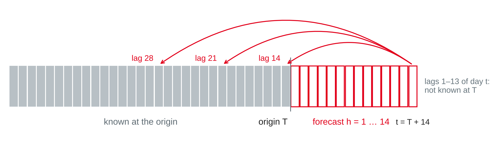
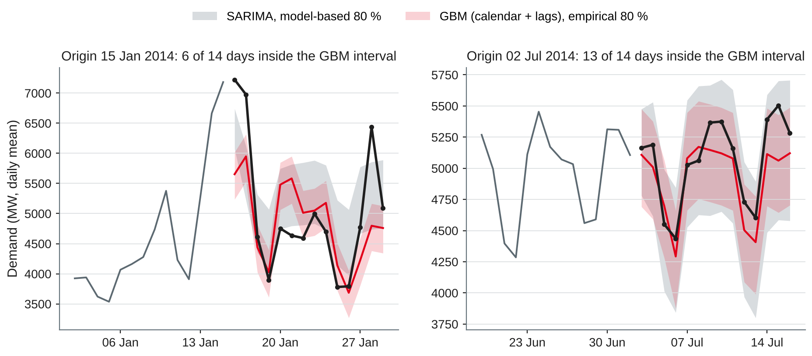

# Time Series Forecasting II {.title}

::: notes
Time plan for today (3 h): recap 5 min · forecasting as regression, lags and calendar 18 min · exercise 1 8 min · external regressors and results 20 min · break 10 min · prediction intervals 20 min · exercise 2 10 min · lab 65 min · wrap-up 5 min · ~19 min buffer.
Input about 63 min, hands-on about 83 min (two exercises and the lab). Same dataset and evaluation as sessions 11–12: daily vic_elec demand (1,096 days), 26 folds of 14 days across 2014; all modelling choices are made on 2012–2013, and 2013 is also the validation year for calibrating intervals. Students need pandas, statsmodels and scikit-learn (session 1 setup) and their session 12 results as the baseline. All numbers on the slides were run with pandas 3.0.6, statsmodels 0.15.0, scikit-learn 1.9.1 and NumPy 2.5.4 (script make_fc2_figures.py in the img folder, about 15 minutes on four cores — run it before class, not live).
:::

---

# Today's Agenda

1. Recap: what history alone can and cannot forecast
2. Forecasting as a regression problem: lag and calendar features
3. External regressors: holidays, temperature, promotions — ex ante and ex post
4. Prediction intervals: model-based, quantile regression, empirical
5. Evaluating intervals: coverage, width, Winkler score
6. Lab: demand forecast with features and intervals

::: notes
Time and format guide (not shown to students):
0:00 Recap (plenary, ask for session 12 results) · 0:05 Forecasting as regression (input + live feature table) · 0:23 Exercise 1 (pairs, then plenary) · 0:31 External regressors and results (input, discussion of the bar chart) · 0:51 Break · 1:01 Prediction intervals (input) · 1:21 Exercise 2 (pairs) · 1:31 Lab (pairs, consultations) · 2:36 Wrap-up: two pairs show their interval table · ~19 min buffer.
The discussion of ex ante vs. ex post is the most important conceptual point today; if it runs long, keep it and shorten the quantile regression slide — the lab starter covers it.
:::

---

# Recap: Where Session 12 Left Us

| Method (26 folds in 2014) | MAE (MW) |
|---|---|
| Seasonal naive, lag 7 | 335 |
| Seasonal naive, lag 364 | 316 |
| **SARIMA(2,0,2)(0,1,1)₇** | **271** |

- Largest errors: the **January heat waves** and the **Christmas** fold — weather and holidays are not in the models
- Automated refits can fail: **check every fold**, fall back to seasonal naive

::: callout
**Today's question:** how much do calendar and temperature information improve the 14-day forecast — and how sure can we be about it?
:::

::: notes
Ask two pairs for their recommendation sentence from session 12 (lab task 6). The preparation was to refresh gradient boosting in scikit-learn (session 8, track A): HistGradientBoostingRegressor is the regression counterpart of the classifier they tuned there. Today's models are compared with exactly the session 12 numbers: same 26 folds, same MAE definition.
:::

---

# Forecasting with Machine Learning {.section}

From a series to a feature table

---

# Forecasting as a Regression Problem

- One row per **target day** *t*; target *yₜ*; columns = what is **known at the origin**
- Then any regressor works: linear regression, random forest, **gradient boosting**

| Feature group | Examples | Source |
|---|---|---|
| **Lags** | *yₜ₋₁₄*, *yₜ₋₂₈*, *yₜ₋₃₆₄*, mean of a past week | The series itself |
| **Calendar** | Weekday, day of year, holiday, Christmas period | Date dimension (session 11) |
| **External** | Temperature, promotions, prices | Other systems or forecasts |

- Trees capture **non-linear effects and interactions** (weekday × temperature) without manual terms

::: source
Based on Hyndman and Athanasopoulos (2021, Section 7.4) and Januschowski et al. (2022).
:::

::: notes
Hyndman and Athanasopoulos treat trend, seasonal dummies, holiday and trading-day dummies, distributed lags and Fourier terms as "useful predictors" in time series regression; the ML approach uses the same ingredients in a flexible model. Januschowski et al. (2022) review why tree-based models did so well in recent competitions: the winners of both M5 tracks relied heavily on gradient boosted trees, with "lagged and aggregated" target values and calendar features, and good default settings. Limits they name: trees do not readily produce probabilistic forecasts (our topic after the break), and — known from session 8 — trees cannot extrapolate beyond the range of the training target, so a trend must be removed or modelled separately. Our series has almost no trend (session 11), so this does not bite here.
:::

---

# Lags and the Forecast Horizon

{width=88%}

- **Recursive:** one 1-step model, forecasts fed back as lags — errors accumulate
- **Direct:** a separate model per horizon *h*, each with lags ≥ *h*
- **Our lab:** one model for all *h* = 1 … 14, using only lags **≥ 14** — simple, leak-free, gives up short lags

::: source
Own illustration based on Ben Taieb et al. (2012), Hyndman and Athanasopoulos (2021, Section 7.6) and scikit-learn developers (n.d.-b).
:::

::: notes
Ben Taieb et al. (2012) compare five multi-step strategies (recursive, direct, DirRec, MIMO and DIRMO) on the 111 NN5 series; multiple-output strategies did best there. The recursive strategy feeds its own forecasts back, so external regressors and lag features must also be forecast for each step. Our "one model, lags ≥ H" variant is a direct strategy for the longest horizon applied to all horizons: for h = 1 it ignores yesterday's value, which SARIMA uses (session 12: SARIMA MAE 140 MW at h = 1). Worksheet task 5 tests per-horizon direct models. The scikit-learn example on lagged features uses lags from 1 hour on, which is only valid for one-step-ahead forecasts — a common trap when copying tutorials.
:::

---

# Calendar Features

```python
X["dow"], X["doy"] = y.index.dayofweek, y.index.dayofyear
X["holiday"] = daily["Holiday"]                     # public holiday, Victoria
md = y.index.month * 100 + y.index.day
X["xmas"] = ((md >= 1224) | (md <= 102)).astype(int)  # 24 Dec – 2 Jan
```

- Known **years in advance** — always allowed, always ex ante
- Holidays need a **calendar per region**; bridging days and holiday periods are business knowledge
- Linear models need dummies or **Fourier terms** for the yearly pattern; trees can split on day of year
- Calendar alone: MAE **268** MW — as good as SARIMA (271)

::: source
Own example based on Hyndman and Athanasopoulos (2021, Section 7.4); data from O'Hara-Wild et al. (2022).
:::

::: notes
The Christmas-period flag covers the summer holiday season in Australia, when businesses close and demand drops for days that are not public holidays (session 12: the Christmas fold was bad for every method). In Germany the counterparts would be school holidays per federal state and bridging days. Fourier terms (sine and cosine of 2πk·doy/365.25) give a smooth yearly pattern with few parameters — Hyndman and Athanasopoulos use them in dynamic harmonic regression (Section 10.5). With only three years, day of year lets the tree memorise last year's weather on that date; a model with calendar features only reached MAE 268 MW in 2014, close to SARIMA.
:::

---

# Exercise 1: Allowed at the Origin? {.exercise}

Forecast made on **Wednesday 13 August 2014** (origin) for **Wednesday 27 August** (*h* = 14). Which inputs may the model use?

1. Demand on 26 August
2. Demand on 13 August
3. Mean demand of 7–13 August
4. Demand on 28 August 2013
5. Holiday flag of 27 August
6. Observed maximum temperature on 27 August
7. Temperature forecast for 27 August, issued on 13 August
8. For *h* = 1 (14 August): which extra inputs would be allowed?

::: notes
Pairs 5 min, plenary 3 min. Expected answers:
1 No: lag 1 of the target day lies after the origin.
2 Yes: lag 14 — the last known value.
3 Yes: the mean of lags 14–20 (mean7_lag14 in the lab).
4 Yes: lag 364 — 27 August 2014 minus 364 days is Wednesday, 28 August 2013, the same weekday 52 weeks earlier.
5 Yes: the calendar is known in advance.
6 Not for a real forecast: that would be an ex post forecast (next section). Allowed only in an analysis that asks "what if the temperature forecast were perfect?"
7 Yes: that is the ex ante version of 6 — but the training data must then also use forecasts as they were issued, or the model learns from better data than it will get.
8 Lags 1–13 of 14 August (13 August back to 1 August) — a model for h = 1 can use yesterday's demand; our single model with lags ≥ 14 gives this up.
:::

---

# External Regressors {.section}

What we know in advance — and what we only pretend to know

---

# Three Kinds of Regressors

| Kind | Examples | In the forecast |
|---|---|---|
| **Known in advance** | Calendar, public and school holidays, own **promotions**, planned price changes | Use as they are |
| **Must be forecast** | Weather, economic indicators, competitor prices | Use a forecast — its errors add to ours |
| **Not available** | Same-day sales of other shops, the actual weather | Only for explanation, not for forecasting |

- **Ex ante:** only information available at the origin — the honest test
- **Ex post:** later, observed values of the regressors — separates model error from regressor error

::: source
Based on Hyndman and Athanasopoulos (2021, Section 7.6).
:::

::: notes
Hyndman and Athanasopoulos: "Ex-ante forecasts are those that are made using only the information that is available in advance", ex-post forecasts use later information on the predictors; comparing both helps to "separate out the sources of forecast uncertainty". Promotions are the retail classic: the company plans them, so they are known in advance — if the planned calendar is stored. A frequent data problem: only executed promotions are in the warehouse, not the plan as it was known on the origin day (bitemporal data, session 11). Alternative to forecasting a regressor: scenario forecasting ("what if the next two weeks are 5 °C hotter than normal?"), which the book also describes.
:::

---

# Temperature: Three Evaluation Scenarios

- No weather forecasts in the dataset — so we bracket the truth:

| Scenario | Temperature of the target day | Type |
|---|---|---|
| **None** | Not used | Ex ante |
| **Climatology** | Mean daily maximum of the training years, ±7 days around the date | Ex ante, no skill |
| **Observed** | Measured maximum | Ex post: a **perfect** forecast |

- A real weather forecast lies **between** climatology and observed: good for a few days ahead, close to climatology for day 14
- Trees learn the **U-shape** (session 11) directly; linear models need *T* and *T*², or heating and cooling terms

::: source
Based on Hyndman and Athanasopoulos (2021, Sections 7.6 and 10.3); data from O'Hara-Wild et al. (2022).
:::

::: notes
Hyndman and Athanasopoulos (Section 10.3) model daily vic_elec demand with temperature, temperature squared and a working-day indicator plus ARIMA errors, and produce forecasts for a scenario of a constant 26 °C for 14 days — a reminder that the forecast is conditional on the assumed temperatures. In a company setting one would buy or download archived weather forecasts (as issued at each origin) for training and evaluation. Do not claim a skill curve for weather forecasts without data: the point here is the bracket, not the precise value.
:::

---

# Dynamic Regression: SARIMA with Regressors

```python
from statsmodels.tsa.statespace.sarimax import SARIMAX
ex = lambda d: np.column_stack([d["Holiday"], d["Temperature"],
                                d["Temperature"] ** 2])
fit = SARIMAX(train["Demand"], exog=ex(train), order=(2, 0, 2),
              seasonal_order=(0, 1, 1, 7)).fit(disp=False)
fc = fit.get_forecast(14, exog=ex(future))   # future regressors required
```

- Regression on holiday and temperature, **ARIMA errors** take the autocorrelation
- Needs the regressors for all 14 days — **forecast** or **scenario**
- One fold of the validation year failed (origin 12 March 2013) → session 12 guard: fall back to seasonal naive

::: source
Based on Hyndman and Athanasopoulos (2021, Sections 10.1–10.3); own example with statsmodels (Seabold & Perktold, 2010).
:::

::: notes
Same orders as the session 12 SARIMA, chosen on 2012–2013; the regression coefficients are estimated together with the ARIMA part. The failed fold produced forecasts far outside the plausible range (the guard checks 0.5 × minimum and 1.5 × maximum of the training data, as in worksheet 12); without the guard the validation MAE was over 140,000 MW. In 2014 no fold failed. Here "future" is the 14-day DataFrame with holiday flags and temperature for the scenario in question.
:::

---

# Results: What Each Piece of Information Is Worth

{width=88%}

::: source
Own illustration with data from O'Hara-Wild et al. (2022); models with scikit-learn (Pedregosa et al., 2011) and statsmodels (Seabold & Perktold, 2010).
:::

::: notes
Read from top to bottom. Ex ante, the best model is gradient boosting with calendar, lags and climatology: 228 MW, 16 % below SARIMA. The holiday flag alone lowers the SARIMA MAE from 271 to 251. The big step comes from the observed temperature: 145 MW — but that is the ex post bound. The gap between 228 and 145 MW is the value of a perfect 14-day temperature forecast; a real one captures part of it. Gradient boosting was not tuned: max_iter = 300, learning_rate = 0.05, random_state = 0; the feature set was fixed on the validation year 2013.
:::

---

# Reading the Results

| Model (2014) | MAE | RMSE | MAE Jan–Feb | MAE Mar–Dec |
|---|---|---|---|---|
| SARIMA (session 12) | 271 | 418 | 659 | 200 |
| GBM: calendar + lags | 245 | 379 | 594 | 182 |
| GBM: + climatology | 228 | 385 | 639 | 154 |
| GBM: + observed temperature (ex post) | **145** | **222** | 343 | 109 |

- Ex ante gains come from the **calendar** (holidays, Christmas) — the heat waves stay unpredictable without a weather forecast
- Even with perfect temperatures, the summer folds are the hardest

::: source
Own analysis with scikit-learn (Pedregosa et al., 2011) and statsmodels (Seabold & Perktold, 2010); data from O'Hara-Wild et al. (2022).
:::

::: notes
Jan–Feb = folds 1–4 (2 January to 26 February 2014), Mar–Dec = folds 5–26. Ex ante, gradient boosting gains mainly from March to December (SARIMA 200 → 154 MW with climatology); in the heat-wave folds the climatology even hurts (594 → 639 MW): a "normal" January temperature says nothing about a 43 °C day. Mean error (actual − forecast): calendar-only model −79 MW (over-forecasts), calendar + lags −16, climatology +17 — the lags correct the level. Validation year 2013 gave the same ranking (MAE 263, 258, 251 and 181 MW for the four GBM variants). Gradient boosting with lags beats SARIMA in 17 of 26 folds, with observed temperature in 24. Per horizon: SARIMA is better at h = 1 (140 vs. 236 MW) because our single GBM model ignores the last 13 days; at h = 14 GBM wins (335 vs. 361 MW). SARIMA with holiday and observed temperature reaches 186 MW (ex post), with climatology 252 MW.
:::

---

# Prediction Intervals {.section}

How sure are we?

---

# Why a Point Forecast Is Not Enough

- Decisions depend on **risk**: reserve capacity, safety stock, staff on call
- A **prediction interval** contains the future value with a stated probability, e.g. **80 %** or **95 %**
- Intervals usually **widen** with the horizon
- An interval is only as good as its assumptions — check it on unseen data

::: callout
A grid operator does not ask "how much demand?", but "how much capacity so that demand is higher on at most one day in ten?" — that is the **90 % quantile**.
:::

::: source
Based on Hyndman and Athanasopoulos (2021, Section 5.5).
:::

::: notes
A prediction interval is about a future observation; the confidence interval from session 9 is about a parameter (an effect). Students mix them up — ask for the difference. Point forecasts minimising MAE target the median, minimising RMSE the mean (session 12); a quantile forecast targets another point of the distribution. The 90 % quantile is the upper end of a central 80 % interval. Link to session 7: the cost of under- and over-forecasting is asymmetric (a blackout costs more than idle reserve), so the decision should use a quantile, not the point forecast.
:::

---

# Three Ways to Get an Interval

::: cards
### Model-based
ŷ ± *c* · σ̂ₕ with *c* = 1.28 (80 %) or 1.96 (95 %). From SARIMA or ETS directly; assumes normal, uncorrelated errors.
### Quantile regression
Train one model per quantile, e.g. 10 % and 90 %, with the **pinball loss**. Works with any features; no distribution assumed.
### Empirical
Add quantiles of **past forecast errors** to the point forecast — errors from cross-validation on a validation year, not in-sample residuals.
:::

- Regression intervals assume the regressors are **known**: with forecast temperatures they are too narrow

::: source
Based on Hyndman and Athanasopoulos (2021, Sections 5.5 and 7.6), scikit-learn developers (n.d.-b) and Januschowski et al. (2022).
:::

::: notes
Model-based: statsmodels get_forecast(h).conf_int(alpha=0.2) gives the 80 % interval. Hyndman and Athanasopoulos note that multi-step intervals assume uncorrelated residuals and that bootstrapped residuals avoid the normality assumption. They also state that regression prediction intervals do not include the uncertainty of the future predictor values. Januschowski et al. (2022): gradient boosted trees "do not readily produce probabilistic forecasts"; strong M5 uncertainty entries used residual-based intervals, conformal-style methods or quantile regression. The empirical method is the simplest version of conformal prediction — the name students will meet in the literature.
:::

---

# Quantile Regression with Gradient Boosting

Pinball loss for quantile *p*, with forecast *q*:

- Actual **above** *q*: loss = *p* · (*y* − *q*)
- Actual **below** *q*: loss = (1 − *p*) · (*q* − *y*)
- For *p* = 0.9, under-forecasting costs **9 times** as much as over-forecasting → the forecast moves up to the 90 % quantile

```python
lo = HistGradientBoostingRegressor(loss="quantile", quantile=0.1,
        max_iter=100, min_samples_leaf=50, random_state=0).fit(X_tr, y_tr)
hi = HistGradientBoostingRegressor(loss="quantile", quantile=0.9,
        max_iter=100, min_samples_leaf=50, random_state=0).fit(X_tr, y_tr)
```

::: source
Based on Hyndman and Athanasopoulos (2021, Section 5.9) and scikit-learn developers (n.d.-a, n.d.-b).
:::

::: notes
Hyndman and Athanasopoulos define the quantile score with a factor 2 (2p and 2(1 − p)); scikit-learn's mean_pinball_loss has no factor — the ranking is the same. Why the stronger regularisation (100 trees, at least 50 days per leaf)? With the default settings (300 trees), the quantile models fit the training days too closely: the 80 % band covered only 53 % of the validation days in 2013 — the trees learn the quantiles of their own training residuals, which are too small. The regularised setting was chosen on 2013 (about 70 % coverage) — still too narrow, as the next slides show. The scikit-learn example on lagged features fits 5 %, 50 % and 95 % quantile models in the same way.
:::

---

# Evaluating Intervals

| Measure | Question | Target |
|---|---|---|
| **Coverage** | Share of actuals inside the interval | Close to the nominal 80 % |
| **Width** | Average upper − lower bound | As narrow as possible **at** correct coverage |
| **Winkler score** | Width + 2/α × distance outside | Lower is better; α = 0.2 for 80 % |

- Too narrow: looks precise, fails exactly when it matters; too wide: useless
- Check coverage **per season or segment**: the average can hide failures

::: source
Based on Hyndman and Athanasopoulos (2021, Section 5.9).
:::

::: notes
Winkler score: for an observation inside the interval, the width; below the lower bound ℓ, width + (2/α)(ℓ − y); above the upper bound u, width + (2/α)(y − u). With α = 0.2 every MW outside counts ten times. It rewards narrow intervals but punishes misses, so it is a single number for comparing interval methods — like the MAE for point forecasts. Coverage needs many test points: with 364 forecasts, 80 % ± about 4 percentage points is noise (binomial standard error √(0.8 × 0.2 / 364) ≈ 2.1 points); folds are also correlated, so be generous.
:::

---

# Exercise 2: Score an Interval Forecast {.exercise}

80 % intervals from the lab model (calendar + lags), origin Wednesday 15 January 2014:

| Day | Actual | Forecast | Lower | Upper |
|---|---|---|---|---|
| Thu 16 Jan | 7,223 | 5,653 | 5,236 | 6,020 |
| Fri 17 Jan | 6,976 | 5,949 | 5,532 | 6,316 |
| Sat 18 Jan | 4,615 | 4,440 | 4,022 | 4,806 |
| Sun 19 Jan | 3,898 | 4,026 | 3,609 | 4,393 |
| Mon 20 Jan | 4,752 | 5,480 | 5,063 | 5,847 |

1. Which days are inside the interval? What is the coverage?
2. Compute the mean width and the Winkler score (α = 0.2) for each day and on average.
3. Would you trust this interval for reserve planning in a heat wave? What would you change?

::: notes
Pairs 6 min, plenary 4 min. Values in MW, rounded; interval = forecast − 417 to forecast + 367 (10 % and 90 % quantiles of the 2013 validation errors). Expected answers:
1 Inside: Saturday and Sunday. Thursday and Friday are above the upper bound (heat wave: 43.2 °C on 16 January), Monday below the lower bound. Coverage 2 of 5 = 40 % (whole fold: 6 of 14 = 43 %).
2 Width 784 MW every day (empirical intervals have constant width). Winkler: Thu 784 + 10 × 1,203 = 12,814; Fri 784 + 10 × 660 = 7,384; Sat 784; Sun 784; Mon 784 + 10 × 311 = 3,894. Mean 5,132 — compared with 1,356 for the whole year (interval table on the next slide).
3 No. The interval is built from errors of all seasons; summer heat-wave errors are much larger. Options: intervals per season (errors of the same months only), wider quantiles in summer, a model with a temperature forecast, or heat-wave scenarios. Point out that Monday was over-forecast by 728 MW: misses happen in both directions, and two days of 40 or more points in the Winkler score outweigh many good days.
:::

---

# Intervals on 26 Folds in 2014

| 80 % interval | Coverage | Jan–Feb | Mar–Dec | Width | Winkler |
|---|---|---|---|---|---|
| SARIMA, model-based | 85.7 % | 39.3 % | 94.2 % | 1,022 | 1,530 |
| SARIMA + holiday, model-based | 88.2 % | 41.1 % | 96.8 % | 951 | 1,388 |
| GBM quantile, default settings | 51.1 % | 44.6 % | 52.3 % | 431 | 1,330 |
| GBM quantile, regularised | 74.7 % | 57.1 % | 77.9 % | 661 | 1,222 |
| GBM + empirical (2013 errors) | 82.4 % | 37.5 % | 90.6 % | 784 | 1,356 |
| *Ex post:* GBM + temperature, empirical | 88.2 % | 57.1 % | 93.8 % | 570 | 805 |

- All GBM rows: calendar + lags; ex ante unless marked
- Overall coverage looks fine for SARIMA and the empirical method — but **below 40 %** in January–February

::: source
Own analysis with scikit-learn (Pedregosa et al., 2011) and statsmodels (Seabold & Perktold, 2010); data from O'Hara-Wild et al. (2022).
:::

::: notes
364 test days per row; width and Winkler score in MW, α = 0.2. The SARIMA intervals widen from 690 MW at h = 1 to 1,116 MW at h = 14; the empirical intervals are 784 MW wide for every horizon (one error distribution, because our GBM model uses the same lags for all horizons). Quantile regression with default settings is far too narrow (51 %) — it learned in-sample quantiles; regularisation helps (75 %) but stays below 80 %. The regularised quantile model has the best Winkler score ex ante (1,222) because its band is narrower where errors are small; with temperature (ex post) the empirical intervals are best (805). Misses are roughly balanced: for GBM + empirical 10.4 % below and 7.1 % above. With the 95 % level, SARIMA covered 94.8 % overall. Discussion: which number would the grid operator care about? (The summer coverage.)
:::

---

# Intervals Fail Where Errors Are Largest

{width=86%}

- Summer errors are larger: one error distribution is **too narrow in summer**, too wide in winter

::: source
Own illustration with data from O'Hara-Wild et al. (2022), based on Hyndman and Athanasopoulos (2021, Sections 5.5 and 5.9).
:::

::: notes
Left: the forecast from 15 January cannot know the heat wave of 16–17 January (7,223 and 6,976 MW) — both days lie far above both intervals; the SARIMA interval is wider but misses as well. Right: in winter both intervals cover the actual values well, and the SARIMA interval is clearly wider than needed. This is the core problem of a single error distribution: errors are larger in summer (heteroscedasticity). Remedies, in rising effort: error quantiles per season, quantile models with temperature, intervals from a model of the error size, or scenario forecasts with weather ensembles. Hyndman and Athanasopoulos note for their vic_elec model that heteroscedastic residuals may affect the coverage of the intervals (Section 10.3).
:::

---

# Lab: Demand Forecast with Features and Intervals {.section}

Gradient boosting, regressors and intervals with the session 12 folds

---

# Lab Starter (1/2): The Feature Table

```python
import numpy as np, pandas as pd
from sklearn.ensemble import HistGradientBoostingRegressor
from sklearn.model_selection import TimeSeriesSplit
# daily, y = daily["Demand"].asfreq("D") from the session 11 lab starter

X = pd.DataFrame(index=y.index)
X["dow"], X["doy"] = y.index.dayofweek, y.index.dayofyear
X["holiday"] = daily["Holiday"]
md = y.index.month * 100 + y.index.day
X["xmas"] = ((md >= 1224) | (md <= 102)).astype(int)    # 24 Dec – 2 Jan
for k in (14, 21, 28, 364):                              # only lags >= 14
    X[f"lag{k}"] = y.shift(k)
X["mean7_lag14"] = y.shift(14).rolling(7).mean()         # days t-20 ... t-14
X["temp"] = daily["Temperature"]                         # observed: ex post!
```

::: source
Own example with scikit-learn (Pedregosa et al., 2011); data from O'Hara-Wild et al. (2022).
:::

::: notes
The first 364 rows have missing lag364 values; HistGradientBoostingRegressor handles missing values natively (it learns at each split which side they go to), so no imputation is needed. For 16 January 2014 (43.2 °C) the row reads: dow 3 (Thursday), lag14 3,924 MW, lag364 5,867 MW, temp 43.2. Check yourself: no feature uses data after the origin for any h ≤ 14. The temp column is the observed value — keep it out of the ex ante models, or replace it per fold by the climatology (lab task 3).
:::

---

# Lab Starter (2/2): Cross-Validation and Empirical Intervals

```python
def cv_gbm(cols, end="2014-12-31"):
    yy, E = y[:end], []
    for tr, te in TimeSeriesSplit(n_splits=26, test_size=14).split(yy):
        m = HistGradientBoostingRegressor(max_iter=300, learning_rate=0.05,
                                          random_state=0)
        m.fit(X.iloc[tr][cols], yy.iloc[tr])
        E.append(yy.iloc[te].to_numpy() - m.predict(X.iloc[te][cols]))
    return np.array(E)                                   # 26 folds × 14 days

cols = ["dow", "doy", "holiday", "xmas",
        "lag14", "lag21", "lag28", "lag364", "mean7_lag14"]
E_val, E_test = cv_gbm(cols, "2013-12-31"), cv_gbm(cols)
lo, hi = np.quantile(E_val, [0.1, 0.9])                 # calibrated on 2013
print(np.abs(E_test).mean(), lo, hi, ((E_test >= lo) & (E_test <= hi)).mean())
```

::: source
Own example based on Hyndman and Athanasopoulos (2021, Sections 5.5 and 5.10) and scikit-learn developers (n.d.-c).
:::

::: notes
Expected output: MAE 245.2, lo −417, hi 367, coverage 0.824. With "temp" added (ex post): MAE 145.0, lo −311, hi 259, coverage 0.882. The interval for each test day is forecast + [lo, hi]; an actual lies inside exactly when its error lies between lo and hi, hence the last expression. Same folds as session 12, so the MAE is directly comparable with SARIMA's 271. Runtime: about 30 seconds per call of cv_gbm.
:::

---

# Lab Tasks {.exercise}

Work in pairs on the daily demand series (O'Hara-Wild et al., 2022); keep everything for notebook 3.

1. **Features:** build the feature table; check for one target day that every feature is known at the origin
2. **Ex ante model:** calendar only, then calendar + lags — compare with your session 12 table
3. **Regressors:** add temperature as climatology (ex ante) and as observed (ex post); add the holiday flag to SARIMA
4. **Intervals:** model-based for SARIMA, quantile regression and empirical intervals for gradient boosting
5. **Evaluate:** coverage overall and January–February, width, Winkler score
6. **Recommend:** five sentences for the energy planner — forecast, uncertainty, and which data to buy

::: notes
Expected results (tested): 1 For 16 January 2014: lag14 = 2 January (3,924 MW), lag364 = 17 January 2013 (5,867 MW). 2 Calendar only MAE 268, + lags 245 (SARIMA 271). 3 GBM + climatology 228, + observed temperature 145; SARIMA + holiday 251, + holiday + observed temperature 186 (one validation fold needs the fallback, origin 12 March 2013). 4–5 See interval table: SARIMA 85.7 % (Jan–Feb 39 %), GBM quantile default 51 %, regularised 75 %, empirical 82 %. 6 Example: "Use gradient boosting with calendar and lags for two-week planning: average error about 245 MW (5.2 %), 10 % below the best history-only model; with a climatological temperature 228 MW. An 80 % range of about −420 to +370 MW around the forecast holds on 82 % of days, but in January–February only on about 40 %: heat waves remain the main risk. A perfect temperature forecast would cut the error to 145 MW — buying archived and current weather forecasts is the most valuable next step. Holidays and the Christmas period must stay in the calendar." Pairs that finish early: worksheet 13, task 5.
:::

---

# Key Takeaways

- ML forecasting = **regression on a feature table**: lags, calendar, external regressors
- Every feature must be **known at the origin** — lags ≥ horizon, or one model per horizon
- **Ex ante** evaluation is the honest one; **ex post** shows the value of better regressor forecasts
- Calendar features and holidays are cheap and **always ex ante**; weather must be forecast
- An interval is judged by **coverage, width and Winkler score** — per season, not only on average
- Quantile models and residual-based intervals are **too narrow** if errors differ between seasons — calibrate on unseen data

---

# Next Session: Forecasting at Scale and Use Cases

- Forecasting **many series**: global models, hierarchies and reconciliation
- **Intermittent** demand and **anomaly detection** in time series
- Choosing a method for a use case
- **Lab:** demand forecasting case — portfolio notebook 3

::: callout
**Preparation:** finish today's lab table (point and interval results) — notebook 3 starts from it. Try worksheet 13 and think about which of your company's series would need a global model.
:::

---

# References {.references}

- Ben Taieb, S., Bontempi, G., Atiya, A. F., & Sorjamaa, A. (2012). A review and comparison of strategies for multi-step ahead time series forecasting based on the NN5 forecasting competition. *Expert Systems with Applications, 39*(8), 7067–7083. https://doi.org/10.1016/j.eswa.2012.01.039
- Hyndman, R. J., & Athanasopoulos, G. (2021). *Forecasting: Principles and practice* (3rd ed.). OTexts. https://otexts.com/fpp3/
- Januschowski, T., Wang, Y., Torkkola, K., Erkkilä, T., Hasson, H., & Gasthaus, J. (2022). Forecasting with trees. *International Journal of Forecasting, 38*(4), 1473–1481. https://doi.org/10.1016/j.ijforecast.2021.10.004
- O'Hara-Wild, M., Hyndman, R., Wang, E., & Godahewa, R. (2022). *tsibbledata: Diverse datasets for 'tsibble'* (R package version 0.4.1) [Computer software]. https://CRAN.R-project.org/package=tsibbledata
- Pedregosa, F., Varoquaux, G., Gramfort, A., Michel, V., Thirion, B., Grisel, O., Blondel, M., Prettenhofer, P., Weiss, R., Dubourg, V., Vanderplas, J., Passos, A., Cournapeau, D., Brucher, M., Perrot, M., & Duchesnay, É. (2011). Scikit-learn: Machine learning in Python. *Journal of Machine Learning Research, 12*(85), 2825–2830. https://jmlr.org/papers/v12/pedregosa11a.html
- Seabold, S., & Perktold, J. (2010). Statsmodels: Econometric and statistical modeling with Python. In S. van der Walt & J. Millman (Eds.), *Proceedings of the 9th Python in Science Conference* (pp. 92–96). https://doi.org/10.25080/Majora-92bf1922-011

---

# References: Software Documentation {.references}

- scikit-learn developers. (n.d.-a). *HistGradientBoostingRegressor* (scikit-learn 1.9.1 documentation, API reference). Retrieved October 22, 2026, from https://scikit-learn.org/stable/modules/generated/sklearn.ensemble.HistGradientBoostingRegressor.html
- scikit-learn developers. (n.d.-b). *Lagged features for time series forecasting* (scikit-learn 1.9.1 documentation, example gallery). Retrieved October 22, 2026, from https://scikit-learn.org/stable/auto_examples/applications/plot_time_series_lagged_features.html
- scikit-learn developers. (n.d.-c). *TimeSeriesSplit* (scikit-learn 1.9.1 documentation, API reference). Retrieved October 22, 2026, from https://scikit-learn.org/stable/modules/generated/sklearn.model_selection.TimeSeriesSplit.html
