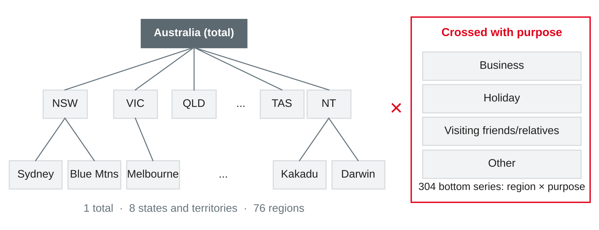
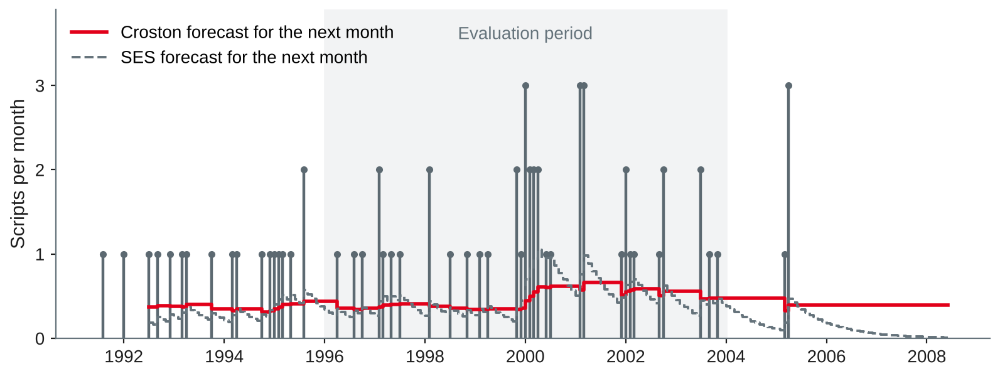
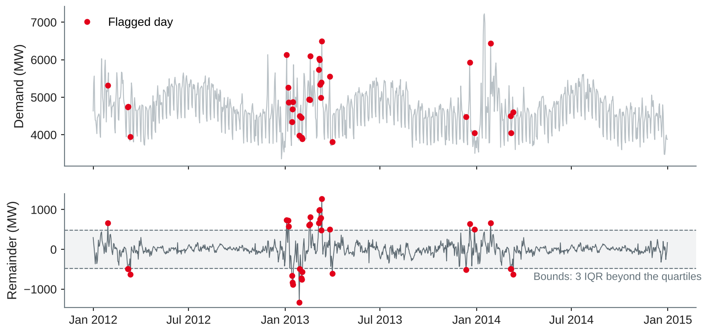

# Forecasting at Scale and Use Cases {.title}

::: notes
Time plan for today (3 h): recap 5 min · many series and global models 14 min · hierarchies and reconciliation 14 min · exercise 1 8 min · break 10 min · intermittent demand 10 min · anomaly detection 10 min · choosing a method 6 min · exercise 2 8 min · notebook 3 brief 8 min · lab 70 min · wrap-up 5 min · ~12 min buffer.
Input about 67 min, hands-on about 86 min (two exercises and the lab). The last time series session: it widens the view from one series (vic_elec, sessions 11–13) to many. Two new public datasets from the same pinned Rdatasets commit, both without login: tourism (R package tsibble, 304 quarterly series) for global models and reconciliation, and one PBS prescription series (tsibbledata) for intermittent demand. Anomaly detection uses vic_elec again. Students need pandas, statsmodels and scikit-learn (session 1 setup). All numbers on the slides were run with pandas 3.0.6, statsmodels 0.15.0, scikit-learn 1.9.1 and NumPy 2.5.4 (script make_fc3_figures.py in the img folder, about 1.5 minutes on four cores).
:::

---

# Today's Agenda

1. Recap: one series, features and intervals
2. Forecasting many series: local and global models
3. Hierarchies and reconciliation: forecasts that add up
4. Intermittent demand and anomaly detection
5. Choosing a method for a use case
6. Lab: demand forecasting case — portfolio notebook 3

::: notes
Time and format guide (not shown to students):
0:00 Recap (plenary) · 0:05 Many series and global models (input) · 0:19 Hierarchies and reconciliation (input) · 0:33 Exercise 1 (pairs, then plenary) · 0:41 Break · 0:51 Intermittent demand (input) · 1:01 Anomaly detection (input + discussion of the figure) · 1:11 Choosing a method (input) · 1:17 Exercise 2 (pairs) · 1:25 Notebook 3 brief and choice of track (input, pairs confirm their track) · 1:33 Lab (pairs, consultations) · 2:43 Wrap-up: two pairs, one per track, show a first result · ~12 min buffer.
Today has more topics than the other time series sessions, each in less depth: the aim is to know when each technique is needed and where to read on, not to master all four. If the reconciliation part runs long, shorten intermittent demand — worksheet 14 covers it.
:::

---

# Recap: Where Session 13 Left Us

| Daily demand, 26 folds in 2014 | MAE (MW) |
|---|---|
| SARIMA (session 12) | 271 |
| Gradient boosting: calendar + lags | 245 |
| + temperature climatology (ex ante) | **228** |
| + observed temperature (ex post) | 145 |

- 80 % intervals: coverage **82 %** overall, but only **38 %** in January–February
- So far: **one** series, carefully modelled

::: callout
**Today's question:** what changes when a company needs forecasts for **hundreds of series** at once — and how do we choose the method for a use case?
:::

::: notes
Ask two pairs for their recommendation to the energy planner (session 13 lab task 6). The preparation task was to think about a company series that would need a global model: collect two or three examples (products × stores, spare parts, branches, call queues) — they come back in exercise 2. Make the link: the vic_elec work of sessions 11–13 is the basis of track A of notebook 3; today adds the "at scale" view and a second track.
:::

---

# Forecasting Many Series {.section}

One model per series — or one model for all?

---

# From One Series to Thousands

- Retail: products × stores × days; the M5 competition used **42,840** Walmart series
- Utilities: substations, meters; tourism: regions × purposes; services: branches × queues
- What changes at scale:
  - **No manual modelling** per series: automatic selection, monitoring, fallbacks
  - Many series are **short, noisy or sparse**; new products have **no history**
  - Series form **hierarchies**: store → region → total, and plans must add up

::: source
Based on Makridakis et al. (2022), Januschowski et al. (2022) and Hyndman and Athanasopoulos (2021, Section 11.1).
:::

::: notes
Makridakis et al. (2022) report that the M5 accuracy competition asked for daily forecasts of 42,840 hierarchically organised series of Walmart unit sales, 28 days ahead. Among their findings: all top 50 methods used "cross-learning" — one model across many series, i.e. global models — most of them LightGBM, and combining forecasts improved accuracy; the horizon was 28 days. Januschowski et al. (2022) explain why trees did so well there (session 13). Link to session 12: the automatic SARIMA refits needed a guard ("check every fold, fall back to seasonal naive"); with 10,000 series, nobody can inspect each fit, so guards and monitoring become part of the method.
:::

---

# Local or Global Models?

::: cards
### Local
One model **per series**, e.g. ETS or SARIMA fitted 304 times. Adapts to each series; parameters grow with the number of series; short series give unstable fits.
### Global
One model **for all series**, trained on windows from every series (scaled to a common level). Learns shared patterns; works for short series and new products; complexity independent of the number of series.
:::

- A global model does **not** assume that series are similar — it can produce the same forecasts as local ones
- Scaling is essential: each window divided by its own level, the forecast multiplied back

::: source
Based on Montero-Manso and Hyndman (2021) and Januschowski et al. (2022).
:::

::: notes
Montero-Manso and Hyndman (2021) show that global methods are not more restrictive than local ones and that the complexity of local models grows with the number of series while that of a global model stays constant; deliberately simple global models — linear autoregressions with long memory — were competitive with far fewer parameters. Practical points: a global model needs inputs on a common scale (divide by the series mean or the last year's level), may get series features (category, region) as extra columns, and can forecast a series with little history, because it learned the dynamics from the others. Ask: which local model have we used so far? (All of sessions 12–13 were local: one series.)
:::

---

# The Tourism Data: 304 Quarterly Series

- Overnight trips (thousands) in Australia, **1998 Q1 – 2017 Q4**: 80 quarters
- 76 regions × 4 purposes = **304** series; sizes from 0.3 to 747 thousand trips per quarter, median 28
- Small series are noisy: **6 %** of all values are zero
- Source: Tourism Research Australia, R package tsibble; used in Hyndman and Athanasopoulos (2021, Chapter 11)

```python
URL = ("https://raw.githubusercontent.com/vincentarelbundock/Rdatasets/"
       "1dcc2bf5f955cc1224a3e1307256e1fe86b68dae/csv/tsibble/tourism.csv")
```

::: source
Own analysis with data from Wang et al. (2020), loaded from Arel-Bundock (n.d.).
:::

::: notes
Same Rdatasets commit as vic_elec (session 11), so the data cannot change under our feet. The tsibble package accompanies Wang et al. (2020); it is GPL-3 and the data come from the National Visitor Survey of Tourism Research Australia. We load the CSV from the URL in the notebook and do not redistribute it. Note: the Rdatasets help page still says "1998 Q1 to 2016 Q4, 23,408 rows" — the CSV has 24,320 rows to 2017 Q4; trust the data and check it (lesson from session 11). Hyndman and Athanasopoulos use exactly this dataset in Section 11.4 with ETS base forecasts, training to 2015 and testing 2016–2017 — we use the same split, so students can compare with the book.
:::

---

# Result: One Global Model vs. 304 Local Models

| Test 2016–2017, mean MASE | Total | State | Region | 304 bottom | All 425 |
|---|---|---|---|---|---|
| Seasonal naive (each series) | 1.96 | 1.40 | 1.18 | 1.17 | 1.18 |
| ETS per series, summed up | 3.31 | 2.04 | 1.24 | **0.99** | 1.11 |
| Global linear AR, summed up | **1.04** | 1.34 | 1.12 | 1.01 | **1.05** |
| Global gradient boosting, summed up | 1.29 | 1.32 | 1.10 | 1.01 | 1.04 |

- Global linear model: **9 coefficients per horizon** (72 in all) vs. about 1,000 ETS parameters — same accuracy at the bottom
- Summed up, the global forecasts are far better at the top: ETS **under-forecasts** the growth of 2016–2017

::: source
Own analysis with statsmodels (Seabold & Perktold, 2010) and scikit-learn (Pedregosa et al., 2011); data from Wang et al. (2020); method based on Montero-Manso and Hyndman (2021).
:::

::: notes
Setup: training to 2015 Q4, horizons 1–8 quarters. ETS: additive models (zeros in the data), chosen per series by AICc among ANN, AAdN, ANA, AAdA — 193 series got ANN, 98 ANA, 13 a damped trend. Global models: one model per horizon h (direct strategy, session 13) on all windows of the 304 series; input = the last 8 quarters divided by the mean of the last 4 (floored at 10 % of the series mean for tiny series); the window length was chosen on a validation origin (training to 2013 Q4, test 2014–2015) by the MASE over all 425 series — 8 quarters for both models. Gradient boosting: 300 iterations, learning rate 0.05, random_state 0. The global linear model beats ETS in 140 of the 304 bottom series: neither dominates. Two-year total: actual 209,194 thousand trips; ETS summed up 185,066 (−11.5 %), global linear 213,524 (+2.1 %). Caveat: one test origin, and on the validation origin the global models were not better at the top level — do not oversell. The point: one simple global model is a serious competitor to 304 tuned local models.
:::

---

# Hierarchies and Reconciliation {.section}

Forecasts that add up

---

# Hierarchical and Grouped Series

{width=86%}

- **Hierarchical:** nested (region → state → total); **grouped:** crossed (× purpose)
- 425 series in 6 levels; all are sums of the 304 bottom series: **y = S b**

::: source
Own illustration based on Hyndman and Athanasopoulos (2021, Section 11.1); data from Wang et al. (2020).
:::

::: notes
Levels: total 1, purpose 4, state 8, state × purpose 32, region 76, region × purpose 304 — 425 series, as in the book's Section 11.4. S is the summing matrix (425 × 304): each row says which bottom series add up to that series; the bottom block is the identity. Business examples: product → category → total (and crossed by channel), store → region → country, cost centre → department → company. Link to session 3: these are the hierarchies of the dimension tables (roll-up), now used for forecasts. Different users need different levels: the board plans the total, a regional manager her region, the warehouse each item.
:::

---

# Why Forecasts Do Not Add Up

- Each series forecast separately (base forecasts) → **incoherent**: levels contradict each other
- Example, 2016 Q1 (thousand trips): actual total **26,661**

| ETS forecast of | Total |
|---|---|
| The total series itself | 25,692 |
| Sum of the 8 state forecasts | 25,663 |
| Sum of the 304 bottom forecasts | **24,560** |

- Plans built on different levels contradict each other — the budget does not match the sum of the regional plans

::: source
Own analysis with statsmodels (Seabold & Perktold, 2010); data from Wang et al. (2020); based on Hyndman and Athanasopoulos (2021, Section 11.3).
:::

::: notes
Why the bottom sum is lowest: many small series get flat ETS(A,N,N) forecasts and miss the growth that is visible in the aggregates; aggregates are smoother and their trend is easier to estimate. In general, aggregate series have a higher signal-to-noise ratio, while bottom series carry the detail. Reconciliation combines both. Ask: which number would the CEO accept, and which the regional managers?
:::

---

# Making Forecasts Coherent

| Approach | Idea | Uses |
|---|---|---|
| **Bottom-up** | Forecast the bottom, add up | Only bottom forecasts |
| **Top-down** | Forecast the total, split by proportions | Only the total |
| **Middle-out** | Forecast one middle level, sum up and split down | One level |
| **Optimal reconciliation** | Adjust **all** base forecasts as little as possible so they add up | All levels |

- Reconciled forecasts: **ỹ = S G ŷ** — G maps all 425 base forecasts to 304 coherent bottom values
- **OLS:** all errors weighted equally · **WLS:** weights by series size · **MinT:** weights from the error covariance

::: source
Based on Hyndman and Athanasopoulos (2021, Sections 11.2–11.3) and Wickramasuriya et al. (2019).
:::

::: notes
G = (S′W⁻¹S)⁻¹S′W⁻¹ with a weight matrix W: identity (OLS), diagonal with the number of bottom series under each node (WLS with structural scaling), or an estimate of the covariance of the one-step base forecast errors (MinT, "minimum trace"). Wickramasuriya et al. (2019) show that MinT minimises the total variance of the reconciled forecast errors among unbiased reconciliations; with 425 series the sample covariance is unstable, so the shrinkage version shrinks the correlations towards zero (estimated shrinkage here: 0.75). Bottom-up is G = [0 I]; top-down is not unbiased even with unbiased base forecasts. Python: statsmodels has no reconciliation function; the few lines in the lab starter are enough.
:::

---

# Result: Reconciliation on the Tourism Data

| Test 2016–2017, mean MASE | Total | State | Region | 304 bottom | All 425 |
|---|---|---|---|---|---|
| ETS base (incoherent) | 1.71 | 1.34 | 1.12 | 0.99 | 1.04 |
| Bottom-up | 3.31 | 2.04 | 1.24 | 0.99 | 1.11 |
| OLS | 1.75 | 1.32 | **1.00** | 1.00 | 1.01 |
| WLS (structural) | 2.27 | 1.51 | 1.04 | 0.98 | 1.02 |
| MinT (shrink) | 2.18 | 1.47 | 1.03 | **0.93** | **0.99** |

- MinT beats bottom-up on every level; at the middle levels OLS and MinT also beat the **base** forecasts
- Coherence comes **almost for free** in accuracy

::: source
Own analysis with statsmodels (Seabold & Perktold, 2010); data from Wang et al. (2020); methods from Wickramasuriya et al. (2019); same setup as Hyndman and Athanasopoulos (2021, Section 11.4).
:::

::: notes
Compare with Table 11.2 in the book (MASE total: base 1.53, BU 3.17, MinT 2.09, OLS 1.63; bottom: 0.98, 0.98, 0.94, 1.02) — same pattern, slightly different numbers because our ETS selection is restricted to additive models and statsmodels estimates differently from R's fable. RMSE (thousand trips) total: base 1,816, BU 3,195, OLS 1,863, MinT 2,229; bottom: 20.0, 20.0, 18.3, 18.1. Whether OLS or MinT is better depends on the level — a typical result; MinT is the usual default. The large total error of all ETS variants comes from the growth in 2016–2017 that most series did not show before; recall the global model on the previous section's result slide (total MASE 1.04). Combining both ideas — global base forecasts, then reconciliation — is what many M5 entries did.
:::

---

# Exercise 1: Reconcile by Hand {.exercise}

A company sells in two regions, A and B. Base forecasts for next month (units):

| Total | A | B |
|---|---|---|
| 100 | 70 | 40 |

1. Why are these forecasts incoherent? By how much?
2. Give the **bottom-up** and the **top-down** forecasts (historical shares: A 60 %, B 40 %).
3. **OLS reconciliation** spreads the gap equally over the three series. Compute the reconciled forecasts.
4. The total is known to be forecast much more accurately than A and B. Which method fits better — and in which direction would the result move?

::: notes
Pairs 5 min, plenary 3 min. Expected answers:
1 A + B = 110, but the total forecast is 100: a gap of 10 units.
2 Bottom-up: A 70, B 40, total 110. Top-down: total 100, A 60, B 40.
3 With S = [[1, 1], [1, 0], [0, 1]], OLS gives b̃ = (S′S)⁻¹S′ŷ: S′ŷ = (170, 140), (S′S)⁻¹ = ⅓ [[2, −1], [−1, 2]], so A = (340 − 140)/3 = 66.7, B = (−170 + 280)/3 = 36.7, total 103.3. Each of the three forecasts moves by 10/3 = 3.3 units: total up, A and B down.
4 WLS or MinT with a smaller error variance for the total: the reconciled total moves closer to 100, and A and B are reduced more. (Top-down would trust the total fully but ignores the information in the regional forecasts.)
:::

---

# Intermittent Demand and Anomalies {.section}

When zeros dominate — and when a value should not be there

---

# Intermittent Demand

- Many periods with **zero** demand: spare parts, slow-moving items, rare medicines
- Classify by **ADI** (average interval between demands) and **CV²** (variation of the non-zero sizes)

| | CV² < 0.49 | CV² ≥ 0.49 |
|---|---|---|
| **ADI < 1.32** | Smooth | Erratic |
| **ADI ≥ 1.32** | Intermittent | Lumpy |

- Example: prescriptions of immune sera (J06), concessional, 1991–2003: **68 %** of months zero, ADI **3.1**, CV² **0.20** → intermittent
- MAPE fails (division by zero); **MAE favours forecasting zero** — next slides

::: source
Based on Syntetos et al. (2005), Syntetos and Boylan (2005) and Hyndman and Athanasopoulos (2021, Section 13.2); data from O'Hara-Wild et al. (2022).
:::

::: notes
Syntetos et al. (2005) derive the cut-offs ADI = 1.32 and CV² = 0.49 by comparing which method (Croston, SBA or SES) has the lower theoretical error; the categories are a guide for choosing a method, not a law. Our series: monthly scripts of ATC2 group J06 (immune sera and immunoglobulins) in the PBS data, concessional co-payments, 1991–2003: 102 of 150 months zero, mean 0.43 per month, at most 3. Hyndman and Athanasopoulos use the J06 total in Section 13.2. In 2004–2008 demand disappears almost completely (last script April 2005) — obsolescence, a topic of its own (next slide notes). Link to session 12 exercise 2: the spare-parts case with MAPE.
:::

---

# Croston's Method

{width=86%}

- Smooth the **non-zero sizes** *q* and the **intervals** *p* separately (SES); forecast = *q̂* / *p̂*, a **rate** per period
- Updates only when demand occurs: after the last script (April 2005) Croston still forecasts **0.39** per month in 2008

::: source
Own illustration with data from O'Hara-Wild et al. (2022), based on Croston (1972) and Hyndman and Athanasopoulos (2021, Section 13.2).
:::

::: notes
Croston (1972) noticed that SES forecasts for intermittent items are highest right after a demand — exactly when the next demand is least likely — and proposed to smooth size and interval separately. Croston used α = 0.1 for both, as we do. Known issues: the forecast is biased upwards; Syntetos and Boylan (2005) correct it by the factor (1 − α/2) — the SBA method. Croston's method is not a statistical model, so there are no algebraic prediction intervals (Hyndman & Athanasopoulos, 2021, Section 13.2). It cannot notice obsolescence: Teunter et al. (2011) propose updating the probability of demand every period instead of the interval (TSB method), which lets the forecast decay to zero. For stock decisions the rate alone is not enough: the distribution of lead-time demand matters.
:::

---

# Which Error Measure Rewards the Right Forecast?

| 91 origins 1996–2003, *h* = 1–6 | MAE | RMSE | Mean error | 6-month demand above 6 × forecast |
|---|---|---|---|---|
| **Zero** | **0.49** | 0.94 | +0.49 | 90 % |
| Mean of all months | 0.63 | **0.82** | +0.12 | 57 % |
| SES (α = 0.1) | 0.68 | 0.85 | +0.01 | 52 % |
| Croston (α = 0.1) | 0.67 | **0.82** | +0.02 | 34 % |
| SBA (α = 0.1) | 0.66 | **0.82** | +0.04 | 37 % |

- The **MAE** picks "never stock it" — the median of mostly-zero demand is zero
- Judge by **bias**, RMSE or scaled MSE, and by the **inventory** consequence

::: source
Own analysis with data from O'Hara-Wild et al. (2022), based on Syntetos and Boylan (2005) and Hyndman and Athanasopoulos (2021, Sections 5.8 and 13.2).
:::

::: notes
Session 12: minimising the MAE leads to the median, minimising the RMSE to the mean. With 68 % zeros the median is zero, so the zero forecast "wins" on MAE although it would never stock the medicine. The last column is a crude inventory view: if one ordered six months' forecast in advance, how often would demand in those six months exceed it? Croston and SBA reach the lowest share because their rate stays up after a demand. Differences between Croston, SBA and SES are small on one series — studies compare thousands of items. For a real decision, simulate the stock policy (service level, holding cost) with the forecasts.
:::

---

# Anomalies in Time Series

- **Point anomaly:** one unusual value · **Subsequence anomaly:** a run of unusual values (a heat wave, an outage)
- Two purposes: **errors** to clean before modelling, or **events** of interest to report
- Basic recipe: *observed − expected* → residual → robust threshold
  - Expected from a **decomposition** (STL, MSTL) or a **forecast model** with known drivers
  - Threshold e.g. **3 IQR** beyond the quartiles of the residuals
- Do not delete automatically: ask **why** the value is unusual

::: source
Based on Blázquez-García et al. (2021) and Hyndman and Athanasopoulos (2021, Section 13.9).
:::

::: notes
Blázquez-García et al. (2021) define a point outlier as a datum that behaves unusually at a specific time instant and subsequence outliers as consecutive points whose joint behaviour is unusual; they distinguish outliers that are unwanted data (noise, errors) from anomalies as events of interest. Hyndman and Athanasopoulos (Section 13.9) use a robust STL decomposition and flag remainders more than 3 IQR beyond the central 50 % — their example is the Adelaide Hills "visiting" series from today's tourism data. They warn that replacing outliers "without thinking about why they have occurred is a dangerous practice". Link to session 8, track C: isolation forest on order lines; here the time order and the seasonal pattern define what is "normal".
:::

---

# Anomalies in Daily Demand

{width=74%}

- MSTL remainder, 3 IQR rule: **34** days, 26 in 2013 — mostly heat days and holidays
- The record day, 16 Jan 2014, is **not** flagged: the yearly component absorbed it

::: source
Own illustration with statsmodels (Seabold & Perktold, 2010) and data from O'Hara-Wild et al. (2022), based on Hyndman and Athanasopoulos (2021, Section 13.9).
:::

::: notes
MSTL(7, 365) as in session 11; remainder IQR 138 MW, bounds −485 and +481 MW; 18 days above, 16 below; 15 of the high days had at least 33 °C, 4 flagged days were public holidays (e.g. Australia Day 28 January 2013, −1,331 MW). With three years, the yearly component is the average of three summers, including their heat waves: on 15 January 2014 the yearly component is +2,008 MW, the remainder only +413 MW. So "anomaly" depends on what the expected value already contains. Most flags are explained by known drivers (temperature, holidays) — they are events, not errors. Model-based alternative, tested: cross-validated errors of the session 13 gradient boosting with calendar and observed temperature (ex post is fine for monitoring after the fact) flag 9 days in 2014, among them 14–17 January (+900 to +1,411 MW: even with temperature, the trees cannot extrapolate to 43 °C). A planted data error — 20 August 2014 halved from 5,152 to 2,576 MW — is flagged by the model (error −2,700 MW) but not by MSTL (remainder −445 MW, inside the bounds): the decomposition partly absorbs it. Lesson: detect against a model that includes the drivers, and test the detector with planted anomalies (session 8).
:::

---

# Choosing a Method {.section}

From the use case to the forecasting approach

---

# Choosing a Method for a Use Case

| Situation | Start with | Then try | Evaluate with |
|---|---|---|---|
| One important series, strong seasonality | Seasonal naive, ETS, SARIMA | Regressors, gradient boosting | Rolling origin, MAE/MASE |
| Known drivers (calendar, weather, promotions) | Regression with calendar | Gradient boosting, dynamic regression | Ex ante, plus ex post |
| Many related series | Seasonal naive per series | **Global** model, local ETS | MASE per series and level |
| Plans at several levels | Base forecasts per level | **Reconciliation** (OLS, MinT) | Errors at every level |
| Many zeros | Mean, SES | **Croston**, SBA, TSB | Bias, RMSE, stock outcome |
| Monitoring data quality or events | Decomposition residuals | Model residuals with drivers | Planted anomalies, review effort |

::: source
Own compilation based on Hyndman and Athanasopoulos (2021), Montero-Manso and Hyndman (2021) and Syntetos et al. (2005).
:::

::: notes
The guiding questions come from sessions 7 and 12: which decision, which horizon, what is known at the origin, what does an error cost? Then: how many series, which levels must add up, how sparse are they? Always start with a baseline and a time-respecting evaluation. A method is "suitable" if it beats the baseline on the decision-relevant measure and can be run, monitored and explained in production — the suitability assessment of the notebooks (session 10). Ask the class to place their company examples from the preparation task in the table.
:::

---

# Exercise 2: Which Method? {.exercise}

For each case, choose a forecasting approach and an evaluation, and name one risk.

1. A bakery chain forecasts tomorrow's sales of **200 products in 40 stores**; new products are added every month.
2. A machine builder stocks **12,000 spare parts**; most parts sell in fewer than one month out of four.
3. A grid operator wants to detect **meter data errors** in hourly demand before billing.
4. A tour operator needs a national budget, regional staffing plans and purpose-based marketing plans that **add up**.
5. A start-up has **eight weeks** of sales of its only product and wants a three-month forecast.

::: notes
Pairs 5 min, plenary 3 min. Expected answers:
1 Global model (gradient boosting with lags ≥ horizon, calendar, product and store features, scaled sales) — handles new products through their features; evaluate on rolling origins with MASE per product and store; risk: promotions or stock-outs distort the training data (lost sales are not demand).
2 Intermittent demand: classify by ADI and CV²; Croston/SBA, or TSB for obsolescence; evaluate bias and the simulated service level and stock, not MAE; risk: dead parts keep a positive forecast (Croston) and tie up capital.
3 Anomaly detection: expected demand from a model with calendar and temperature, residuals with a robust threshold, checked with planted errors; risk: flagging every heat wave (true events) and overloading the review team — set the threshold from review capacity (session 8).
4 Hierarchical forecasting with reconciliation (MinT or OLS) over region × purpose; evaluate at every level; risk: base forecasts at the bottom are noisy — keep the reconciliation and check that no forecast becomes negative.
5 Not enough history for any statistical model with yearly seasonality: use judgement, analogues (similar products, a global model trained on them) or a simple trend with wide ranges; evaluate as the data arrive; risk: false precision.
:::

---

# Lab: Demand Forecasting Case {.section}

Portfolio notebook 3

---

# Portfolio Notebook 3: The Brief

- **Work in pairs** on **one** forecasting case, from the business question to a recommendation
- **Track A — Energy demand:** the daily vic_elec series of sessions 11–13, 14 days ahead
- **Track B — Tourism demand:** the 304 tourism series, 8 quarters ahead, at all levels
- Or a public dataset of comparable depth — agree on it with the lecturer
- End with a short written **assessment of method suitability**

::: callout
The question is not "which model is best?" but "**which forecast helps this decision — and how sure are we?**"
:::

::: source
Own compilation based on Hyndman and Athanasopoulos (2021, Chapter 5) and Chapman et al. (2000).
:::

::: notes
Portfolio table in the session plan: three lab notebooks in pairs (DWH/OLAP/SQL, ML use case, time series forecast), each with a short written assessment of method suitability — together 45 % of the portfolio. As for notebook 2, the official brief (deadline, format, assessment criteria) is published separately on the course platform; the slides give the content expectations only. Track A reuses the lab work of sessions 11–13 and adds an anomaly screening and a final method choice; track B is new and closer to retail practice. Both tracks are equally valued. Worksheets 11–14 contain practice tasks in the same style; they are training material, not the notebook.
:::

---

# What a Good Notebook 3 Contains

| Part | Content |
|---|---|
| Framing | Decision, user, origin, horizon, information set, cost of errors |
| Data | Loading by URL, checks (time zones, gaps, zeros), anomaly screening |
| Baselines | Seasonal naive and one more simple method |
| Evaluation design | Rolling origins or a validation origin; the test period used **once** |
| Models | At least one model beyond the baselines, chosen on validation data |
| Uncertainty or coherence | A: prediction intervals with coverage · B: reconciled forecasts at all levels |
| Results | Errors per fold, horizon, season or level — not only one average |
| Suitability | Recommendation, limits, risks, next steps |

::: notes
This mirrors "What a Good Notebook Contains" from session 8 and the checklists from session 10 (reproducible: runs top to bottom on a fresh kernel, versions printed, random_state fixed, no manual steps). Typical gaps from sessions 12–13 to warn about: a model chosen on the test year, observed temperature in an "ex ante" model, MAPE on series with zeros, and an average coverage that hides the summer. For track B: report MASE per level and check that reconciled forecasts are non-negative (OLS can produce small negative values for tiny series — set them to zero and say so).
:::

---

# Lab Starter (1/2): Tourism Data and Summing Matrix

```python
import numpy as np, pandas as pd
from statsmodels.tsa.exponential_smoothing.ets import ETSModel
t = pd.read_csv(URL).drop(columns="rownames")              # URL: tourism, see above
t["Q"] = pd.PeriodIndex(t["Quarter"].str.replace(" ", ""), freq="Q")
bottom = t.pivot_table(index="Q", columns=["State", "Region", "Purpose"],
                       values="Trips")                      # 80 quarters x 304 series
keys = bottom.columns.to_frame(index=False)
def rows(cols):                                             # one row per aggregate
    return pd.get_dummies(keys[cols].agg("|".join, axis=1)).T.to_numpy(float)
S = np.vstack([np.ones((1, 304)), rows(["Purpose"]), rows(["State"]),
               rows(["State", "Purpose"]), rows(["State", "Region"]), np.eye(304)])
Y = S @ bottom.to_numpy().T                                 # 425 series x 80 quarters
train, test = Y[:, :72], Y[:, 72:]                          # test: 2016 Q1 - 2017 Q4
```

::: source
Own example with statsmodels (Seabold & Perktold, 2010); data from Wang et al. (2020), loaded from Arel-Bundock (n.d.).
:::

::: notes
Row 0 of Y is the total, the last 304 rows are the bottom series in the column order of bottom. Check: S has shape (425, 304); Y[0, 72] = 26,661 (2016 Q1). get_dummies sorts the labels, so the order within a level is alphabetical — fine, because S and Y are built together. Track A pairs continue with their notebooks from sessions 11–13 and use the anomaly code from worksheet 14 (MSTL residuals with the 3 IQR rule, model residuals from the session 13 lab starter).
:::

---

# Lab Starter (2/2): Base Forecasts, Reconciliation, Global Model

```python
def ets(y, h=8):                                            # additive ETS, chosen by AICc
    fits = [ETSModel(y, error="add", trend=tr, damped_trend=tr is not None, seasonal=se,
                     seasonal_periods=4).fit(disp=False)
            for tr in (None, "add") for se in (None, "add")]
    return min(fits, key=lambda f: f.aicc).forecast(h)
def reconcile(base, W):
    Wi = np.linalg.inv(W)
    return S @ np.linalg.solve(S.T @ Wi @ S, S.T @ Wi @ base)
base = np.array([ets(y) for y in train])                    # 425 x 8, incoherent
bu, ols = S @ base[-304:], reconcile(base, np.eye(425))
def global_ar(B, h, L=8):                                   # B: 304 x training quarters
    lvl = lambda w: np.maximum(w[:, -4:].mean(axis=1), 0.1 * B.mean(axis=1))
    X, y = [], []
    for o in range(L, B.shape[1] - h + 1):                  # all windows of all series
        w = B[:, o - L:o]; X.append(w / lvl(w)[:, None]); y.append(B[:, o + h - 1] / lvl(w))
    m = LinearRegression().fit(np.vstack(X), np.concatenate(y))
    w = B[:, -L:]
    return m.predict(w / lvl(w)[:, None]) * lvl(w)
glob = np.column_stack([global_ar(train[-304:], h) for h in range(1, 9)])
```

::: source
Own example based on Hyndman and Athanasopoulos (2021, Sections 11.3–11.4), Wickramasuriya et al. (2019) and Montero-Manso and Hyndman (2021).
:::

::: notes
Also import LinearRegression from sklearn.linear_model. Expected results (tested): MASE scale = mean absolute seasonal difference (lag 4) of each training series; total / bottom / all: base 1.714 / 0.992 / 1.041; bottom-up 3.314 / 0.992 / 1.108; OLS 1.748 / 0.998 / 1.014; WLS structural (W = np.diag(S.sum(axis=1))) 2.274 / 0.979 / 1.021; global linear summed up (S @ glob) 1.035 / 1.007 / 1.050. Runtime: about 40 s for the 425 × 4 ETS fits. MinT-shrink needs the in-sample residuals (fit.resid) of the chosen ETS models and a shrinkage estimate of their covariance — the function is in make_fc3_figures.py and in the worksheet solution.
:::

---

# Lab Tasks {.exercise}

Work in pairs on **your** track; all tasks go into portfolio notebook 3.

- **A Energy:** frame the planner's decision · screen the series for anomalies (MSTL and model residuals) and decide what to do with them · choose the final method on 2013, report 2014 once · intervals with coverage per season
- **B Tourism:** run the starter · seasonal naive, ETS and the global model with MASE per level · bottom-up, OLS, WLS and MinT · one improvement (e.g. a global model with purpose and state features)
- **All:** write the framing section and a first suitability assessment

::: notes
Expected results (tested, see the result slides): A — MSTL flags 34 days (26 in 2013); model residuals flag 9 days in 2014; best ex ante model GBM + climatology MAE 228 MW; empirical 80 % intervals 82 % overall, 38 % in January–February. Good A notebooks decide explicitly not to remove heat-wave days (they are real demand) but to check holiday handling. B — numbers in the notes of the previous slide; MinT shrink total / bottom / all 2.181 / 0.934 / 0.987. Typical B improvement: reconcile the global model forecasts as base forecasts for the bottom level combined with ETS at the upper levels. Consult each pair at least once; check the evaluation design first (validation vs. test), then the scaling of the global model. Pairs that finish early: worksheet 14, task 5.
:::

---

# Key Takeaways

- At scale, forecasting needs **automation, guards and monitoring** — not hand-tuned models
- **Global models** learn from all series at once; simple ones compete with hundreds of local models
- Forecasts of a hierarchy must be **coherent**; optimal reconciliation (OLS, MinT) is cheap and often improves accuracy
- **Intermittent** demand needs rate forecasts (Croston, SBA) and error measures that do not reward zero
- An **anomaly** is a deviation from an expected value — include the known drivers before flagging
- Choose the method from the **decision, data situation and evaluation**, starting from a baseline

---

# Next Session: Big Data Analytics with Spark

- Short recap of Spark from *Cloud Computing and Big Data*
- Analysing large data with **Spark SQL and DataFrames**
- One **ML pipeline** with Spark MLlib
- When DuckDB is enough — and when a big data framework is needed

::: callout
**Preparation:** install PySpark (`pip install pyspark`) and check that Java runs (`java -version`, version 17 or later); if it does not, create a free cloud notebook account. Continue notebook 3 and try worksheet 14.
:::

---

# References (1/2) {.references}

- Arel-Bundock, V. (n.d.). *Rdatasets: A collection of datasets originally distributed in R packages*. Retrieved October 22, 2026, from https://vincentarelbundock.github.io/Rdatasets/
- Blázquez-García, A., Conde, A., Mori, U., & Lozano, J. A. (2021). A review on outlier/anomaly detection in time series data. *ACM Computing Surveys, 54*(3). https://doi.org/10.1145/3444690
- Chapman, P., Clinton, J., Kerber, R., Khabaza, T., Reinartz, T., Shearer, C., & Wirth, R. (2000). *CRISP-DM 1.0: Step-by-step data mining guide*. SPSS.
- Croston, J. D. (1972). Forecasting and stock control for intermittent demands. *Operational Research Quarterly, 23*(3), 289–303. https://doi.org/10.1057/jors.1972.50
- Hyndman, R. J., & Athanasopoulos, G. (2021). *Forecasting: Principles and practice* (3rd ed.). OTexts. https://otexts.com/fpp3/
- Januschowski, T., Wang, Y., Torkkola, K., Erkkilä, T., Hasson, H., & Gasthaus, J. (2022). Forecasting with trees. *International Journal of Forecasting, 38*(4), 1473–1481. https://doi.org/10.1016/j.ijforecast.2021.10.004
- Makridakis, S., Spiliotis, E., & Assimakopoulos, V. (2022). M5 accuracy competition: Results, findings, and conclusions. *International Journal of Forecasting, 38*(4), 1346–1364. https://doi.org/10.1016/j.ijforecast.2021.11.013
- Montero-Manso, P., & Hyndman, R. J. (2021). Principles and algorithms for forecasting groups of time series: Locality and globality. *International Journal of Forecasting, 37*(4), 1632–1653. https://doi.org/10.1016/j.ijforecast.2021.03.004
- O'Hara-Wild, M., Hyndman, R., Wang, E., & Godahewa, R. (2022). *tsibbledata: Diverse datasets for 'tsibble'* (R package version 0.4.1) [Computer software]. https://CRAN.R-project.org/package=tsibbledata

---

# References (2/2) {.references}

- Pedregosa, F., Varoquaux, G., Gramfort, A., Michel, V., Thirion, B., Grisel, O., Blondel, M., Prettenhofer, P., Weiss, R., Dubourg, V., Vanderplas, J., Passos, A., Cournapeau, D., Brucher, M., Perrot, M., & Duchesnay, É. (2011). Scikit-learn: Machine learning in Python. *Journal of Machine Learning Research, 12*(85), 2825–2830. https://jmlr.org/papers/v12/pedregosa11a.html
- Seabold, S., & Perktold, J. (2010). Statsmodels: Econometric and statistical modeling with Python. In S. van der Walt & J. Millman (Eds.), *Proceedings of the 9th Python in Science Conference* (pp. 92–96). https://doi.org/10.25080/Majora-92bf1922-011
- Syntetos, A. A., & Boylan, J. E. (2005). The accuracy of intermittent demand estimates. *International Journal of Forecasting, 21*(2), 303–314. https://doi.org/10.1016/j.ijforecast.2004.10.001
- Syntetos, A. A., Boylan, J. E., & Croston, J. D. (2005). On the categorization of demand patterns. *Journal of the Operational Research Society, 56*(5), 495–503. https://doi.org/10.1057/palgrave.jors.2601841
- Teunter, R. H., Syntetos, A. A., & Babai, M. Z. (2011). Intermittent demand: Linking forecasting to inventory obsolescence. *European Journal of Operational Research, 214*(3), 606–615. https://doi.org/10.1016/j.ejor.2011.05.018
- Wang, E., Cook, D., & Hyndman, R. J. (2020). A new tidy data structure to support exploration and modeling of temporal data. *Journal of Computational and Graphical Statistics, 29*(3), 466–478. https://doi.org/10.1080/10618600.2019.1695624
- Wickramasuriya, S. L., Athanasopoulos, G., & Hyndman, R. J. (2019). Optimal forecast reconciliation for hierarchical and grouped time series through trace minimization. *Journal of the American Statistical Association, 114*(526), 804–819. https://doi.org/10.1080/01621459.2018.1448825
