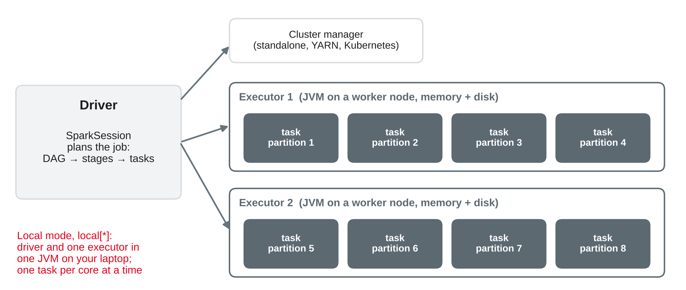
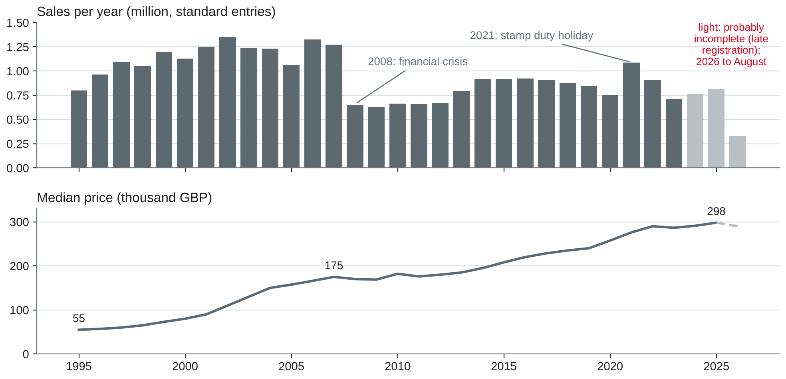
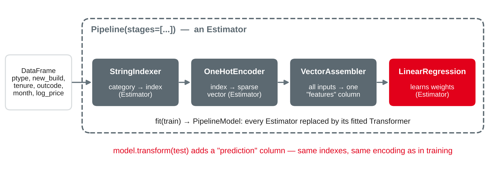

# Big Data Analytics with Spark {.title}

::: notes
Time plan for today (3 h): recap 5 min · Spark in brief 15 min · exercise 1 7 min · Spark SQL and DataFrames 20 min · exercise 2 8 min · break 10 min · ML pipeline with MLlib 15 min · DuckDB or Spark 12 min · exercise 3 8 min · lab 65 min · wrap-up 5 min · ~10 min buffer.
Input about 67 min, hands-on about 88 min (three exercises and the lab). The only Spark session of the course: students know the architecture from Cloud Computing and Big Data (W4DSKI_204), so the recap stays short and the focus is on analysis. Dataset: HM Land Registry Price Paid Data (all residential sales in England and Wales since 1995, Open Government Licence v3.0) — 31.6 million rows, 5.5 GB CSV. All numbers on the slides were run on a laptop-class machine (4 cores, 15 GB RAM, Linux) with PySpark 4.2.0 in local mode, OpenJDK 21, DuckDB 1.5.6, pandas 3.0.6 and scikit-learn 1.9.1, on the complete file downloaded on 22 October 2026 (published 28 September 2026; SHA-256 starts 39f0c69f). The file is updated monthly, so the counts of recent years will change slightly in a later download. Before class: download the five yearly files of the lab (about 850 MB) to a USB stick or the course platform in case the room network is slow — redistribution is allowed under the licence with the attribution statement.
:::

---

# Today's Agenda

1. Recap: where Part C left us — and the setup check
2. Spark in brief: driver, executors, partitions, lazy evaluation
3. Analysing large data with Spark SQL and DataFrames
4. One ML pipeline with Spark MLlib
5. DuckDB or Spark? When a big data framework is needed
6. Lab: 31 million property sales with PySpark

::: notes
Time and format guide (not shown to students):
0:00 Recap and setup check (plenary: who has `java -version` 17 or later and a working `pip install pyspark`?) · 0:05 Spark in brief (input) · 0:20 Exercise 1 (pairs, then plenary) · 0:27 Spark SQL and DataFrames (input + live demo) · 0:47 Exercise 2 (pairs) · 0:55 Break · 1:05 ML pipeline with MLlib (input + live demo) · 1:20 DuckDB or Spark (input + discussion) · 1:32 Exercise 3 (pairs) · 1:40 Lab (pairs, consultations) · 2:45 Wrap-up: three pairs give their DuckDB-or-Spark recommendation · ~10 min buffer.
Start the download of the lab data during the recap, so it is ready when the demo starts. Students without a working local Spark use a free cloud notebook (preparation task of session 14) or pair with a neighbour; DuckDB parts work on every laptop.
:::

---

# Recap: Where Part C Left Us

- Sessions 11–14: **temporal data and forecasting** — from one series (1,096 days) to 425 series
- Every dataset so far fitted easily into **pandas or DuckDB** on a laptop
- Portfolio: notebook 3 in progress; the **group case study** needs a big data framework **or** a dashboard

::: callout
**Today's question:** when does an analysis need a big data framework such as Spark — and what does it change in how we query and model?
:::

::: notes
Collect the preparation: java -version (Spark 4.2 runs on Java 17, 21 or 25) and pip install pyspark. Typical problems: an old Java 8 or 11 first on the PATH (fix JAVA_HOME), or no admin rights — then the cloud notebook. Link to the portfolio: the case study (40 %) asks for "a big data framework or dashboard"; today gives the material for the first option, session 6 gave Streamlit for the second. Notebook 3 continues in parallel; worksheet 15 is training material, not part of a notebook.
:::

---

# Spark in Brief {.section}

What you know from Cloud Computing and Big Data — in three slides

---

# Spark: One Engine, Many Machines

{width=78%}

- Data is split into **partitions**; one **task** processes one partition
- The same code runs in **local mode** on a laptop and on a cluster

::: source
Own illustration based on Zaharia et al. (2016) and Apache Software Foundation (n.d.-a); further reading: Tandon et al. (2022, Chapter 2) and Parsian (2022, Chapters 1–2).
:::

::: notes
Zaharia et al. (2016) describe Spark as a "unified engine": one programming model (resilient distributed datasets, RDDs) underneath SQL, streaming, machine learning and graph libraries, so they can be combined in one application. The Cluster Mode Overview defines the parts: the driver runs main() and creates the SparkContext (in PySpark: the SparkSession); a cluster manager (standalone, YARN, Kubernetes) allocates executors on worker nodes; an executor is a process that runs tasks and keeps data in memory or on disk; each action creates a job, which is split into stages of tasks. local[*] means: driver and executor in one JVM with one worker thread per core — no cluster needed, which is how we use Spark today.
:::

---

# Lazy Evaluation, Jobs and Shuffles

| Concept | Meaning | Example |
|---|---|---|
| **Transformation** | Defines a new DataFrame; computes nothing yet | `filter`, `select`, `withColumn`, `groupBy().agg()`, `join` |
| **Action** | Triggers a job and returns or writes a result | `count`, `show`, `collect`, `toPandas`, `write` |
| **Narrow** | Each output partition needs one input partition | `filter`, `withColumn` |
| **Wide (shuffle)** | Rows move between partitions over the network | `groupBy`, `join`, `orderBy`, window `PARTITION BY` |

- Lazy plans let the **Catalyst** optimiser rewrite the whole query before it runs
- Shuffles split a job into **stages** — they are what makes big data slow

::: source
Based on Apache Software Foundation (n.d.-b), Armbrust et al. (2015) and Zaharia et al. (2016).
:::

::: notes
The RDD programming guide: "All transformations in Spark are lazy, in that they do not compute their results right away"; they are computed when an action needs a result. Zaharia et al. explain the benefit: Spark sees the whole chain and can fuse operations into one pass and avoid data movement. Armbrust et al. (2015) introduce Spark SQL with the DataFrame API and Catalyst, an extensible optimiser — DataFrame code and SQL strings end up in the same optimised plan. A shuffle writes data to disk and sends it over the network: on a cluster it is the most expensive operation; on a laptop it is still the step that costs most. Demo idea: define three transformations (instant), then call count() (seconds) — students see laziness.
:::

---

# Spark on Your Laptop

```python
from pyspark.sql import SparkSession, functions as F
spark = (SparkSession.builder
         .master("local[*]")                              # all cores, one machine
         .appName("ppd")
         .config("spark.driver.memory", "4g")             # half the RAM at most
         .config("spark.sql.shuffle.partitions", "8")     # default 200
         .getOrCreate())
print(spark.version)                                      # 4.2.0 in our tests
```

- Needs **Java 17, 21 or 25** and Python 3.10 or later
- The Spark UI at **http://localhost:4040** shows jobs, stages and tasks

::: source
Based on Apache Software Foundation (n.d.-c, n.d.-d).
:::

::: notes
The Spark 4.2.0 overview page: "Spark runs on Java 17/21/25, Scala 2.13, Python 3.10+"; local[N] runs locally with N threads. spark.sql.shuffle.partitions defaults to 200 (performance tuning guide); adaptive query execution, enabled by default since Spark 3.2, coalesces small shuffle partitions anyway — in our tests 8 vs. 200 made only a small difference (district query 1.9 vs. 2.0 s warm), but 8 gives a tidier Spark UI. Known setup issues: (1) PySpark 4.2 warns "PySpark does not yet fully support pandas >= 3.0.0" — everything in today's lab ran with pandas 3.0.6 despite the warning; if something breaks, use a separate virtual environment with pandas below 3. (2) On Windows, writing files can fail with a winutils/HADOOP_HOME error — not testable here; then use the cloud notebook or work from the CSV files without writing Parquet. (3) Several Java versions installed: set JAVA_HOME to the 17+ one.
:::

---

# Exercise 1: When Does Spark Work? {.exercise}

```python
s = spark.read.parquet("data/ppd")                       # (1)
flats = s.filter(F.col("ptype") == "F")                  # (2)
by_town = flats.groupBy("town").agg(F.median("price"))   # (3)
top = by_town.orderBy(F.desc("median(price)"))           # (4)
top.show(5)                                              # (5)
print(flats.count())                                     # (6)
```

1. Which lines are transformations, which are actions? When does Spark read the data?
2. Which lines cause a **shuffle**? How many jobs do lines (1)–(6) start, at least?
3. Line (6) reads the data a second time. How could you avoid that — and when is it worth it?

::: notes
Pairs 4 min, plenary 3 min. Expected answers:
1 Transformations: (2), (3), (4); actions: (5) and (6). Line (1) reads only the Parquet metadata (schema, file list) — the rows are read when an action runs: in (5) and again in (6).
2 Shuffles: (3) groupBy (rows of one town must meet in one partition) and (4) orderBy (global sort, range partitioning). (2) is narrow. At least two jobs, one per action; in practice Spark starts more (e.g. a sampling job for the range partitioning of orderBy) — the Spark UI shows them.
3 flats.cache() (or persist) before the first action keeps the filtered rows in memory; worth it when the same intermediate result is used several times and fits in memory, not for a single use. Alternative: compute both results in one aggregation.
:::

---

# Spark SQL and DataFrames {.section}

31 million property sales

---

# The Lab Data: Price Paid Data

- Every residential sale for value in **England and Wales** registered with HM Land Registry, **1995 to today**
- Complete file: **31.6 million rows**, 16 columns, **5.5 GB** CSV without header; also one file per year (about 150–190 MB)
- Columns: price, date of transfer, postcode, property type (D, S, T, F, O), new build, tenure, address, district, county, category (A standard, B additional, e.g. repossessions)
- **Open Government Licence v3.0**: free use with the attribution "Contains HM Land Registry data © Crown copyright and database right 2021. This data is licensed under the Open Government Licence v3.0."

::: source
HM Land Registry (n.d.-a, n.d.-b); The National Archives (n.d.).
:::

::: notes
Why this dataset: real, business-relevant (property portals, banks, insurers, local planning), large enough that a naive pandas read_csv of all columns needs many GB of memory, and openly licensed. Read the licence details: HM Land Registry permits commercial and non-commercial use, but the address data come from Ordnance Survey AddressBase and Royal Mail PAF, which may be used only for personal and/or non-commercial use or to display property price information — our teaching use is fine; do not build a commercial address product from it. Category B (since October 2013) covers repossessions, buy-to-lets identified by a mortgage, transfers to companies and "other" property types; we use category A for price statistics. Excluded from the data: right-to-buy discounts, gifts, transfers of shares, and sales not lodged with HM Land Registry. Downloads: the official links on the gov.uk pages; the older HM Land Registry address http://prod.publicdata.landregistry.gov.uk.s3-website-eu-west-1.amazonaws.com/pp-complete.csv served the same file in our tests (the official host was blocked in our test network). Download time for 5.5 GB here: under 3 minutes.
:::

---

# Loading: Schema First, then Parquet

```python
SCHEMA = ("tid STRING, price INT, date TIMESTAMP, postcode STRING, ptype STRING, "
          "new_build STRING, tenure STRING, paon STRING, saon STRING, street STRING, "
          "locality STRING, town STRING, district STRING, county STRING, "
          "category STRING, status STRING")
raw = spark.read.csv("data/pp-*.csv", schema=SCHEMA)        # no header in the files
ppd = (raw.drop("paon", "saon", "street", "locality", "status")
          .withColumn("year", F.year("date")))
ppd.write.mode("overwrite").partitionBy("year").parquet("data/ppd")
p = spark.read.parquet("data/ppd"); p.createOrReplaceTempView("ppd")
```

- An explicit **schema** avoids a slow and error-prone schema inference pass
- **Parquet**, partitioned by year: 5.5 GB CSV → **1.2 GB**; queries read only the needed columns and years

::: source
Own example based on Apache Software Foundation (n.d.-e) and Armbrust et al. (2015); data from HM Land Registry (n.d.-a).
:::

::: notes
Tested on the complete file: 31,610,742 rows from 1 January 1995 to 28 August 2026; the CSV is read in 42 partitions (about 128 MB each); count() 6.4 s; writing Parquet 70 s; the Parquet data is read back in 13 partitions. No row failed to parse (no NULL price or date); the highest price is £900 million (category B), so INT is large enough. We drop the house number and street columns: not needed for the analysis, and less personal address detail in our copies. Parquet is columnar and compressed: a query on price and district reads only those columns (projection pushdown) and only the year folders it needs (partition pruning) — next slides. With the five yearly files of the lab (pp-*.csv): 4.7 million rows, 19 s to write.
:::

---

# The Same Question in Two APIs

::: columns
**DataFrame API**

```python
(p.filter(F.col("category") == "A")
  .groupBy("year")
  .agg(F.count("*").alias("sales"),
       F.median("price").alias("median_price"))
  .orderBy("year")
  .show())
```
|||
**Spark SQL**

```sql
SELECT year, count(*) AS sales,
       median(price) AS median_price
FROM ppd
WHERE category = 'A'
GROUP BY year
ORDER BY year
```
:::

- Both produce the **same optimised plan** — choose by readability and team habits
- SQL from sessions 2–4 transfers almost one to one; DuckDB returns the identical result

::: source
Based on Armbrust et al. (2015) and Apache Software Foundation (n.d.-e).
:::

::: notes
spark.sql("...") runs the SQL string on the temporary view registered on the previous slide. Armbrust et al. (2015) describe the DataFrame API as relational operations that are planned lazily and optimised by Catalyst, integrated with procedural code — that is why DataFrame code and SQL give the same plan (check with .explain()). Practical guidance: SQL for analysis queries that analysts read; the DataFrame API when building queries in Python (loops over columns, functions, parameters) and for ML pipelines. Window functions, CTEs, GROUPING SETS, ROLLUP and CUBE exist in Spark SQL as in DuckDB (session 4); QUALIFY is DuckDB-specific — in Spark, filter in an outer query. Tested: Spark and DuckDB return identical counts and identical exact medians for every year.
:::

---

# Result: Thirty Years of Sales

{width=74%}

- New-build share: **12.7 %** of 2022 sales, **6.2 %** of 2025, **0.2 %** of 2026 — new builds are **registered late**

::: source
Own analysis with Spark (Zaharia et al., 2016); data from HM Land Registry (n.d.-a).
:::

::: notes
Standard entries (category A). The financial crisis halved the number of sales (2007: 1.27 million, 2009: 0.63 million); the 2021 peak (1.09 million) coincides with the temporary stamp duty reduction during the pandemic — an explanation from outside the data, to be checked before it goes into a report. Data quality lesson, as with the incomplete year 1998 in TPC-H (session 2): the latest months are incomplete, and not at random — new-build sales take longer to register, so the new-build share falls from 11–13 % to 6.2 % in 2025. Any analysis of recent prices is biased towards established homes. Question to the class: what would you do in a report? (Mark the last periods as provisional, compare like with like, or re-run after later releases.)
:::

---

# Reading the Plan: `explain()`

```text
+- Window [rank(...) ...]
   +- Exchange SinglePartition                      <- shuffle: global ranking
      +- HashAggregate(keys=[district], ...)
         +- Exchange hashpartitioning(district, 8)  <- shuffle
            +- ObjectHashAggregate(keys=[district, year], functions=[percentile(price, 0.5)])
               +- Exchange hashpartitioning(district, year, 8)
                  +- FileScan parquet [price, district, category, year]
                     PartitionFilters: [year IN (2015, 2025)]
                     PushedFilters: [IsNotNull(category), EqualTo(category, A)]
```

- **PartitionFilters:** only 2 of 32 year folders are read · **ReadSchema:** 4 of 12 columns
- Each **Exchange** is a shuffle — read plans bottom-up, as in session 4

::: source
Own example with Spark (Armbrust et al., 2015); plan shortened.
:::

::: notes
This is the physical plan of the district growth query on the next slide (spark.sql(q).explain()), shortened: Project and Filter nodes and expression IDs removed. Points to find: the filter on category is pushed into the Parquet reader, the year filter prunes whole folders, only four columns are read. Three Exchange nodes = three shuffles: group by district and year (median), group by district (pivot of the two years), and the global window for the ranking, which moves everything into one partition — fine for 304 rows, a bottleneck for millions. AdaptiveSparkPlan isFinalPlan=false at the top means AQE may still change the plan at runtime.
:::

---

# Window Functions at Scale: Where Prices Grew

| District (≥ 500 sales in both years) | Median 2015 | Median 2025 | Growth | Rank of 304 |
|---|---|---|---|---|
| Salford | 129,995 | 240,000 | +84.6 % | 1 |
| Blaenau Gwent | 78,000 | 140,250 | +79.8 % | 2 |
| Oldham | 119,725 | 215,000 | +79.6 % | 3 |
| Kensington and Chelsea | 1,175,000 | 1,200,000 | +2.1 % | 302 |
| City of Westminster | 890,000 | 897,000 | +0.8 % | 303 |
| Hammersmith and Fulham | 730,000 | 709,600 | −2.8 % | 304 |

- Cheaper northern and Welsh districts grew fastest; central London was flat in nominal terms
- A **median** of a district hides changes in the **mix** of properties sold

::: source
Own analysis with Spark SQL (Armbrust et al., 2015); data from HM Land Registry (n.d.-a).
:::

::: notes
Query: CTE with median price and count per district and year (2015, 2025, category A); pivot with max(CASE WHEN year = 2015 ...); keep districts with at least 500 sales in both years (304 districts; 318 districts appear in 2024); rank() OVER (ORDER BY m25 / m15 DESC). Same result in DuckDB. Places 4 and 5: Leicester +79.4 %, Manchester +78.3 %. Nominal prices — inflation 2015–2025 is not removed. Interpretation caveat (session 5, storytelling): a district median changes when the mix changes (more flats sold, new-build estates) — a hedonic or repeat-sales index would control for that; the ONS/HM Land Registry house price index does. For the analysis this is ordinary analytical SQL; Spark only changes where it runs.
:::

---

# Exercise 2: Spot the Problem {.exercise}

An analyst reports: *"Flats are crashing: the median flat sold for £213,000 in 2026, 9 % below 2025 (£235,000) — and only 0.7 % of the flats sold were new builds, so developers have stopped building."* Her code:

```python
(p.filter(F.col("year") >= 2025)
  .groupBy("year", "ptype")
  .agg(F.percentile_approx("price", 0.5).alias("median"),
       F.avg((F.col("new_build") == "Y").cast("int")).alias("share_new")))
```

1. Find **three** problems in the code or in the conclusions.
2. Rewrite the query in Spark SQL with the corrections.

::: notes
Pairs 5 min, plenary 3 min. The numbers in the claim are exactly what this code returns in Spark on our download (all categories: percentile_approx 235,000 and 213,000, exact medians 235,000 and 213,500; new-build share of flats 8.4 % in 2025, 0.7 % in 2026). Expected answers:
1 (a) 2026 covers only January to August (and is still incomplete), compared with a full year 2025 — compare the same months; (b) new builds are registered late, so the 0.7 % says nothing about building activity — and because new-build flats are expensive (median £392,000 in January–August 2025), their absence lowers the 2026 median: a mix effect; (c) no filter on category = 'A': repossessions and company sales are mixed in; (d) percentile_approx is approximate — fine for exploration, check reported numbers with the exact median.
2 SELECT year, median(price) AS median_price, count(*) AS sales FROM ppd WHERE category = 'A' AND ptype = 'F' AND new_build = 'N' AND month(date) <= 8 AND year IN (2025, 2026) GROUP BY year. Tested: established flats, January–August: £235,000 (2025) vs. £220,000 (2026), −6.4 % — the fall shrinks but does not disappear; report it as provisional and re-check after later releases. In our data, percentile_approx and the exact median per year were identical in 30 of 32 years (2009: 168,950 vs. 168,900; 2015: 208,200 vs. 208,000).
:::

---

# An ML Pipeline with MLlib {.section}

A first price estimate for 763,740 sales

---

# The Use Case: A First Price Estimate

- A **property portal** wants to show a first price estimate next to each listing
- **Framing:** one row per sale · target log price · features known at listing: property type, new build, tenure, postcode district (e.g. RH15), month
- **Training:** 2023 (708,233 sales) · **test:** 2024 (763,740), category A only
- **Measures:** median absolute percentage error (**MdAPE**) and the share of estimates **within ±20 %**
- **Baseline first:** median price of the same postcode district and property type in 2023

::: source
Own framing based on Provost and Fawcett (2013) and Chapman et al. (2000); data from HM Land Registry (n.d.-a).
:::

::: notes
The six framing questions of session 7: decision (show an estimate or not; which range), unit (a sale), target (price; log because errors are relative and prices are skewed), timing (estimate made before the sale; train on an earlier year, test on the next — time-respecting as in session 8), features available at that point, and the cost of errors (an estimate 30 % off damages trust). MdAPE and "within ±x %" are the usual way to report automated valuation accuracy because the business cares about relative errors; we define them ourselves here. About 2,300 postcode districts; the baseline falls back to the median of the property type when a postcode district has fewer than 5 sales of that type (2,145 test rows). Missing: floor area, rooms, condition — the biggest price drivers are not in the data, so expectations should be modest.
:::

---

# Pipelines in MLlib

{width=86%}

| scikit-learn (session 8) | Spark MLlib |
|---|---|
| `Pipeline`, `fit`, `predict` | `Pipeline`, `fit`, `transform` (adds a `prediction` column) |
| `ColumnTransformer` + `OneHotEncoder` | `StringIndexer` + `OneHotEncoder` + `VectorAssembler` |

::: source
Own illustration based on Apache Software Foundation (n.d.-f) and Meng et al. (2016).
:::

::: notes
The ML Pipelines guide defines a Transformer as an algorithm that transforms one DataFrame into another (transform()), an Estimator as an algorithm that is fit on a DataFrame and produces a Transformer (fit()), and a Pipeline as a chain of stages that is itself an Estimator; fitting returns a PipelineModel, used at test time so that training and test data get identical feature processing — the same safety argument as for scikit-learn pipelines in session 8. MLlib models expect all inputs in one vector column ("features"), hence the VectorAssembler. Meng et al. (2016) describe MLlib as Spark's distributed ML library with a high-level pipeline API; the algorithms (linear models, trees, gradient-boosted trees, k-means, ALS) run on partitions in parallel.
:::

---

# The Pipeline in Code

```python
from pyspark.ml import Pipeline
from pyspark.ml.feature import StringIndexer, OneHotEncoder, VectorAssembler
from pyspark.ml.regression import LinearRegression
data = (p.filter("category = 'A' AND postcode IS NOT NULL AND year IN (2023, 2024)")
         .withColumn("outcode", F.split("postcode", " ")[0])
         .withColumn("month", F.month("date"))
         .withColumn("log_price", F.log("price")))
train, test = data.filter("year = 2023"), data.filter("year = 2024")
cats = ["ptype", "new_build", "tenure", "outcode"]
pipe = Pipeline(stages=[
    StringIndexer(inputCols=cats, outputCols=[c + "_i" for c in cats], handleInvalid="keep"),
    OneHotEncoder(inputCols=[c + "_i" for c in cats], outputCols=[c + "_v" for c in cats]),
    VectorAssembler(inputCols=[c + "_v" for c in cats] + ["month"], outputCol="features"),
    LinearRegression(featuresCol="features", labelCol="log_price")])
model = pipe.fit(train)
pred = model.transform(test)                       # adds the column "prediction"
```

::: source
Own example based on Apache Software Foundation (n.d.-f); data from HM Land Registry (n.d.-a).
:::

::: notes
handleInvalid="keep" gives postcode districts that appear only in 2024 their own "unknown" index instead of an error — the MLlib counterpart of handle_unknown="ignore". The fitted model has 2,287 features (one-hot columns plus month); training R² on the log scale 0.715. Fit 21 s, evaluation 19 s on our machine. Evaluation code (in the lab starter): ape = |exp(prediction) − price| / price, then F.median(ape) and the mean of (ape <= 0.2). The pipeline can be saved with model.write().save(path) and loaded in a batch scoring job — the deployment step of CRISP-DM.
:::

---

# Result: The Baseline Is Hard to Beat

| Test 2024 (763,740 sales) | MdAPE | Within ±10 % | Within ±20 % | Fit time |
|---|---|---|---|---|
| Median of all 2023 sales | 37.7 % | 13.3 % | 27.5 % | — |
| Median by property type | 34.8 % | 15.3 % | 30.0 % | — |
| **Baseline:** median by postcode district × type | **18.3 %** | **29.6 %** | **53.7 %** | 0.3 s (DuckDB) |
| MLlib linear regression, one-hot | 19.1 % | 28.1 % | 51.8 % | 21 s |
| MLlib gradient-boosted trees + baseline as feature | 18.4 % | 29.4 % | 53.4 % | 61 s |

- Location and type explain most of what these columns can explain — size and condition are **missing**
- Spark made the model **possible at scale**, not **better**

::: source
Own analysis with Spark MLlib (Meng et al., 2016) and DuckDB (Raasveldt & Mühleisen, 2019); data from HM Land Registry (n.d.-a).
:::

::: notes
All models on the log scale, back-transformed with exp. Gradient-boosted trees: GBTRegressor(maxIter=50, maxDepth=5, seed=42) on property type, new build, tenure, month and the baseline value (the training median of the postcode district × type — target encoding computed on 2023 only); the baseline feature takes 93 % of the importance. Training on 2022–2023 instead of 2023 does not help (linear regression MdAPE 19.1 %). The same linear model in scikit-learn on the same rows: identical MdAPE (19.1 %), fit in 3.9 s after 2.3 s to load both years from Parquet with DuckDB. Median log ratio prediction − actual: +0.004 for the linear model, so 2023 prices transfer well to 2024 (median price +1.6 %). Message as in session 8: "a simple rule is enough" is a valid, valuable result; the next step would be more information (floor area from energy performance certificates, for example), not a bigger engine.
:::

---

# DuckDB or Spark? {.section}

When a big data framework is needed

---

# Same Data, Two Engines

| 31.6 million rows, 4 cores, 15 GB RAM | Spark 4.2 (local) | DuckDB 1.5 |
|---|---|---|
| Count rows in the 5.5 GB CSV | 6.4 s | 6.3 s |
| CSV → Parquet | 70 s | 22 s |
| Q1: sales and exact median per year | 3.0–7.9 s | 0.4–0.5 s |
| Q2: district growth with window ranking | 1.9–4.4 s | 0.05–0.07 s |
| Q3: filter and count (London sales over £5 million) | 0.9–1.5 s | 0.1–0.2 s |
| Linear regression on 708,233 rows | 21 s (MLlib) | 3.9 s (scikit-learn) |

- On **one machine**, the single-node engine wins: Spark pays for planning, JVM and shuffles that a cluster needs
- Spark's advantage starts where one machine **ends**

::: source
Own measurements with Spark (Zaharia et al., 2016) and DuckDB (Raasveldt & Mühleisen, 2019); data from HM Land Registry (n.d.-a).
:::

::: notes
Three runs per query, first run first (the first Spark run includes warm-up); same Parquet files for both engines (DuckDB read Spark's year folders with hive_partitioning=true), identical results. Q3 counts 15,902 sales. Do not over-generalise: one machine, one dataset, small queries; timings vary with hardware, file layout and versions — measure on your own data. CSV → Parquet: DuckDB wrote one file, Spark 32 year folders. DuckDB also handles data larger than memory by spilling to disk, so "fits in RAM" is not the limit; "fits on one machine's disk and finishes in acceptable time" is closer.
:::

---

# When Is a Big Data Framework Needed?

| Requirement | One machine (DuckDB, pandas) | Spark (or similar) |
|---|---|---|
| Data volume | Fits on one disk; queries finish in acceptable time | Larger than one machine, or too slow on the biggest one |
| Where the data lives | Files on a laptop or one server | Already in a data lake or lakehouse on a cluster |
| Workload | Interactive analysis, notebooks, prototypes | Scheduled pipelines over many TB, many parallel jobs |
| Reliability | A failed run is simply restarted | Long jobs must survive failing machines |
| Streams | Batch files | Continuous streams (Structured Streaming) |
| Team and platform | Individual analysts | A shared platform with governance |

- **COST** (McSherry et al., 2015): how much hardware does a distributed system need to beat one good single-threaded program? Choose the **smallest tool that meets the requirements**

::: source
Own compilation based on Zaharia et al. (2016), McSherry et al. (2015), Raasveldt and Mühleisen (2019) and Armbrust et al. (2021).
:::

::: notes
Zaharia et al. (2016): fault tolerance through lineage (lost partitions are recomputed), one engine for batch, SQL, streaming and ML. Armbrust et al. (2021, session 2): lakehouses keep data in open formats on cloud storage, and engines such as Spark run on it — often the decision is made by the platform, not by data size. Practical pattern: prototype on a sample or a few yearly files with DuckDB, run the production pipeline where the data lives. The same SQL largely works in both. Many companies with "big data" have a few large fact tables and many small ones — check the size of the tables you actually query. COST: McSherry, Isard and Murray (2015) define it as the "Configuration that Outperforms a Single Thread" and report that many data-parallel systems from recent systems conferences had a very high COST, sometimes hundreds of cores, and some were slower than a single thread in every configuration reported. The point is not that Spark is bad, but that scalability alone is not a goal: measure against a strong single-machine baseline — as with forecasting and ML baselines. DuckDB was designed as an embedded analytical database for analysis on one machine (Raasveldt & Mühleisen, 2019). Discussion: what in your company would need more than one machine?
:::

---

# Exercise 3: Which Tool? {.exercise}

Choose DuckDB/pandas on one machine or Spark, and name the deciding requirement.

1. A controller analyses **8 GB** of order lines from the ERP export, once a month, in a notebook.
2. An online shop computes recommendations every night from **40 TB** of clickstream data in its cloud data lake.
3. A team trains a churn model on **2 million** customer rows; the data comes from the warehouse.
4. A utility monitors **smart-meter readings** from 3 million households, arriving every 15 minutes, for anomalies.
5. Your case study group wants to analyse the **31 million** Price Paid rows.

::: notes
Pairs 5 min, plenary 3 min. Expected answers:
1 DuckDB (or pandas with Parquet): fits on one laptop; Spark would add setup without benefit.
2 Spark (or another distributed engine): volume beyond one machine, data already in the lake, nightly pipeline that must survive machine failures.
3 One machine: 2 million rows fit easily; scikit-learn plus SQL in the warehouse; Spark only if the company platform requires it.
4 Streaming at scale: Spark Structured Streaming (or Flink/Kafka Streams); 3 million × 96 readings a day ≈ 288 million rows per day, continuously — volume and velocity.
5 Both are defensible: DuckDB is faster here (see the timing slide); Spark is the right choice if the group's goal is to show a big data framework — then say so and measure both. The case study asks for a justified choice, not for Spark at any price.
:::

---

# Lab Starter: 31 Million Property Sales

```python
import os, urllib.request
BASE = "http://prod.publicdata.landregistry.gov.uk.s3-website-eu-west-1.amazonaws.com/"
os.makedirs("data", exist_ok=True)
for y in (2015, 2022, 2023, 2024, 2025):                  # about 850 MB
    urllib.request.urlretrieve(BASE + f"pp-{y}.csv", f"data/pp-{y}.csv")
# optional: BASE + "pp-complete.csv" (5.5 GB, 1995 to today)
```

- Then the Spark session and the loading code from the previous slides: `spark.read.csv("data/pp-*.csv", schema=SCHEMA)` → Parquet in `data/ppd`
- Evaluation helper for the ML part:

```python
def mdape(df, col="prediction"):
    ape = F.abs(F.exp(F.col(col)) - F.col("price")) / F.col("price")
    return df.agg(F.median(ape).alias("MdAPE"), F.avg((ape <= 0.2).cast("int")).alias("within_20pct"))
```

::: source
Own example; data from HM Land Registry (n.d.-a), licensed under the Open Government Licence v3.0.
:::

::: notes
Tested end to end with spark.driver.memory 4g (laptops with 8 GB RAM): download 31 s on our connection, Parquet 19 s, all lab queries and the pipeline about 2 minutes in total. The five yearly files contain 4,856,029 rows: 2015 1,011,782 · 2022 1,077,205 · 2023 861,502 · 2024 931,453 · 2025 974,087 (category A + B). The yearly file of a year contains exactly the sales dated in that year, so all lab results equal those on the complete file. Fallback if Spark does not run: do tasks 1–4 in DuckDB (read_csv with the same column list) and pair up for the MLlib part.
:::

---

# Lab Tasks {.exercise}

Work in pairs; write queries, results and one sentence of interpretation per task.

1. **Load and check:** rows per year and category; NULLs in price, date, postcode; the highest prices
2. **Two APIs:** sales and median price per year and property type — once as DataFrame code, once as Spark SQL
3. **Window function:** district growth 2015 → 2025 with `rank()`; run `explain()` and find the pruning and the shuffles
4. **Data quality:** new-build share per year — what does it mean for an analysis of 2025?
5. **MLlib:** run the pipeline, compute the baseline, then try **one** improvement and compare
6. **DuckDB or Spark:** run tasks 2–3 in DuckDB on the same Parquet files, time both, and write a three-sentence recommendation for your case study

::: notes
Expected results (tested): 1 — 2015: 918,957 A / 92,825 B; 2022: 909,941 / 167,264; 2023: 708,315 / 153,187; 2024: 763,905 / 167,548; 2025: 809,461 / 164,626; no NULL prices or dates; postcode NULL in about 0.16 % of all rows (50,792 of 31.6 million in the complete file). 2 — medians by type 2024: detached 415,000, semi-detached 269,950, terraced 235,000, flats 245,000. 3 — as on the slide; PartitionFilters [year IN (2015, 2025)], three Exchange nodes. 4 — 12.7 % (2022), 11.3 % (2023), 9.5 % (2024), 6.2 % (2025): recent years under-represent new builds. 5 — linear regression MdAPE 19.1 %, baseline 18.3 %; typical improvements: GBT with the baseline as a feature (18.4 %), training on 2022–2023 (19.1 %) — none beats the baseline clearly; a good answer says so. 6 — DuckDB about 6–40 times faster on these queries on one laptop (warm runs). Consult each pair at least once; check that they filter category A and treat 2025/2026 as incomplete. Pairs that finish early: worksheet 15, task 6.
:::

---

# Key Takeaways

- Spark splits data into **partitions** and work into **tasks**; transformations are **lazy**, actions run jobs, shuffles cost most
- **Spark SQL and DataFrames** are two APIs on one optimiser — analytical SQL from this course carries over
- Store large data as **Parquet**, partitioned by a common filter; read plans with `explain()`
- **MLlib pipelines** mirror scikit-learn: fit on training data, transform test data — and still start with a **baseline**
- On one machine **DuckDB** is usually faster; Spark is needed when data, workload or platform exceed one machine

---

# Next Session: Case Study Workshop

- Team work on the **group case study**
- Review of approach, results and dashboards — with consultations
- Feedback round between teams
- Preparing the presentations of session 17

::: callout
**Preparation:** bring your case study notebook in its current state, one open question for the consultation, and a first outline of your presentation. If you use Spark or DuckDB, note why — with a measurement.
:::

---

# References (1/2) {.references}

- Apache Software Foundation. (n.d.-a). *Cluster mode overview* (Spark 4.2.0 documentation). Retrieved October 22, 2026, from https://spark.apache.org/docs/latest/cluster-overview.html
- Apache Software Foundation. (n.d.-b). *RDD programming guide* (Spark 4.2.0 documentation). Retrieved October 22, 2026, from https://spark.apache.org/docs/latest/rdd-programming-guide.html
- Apache Software Foundation. (n.d.-c). *Spark overview* (Spark 4.2.0 documentation). Retrieved October 22, 2026, from https://spark.apache.org/docs/latest/index.html
- Apache Software Foundation. (n.d.-d). *Performance tuning* (Spark 4.2.0 documentation, Spark SQL guide). Retrieved October 22, 2026, from https://spark.apache.org/docs/latest/sql-performance-tuning.html
- Apache Software Foundation. (n.d.-e). *Spark SQL, DataFrames and Datasets guide* (Spark 4.2.0 documentation). Retrieved October 22, 2026, from https://spark.apache.org/docs/latest/sql-programming-guide.html
- Apache Software Foundation. (n.d.-f). *ML pipelines* (Spark 4.2.0 documentation). Retrieved October 22, 2026, from https://spark.apache.org/docs/latest/ml-pipeline.html
- Armbrust, M., Ghodsi, A., Xin, R., & Zaharia, M. (2021). Lakehouse: A new generation of open platforms that unify data warehousing and advanced analytics. In *Proceedings of the 11th Conference on Innovative Data Systems Research (CIDR)*. https://www.cidrdb.org/cidr2021/papers/cidr2021_paper17.pdf
- Armbrust, M., Xin, R. S., Lian, C., Huai, Y., Liu, D., Bradley, J. K., Meng, X., Kaftan, T., Franklin, M. J., Ghodsi, A., & Zaharia, M. (2015). Spark SQL: Relational data processing in Spark. In *Proceedings of the 2015 ACM SIGMOD International Conference on Management of Data*. ACM. https://doi.org/10.1145/2723372.2742797
- Chapman, P., Clinton, J., Kerber, R., Khabaza, T., Reinartz, T., Shearer, C., & Wirth, R. (2000). *CRISP-DM 1.0: Step-by-step data mining guide*. SPSS.
- HM Land Registry. (n.d.-a). *Price Paid Data* [Data set]. GOV.UK. Retrieved October 22, 2026, from https://www.gov.uk/government/statistical-data-sets/price-paid-data-downloads
- HM Land Registry. (n.d.-b). *How to access HM Land Registry Price Paid Data*. GOV.UK. Retrieved October 22, 2026, from https://www.gov.uk/about-the-price-paid-data

---

# References (2/2) {.references}

- McSherry, F., Isard, M., & Murray, D. G. (2015). Scalability! But at what COST? In *15th Workshop on Hot Topics in Operating Systems (HotOS XV)*. USENIX Association. https://www.usenix.org/conference/hotos15/workshop-program/presentation/mcsherry
- Meng, X., Bradley, J., Yavuz, B., Sparks, E., Venkataraman, S., Liu, D., Freeman, J., Tsai, D. B., Amde, M., Owen, S., Xin, D., Xin, R., Franklin, M. J., Zadeh, R., Zaharia, M., & Talwalkar, A. (2016). MLlib: Machine learning in Apache Spark. *Journal of Machine Learning Research, 17*(34), 1–7. https://jmlr.org/papers/v17/15-237.html
- Parsian, M. (2022). *Data algorithms with Spark: Recipes and design patterns for scaling up using PySpark*. O'Reilly Media.
- Provost, F., & Fawcett, T. (2013). *Data science for business: What you need to know about data mining and data-analytic thinking*. O'Reilly Media.
- Raasveldt, M., & Mühleisen, H. (2019). DuckDB: An embeddable analytical database. In *Proceedings of the 2019 International Conference on Management of Data (SIGMOD '19)* (pp. 1981–1984). ACM. https://doi.org/10.1145/3299869.3320212
- Tandon, A., Ryza, S., Laserson, U., Owen, S., & Wills, J. (2022). *Advanced analytics with PySpark: Patterns for learning from data at scale using Python and Spark*. O'Reilly Media.
- The National Archives. (n.d.). *Open Government Licence for public sector information* (Version 3.0). Retrieved October 22, 2026, from https://www.nationalarchives.gov.uk/doc/open-government-licence/version/3/
- Zaharia, M., Xin, R. S., Wendell, P., Das, T., Armbrust, M., Dave, A., Meng, X., Rosen, J., Venkataraman, S., Franklin, M. J., Ghodsi, A., Gonzalez, J., Shenker, S., & Stoica, I. (2016). Apache Spark: A unified engine for big data processing. *Communications of the ACM, 59*(11), 56–65. https://doi.org/10.1145/2934664
