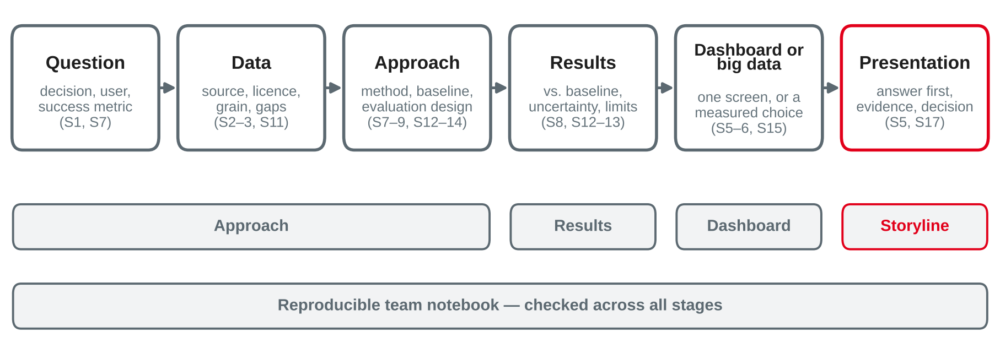

# Case Study Workshop {.title}

::: notes
Workshop block: no new content. Time plan for today (3 h): recap and status round 8 min · the case study and today's plan 7 min · review checklists 12 min · common pitfalls 10 min · exercise "spot the pitfall" 10 min · break 10 min · team work with consultations 55 min · feedback round between teams 25 min · preparing the presentations 12 min · storyboard exercise 15 min · partner projects status 5 min · wrap-up 5 min · ~6 min buffer.
Input about 50 min, hands-on about 105 min. Teams need their case study notebook (and dashboard or Spark code, if any) in its current state, as asked on the "Next Session" slide of session 15: notebook, one open question for the consultation, a first presentation outline, and a measurement if they use Spark or DuckDB. Nothing new is installed today. Before class: prepare a consultation list with one slot per team, and decide which teams review each other in the feedback round (pairs of teams with different datasets work best — the reviewers then cannot rely on domain knowledge and must check the reasoning).
:::

---

# Today's Agenda

1. Recap: where session 15 left us — and your preparation
2. The group case study and today's plan
3. Review checklists: approach, results, dashboards
4. Common pitfalls from sessions 1–15
5. Team work with consultations
6. Feedback round between teams
7. Preparing the presentations for session 17

::: notes
Time and format guide (not shown to students):
0:00 Status round (plenary: each team says its question, dataset and its biggest open point in two sentences) · 0:08 Case study and today's plan (input) · 0:15 Checklists (input) · 0:27 Pitfalls (input) · 0:37 Spot the pitfall (pairs within teams, then plenary) · 0:47 Break · 0:57 Team work with consultations (one slot per team at its table) · 1:52 Feedback round (two teams swap) · 2:17 Presentations: structure and slides (input) · 2:29 Storyboard (teams) · 2:44 Partner projects status (plenary, short) · 2:49 Wrap-up · ~6 min buffer.
Order is flexible: if many teams are blocked, start the team work right after the checklists and show the pitfall slides later as a plenary interlude when three teams have the same problem.
:::

---

# Recap: Where Session 15 Left Us

- Spark splits work into **partitions and tasks**; on one machine **DuckDB** was 6–40 times faster
- In the price estimate, the **baseline** (median by postcode district and type) beat the MLlib model
- Choose the **smallest tool that meets the requirements** — and justify it with a measurement

::: callout
**Your preparation:** your case study notebook, one open question for the consultation, a first presentation outline — and, if you use Spark or DuckDB, the reason with a measurement.
:::

::: notes
Status round: ask every team for its question, its dataset and its biggest open point; write the open points on the whiteboard and cluster them (data and definitions · method and evaluation · dashboard · tool choice · presentation). The clusters decide the order of consultations and whether a pitfall slide is worth repeating for the whole room. Remind teams of the session 15 message: "Spark made the model possible at scale, not better" — a measured DuckDB-or-Spark decision is a strong part of a case study, whichever way it goes.
:::

---

# The Group Case Study at a Glance

An **end-to-end** case on a **public dataset**, with a **big data framework or a dashboard** — delivered as a **notebook** and a **presentation** in session 17.

{width=100%}

::: source
Own illustration based on Chapman et al. (2000) and Few (2013).
:::

::: notes
Portfolio table (session 1): group case study, 40 %, notebook plus presentation. The case study deliberately uses public data, not partner-company data (confidentiality, no double assessment with the semester-6 project). The official brief with deadline, format and assessment criteria is published separately on the course platform — today's checklists are guidance for the review, not the rubric. The figure is the plan for the day: each checklist later in the deck checks one or more stages; the storyline is prepared at the end. Point out that the stages follow CRISP-DM (business understanding to deployment), and that "deployment" here means a dashboard, a scheduled pipeline or a clear recommendation.
:::

---

# How Today Works

::: cards
### Team work
Work on the open points of your case study. Use the checklists to decide what is missing.
### Consultations
Each team gets a slot at its table. Bring **one** concrete question — with the cell, query or chart where you are stuck.
### Feedback round
Two teams swap notebooks and dashboards and review each other against the checklists.
### Presentation preparation
Turn your results into a storyline for session 17 — titles first, slides later.
:::

::: notes
Consultation rules as in session 10: the minimal-example format (what do you want to find out, what did you do, what did you expect and get, what have you tried). A slot is for one question; if a problem needs more, give the team a concrete next step and come back. Keep a list of recurring questions; if three teams share one, explain it to the room. Rule for the room: every team leaves today with (1) a list of open tasks with owners, (2) the feedback of another team, (3) a storyboard of action titles.
:::

---

# Review Checklists {.section}

Approach · results · dashboards · reproducibility

---

# Checklist: Approach

- **Question:** one business question and the **decision** it supports — with a user and a success metric
- **Data:** source, licence, time span, **grain** and known gaps documented; incomplete periods marked
- **Method choice:** why this method for this question — descriptive, predictive or causal?
- **Baseline:** a simple method, evaluated **exactly like** the main method
- **Evaluation design:** split in time where time matters; test data used **once**; features known at the prediction point
- **Tool choice:** DuckDB, pandas, Spark or a dashboard tool — justified by data size, workload and a **measurement**

::: source
Own compilation based on Chapman et al. (2000), Kaufman et al. (2012) and McSherry et al. (2015).
:::

::: notes
The checklist condenses the framing questions of session 7, the evaluation design of sessions 8 and 12, and the tool decision of session 15. Typical gaps found in case study drafts: a question that is a topic ("analyse bike trips") instead of a decision; no baseline because "the data is new"; Spark chosen because the dataset "sounds big". Ask teams to write the question and the decision as the first Markdown cell of the notebook — the presentation starts from the same sentence.
:::

---

# Checklist: Results

- **Against the baseline:** improvement in the unit of the business (MW, euros, hits at capacity) — not only a score
- **Spread, not only averages:** errors per fold, season, segment or level; outliers explained
- **Uncertainty:** intervals or ranges with their coverage; experiments with a confidence interval
- **Honesty:** ex ante vs. ex post stated; negative results reported — "the baseline is enough" is a result
- **Interpretation:** every table and chart has one or two sentences: what it means and how sure we are
- **Limits and next step:** what the data and method cannot show — and what would close the gap

::: source
Own compilation based on Hyndman and Athanasopoulos (2021), Kohavi et al. (2020) and Provost and Fawcett (2013).
:::

::: notes
Examples from the course to quote in consultations: session 12 — errors varied more between origins than between methods; one auto-SARIMA refit blew up in a single fold, so "check every fold"; session 13 — 80 % intervals covered 82–88 % overall but only 37–57 % in January–February; ex post with observed temperature (GBM 145 MW) looked far better than the honest ex ante result (228 MW); session 15 — the baseline beat linear regression (MdAPE 18.3 % vs. 19.1 %). A results section that shows such facts openly is stronger than one with a single good average.
:::

---

# Checklist: Dashboards

- **Purpose and role:** who uses it, for which decision — strategic, analytical or operational?
- **One screen:** the most important KPI top left, details below or on click
- **Context for every number:** target, previous period or benchmark; **defined** KPIs
- **Honest charts:** bars start at zero, no dual axes, incomplete periods marked, one accent colour
- **Visible filters and data freshness:** "Data as of …", time zone, complete periods only
- **Access:** filters by user enforced in the **query**, not only in the widget

::: source
Own compilation based on Few (2013) and Knaflic (2015).
:::

::: notes
Sessions 5 and 6 in one list. For Streamlit apps also check: cached queries (st.cache_data), no hard-coded local paths, the app starts with one command from the README. A dashboard in the case study is judged like a chart in a report: does it answer the question at a glance? A common problem is the "everything dashboard" with 12 tiles and no message — ask the team which three numbers a user would check every morning and build the screen around them.
:::

---

# Checklist: Reproducible Team Notebook

- Runs **top to bottom** on a fresh kernel; data loaded by URL or script, not copied by hand
- Library **versions** printed or pinned (`requirements.txt`); random seeds fixed
- One **shared repository** — no "final_v3_really_final.ipynb" on four laptops
- Every number in the text comes from a **cell above it**
- Markdown cells explain **decisions**; long code moves to functions or modules
- Names of all team members, the date and the **data licence** at the top

::: source
Based on Sandve et al. (2013).
:::

::: notes
Same rules as the notebook checklist of session 10, extended for teams. Sandve et al. (2013) give ten rules, among them: keep track of how every result was produced, avoid manual data manipulation steps, archive the exact versions of external programs, version-control custom scripts, record random seeds, and store raw data behind plots. Practical test today: one team member who did not write a section restarts the kernel and runs it. If the dataset is large (e.g. Price Paid Data), the notebook downloads it or documents the exact file and download date; a small sample for the review is fine if the notebook says so. Licence line: e.g. the OGL attribution statement for HM Land Registry data, or the GPL-3 note for tsibbledata datasets.
:::

---

# Common Pitfalls {.section}

What went wrong most often in sessions 1–15

---

# Pitfalls (1/2): Data, Queries and Charts

| Pitfall | Seen in | Check |
|---|---|---|
| Incomplete last period | TPC-H 1998 ends on 2 August; Price Paid 2026 to August | Compare like with like; mark provisional data |
| Mixed grain | Order fee on every order line | State the grain of every table |
| Average of ratios | "Revenue per customer" averaged over regions | Sum ÷ sum, defined once |
| Wrong aggregation over time | Summing a level such as MW | Sum flows, average levels |
| Time zones and DST | 46 or 50 half-hours on six days of vic_elec | Store in UTC, analyse in local time |
| Mix effects in medians | New builds registered late | Compare like with like, or control the mix |
| Misleading charts | Truncated bars, dual axes | Session 5 rules |

::: source
Own compilation of sessions 2–6, 11 and 15, based on Kimball and Ross (2013) and Knaflic (2015).
:::

::: notes
Every row is a trap that students met in a lab: session 2/5 (1998 "collapse"), session 3 (shipping fee, mixed grain), session 6 (non-additive ratio in the semantic layer), session 11 (aggregation by the nature of the measure; DST days), session 15 (new-build share 12.7 % in 2022 vs. 6.2 % in 2025 because of late registration). Ask the room: which of these could appear in your own case study dataset? Most public datasets have at least an incomplete last period.
:::

---

# Pitfalls (2/2): Models, Forecasts and Experiments

| Pitfall | Seen in | Check |
|---|---|---|
| Leakage | A feature from the label window (lift 2.90) | Everything known at the prediction point? |
| Random split of time-ordered data | Churn snapshots, daily demand | Later cut-off, rolling origins |
| Choosing on the test period | Model or parameters picked by test error | Validate first, test **once** |
| No baseline | Majority class at 65.5 % accuracy | Seasonal naive, a rule, a median |
| Ex post sold as ex ante | Observed temperature: 145 vs. 228 MW | Use only what is known at the origin |
| Averages hide failures | Intervals 82–88 % overall, 37–57 % in Jan–Feb | Per fold, season, segment |
| Peeking, fishing in segments | "Significant" after a few days | Plan once, analyse once |

::: source
Own compilation of sessions 7–9 and 12–15, based on Kaufman et al. (2012), Hyndman and Athanasopoulos (2021) and Kohavi et al. (2020).
:::

::: notes
Numbers from the session decks: lift 2.90 of the leaky "orders in 1997" feature (session 7); 65.5 % accuracy of the majority baseline (session 7); GBM ex post 145 MW vs. ex ante 228 MW MAE (session 13); interval coverage 82–88 % overall and 37–57 % in January–February (session 13). The bigger-engine pitfall belongs here too: the MLlib model did not beat the median baseline (session 15). Point to the leakage row first — as in worksheet 10: as long as a leak is in the model, every other number is meaningless.
:::

---

# Exercise: Spot the Pitfall {.exercise}

A draft case study on a **city bike-sharing** dataset (fictional): trips per station, 2023 to 30 September 2025.

1. "Trips fell by 28 % in 2025 compared with 2024."
2. "Our model forecasts tomorrow's trips with an MAE of 210 — using the measured weather of that day."
3. "Average trip duration: 14.2 minutes, the mean of the 180 station averages."
4. "We used Spark because 9 million trips are big data."
5. "We predict which stations run empty in the next hour with 95 % accuracy." (5 % of station-hours run empty)
6. "Rush hour peaks at 06:00 and 15:00." (Timestamps in UTC; the city is in Germany)

For each statement: name the pitfall and the check that would fix it.

::: notes
Pairs within the teams 6 min, plenary 4 min. Expected answers:
1 Incomplete period: 2025 has nine months, 2024 twelve — compare January–September of both years (or trips per day); bike trips are seasonal, and the missing months include autumn, so the bias is not just three twelfths.
2 Ex post sold as ex ante: tomorrow's measured weather is not known at the origin — use the weather forecast or climatology, report both and label them.
3 Average of ratios: stations with few trips count as much as busy ones — total duration ÷ total trips; also check outliers (bikes not returned) and use the median.
4 Tool choice without measurement: 9 million rows fit easily in DuckDB or pandas on a laptop; Spark is defensible only with a reason (showing the framework, data already in a lake) — then measure both (session 15).
5 No baseline: "never empty" already reaches 95 % — use precision and recall at the number of stations the operator can refill, compare with a rule (e.g. stock below 3 bikes).
6 Time zone: 06:00 and 15:00 UTC are 08:00 and 17:00 in German summer time (07:00 and 16:00 in winter) — convert to local time before computing daily profiles (session 11).
:::

---

# Feedback Round {.section}

Two teams review each other

---

# Feedback Round: Team Review {.exercise}

Swap notebook and dashboard with your partner team. Review against the checklists, then give feedback.

1. **Read:** the question cell, the results section and the dashboard first — can you say in one sentence what the team found?
2. **Check:** one checklist each for approach, results, dashboard and reproducibility — note evidence (cell, chart, number)
3. **Feedback:** two strengths, three suggestions with a concrete next step, one question

::: callout
Feedback is about the **work**, not the people — and only useful if the other team can act on it before session 17.
:::

::: source
Based on Hattie and Timperley (2007).
:::

::: notes
Format: within each team, split the four checklists among members (one or two per checklist), 12 min reading, then 6 min feedback per direction. The first step tests the storyline: if the reviewers cannot say what the team found, the presentation will have the same problem. Hattie and Timperley's three questions structure the feedback: where am I going (the question and the decision), how am I going (checklist evidence), where to next (the three suggestions). Walk around and push for concrete suggestions ("show MAE per fold in a chart, not only the mean") rather than vague ones ("more analysis"). Worksheet 16 practises the same review on a fictional case.
:::

---

# Preparing the Presentations {.section}

From notebook to storyline

---

# A Storyline for Session 17

1. **Question and decision:** who decides what, and why it matters
2. **Answer first:** the main finding in one sentence
3. **Data:** source, size, time span, the most important limitation
4. **Approach:** method and baseline, and how you evaluated
5. **Evidence:** two or three results with action titles — including what did **not** work
6. **Dashboard or big data part:** a short demo or screenshots, and why this tool
7. **Recommendation:** what to do, how sure you are, the next step

::: source
Own compilation based on Knaflic (2015) and Chapman et al. (2000).
:::

::: notes
This is the communication structure of session 8 (answer first, evidence, decision, limits, next step) applied to a presentation, plus Knaflic's "big idea": one sentence with a point of view and what is at stake. The presentation time per team and the running order of session 17 are set by the lecturer (open decision — announce them today if possible). Tell teams to plan the content for the time they get, not for the work they did: most teams have too many slides; a good test is that the titles alone tell the story.
:::

---

# Slides, Demo and Questions

- **Action titles:** "SARIMA cuts the error by 14 % against seasonal naive" — not "Results"
- **One message per slide;** large numbers, few charts, the chart rules of session 5
- **Live demo with a fallback:** screenshots or a recording in case the network or the app fails
- **Everyone has a part** — and every member can answer questions on the whole case
- **Rehearse once with a timer**, and prepare for the obvious questions: baseline? leakage? why this tool?

::: source
Based on Knaflic (2015).
:::

::: notes
Example action title from the course: in session 12, SARIMA had an MAE of 271 MW against 316 MW for seasonal naive (lag 364), i.e. about 14 % lower — a team on vic_elec could use exactly that title. Knaflic's test: if the audience reads only the titles, do they get the story? Demo failures are the most common problem in student presentations: the room network, a Streamlit app that needs a database file on another laptop, a Spark session that takes a minute to start. Recommend starting the app before the session and keeping screenshots in the slides. Questions from the audience typically target the baseline, the test period and the tool choice — the three checklists of today.
:::

---

# Exercise: Storyboard in Action Titles {.exercise}

In your team, without opening a slide tool:

1. Write the **one-sentence answer** of your case study.
2. Write **six to eight action titles** — one per slide, in order — that tell the story on their own.
3. Mark each title with the **evidence** behind it: a cell, a chart or a number in your notebook.
4. Mark any title without evidence yet — that is your to-do list until session 17.

::: notes
Teams 12 min, then 3 min: two volunteer teams read their titles aloud; the room says whether the story is clear. Expected kind of answers: a title sequence such as "Demand planners need a 14-day forecast to buy power" → "A weekly-seasonal baseline is already within 7 % of actual demand" → "SARIMA improves it by 14 %, mostly in summer" → "Intervals are too narrow in heat waves" → "The dashboard shows the forecast with its uncertainty" → "Recommendation: use SARIMA with a seasonal-naive fallback; add temperature forecasts next". Typical weaknesses: topic titles ("Data", "Model"), no title on what did not work, a recommendation that does not follow from the evidence. Titles without evidence are the most useful output of the exercise.
:::

---

# Partner Projects: Status Before Semester 6

::: columns
**Project A: {{private:partner_a|Partner Company A}}**

**Topic:** {{private:partner_a_topic|Presented by the partner company in session 1}}

- Project brief: status and open points
- Data access: requested, granted, open?
- Next contact with the partner
|||
**Project B: {{private:partner_b|Partner Company B}}**

**Topic:** {{private:partner_b_topic|Presented by the partner company in session 1}}

- Project brief: status and open points
- Data access: requested, granted, open?
- Next contact with the partner
:::

::: callout
Partner information stays **confidential**: no names, data or screenshots in public repositories, chats or the case study.
:::

::: notes
Short status check only — the group case study uses public data and is separate from the partner projects. Each team says in two sentences where the project brief stands and what it needs before the semester-6 kickoff. Company names and topics are filled in only in the offline PPTX (from tools/local.json); the public web version shows the placeholders. Do not write any status or findings into this file — notes are public; record them in the lecturer's private notes for the project module.
:::

---

# Key Takeaways

- The case study is reviewed in **stages**: approach, results, dashboard or big data part — and reproducibility throughout
- The pitfalls of the course repeat: **incomplete periods, grain, leakage, time-ordered splits, missing baselines, ex post as ex ante**
- Good results show the **baseline, the spread and the uncertainty** — and say when the simple method is enough
- Useful feedback is **specific and actionable**: two strengths, three suggestions, one question
- A presentation starts with the **answer** and tells its story in **action titles**

---

# Next Session: Portfolio Presentations and Wrap-Up

- Group case study **presentations** with questions and feedback
- Wrap-up of the course: what connects the four parts
- Outlook to semester 6: *Project Data Engineering and Analytics*

::: callout
**Preparation:** finish the notebook and run it top to bottom on a fresh kernel; work in the feedback of today's partner team; rehearse the presentation once with a timer and prepare a fallback for the demo. Try worksheet 16.
:::

::: notes
Session 17 is a 2 h block. Running order and presentation time per team still to be set by the lecturer; announce them in the course platform together with the hand-in deadline of the notebook (from the official brief).
:::

---

# References {.references}

- Chapman, P., Clinton, J., Kerber, R., Khabaza, T., Reinartz, T., Shearer, C., & Wirth, R. (2000). *CRISP-DM 1.0: Step-by-step data mining guide*. SPSS.
- Few, S. (2013). *Information dashboard design: Displaying data for at-a-glance monitoring* (2nd ed.). Analytics Press.
- Hattie, J., & Timperley, H. (2007). The power of feedback. *Review of Educational Research, 77*(1), 81–112. https://doi.org/10.3102/003465430298487
- Hyndman, R. J., & Athanasopoulos, G. (2021). *Forecasting: Principles and practice* (3rd ed.). OTexts. https://otexts.com/fpp3/
- Kaufman, S., Rosset, S., Perlich, C., & Stitelman, O. (2012). Leakage in data mining: Formulation, detection, and avoidance. *ACM Transactions on Knowledge Discovery from Data, 6*(4), Article 15. https://doi.org/10.1145/2382577.2382579
- Kimball, R., & Ross, M. (2013). *The data warehouse toolkit: The definitive guide to dimensional modeling* (3rd ed.). Wiley.
- Knaflic, C. N. (2015). *Storytelling with data: A data visualization guide for business professionals*. Wiley.
- Kohavi, R., Tang, D., & Xu, Y. (2020). *Trustworthy online controlled experiments: A practical guide to A/B testing*. Cambridge University Press. https://doi.org/10.1017/9781108653985
- McSherry, F., Isard, M., & Murray, D. G. (2015). Scalability! But at what COST? In *15th Workshop on Hot Topics in Operating Systems (HotOS XV)*. USENIX Association. https://www.usenix.org/conference/hotos15/workshop-program/presentation/mcsherry
- Provost, F., & Fawcett, T. (2013). *Data science for business: What you need to know about data mining and data-analytic thinking*. O'Reilly Media.
- Sandve, G. K., Nekrutenko, A., Taylor, J., & Hovig, E. (2013). Ten simple rules for reproducible computational research. *PLoS Computational Biology, 9*(10), Article e1003285. https://doi.org/10.1371/journal.pcbi.1003285
