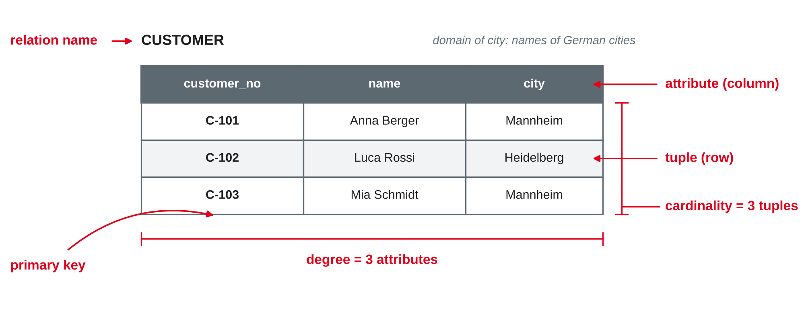
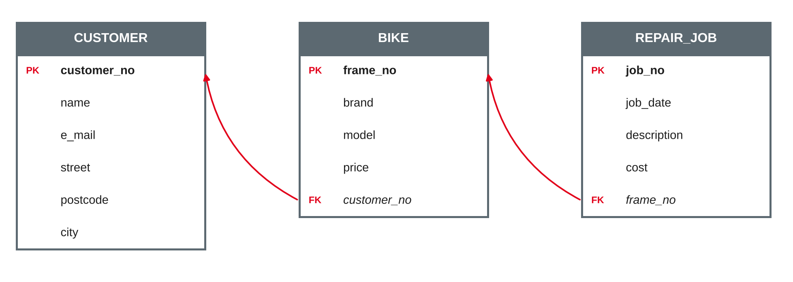

# The Relational Model {.title}

::: notes
Time plan for today (3 h): recap 10 min · relational model concepts 25 min · keys 15 min · mini exercise keys 10 min · break 10 min · integrity constraints 15 min · mapping rules 25 min · bike shop mapping exercise 25 min · team mapping of project ER models 35 min · wrap-up 5 min · ~5–10 min buffer.
Input is about 80 minutes in total, hands-on about 80 minutes. The team mapping is the core of the practical part. If the input runs long, move the optional slides to self-study and shorten the bike shop exercise (map only tasks 1–3), but keep at least 30 minutes for the teams.
:::

---

# Today's Agenda

1. Recap: from your ER model to tables
2. The relational model: relations, tuples, attributes, domains
3. Keys: superkey, candidate key, primary key, foreign key
4. Integrity constraints
5. Mapping an ER model to a relational schema
6. Exercise: map the bike shop
7. Team work: map your project ER model

::: notes
Time and format guide (not shown to students):
0:00 Recap (plenary, teams show one entity type and one relationship of their ER model) · 0:10 Relational model concepts (input) · 0:35 Keys (input) · 0:50 Mini exercise keys (pairs) · 1:00 Break · 1:10 Integrity constraints (input) · 1:25 Mapping rules (input with the bike shop as running example) · 1:50 Bike shop mapping (groups of 3, same as sessions 3–4) · 2:15 Team mapping of project ER models · 2:50 Wrap-up.
:::

---

# Recap: Your ER Models

- Which **entity types** did your team find? Which one has the most attributes?
- Where did you need a **weak entity type**, an **M:N relationship with attributes** or a **specialisation**?
- How would you store your model in a **table** — as one big table or as several?

::: callout
Today we turn ER models into **tables**: the logical level from session 3.
:::

::: notes
Preparation from session 4: each team finished a first version of its ER model. Ask 2–3 teams to show one part of their model. The third question is a hook: most students intuitively say "several tables" — today gives the rules. Point back to the three levels of data models (conceptual → logical → physical): we are now at the logical level.
:::

---

# The Relational Model {.section}

Relations, tuples, attributes and domains

---

# Codd's Idea (1970)

- **Edgar F. Codd** (IBM) proposed to represent all data as **relations** — tables in the mathematical sense
- Users work with the **logical structure** only; how data is stored, sorted or indexed stays hidden (**data independence**)
- Data is accessed by **values**, not by following pointers through storage structures
- The relational model is the basis of SQL and of most business databases today

::: callout
"Future users of large data banks must be protected from having to know how the data is organized in the machine."
:::

::: source
Codd (1970, p. 377).
:::

::: notes
Context: before 1970, hierarchical (IBM IMS) and network (CODASYL) databases were common. Programs navigated record by record along pointers, so changing the storage structure broke programs. Codd's paper separated the logical model from the physical storage. Codd received the Turing Award in 1981. The quote is the first sentence of the abstract — students can read the first pages of the paper themselves; the mathematical parts are not exam-relevant.
:::

---

# Anatomy of a Relation

{width=92%}

::: source
Own illustration based on Codd (1970) and Elmasri and Navathe (2016).
:::

::: notes
Walk through the terms: relation name, attributes (column headings), tuples (rows), domain (set of allowed values of an attribute), degree (number of attributes), cardinality (number of tuples). Warning: "cardinality" of a relation (number of tuples) is not the same as the cardinality of a relationship in the ER model (1:1, 1:N, M:N). Students mix these up in the exam.
:::

---

# Terms: Formal, Table, File

| Relational model | Table view | Older file view |
|---|---|---|
| Relation | Table | File |
| Tuple | Row | Record |
| Attribute | Column | Field |
| Domain | Data type plus allowed values | — |
| Degree | Number of columns | — |
| Cardinality | Number of rows | Number of records |

::: source
Based on Elmasri and Navathe (2016).
:::

::: notes
In practice the table terms dominate (and SQL uses them). For the exam students should know the formal terms and their table equivalents. A domain is more than a data type: "postcode" and "quantity" can both be integers, but they have different domains (five digits vs. positive numbers) and comparing them makes no sense.
:::

---

# Properties of a Relation

- **No duplicate tuples:** a relation is a set — every tuple is unique
- **No order of tuples:** the rows have no meaningful sequence
- **No order of attributes:** columns are identified by their names, not their position
- **Atomic values:** each cell holds exactly one value from the domain — no lists, no nested tables

::: callout
These properties make a relation more than "any table in Excel": a spreadsheet can have duplicate rows, merged cells and lists in one cell.
:::

::: source
Based on Codd (1970) and Elmasri and Navathe (2016).
:::

::: notes
Codd lists the order-independence of rows and the distinctness of rows as properties of the array that represents a relation. Atomic values are the condition for first normal form (session 6) — a first hint. Practical note: SQL tables can contain duplicate rows if no key is defined; SQL is not 100 % faithful to the relational model. Ask: why is "no order of tuples" useful? (The system can store and sort as it likes — data independence.)
:::

---

# Schema and Instance

- The **relation schema** describes the structure: name and attributes
- The **relation instance** (state) is the set of tuples at a given moment — it changes with every insert, update or delete
- A **relational database schema** is the set of all relation schemas plus the integrity constraints

**Notation used in this module:**

CUSTOMER(**customer_no**, name, e_mail, street, postcode, city)

BIKE(**frame_no**, brand, model, price, *customer_no* → CUSTOMER)

::: callout
**Bold** = primary key (on paper: underline it) · *italic* with **→** = foreign key and the relation it refers to.
:::

::: source
Based on Elmasri and Navathe (2016).
:::

::: notes
Textbooks use different notations for foreign keys (arrows, a hash sign, dashed underline). Whatever students use in the exam, it must be clear which attribute is the primary key and which relation a foreign key refers to. The schema is stable; the instance changes all the time — comparable to the ER model (entity type) vs. the actual data (entities).
:::

---

# Keys {.section}

Identifying tuples and linking relations

---

# From Superkey to Primary Key

| Key | Definition | Example in BIKE |
|---|---|---|
| **Superkey** | Any set of attributes whose values are unique for every tuple | {frame_no, brand}, {frame_no} |
| **Candidate key** | A minimal superkey: no attribute can be removed without losing uniqueness | {frame_no} |
| **Primary key** | The candidate key chosen to identify tuples | frame_no |
| **Alternate key** | Every other candidate key | — (e.g. an RFID tag number, if stored) |

::: source
Based on Codd (1970) and Elmasri and Navathe (2016).
:::

::: notes
The set of all attributes is always a superkey (because there are no duplicate tuples). "Minimal" is the key word for candidate keys. A key is a rule about all possible instances, not just today's data: if the current table happens to have unique names, name is still not a key. Selection criteria for the primary key: unique, stable, never empty, short (session 3: good keys).
:::

---

# Natural and Surrogate Keys {.optional}

- A **natural key** comes from the business: ISBN, IBAN, licence plate, frame number
- A **surrogate key** is an artificial number without business meaning, generated by the system: customer_id 1, 2, 3 …
- Surrogate keys are stable and short — but they do not prevent duplicates in the business data, so keep a **uniqueness rule** on the natural key as well

::: source
Based on Elmasri and Navathe (2016).
:::

::: notes
Self-study. Example: if customers get surrogate numbers, the same person can be registered twice with two numbers. A unique constraint on e-mail would catch some duplicates but has the problems discussed in session 3. In SQLite, INTEGER PRIMARY KEY generates surrogate values automatically (session 7).
:::

---

# Foreign Keys

- A **foreign key** is an attribute (or set of attributes) in one relation that refers to the **primary key of another** (or the same) relation
- It implements the **relationships** of the ER model: there are no lines or pointers between tables, only matching values
- Its values must come from the referenced key — or be NULL if the relationship is optional

{width=70%}

::: source
Based on Codd (1970); own illustration.
:::

::: notes
Codd (1970) introduced the term foreign key for a domain (or combination) that is not the primary key of its relation but whose values are values of the primary key of another relation. Read the arrows from the FK to the referenced PK: BIKE.customer_no refers to CUSTOMER.customer_no. A foreign key does not need to have the same name as the referenced key (e.g. owner_no), but the same domain.
:::

---

# Find the Keys {.exercise}

For each relation, name the candidate keys, choose a primary key and name any foreign key.

1. EMPLOYEE(employee_no, tax_id, name, e_mail, department_no)
2. FLIGHT(flight_no, flight_date, departure_time, aircraft_reg)
3. EXAM_RESULT(student_no, course_no, attempt, grade)
4. ROOM(building, room_no, seats)
5. COUNTRY(iso_code, name, capital)

::: notes
About 10 min in pairs. Expected answers: 1 candidate keys employee_no and tax_id (e-mail is a weak candidate — may change or be shared); PK employee_no; FK department_no → DEPARTMENT · 2 candidate key {flight_no, flight_date} (the same flight number repeats daily); FK aircraft_reg → AIRCRAFT · 3 {student_no, course_no, attempt}; FKs student_no → STUDENT, course_no → COURSE · 4 {building, room_no} — the pattern of a weak entity type; building may be an FK → BUILDING · 5 iso_code and name are both candidate keys; PK iso_code (stable, short). Discuss: why not just add an id column everywhere? (Possible, but the business rule still needs a uniqueness constraint.)
:::

---

# Integrity Constraints {.section}

Rules the database enforces

---

# Four Types of Integrity Constraints

| Constraint | Rule | Violated by |
|---|---|---|
| **Domain constraint** | Every value comes from the attribute's domain | price = "cheap", postcode = 6816 |
| **Key constraint** | No two tuples have the same key value | Two bikes with frame_no WAX123 |
| **Entity integrity** | No part of the primary key is NULL | A repair job without job_no |
| **Referential integrity** | Every foreign key value exists in the referenced relation, or is NULL | BIKE.customer_no = C-999, but there is no customer C-999 |

::: source
Based on Elmasri and Navathe (2016).
:::

::: notes
NULL means "unknown" or "not applicable" — not zero and not an empty string. Entity integrity follows from the purpose of the primary key: a NULL key cannot identify anything. Beyond these, business rules ("a repair job costs at least 0 €", "a mechanic supervises at most 3 apprentices") are semantic constraints; some can be declared in SQL with CHECK (session 7), others need application logic or triggers.
:::

---

# What If a Referenced Tuple Is Deleted?

Customer C-101 is deleted, but bike WAX123 still refers to C-101. The schema defines what happens:

| Option | Effect on BIKE |
|---|---|
| **Restrict / no action** | The delete is rejected while bikes refer to C-101 |
| **Cascade** | The bikes of C-101 are deleted as well |
| **Set NULL** | BIKE.customer_no is set to NULL — the bike has no owner |

::: callout
The right choice is a **business decision**: deleting a customer must not silently delete the repair history of a bike.
:::

::: source
Based on Elmasri and Navathe (2016).
:::

::: notes
The same options exist for updates of the referenced key (ON UPDATE). Ask for each relationship in the bike shop: should deleting a repair job delete its repair lines? (Yes — cascade fits a weak entity type.) Should deleting a customer delete their bikes? (No — set NULL or restrict.) The SQL syntax (ON DELETE CASCADE …) follows in session 7; in SQLite, foreign key enforcement must be switched on explicitly.
:::

---

# Mapping ER to Relational {.section}

From the conceptual to the logical model

---

# Mapping Rules I: Entity Types and Attributes

| ER construct | Relational schema |
|---|---|
| Strong entity type | Relation with all simple attributes; the key becomes the **primary key** |
| Composite attribute | Only its parts become attributes: street, postcode, city |
| Multi-valued attribute | **New relation** with the owner's key as foreign key, e.g. PHONE(**customer_no, phone_no**) |
| Derived attribute | Not stored — calculated when needed |
| Weak entity type | Relation with the owner's key as foreign key; **primary key = owner key + partial key** |

::: source
Based on Elmasri and Navathe (2016, Chapter 9) and Gadatsch (2019).
:::

::: notes
Multi-valued attributes cannot stay in one column because of atomic values. Example of a weak entity type: REPAIR_LINE(**job_no, line_no**, quantity, price_charged, *part_no* → SPARE_PART), with job_no also a foreign key → REPAIR_JOB. In the PK of PHONE, both columns are needed because a customer can have several numbers.
:::

---

# Mapping Rules II: Relationships

| Relationship | Relational schema |
|---|---|
| **1:N** | Foreign key on the **N side**, referring to the 1 side; relationship attributes go with it |
| **1:1** | Foreign key on one side — preferably the side with **total participation** (avoids NULLs); add a uniqueness rule |
| **M:N** | **New relation** with foreign keys to both sides; together they form the primary key; relationship attributes become columns |
| **Recursive** | Foreign key to the **same relation**, named after the role, e.g. supervisor_no |

::: source
Based on Elmasri and Navathe (2016, Chapter 9) and Gadatsch (2019).
:::

::: notes
Why the N side? Each bike has at most one owner, so one column suffices; on the customer side we would need a list (not atomic). Example M:N: WORKS_ON(**employee_no, job_no**, hours). Example recursive 1:N: MECHANIC(…, *supervisor_no* → MECHANIC). A recursive M:N (part consists of part) becomes its own relation with two foreign keys to the same relation. 1:1 with total participation on both sides could also be merged into one relation.
:::

---

# Mapping Rules III: Specialisation

| Option | Relations | Good when … |
|---|---|---|
| **A · Superclass and subclasses** | EMPLOYEE(**employee_no**, name) · MECHANIC(**employee_no**, qualification) · SALESPERSON(**employee_no**, sales_target) — subclass key is also FK → EMPLOYEE | always works; subclasses have own relationships |
| **B · Subclasses only** | MECHANIC(**employee_no**, name, qualification) · SALESPERSON(**employee_no**, name, sales_target) | specialisation is **total and disjoint** |
| **C · One relation** | EMPLOYEE(**employee_no**, name, emp_type, qualification, sales_target) | few subclass attributes; many NULLs are acceptable |

::: source
Based on Elmasri and Navathe (2016, Chapter 9).
:::

::: notes
Option A is the safe default for the exam and the project. Option B loses the common relation — a query "all employees" needs a UNION, and an overlapping specialisation would store common attributes twice. Option C is simple and fast to query, but subclass attributes are NULL for the other types and rules like "only mechanics have a qualification" need CHECK constraints. Ask: which option fits the bike shop, where only mechanics work on repair jobs? (A — the relationship refers to MECHANIC.)
:::

---

# Worked Example: Customer, Bike, Repair Job

**ER model (session 3):** Customer **buys** Bike (1:N, optional for the bike) · Bike **is repaired in** Repair job (1:N, mandatory for the repair job)

CUSTOMER(**customer_no**, name, e_mail, street, postcode, city)

BIKE(**frame_no**, brand, model, price, *customer_no* → CUSTOMER)

REPAIR_JOB(**job_no**, job_date, description, cost, *frame_no* → BIKE)

- *customer_no* in BIKE **may be NULL** — bikes in stock have no customer yet
- *frame_no* in REPAIR_JOB is **NOT NULL** — every repair job concerns exactly one bike

::: source
Own example based on the bike shop case from session 3.
:::

::: notes
Participation becomes NOT NULL (mandatory) or a nullable foreign key (optional). Address was composite and is split. Discuss: bikes not bought in the shop but brought for repair — they need a customer link that is not "buys". One solution: rename the FK to owner_no and define it as "current owner", independent of where the bike was bought. Modelling decisions on the ER level show up as columns here.
:::

---

# Exercise: Map the Bike Shop {.exercise}

Map the rest of the extended bike shop model from session 4 to relations. Mark primary and foreign keys.

1. **Spare part** and its use in repair jobs (quantity, price charged) — as an M:N relationship or as the weak entity type *repair line*
2. **Employee** with the subclasses *Mechanic* and *Salesperson* — choose option A, B or C and justify
3. **Mechanic works on repair job** (M:N)
4. **Mechanic supervises apprentice** (recursive, 1:N)
5. Which foreign keys may be NULL? What should happen to the repair lines if a repair job is deleted?

::: notes
Groups of 3 (same as sessions 3–4), about 20 min + 5 min comparison.
Expected solution:
SPARE_PART(**part_no**, name, list_price).
Variant M:N: USES(**job_no, part_no**, quantity, price_charged) with job_no → REPAIR_JOB, part_no → SPARE_PART. Variant weak entity: REPAIR_LINE(**job_no, line_no**, quantity, price_charged, part_no → SPARE_PART), job_no → REPAIR_JOB.
Option A: EMPLOYEE(**employee_no**, name) · MECHANIC(**employee_no**, qualification, supervisor_no → MECHANIC) with employee_no → EMPLOYEE · SALESPERSON(**employee_no**, sales_target) with employee_no → EMPLOYEE.
WORKS_ON(**employee_no, job_no**) with employee_no → MECHANIC, job_no → REPAIR_JOB (attribute hours if the group added it).
NULL allowed: BIKE.customer_no, MECHANIC.supervisor_no (the most senior mechanic has no supervisor). Not NULL: every key part and REPAIR_JOB.frame_no, REPAIR_LINE.part_no. Deleting a repair job: cascade to its repair lines and WORKS_ON rows — or, better for accounting, restrict deletion of repair jobs that have been invoiced.
:::

---

# Team Work: Map Your Project ER Model {.exercise}

1. Map every **entity type** of your ER model to a relation; mark the primary key
2. Map every **relationship** using the rules; mark foreign keys and decide whether they may be NULL
3. For each **specialisation**, choose option A, B or C and write down why
4. Note at least one **referential action** (restrict, cascade, set NULL) and justify it
5. List open questions — and **redundancies** you notice (they are the topic of session 6)

::: callout
The mapped schema is the first part of **milestone 2** (relational schema, after session 7). You will normalise it in session 6 and implement it in SQL in session 7.
:::

::: notes
About 35 min. Walk around and check: M:N relationships mapped to their own relation? Foreign keys on the N side? Composite keys for weak entity types? Teams often put foreign keys on the 1 side or forget the key of an M:N relation. Milestone 1 (ER model) is due after session 6 — teams can still improve their ER model while mapping; changes in one should show in the other. Ask each team to keep the schema in a shared document (text notation as on the slides is enough).
:::

---

# Key Takeaways

- The **relational model** (Codd, 1970) represents data as relations: sets of tuples over attributes with domains
- A relation has **no duplicate tuples**, no order of rows or columns, and **atomic values**
- **Candidate keys** are minimal superkeys; one is chosen as **primary key**; **foreign keys** link relations by values
- **Integrity constraints:** domain, key, entity integrity, referential integrity
- **Mapping:** entity type → relation · 1:N → FK on the N side · M:N → own relation · weak entity → composite key · specialisation → options A, B, C

---

# Next Session: Efficient Database Design — Normalisation

- Update, insert and delete anomalies
- Functional dependencies
- Normal forms: 1NF, 2NF, 3NF and BCNF
- When to denormalise

::: callout
**Preparation:** bring your team's relational schema. Look for data that is stored more than once — where could it become inconsistent?
:::

---

# References {.references}

- Codd, E. F. (1970). A relational model of data for large shared data banks. *Communications of the ACM, 13*(6), 377–387. https://doi.org/10.1145/362384.362685
- Elmasri, R., & Navathe, S. B. (2016). *Fundamentals of database systems* (7th ed.). Pearson.
- Gadatsch, A. (2019). *Datenmodellierung: Einführung in die Entity-Relationship-Modellierung und das Relationenmodell* (2nd ed.). Springer Vieweg. https://doi.org/10.1007/978-3-658-25730-9
