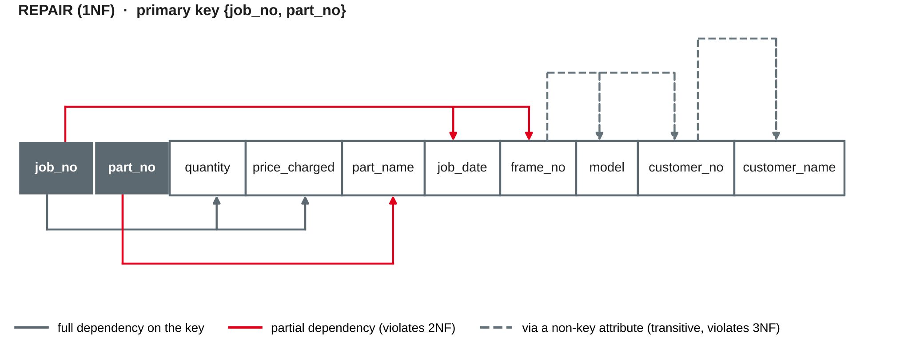

# Efficient Database Design: Normalisation {.title}

::: notes
Time plan for today (3 h): recap 10 min · anomalies 10 min · functional dependencies 15 min · mini exercise FDs 10 min · break 10 min · normal forms 1NF–3NF 25 min · BCNF and beyond 10 min · denormalisation 10 min · rental spreadsheet exercise 30 min · team work on project schemas 35 min · wrap-up 5 min · ~10 min buffer.
Input is about 70 minutes in total, hands-on about 75 minutes. The team work is the core of the practical part, because milestone 2 (mapped and normalised schema) is due after session 7. If the input runs long, set the optional slides (4NF/5NF, lossless decomposition) as self-study and shorten the rental exercise to tasks 1–3, but keep at least 30 minutes for the teams.
:::

---

# Today's Agenda

1. Recap: redundancy in your project schema
2. Why normalise? Update, insert and delete anomalies
3. Functional dependencies
4. Normal forms: 1NF, 2NF, 3NF and BCNF
5. When to denormalise
6. Exercise: normalise a messy rental spreadsheet
7. Team work: normalise your project schema

::: notes
Time and format guide (not shown to students):
0:00 Recap (plenary, 2–3 teams report where they found data stored twice) · 0:10 Anomalies (input with the repair-job spreadsheet) · 0:20 Functional dependencies (input) · 0:35 Mini exercise FDs (pairs) · 0:45 Break · 0:55 1NF–3NF step by step (input, worked example) · 1:20 BCNF and beyond (input) · 1:30 Denormalisation (input and short discussion) · 1:40 Rental spreadsheet (groups of 3, same groups as sessions 3–5) · 2:10 Team work on project schemas · 2:45 Wrap-up.
:::

---

# Recap: Where Is Your Data Stored Twice?

- Last session your team mapped its ER model to a **relational schema**
- Preparation task: find data that is stored **more than once**
- Where could the copies become **inconsistent**? What would happen if one copy is changed and the other is not?

::: callout
Today we get a method to find redundancy systematically — and to remove it: **normalisation**.
:::

::: notes
Preparation from session 5: bring the relational schema and look for redundancy. Ask 2–3 teams for one example each and write them on the board; come back to them in the team work. Typical findings: customer name stored in the order relation, a product price in the order line (careful: that one may be intended history, pitfall 2 from session 4), department name repeated in the employee relation. Reminder: milestone 1 (ER model) is due after today; milestone 2 (mapped and normalised schema) after session 7.
:::

---

# Why Normalise? {.section}

Redundancy and anomalies

---

# A Spreadsheet from the Workshop

*Velo Neckar* has kept its repair jobs in a spreadsheet so far:

| job_no | job_date | frame_no | model | customer | mechanics | parts used |
|---|---|---|---|---|---|---|
| J-501 | 2027-04-06 | WAX123 | Cube Kathmandu | C-101 Anna Berger | Kaya, Brandt | P-17 brake pads ×2 · P-30 chain ×1 |
| J-502 | 2027-04-07 | GZT884 | Gazelle Ultimate | C-102 Luca Rossi | Novak | P-17 brake pads ×1 |
| J-503 | 2027-04-09 | WAX123 | Cube Kathmandu | C-101 Anna Berger | Kaya | P-52 inner tube ×2 |

- Is this a **relation**? Which properties from session 5 does it break?
- Which facts are stored **more than once**?

::: source
Own example based on the bike shop case from sessions 3–5.
:::

::: notes
Let students answer before moving on. Not a relation: the cells "customer", "mechanics" and "parts used" are not atomic (lists, and number plus name in one cell). Redundancy: model and customer of bike WAX123 appear in every repair job of that bike; the name of part P-17 appears in every job that uses it. Many real business spreadsheets look like this — they are convenient to type into, but hard to query and to keep consistent. Prices are left out here to keep the table readable; they come in on the next slides.
:::

---

# Three Kinds of Anomalies

| Anomaly | What happens | Example in the spreadsheet |
|---|---|---|
| **Update anomaly** | The same fact is stored several times; changing only some copies makes the data inconsistent | Anna Berger marries and changes her name — every row of her bikes must be changed |
| **Insert anomaly** | A fact cannot be stored without an unrelated other fact | A new spare part cannot be recorded until a repair job uses it |
| **Delete anomaly** | Deleting one fact unintentionally deletes another | Deleting job J-502 deletes the only record of customer Luca Rossi and his bike |

::: callout
The root cause is always the same: **several independent facts in one row**.
:::

::: source
Based on Codd (1972) and Elmasri and Navathe (2016, Chapter 14).
:::

::: notes
Codd (1972) named freeing relations from undesirable insertion, update and deletion dependencies as an objective of further normalisation. Ask: what does the shop do today if a customer registers but has no repair job yet? (Leave job columns empty, i.e. NULLs in the "key" column — entity integrity from session 5 forbids that.) Anomalies are a data quality problem (Part C of the module): inconsistent copies are a typical cause of poor data quality.
:::

---

# The Idea of Normalisation

- **Normalisation** decomposes a relation step by step into smaller relations, so that every fact is stored **once**
- Each step is guided by a **normal form**: a condition that a relation either meets or not
- Decomposition must be **lossless**: joining the parts gives back exactly the original data

::: layers
- BCNF: every determinant is a candidate key
- 3NF: no non-key attribute depends on another non-key attribute
- 2NF: no non-key attribute depends on only part of a key
- 1NF: atomic values only
:::

::: source
Based on Codd (1970, 1972) and Elmasri and Navathe (2016, Chapter 14).
:::

::: notes
Each normal form includes the ones below it: a relation in 3NF is also in 2NF and 1NF. Codd introduced first normal form ("normalization" to eliminate non-simple domains) in 1970 and 2NF and 3NF in 1971/1972; BCNF followed a few years later (named after Raymond Boyce and Codd). Higher normal forms (4NF, 5NF) exist but are rarely needed in practice — optional slide later. The informal definitions in the layers are refined on the next slides; the precise definitions use functional dependencies.
:::

---

# Functional Dependencies {.section}

Which attribute determines which?

---

# Functional Dependencies

- **X → Y** (read: "X determines Y", "Y is functionally dependent on X"): any two tuples with the **same value of X** always have the **same value of Y**
- X is the **determinant**; X and Y can be sets of attributes
- Examples at *Velo Neckar*:
  - frame_no → model, customer_no
  - customer_no → customer_name
  - {job_no, part_no} → quantity
- A functional dependency is a **business rule**, like a key: sample data can **disprove** it, but never prove it

::: callout
A key is a special case: a candidate key K determines **all** attributes of its relation, K → R.
:::

::: source
Based on Elmasri and Navathe (2016, Chapter 14).
:::

::: notes
Check with students: does customer_name → customer_no hold? (No — two customers can have the same name.) Does frame_no → customer_no hold? Only if we store the current owner of a bike. If the shop wants to know who brought the bike for a particular job (bikes are sold second-hand), the business rule is job_no → customer_no instead — FDs come from asking the business, exactly like cardinalities in session 3. The link to session 5: a superkey is a set of attributes that determines all others; a candidate key is a minimal one.
:::

---

# Dependencies in the Repair Spreadsheet

{width=96%}

::: source
Own illustration based on the FD diagram notation in Elmasri and Navathe (2016, Chapter 14).
:::

::: notes
This is the spreadsheet after the first step (1NF, next section): one row per repair job and spare part, mechanics moved out. The primary key is {job_no, part_no}. Read the arrows: below, quantity and price_charged need the whole key (the price charged for brake pads in job J-501); part_name needs only part_no. Above, job_date and frame_no need only job_no; model and customer_no depend on frame_no, which is not a key; customer_name depends on customer_no. Colours anticipate the next slide: red violates 2NF, dashed violates 3NF.
:::

---

# Full, Partial and Transitive Dependencies

| Type | Definition | Example |
|---|---|---|
| **Full** | Y depends on the **whole** key, not on a part of it | {job_no, part_no} → quantity |
| **Partial** | Y depends on **part of** a composite key | part_no → part_name |
| **Transitive** | Y depends on the key **via a non-key attribute**: K → X and X → Y | job_no → frame_no → model |

- Partial dependencies only occur with **composite keys**
- Both partial and transitive dependencies mean: the relation describes **more than one thing**

::: source
Based on Codd (1972) and Elmasri and Navathe (2016, Chapter 14).
:::

::: notes
Students often call any dependency on a non-key attribute "transitive". Precisely: the dependency of model on the key job_no is transitive because it runs through frame_no. A relation with a single-attribute key cannot have partial dependencies — it is automatically in 2NF if it is in 1NF. Ask: which "things" are mixed in the spreadsheet? (Repair job, repair line, spare part, bike, customer — exactly the entity types from session 3.)
:::

---

# Mini Exercise: Find the Dependencies {.exercise}

A small hotel stores its bookings in one table:

BOOKING(booking_no, arrival, guest_no, guest_name, room_no, room_type, nightly_rate)

Business rules: each booking is for one guest and one room; each room has one type; the nightly rate depends on the room type only.

1. Write down all functional dependencies
2. What is the primary key?
3. Which dependencies are **transitive**? Are there partial dependencies?

::: notes
About 10 min in pairs. Expected answers: 1 booking_no → arrival, guest_no, room_no · guest_no → guest_name · room_no → room_type · room_type → nightly_rate. 2 booking_no. 3 Transitive: booking_no → guest_no → guest_name; booking_no → room_no → room_type → nightly_rate (a chain of two steps). No partial dependencies, because the key has only one attribute — so BOOKING is in 2NF but not in 3NF. Preview of the decomposition: GUEST, ROOM, ROOM_TYPE, BOOKING with foreign keys. Discussion: if rates change by season, the rate charged belongs to the booking (history).
:::

---

# Normal Forms {.section}

1NF, 2NF, 3NF and BCNF

---

# First Normal Form (1NF)

::: callout
A relation is in **1NF** if every attribute value is **atomic**: no lists, no repeating groups, no nested tables.
:::

Getting the repair spreadsheet into 1NF:

- Split combined cells: "C-101 Anna Berger" → customer_no, customer_name
- **Repeating group "parts used":** one row per job **and** part → key {job_no, part_no}
- **Independent list "mechanics":** own relation JOB_MECHANIC(**job_no, employee_no**) — do not multiply it with the parts

REPAIR(**job_no, part_no**, quantity, price_charged, part_name, job_date, frame_no, model, customer_no, customer_name)

::: source
Based on Codd (1970) and Kent (1983).
:::

::: notes
Codd (1970) called the elimination of non-simple domains "normalization"; the term normal form started there. Kent (1983, p. 120): under first normal form, all occurrences of a record type must contain the same number of fields. Why not flatten mechanics and parts into the same rows? Then job J-501 needs 2 × 2 = 4 rows (every mechanic combined with every part), suggesting that Kaya fitted the brake pads — a fact nobody stated. Two independent multi-valued facts belong in two relations (this is the idea behind 4NF, optional slide). Same rule as for multi-valued attributes in session 5's mapping.
:::

---

# Second Normal Form (2NF)

::: callout
A relation is in **2NF** if it is in 1NF and every non-key attribute depends on the **whole** of every candidate key — no partial dependencies.
:::

- REPAIR violates 2NF: part_no → part_name and job_no → job_date, frame_no, …
- **Fix:** move each partial dependency into its own relation, with the determinant as primary key

| Relation | Primary key | Attributes |
|---|---|---|
| REPAIR_LINE | job_no, part_no | quantity, price_charged |
| SPARE_PART | part_no | part_name |
| REPAIR_JOB | job_no | job_date, frame_no, model, customer_no, customer_name |

::: source
Based on Codd (1972) and Elmasri and Navathe (2016, Chapter 14).
:::

::: notes
The determinant stays in the original relation as a foreign key: job_no and part_no in REPAIR_LINE now refer to REPAIR_JOB and SPARE_PART. That keeps the decomposition lossless. "Non-key attribute" means an attribute that is not part of any candidate key (Elmasri and Navathe call it non-prime). Check the anomalies: a new spare part can now be inserted without a repair job. REPAIR_JOB still has redundancy — model and customer of WAX123 repeat for each job of that bike.
:::

---

# Third Normal Form (3NF)

::: callout
A relation is in **3NF** if it is in 2NF and no non-key attribute depends on another non-key attribute — no transitive dependencies.
:::

- REPAIR_JOB violates 3NF: frame_no → model, customer_no and customer_no → customer_name
- **Fix:** move each transitive dependency into its own relation

REPAIR_JOB(**job_no**, job_date, *frame_no* → BIKE)

BIKE(**frame_no**, model, *customer_no* → CUSTOMER)

CUSTOMER(**customer_no**, customer_name)

::: callout
In 2NF and 3NF, "a nonkey field must provide a fact about the key, the whole key, and nothing but the key" (Kent, 1983, pp. 120–121).
:::

::: source
Based on Codd (1972) and Kent (1983).
:::

::: notes
Kent's sentence is the best mnemonic for the exam: "the key" = 1NF has a key, "the whole key" = 2NF, "nothing but the key" = 3NF. Work through the chain from the end: customer_no → customer_name first goes into CUSTOMER, then frame_no → model, customer_no goes into BIKE. Check: Anna Berger's name is now stored once; a new customer can be registered without a job; deleting J-502 no longer deletes Luca Rossi.
:::

---

# The Result: Normalisation Confirms the Mapping

CUSTOMER(**customer_no**, customer_name)

BIKE(**frame_no**, model, *customer_no* → CUSTOMER)

REPAIR_JOB(**job_no**, job_date, *frame_no* → BIKE)

REPAIR_LINE(**job_no, part_no**, quantity, price_charged), *job_no* → REPAIR_JOB, *part_no* → SPARE_PART

SPARE_PART(**part_no**, part_name)

JOB_MECHANIC(**job_no, employee_no**), *job_no* → REPAIR_JOB, *employee_no* → MECHANIC

::: callout
The same schema as in session 5: a **good ER model, mapped correctly, is usually already in 3NF**. Normalisation is the check — and the tool for data that arrives as a spreadsheet.
:::

::: source
Own example based on the bike shop case from sessions 3–5.
:::

::: notes
Compare with the session 5 worked example and exercise solution. Differences are only in attributes left out here for space (brand, price, e-mail, address). Normalisation finds problems where the ER model was wrong (e.g. publisher data in a book entity, pitfall 1 from session 4) and is the standard method when data comes from legacy files or spreadsheets — which happens in every data migration and in Part C of this module (loading real data).
:::

---

# Boyce–Codd Normal Form (BCNF)

::: callout
A relation is in **BCNF** if for every non-trivial functional dependency X → Y, **X is a superkey** — every determinant is a candidate key.
:::

SERVICE(customer_no, service_type, mechanic) — each customer has one regular mechanic per service type; each mechanic offers **only one** service type (e-bike, suspension, …)

- Candidate keys: {customer_no, service_type} and {customer_no, mechanic}
- mechanic → service_type: the determinant is **not a superkey** → not BCNF; but service_type is part of a key → still 3NF
- **Fix:** MECHANIC_SERVICE(**mechanic**, service_type) and CUSTOMER_MECHANIC(**customer_no, mechanic**)

::: source
Based on Elmasri and Navathe (2016, Chapter 14).
:::

::: notes
3NF and BCNF differ only when a relation has several overlapping composite candidate keys — rare in practice. The precise 3NF definition allows X → A if A is part of a candidate key (prime); BCNF does not. Trade-off: after the decomposition, the rule "one mechanic per customer and service type" can no longer be checked inside one relation — the FD {customer_no, service_type} → mechanic is not preserved. That is why textbooks say: 3NF can always be reached without losing dependencies; BCNF sometimes cannot. For the exam: be able to state the definition and recognise a violation.
:::

---

# Beyond BCNF: 4NF and 5NF {.optional}

- **4NF** deals with **independent multi-valued facts** in one relation: mechanics and parts of a job flattened into the same rows create every combination
- **5NF** deals with relations that can only be split into **three or more** parts without loss
- In practice: if the ER model keeps independent M:N relationships apart, 4NF and 5NF problems rarely occur

::: source
Based on Kent (1983) and Elmasri and Navathe (2016, Chapter 15).
:::

::: notes
Self-study. Kent's paper is short and readable and covers all five normal forms with business examples (employee, skill, language). The mechanic × part example from the 1NF slide is a 4NF violation: the relation JOB_MECHANIC_PART(job_no, employee_no, part_no) would be in BCNF (all three attributes form the key), but still redundant. Not exam-relevant beyond recognising the idea.
:::

---

# Decomposing Without Loss {.optional}

- **Lossless join:** joining the decomposed relations gives back exactly the original tuples — no tuples lost, **no spurious tuples** added
- Rule of thumb: the attributes the parts share must be a **key of at least one part** (it becomes a foreign key in the other)
- **Dependency preservation:** every functional dependency can still be checked within one relation

::: source
Based on Elmasri and Navathe (2016, Chapter 15).
:::

::: notes
Self-study. Counterexample: splitting REPAIR_JOB into (job_no, job_date, model) and (frame_no, model, customer_no) shares only model, which is not a key in either part — joining on model would combine every Cube Kathmandu job with every Cube Kathmandu bike (spurious tuples). Decomposing along functional dependencies, as on the previous slides, is always lossless.
:::

---

# When to Denormalise {.section}

Normalise first, denormalise deliberately

---

# Denormalisation: Trade-offs

- **Denormalisation** deliberately stores data redundantly, usually to make **reading** faster or simpler
- Typical cases: **reporting and analytics** (star schemas in a data warehouse, session 17), stored totals for dashboards, read-heavy web pages
- **Costs:** the anomalies come back — the copies must be kept consistent by triggers, application code or the ETL process
- **Not denormalisation:** the price charged in a repair line or a delivery address on an invoice — these are **different facts** (values at a point in time)

::: callout
"There is no obligation to fully normalize all records when actual performance requirements are taken into account" (Kent, 1983, p. 120). Normalise to 3NF first; denormalise only with a reason, and document it.
:::

::: source
Based on Kent (1983) and Elmasri and Navathe (2016).
:::

::: notes
About 10 min including a short discussion. Ask: should Velo Neckar store a column total_cost in REPAIR_JOB? (It can be computed from REPAIR_LINE; storing it is derived data, pitfall 3. Acceptable if invoices are printed thousands of times and lines never change after invoicing — then it is a snapshot, not a copy.) Operational systems (OLTP) are normally kept in 3NF; analytical systems (OLAP) are denormalised on purpose because data is loaded in batches and only read. For the project: the operational schema must be normalised; any denormalisation needs a written justification.
:::

---

# Exercise: Normalise the Rental Spreadsheet {.exercise}

*Velo Neckar* now also rents out bikes. The sales team keeps this spreadsheet:

| rental_no | rental_date | customer | phone | bikes | day rates | days | sold by |
|---|---|---|---|---|---|---|---|
| R-31 | 2027-05-02 | C-104 Jana Wolf | 0621 555017 | RB-01 (e-trekking), RB-07 (city) | 35.00, 18.00 | 3 | Lea Brandt |
| R-32 | 2027-05-02 | C-105 Omar Haddad | 0621 555042 | RB-03 (e-trekking) | 35.00 | 1 | Lea Brandt |
| R-33 | 2027-05-03 | C-104 Jana Wolf | 0621 555017 | RB-07 (city) | 18.00 | 2 | Tom Weber |

1. Name one update, one insert and one delete anomaly
2. Bring the table into 1NF and write down all functional dependencies (rule: the day rate depends on the bike category)
3. Normalise to 3NF; mark primary and foreign keys
4. The day rate for e-trekking bikes rises to 39.00. What happens to rental R-31 in your schema? Fix it if needed

::: notes
Groups of 3, about 25 min + 5 min comparison.
Expected answers: 1 Update: Jana Wolf's phone number changes — two rows to change. Insert: a new rental bike or a new category with its rate cannot be stored until it is rented. Delete: deleting R-32 deletes the only record of customer Omar Haddad and of bike RB-03.
2 1NF: one row per rental and bike; split customer into customer_no and customer_name; salesperson by employee_no (introduce a key, names are not unique). Key {rental_no, frame_no}. FDs: rental_no → rental_date, days, customer_no, employee_no · customer_no → customer_name, phone · frame_no → category · category → day_rate · employee_no → employee_name.
3 CUSTOMER(**customer_no**, customer_name, phone) · RENTAL(**rental_no**, rental_date, days, *customer_no* → CUSTOMER, *employee_no* → SALESPERSON) · RENTAL_LINE(**rental_no, frame_no**) with FKs → RENTAL, RENTAL_BIKE · RENTAL_BIKE(**frame_no**, *category* → BIKE_CATEGORY) · BIKE_CATEGORY(**category**, day_rate). SALESPERSON exists from session 5 (EMPLOYEE/SALESPERSON).
4 The price of R-31 would change retroactively. Fix: store rate_charged in RENTAL_LINE ({rental_no, frame_no} → rate_charged) — history, not denormalisation. Discussion: is RENTAL_BIKE a specialisation of BIKE (option A from session 5)? Defensible.
:::

---

# Team Work: Normalise Your Project Schema {.exercise}

1. For each relation of your schema, write down the **functional dependencies** (ask: which attribute determines which?)
2. Check every relation for **1NF, 2NF and 3NF**; mark violations
3. Decompose where needed and update **primary and foreign keys**
4. Check the redundancies you found in the preparation: removed, or intended (history, derived data)?
5. If you **denormalise** anything, write down why

::: callout
The normalised schema is **milestone 2**, due after session 7 — next time you implement it in SQL. Milestone 1 (ER model) is due after today.
:::

::: notes
About 35 min. Walk around and ask for the FDs of one relation per team; many teams list only the key dependency. Watch for: lists in one column (phone numbers, tags), names used as keys, attributes copied from a referenced relation "for convenience", totals and ages stored. If the ER model changes because of the normalisation, the team should update the ER model as well (milestone 1). Teams that finish early: check one relation for BCNF.
:::

---

# Key Takeaways

- Redundant data causes **update, insert and delete anomalies**
- A **functional dependency** X → Y is a business rule: equal X values imply equal Y values
- **1NF:** atomic values · **2NF:** no partial dependencies · **3NF:** no transitive dependencies · **BCNF:** every determinant is a candidate key
- Normalisation **decomposes** relations losslessly; a well-mapped ER model is usually already in 3NF
- **Denormalise** only deliberately, mostly for analytics and performance, and document the reason

---

# Next Session: SQL I — Defining Schemas

- Data definition with SQL: `CREATE`, `ALTER`, `DROP`
- Data types in SQLite
- Constraints: `PRIMARY KEY`, `FOREIGN KEY`, `NOT NULL`, `CHECK`
- Hands-on: create the course sample database in SQLite

::: callout
**Preparation:** bring your laptop with Python, Jupyter and SQLite working (setup from session 2) and your team's normalised schema.
:::

---

# References {.references}

- Codd, E. F. (1970). A relational model of data for large shared data banks. *Communications of the ACM, 13*(6), 377–387. https://doi.org/10.1145/362384.362685
- Codd, E. F. (1972). Further normalization of the data base relational model. In R. Rustin (Ed.), *Data base systems* (pp. 33–64). Prentice-Hall.
- Elmasri, R., & Navathe, S. B. (2016). *Fundamentals of database systems* (7th ed.). Pearson.
- Kent, W. (1983). A simple guide to five normal forms in relational database theory. *Communications of the ACM, 26*(2), 120–125. https://doi.org/10.1145/358024.358054
