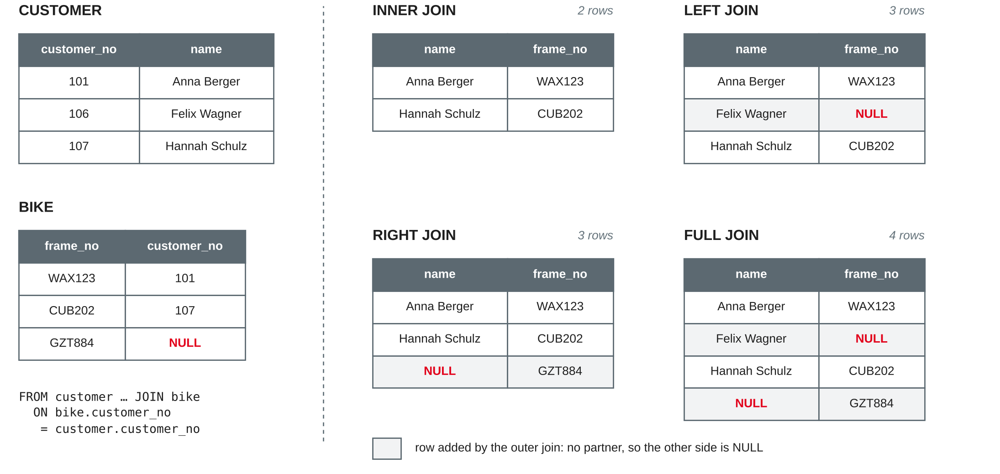

# SQL III: Joins {.title}

::: notes
Time plan for today (3 h): recap and loading today's data 10 min · why joins and INNER JOIN 15 min · more than two tables 10 min · mini exercise 10 min · break 10 min · outer joins 20 min · self joins 10 min · join pitfalls 20 min · hands-on: multi-table queries 40 min · team work: join queries for the project 20 min · wrap-up 5 min · ~10 min buffer.
Input is about 75 minutes in total, hands-on about 70 minutes plus the mini exercise. As in sessions 7 and 8, live coding in a notebook works better than reading code from the slides: predict the number of rows first, then run. If the input runs long, set the optional slide (other ways to write a join) as self-study and shorten the hands-on to questions 1–6, but keep at least 15 minutes for the teams.
Every statement on these slides was run with Python's sqlite3 module (Python 3.13, SQLite 3.45.1) and the sqlite3 command-line tool (SQLite 3.45.1) on a fresh database built from bikeshop-schema.sql, bikeshop-data.sql and bikeshop-data-session09.sql; all row counts, results and error messages are the ones SQLite returned.
:::

---

# Today's Agenda

1. Recap: questions that need two tables
2. Combining tables: `INNER JOIN`
3. Outer joins: `LEFT`, `RIGHT` and `FULL`
4. Self joins: a table joined with itself
5. Join pitfalls: too many, too few and ambiguous rows
6. Hands-on: multi-table queries on the bike shop
7. Team work: join queries for your project

::: notes
Time and format guide (not shown to students):
0:00 Recap and loading the data (plenary) · 0:10 Why joins, INNER JOIN, how a join works (input, live coding) · 0:25 More than two tables · 0:35 Mini exercise (pairs) · 0:45 Break · 0:55 Outer joins (input, live coding) · 1:15 Self joins · 1:25 Join pitfalls (input, ask the class to predict each result) · 1:45 Hands-on (groups of 3, same groups as before, each student on their own laptop) · 2:25 Team work on project queries · 2:45 Wrap-up · buffer.
:::

---

# Recap: Questions That Need Two Tables

- Last session: `SELECT … FROM` **one table** `WHERE … ORDER BY …`
- Some questions could not be answered:
  - "Mechanic 1 has no supervisor" — but **what is her name**? The name is in `employee`
  - "Repair job 507 concerns bike KTM530" — but **whose bike** is it?
- Normalisation (session 6) **split** the data on purpose; the foreign keys say how the pieces belong together

::: callout
Today we put the pieces back together: a **join** combines rows of several tables in one query.
:::

::: notes
Preparation from session 8: sample data loaded and the hands-on questions done; teams bring their data script. Ask which questions the teams noted last time that needed two tables (session 8 team work) and collect two or three on the board — come back to them in the team work. Quick check: who remembers the three referential actions (bike → customer SET NULL, repair_job → bike RESTRICT, CASCADE for repair lines and mechanic assignments)? The SET NULL action comes back on the outer join slides.
:::

---

# Loading Today's Data

```python
import sqlite3

con = sqlite3.connect("bikeshop.db")
con.execute("PRAGMA foreign_keys = ON")
for script in ["bikeshop-schema.sql", "bikeshop-data.sql",
               "bikeshop-data-session09.sql"]:
    with open(script, encoding="utf-8") as f:
        con.executescript(f.read())
```

- A **fresh start**: the schema script drops and recreates all tables, so last session's changes are gone
- **bikeshop-data-session09.sql** (linked from worksheet 9) adds three rows: a new apprentice **Tim Krause** (employee 8, supervised by Deniz Arslan), and a spare part **P-112** that has not been used yet
- Row counts now: customer 12, bike 15, repair_job 12, employee 8, mechanic 5, spare_part 12

::: source
Own example based on the bike shop case from sessions 3–8.
:::

::: notes
Everyone runs this cell now. The extra rows give us a two-level supervisor hierarchy (Tim → Deniz → Katrin), a mechanic without any repair job and a part that was never used — good cases for outer joins. Session 8's data is unchanged. Command-line alternative: run the three scripts in this order with `sqlite3 bikeshop.db < …` (tested). Check: `SELECT sqlite_version();` — anything from 3.39.0 on supports all join types we use today; Python 3.13 here reports 3.45.1.
:::

---

# Combining Tables {.section}

INNER JOIN

---

# Why Joins?

- In a normalised schema, every fact is stored **once**: the bike stores only the **customer_no**, not the customer's name and city
- A **join** pairs rows of two tables that **belong together** — usually where the **foreign key** equals the **primary key**
- Codd's relational model has a **join** operation for this; SQL writes it in the `FROM` clause

| Question | Join path |
|---|---|
| Who owns which bike? | bike.customer_no = customer.customer_no |
| Which parts were used in job 511? | repair_line.part_no = spare_part.part_no |
| What is the mechanic's name? | mechanic.employee_no = employee.employee_no |

::: source
Based on Codd (1970) and Elmasri and Navathe (2016, Chapter 6).
:::

::: notes
Link to session 5: foreign keys were drawn as arrows from the FK to the referenced PK — these arrows are the join paths. Codd (1970, Section 2.1.3) introduced join as one of the operations on relations; in relational algebra it is a Cartesian product followed by a selection (Elmasri and Navathe treat the algebra in Chapter 8; not needed for the exam beyond this idea). A join does not need a declared foreign key — any comparable columns can be joined — but joining along foreign keys is what gives meaningful results.
:::

---

# INNER JOIN: Anatomy

```sql
SELECT   b.frame_no, b.brand, c.name, c.city
FROM     bike AS b
JOIN     customer AS c ON b.customer_no = c.customer_no
ORDER BY c.name;
```

| frame_no | brand | name | city |
|---|---|---|---|
| WAX123 | Cube | Anna Berger | Mannheim |
| RIE420 | Riese & Müller | Clara Neumann | Heidelberg |
| BRO860 | Brompton | Elif Demir | Weinheim |
| … | … | … | … |

- `JOIN … ON` names the second table and the **join condition**; `JOIN` is short for `INNER JOIN`
- **Table aliases** (`b`, `c`) keep queries short; `b.frame_no` says which table a column comes from
- Result: **11 rows** — the 4 bikes in stock have no customer and **disappear**

::: source
Based on Elmasri and Navathe (2016, Chapter 7) and SQLite (n.d.-a).
:::

::: notes
Observed: 11 rows, sorted by name (first name, as in session 8). Ask before running: 15 bikes, 12 customers — how many rows? Many students say 15 or 12. The stock bikes GZT884, TRK311, KTM530, GZT886 have customer_no NULL, and Felix Wagner (106) has no bike; neither appears in an inner join. `AS` before an alias is optional (`bike b`). Once a table has an alias, use the alias everywhere in the query.
:::

---

# How a Join Works

1. Build the **Cartesian product**: every bike paired with every customer — 15 × 12 = **180** rows
2. Keep only the pairs for which the `ON` condition is **TRUE** — **11** rows
3. Then `WHERE`, `SELECT`, `ORDER BY` work on this combined table as in session 8

```sql
SELECT count(*) FROM bike, customer;                -- 180
SELECT count(*) FROM bike JOIN customer
         ON bike.customer_no = customer.customer_no; -- 11
```

::: callout
This is the **logical** meaning of a join. The DBMS does not really build all 180 rows — it uses smarter methods, but the result is the same.
:::

::: source
Based on SQLite (n.d.-a) and Elmasri and Navathe (2016, Chapter 6).
:::

::: notes
SQLite's documentation describes it in exactly this way: "All joins in SQLite are based on the cartesian product of the left and right-hand datasets", and with an ON clause "only rows for which the expression evaluates to true are included" (SQLite, n.d.-a, Section 2.1). TRUE again, as in WHERE: a NULL customer_no gives UNKNOWN, so the stock bikes drop out — the three-valued logic from session 8 at work. Execution strategies (nested loops, indexes) are a topic for session 10 (indexes), not for the exam here.
:::

---

# Joining More Than Two Tables

```sql
SELECT j.job_no, j.job_date, b.frame_no, c.name
FROM   repair_job AS j
JOIN   bike       AS b ON j.frame_no    = b.frame_no
JOIN   customer   AS c ON b.customer_no = c.customer_no;  -- 11 of 12 jobs
```

```sql
SELECT jm.job_no, e.name, m.qualification
FROM   job_mechanic AS jm
JOIN   mechanic     AS m ON jm.employee_no = m.employee_no
JOIN   employee     AS e ON m.employee_no  = e.employee_no
WHERE  jm.job_no IN (502, 504, 511);                      -- 6 rows
```

- Each further `JOIN` adds **one table and one condition**: n tables need **n − 1** join conditions
- An **M:N** relationship is joined **through** its relationship table (`job_mechanic`)

::: source
Based on Elmasri and Navathe (2016, Chapter 6) and SQLite (n.d.-a).
:::

::: notes
Observed: the first query returns 11 jobs; job 507 is missing because its bike KTM530 is in stock (no customer) — we will fix that with an outer join. Second query: 502 Jan Hoffmann and Katrin Vogel, 504 Katrin Vogel and Sophie Lindner, 511 Deniz Arslan and Katrin Vogel. Draw the path on the schema from session 5: repair_job → bike → customer. Shortcut: job_mechanic can be joined directly to employee (same employee_no), which gives the same names; joining via mechanic is needed when we want the qualification.
:::

---

# Other Ways to Write a Join {.optional}

| Syntax | Meaning | Remark |
|---|---|---|
| `FROM bike b, customer c WHERE b.customer_no = c.customer_no` | inner join (older style) | 11 rows; forgetting the WHERE gives 180 |
| `FROM bike JOIN customer USING (customer_no)` | join on equal column **names** | 11 rows; `customer_no` appears once |
| `FROM bike NATURAL JOIN customer` | `USING` on **all** common names | 11 rows — by luck |
| `FROM customer NATURAL JOIN spare_part` | joins on `name` | **0 rows** |

- `NATURAL JOIN` depends on column names: adding a column can **silently change** the result
- Recommendation: write `JOIN … ON` with **explicit** conditions

::: source
Based on SQLite (n.d.-a) and Elmasri and Navathe (2016, Chapter 7).
:::

::: notes
Self-study. All counts observed. In SQLite, `,`, `JOIN` and `INNER JOIN` are completely interchangeable (SQLite, n.d.-a, Section 2.2); `CROSS JOIN` gives the same result but stops the optimizer from reordering tables. The NATURAL JOIN of customer and spare_part compares customer names with part names — no match. A classic real-world case: two tables that both get columns like `created_at` or `name`.
:::

---

# Mini Exercise: Write the Join {.exercise}

Write one query per question. Predict the number of rows first.

1. Every repair job with its date, frame number, brand and model
2. Customers from **Heidelberg** and the brand and model of their bikes
3. For repair job **511**: name of each part, quantity and price charged
4. Name and qualification of the mechanics who worked on job **504**

::: notes
About 10 min in pairs. Expected answers (all observed):
1 `SELECT j.job_no, j.job_date, b.frame_no, b.brand, b.model FROM repair_job j JOIN bike b ON b.frame_no = j.frame_no ORDER BY j.job_date;` → 12 rows: every job has exactly one bike (frame_no NOT NULL), so nothing is lost.
2 `… FROM customer c JOIN bike b ON b.customer_no = c.customer_no WHERE c.city = 'Heidelberg'` → 4: Clara Neumann (Riese & Müller Charger4), Jonas Albrecht (Cube Touring), Mira Okonkwo (Trek FX 3), Paul Richter (Scott Addict 30).
3 `SELECT p.name, l.quantity, l.price_charged FROM repair_line l JOIN spare_part p ON p.part_no = l.part_no WHERE l.job_no = 511;` → Brake cable 1 4.5, Cassette 11-speed 1 59, Chain 11-speed 1 39.9.
4 Three tables: job_mechanic → mechanic → employee, `WHERE jm.job_no = 504` → Katrin Vogel (master), Sophie Lindner (e-bike technician).
Ask: in question 1, why does no job disappear, while in the anatomy slide 4 bikes disappeared? → The FK in repair_job is NOT NULL and always has a partner.
:::

---

# Outer Joins {.section}

LEFT, RIGHT and FULL

---

# Four Join Types at a Glance

{width=85%}

::: source
Own illustration based on SQLite (n.d.-a) and the course sample data.
:::

::: notes
Three customers and three bikes from the sample data. Inner join: only pairs that match. LEFT JOIN keeps every row of the left table (customer, written first): Felix Wagner has no bike, so frame_no is NULL. RIGHT JOIN keeps every row of the right table (bike): the stock bike GZT884 gets NULL for the name. FULL JOIN keeps both. "Left" and "right" refer only to the position in the FROM clause. We deliberately use tables instead of Venn diagrams: Venn diagrams suggest that rows of both tables are "the same kind of thing", which they are not, and cannot show duplicates from 1:N.
:::

---

# LEFT JOIN: Keep All Rows on the Left

```sql
SELECT    c.customer_no, c.name, b.frame_no, b.brand
FROM      customer AS c
LEFT JOIN bike AS b ON b.customer_no = c.customer_no
ORDER BY  c.customer_no;
```

| customer_no | name | frame_no | brand |
|---|---|---|---|
| 105 | Selin Kaya | CAN750 | Canyon |
| 106 | Felix Wagner | NULL | NULL |
| 107 | Hannah Schulz | CUB202 | Cube |

- All **12 customers** appear; Felix Wagner has no bike, so the bike columns are **NULL**
- `LEFT JOIN` = `LEFT OUTER JOIN`; the word `OUTER` is optional
- Use it when the question says **"all …, and their … if any"**

::: source
Based on SQLite (n.d.-a) and Elmasri and Navathe (2016, Chapter 7).
:::

::: notes
Observed: 12 rows, extract shown. SQLite: after the ON filtering, "an extra row is added to the output for each row in the original left-hand input dataset that does not match any row in the right-hand dataset", with NULL in the right-hand columns (SQLite, n.d.-a, Section 2.1). Fix for the 3-table query from earlier: `FROM repair_job j JOIN bike b ON … LEFT JOIN customer c ON …` returns all 12 jobs, job 507 with name NULL. Rule of thumb: once a table is outer-joined, every later table on that path usually needs a LEFT JOIN, too.
:::

---

# Finding Rows Without a Partner

```sql
SELECT    b.frame_no, b.brand, b.model
FROM      bike AS b
LEFT JOIN repair_job AS j ON j.frame_no = b.frame_no
WHERE     j.job_no IS NULL;          -- bikes that were never repaired
```

| Question | Result |
|---|---|
| Bikes never repaired | GZT884, TRK311, CUB203, GZT886 |
| Repair jobs without a mechanic | 512 |
| Mechanics without a repair job | 8 (Tim Krause) |
| Spare parts never used | P-112 (Mudguard set) |

- Pattern: `LEFT JOIN` + `WHERE <partner's primary key> IS NULL`
- Test a column that **cannot be NULL** in the partner table, e.g. its primary key

::: source
Based on SQLite (n.d.-a) and Elmasri and Navathe (2016, Chapter 7).
:::

::: notes
All four results observed. Let students write the other three queries live: job_mechanic for jobs and mechanics, repair_line for parts. Why test the primary key: if we tested a nullable column such as description, real rows with NULL in that column would look like "no partner" — pitfall 4 later. Session 10 shows the same question with NOT EXISTS; both are fine. Also employees who are neither mechanic nor salesperson can be found this way (Ben Weber).
:::

---

# RIGHT and FULL OUTER JOIN

```sql
SELECT    c.customer_no, c.name, b.frame_no
FROM      customer AS c
FULL JOIN bike AS b ON b.customer_no = c.customer_no;
```

| Join of customer (left) and bike (right) | Rows |
|---|---|
| `JOIN` (inner) | 11 |
| `LEFT JOIN`: + Felix Wagner without bike | 12 |
| `RIGHT JOIN`: + 4 bikes in stock | 15 |
| `FULL JOIN`: + both | 16 |

- `A RIGHT JOIN B` gives the same rows as `B LEFT JOIN A` — most people write LEFT joins only
- SQLite supports `RIGHT` and `FULL OUTER JOIN` only **since version 3.39.0** (2022); older versions report a syntax error

::: source
Based on SQLite (n.d.-a, 2022) and Elmasri and Navathe (2016, Chapter 7).
:::

::: notes
All counts observed in SQLite 3.45.1. The release notes of 3.39.0 (2022-06-25) say: "Add (long overdue) support for RIGHT and FULL OUTER JOIN" (SQLite, 2022). Check with `SELECT sqlite_version();` — older Python installations (e.g. an old Anaconda) may still ship an older SQLite; then rewrite RIGHT as LEFT with the tables swapped. FULL JOIN is useful for comparing two lists, e.g. stock list vs. inventory count (session 13, data quality). In the FULL JOIN result, the four stock bikes have customer_no NULL and Felix Wagner has frame_no NULL. MySQL still has no FULL OUTER JOIN; PostgreSQL, Oracle and SQL Server have.
:::

---

# Outer Joins and the Two Meanings of NULL

```sql
SELECT    j.job_no, b.frame_no, b.customer_no, c.name
FROM      repair_job AS j
JOIN      bike AS b ON b.frame_no = j.frame_no
LEFT JOIN customer AS c ON c.customer_no = b.customer_no
WHERE     j.job_no IN (506, 507);
```

| job_no | frame_no | customer_no | name |
|---|---|---|---|
| 506 | SCO640 | 108 → **NULL** | Paul Richter → **NULL** |
| 507 | KTM530 | NULL | NULL |

- Before: job 506 belongs to Paul Richter; job 507 is a **stock bike**
- After `DELETE FROM customer WHERE customer_no = 108` (ON DELETE **SET NULL**), both rows look **the same**
- A join **cannot recover** what the schema has thrown away: "in stock" and "owner deleted" need **different values** (e.g. a status column)

::: source
Based on SQLite (n.d.-a, n.d.-b); own example.
:::

::: notes
Observed before and after the DELETE (run it live, then reload the data). This is worksheet 8, task 3b again: ON DELETE SET NULL mixes "not sold yet" with "owner deleted". Who do we call when job 506 is finished? Nobody — the information is gone. With an inner join, both jobs would simply vanish from the "call the customer" list (10 rows instead of 12). Options from worksheet 8: RESTRICT, a status column, or anonymising instead of deleting (session 19). Worksheet 9 shows what happens with foreign keys switched off: then the bike keeps 108, and only a LEFT JOIN reveals the orphan.
:::

---

# Self Joins {.section}

A table joined with itself

---

# Self Join: Who Supervises Whom?

```sql
SELECT    e.name AS mechanic, m.qualification, s.name AS supervisor
FROM      mechanic AS m
JOIN      employee AS e ON e.employee_no = m.employee_no
LEFT JOIN employee AS s ON s.employee_no = m.supervisor_no
ORDER BY  m.employee_no;
```

| mechanic | qualification | supervisor |
|---|---|---|
| Katrin Vogel | master | NULL |
| Deniz Arslan | journeyman | Katrin Vogel |
| Jan Hoffmann | apprentice | Katrin Vogel |
| Sophie Lindner | e-bike technician | Katrin Vogel |
| Tim Krause | apprentice | Deniz Arslan |

- The **recursive relationship** from sessions 4 and 5: `supervisor_no` refers to the same table
- The same table appears **twice** under **different aliases** — one per **role** (mechanic, supervisor)
- `LEFT JOIN` keeps Katrin Vogel, who has no supervisor; an inner join gives 4 rows

::: source
Based on Elmasri and Navathe (2016, Chapter 7); own example.
:::

::: notes
Observed: 5 rows (ordered by employee_no in the live demo with ORDER BY m.employee_no). Here `employee` is used twice: e for the mechanic's name, s for the supervisor's name. Strictly, supervisor_no references mechanic, and mechanic.employee_no = employee.employee_no, so going straight to employee is correct. Without the AS names, both result columns would be called "name" — pitfall 5. Two levels: joining once more (supervisor's supervisor) gives 1 row: Tim Krause → Deniz Arslan → Katrin Vogel. For hierarchies of any depth, SQL has recursive queries (WITH RECURSIVE) — beyond this course.
:::

---

# Self Join: Pairs in One Table

```sql
SELECT a.job_no, a.employee_no AS mechanic_1, b.employee_no AS mechanic_2
FROM   job_mechanic AS a
JOIN   job_mechanic AS b ON  a.job_no = b.job_no
                         AND a.employee_no < b.employee_no;
```

| job_no | mechanic_1 | mechanic_2 |
|---|---|---|
| 502 | 1 | 3 |
| 504 | 1 | 4 |
| 511 | 1 | 2 |

- Question: which mechanics **worked together** on a job?
- Without the second condition, every mechanic is paired with **himself or herself** (20 rows)
- `<>` gives every pair **twice** (6 rows); `<` keeps each pair **once** (3 rows)

::: source
Own example based on Elmasri and Navathe (2016, Chapter 6).
:::

::: notes
All three counts observed: 20 (14 assignments paired with themselves plus 3 pairs twice), 6 and 3. Join conditions can combine several comparisons with AND, and they need not be equalities. Same pattern elsewhere: bikes of the same brand and model (GZT884 and GZT886, both Gazelle Ultimate), customers in the same city. With names: join employee twice more (hands-on question 7).
:::

---

# Join Pitfalls {.section}

Too many rows, too few rows, wrong rows

---

# Pitfall 1: Missing or Wrong Join Condition

```sql
SELECT count(*) FROM bike, customer;                      -- 180
SELECT count(*) FROM bike JOIN customer;                  -- 180
SELECT count(*) FROM repair_job AS j
       JOIN bike AS b ON j.job_no = b.customer_no;        -- 0
```

- **No condition**: SQLite returns the **Cartesian product** — no error, no warning
- **Wrong columns**: the query runs, but compares values that have **nothing to do** with each other
- Check: n tables need **n − 1** conditions, each along a **foreign key**; compare the row count with your expectation

::: source
Based on SQLite (n.d.-a) and Elmasri and Navathe (2016, Chapter 6).
:::

::: notes
All results observed. In SQLite, JOIN without ON is allowed and means CROSS JOIN; other DBMS (e.g. PostgreSQL) reject `JOIN` without ON and force you to write `CROSS JOIN` for the product. With 100,000 orders and 10,000 customers, a forgotten condition gives a billion rows — the notebook hangs. The wrong-column query returns 0 rows here only by luck (job numbers 501–512, customer numbers 101–112); with overlapping numbers it would return nonsense pairs. Rare useful product: all combinations on purpose, e.g. every mechanic × every weekday for a schedule.
:::

---

# Pitfall 2: Duplicate Rows from 1:N

```sql
SELECT c.name
FROM   customer AS c
JOIN   bike       AS b ON b.customer_no = c.customer_no
JOIN   repair_job AS j ON j.frame_no    = b.frame_no;  -- 11 rows: Anna Berger twice
```

- A join returns **one row per matching pair**: Anna's bike WAX123 has **two** repair jobs (501, 512)
- For "**which** customers …?" use `SELECT DISTINCT c.name` → 10 rows
- Two independent 1:N paths **multiply**: job 511 has 3 repair lines × 2 mechanics = **6 rows**

::: callout
Ask: **what does one row of my result mean?** One customer, one job, one repair line? Then check the row count.
:::

::: source
Based on Elmasri and Navathe (2016, Chapter 6); own example.
:::

::: notes
All observed. The job-511 query joins repair_line and job_mechanic to repair_job: each repair line appears once per mechanic. Teaser for session 10: adding up the line totals of job 511 gives 103.40 € correctly, but 206.80 € after joining the mechanics — the classic "doubled revenue" bug in reports. We fix it next session with GROUP BY and subqueries; today: notice it, and do not join tables you do not need.
:::

---

# Pitfall 3: Filtering an Outer Join — WHERE or ON?

```sql
-- all bikes, with their repair jobs from April 2027 if any
SELECT    b.frame_no, j.job_no, j.job_date
FROM      bike AS b
LEFT JOIN repair_job AS j ON j.frame_no = b.frame_no
WHERE     j.job_date >= '2027-04-01';            -- 2 rows!

LEFT JOIN repair_job AS j ON j.frame_no = b.frame_no
                         AND j.job_date >= '2027-04-01';  -- 15 rows
```

- In `WHERE`, the condition is UNKNOWN for the NULL rows the outer join added — they are **removed again**: the LEFT JOIN acts like an inner join
- A condition on the **optional** (right) table belongs in **ON**; a condition on the **preserved** (left) table belongs in **WHERE**

::: source
Based on SQLite (n.d.-a) and Elmasri and Navathe (2016, Chapter 7).
:::

::: notes
Observed: with WHERE 2 rows (TRK312 with 511, WAX123 with 512); with the condition in ON all 15 bikes, 13 of them with NULL. The other direction is also a trap: a condition on the left table in ON does not filter the left table — `LEFT JOIN repair_job j ON j.frame_no = b.frame_no AND b.brand = 'Cube'` still returns all bikes (16 rows), only non-Cubes get no partner; `WHERE b.brand = 'Cube'` gives 5 rows. For inner joins it makes no difference whether a condition is in ON or WHERE. Exam-relevant.
:::

---

# Pitfall 4: NULLs in Join Columns

- A NULL in a join column **never matches** — not even another NULL: `NULL = NULL` is UNKNOWN
  - the 4 stock bikes never appear in `bike JOIN customer`
- After an outer join, a NULL can mean **"no partner"** or **"value missing in the data"**

```sql
SELECT    b.frame_no, j.job_no, j.description
FROM      bike AS b
LEFT JOIN repair_job AS j ON j.frame_no = b.frame_no
WHERE     j.description IS NULL;     -- 6 rows, not 4
```

- Jobs 506 and 512 exist but have **no description**: they look like "no job"
- Test the partner's **primary key**: `WHERE j.job_no IS NULL` → the 4 bikes without a job

::: source
Based on Elmasri and Navathe (2016, Chapter 7) and SQLite (n.d.-a).
:::

::: notes
Observed: 6 rows — CUB203, GZT884, GZT886, TRK311 (no job) plus SCO640 with job 506 and WAX123 with job 512 (description NULL). Same reasoning as the NOT IN trap in session 8: whenever NULL is involved, ask what it means. Joining on columns that are often NULL (e.g. city, e-mail) is a data quality risk — rows silently go missing; session 13 comes back to this.
:::

---

# Pitfall 5: Ambiguous Column Names

```sql
SELECT customer_no, name, frame_no
FROM   bike JOIN customer ON bike.customer_no = customer.customer_no;
-- Error: ambiguous column name: customer_no
```

- A column that exists in **both** tables must be **qualified**: `b.customer_no` or `c.customer_no`
- `name` works here only because `bike` has no name column — add a table with a `name` (e.g. `spare_part`) and the query **breaks**
- In self joins, give equal column names **different result names**: `e.name AS mechanic, s.name AS supervisor`

::: callout
Habit: **qualify every column** in a multi-table query and give result columns clear names with `AS`.
:::

::: source
Based on SQLite (n.d.-a) and Elmasri and Navathe (2016, Chapter 6).
:::

::: notes
Error message observed in Python ("sqlite3.OperationalError: ambiguous column name: customer_no") and in the CLI ("Parse error … ambiguous column name: customer_no"). Without AS, the self join returns two columns both called "name" (observed); pandas then has duplicate column labels, which causes errors later (session 14). Qualifying all columns also documents the query for the next reader.
:::

---

# Checklist: Before You Trust a Join

1. **Path**: which tables, which foreign keys? Draw it on the schema
2. **Conditions**: n tables → n − 1 join conditions
3. **Granularity**: what does **one row** of the result mean?
4. **Missing rows**: may a row have **no partner**? Then `LEFT JOIN` — and filters on the optional table go into `ON`
5. **NULLs**: test "no partner" on the partner's **primary key**
6. **Names**: qualify columns, rename duplicates with `AS`
7. **Count**: predict the number of rows, then compare

::: source
Own summary of the pitfalls on the previous slides.
:::

::: notes
Use this checklist during the hands-on: when a group's result looks odd, walk through the seven points with them instead of giving the answer. Teams can use it as a review list for milestone 3.
:::

---

# Hands-On: Multi-Table Queries {.section}

Business questions across tables

---

# Exercise: Query the Bike Shop {.exercise}

Use the fresh database with all three scripts. Predict the number of rows first.

1. All bikes with the **name of the owner** — bikes in stock too
2. Customers who have **never had a repair job**
3. Mechanics who worked on a **Riese & Müller** bike — each name once
4. All **employees** with their qualification (mechanics) or sales target (salespeople)
5. Repair jobs in **April 2027** with brand, model and owner's name
6. Spare parts **never used** in a repair
7. Pairs of mechanics who worked together, **with names**
8. Each mechanic, their supervisor **and** the supervisor's supervisor

::: notes
Groups of 3, about 35 min + 5 min comparison. Expected answers (all observed):
1 `FROM bike b LEFT JOIN customer c ON c.customer_no = b.customer_no` → 15 rows, 4 with name NULL (GZT884, GZT886, KTM530, TRK311).
2 `FROM customer c LEFT JOIN bike b ON b.customer_no = c.customer_no LEFT JOIN repair_job j ON j.frame_no = b.frame_no WHERE j.job_no IS NULL` → Felix Wagner (no bike), Noah Fischer (bike CUB203 never repaired). With an inner join to bike, Felix is lost (1 row). Note: this works because nobody owns two bikes; for "no bike of this customer was ever repaired" in general use NOT EXISTS (session 10).
3 bike → repair_job → job_mechanic → employee, `WHERE b.brand = 'Riese & Müller'`, DISTINCT → Katrin Vogel, Sophie Lindner.
4 `FROM employee e LEFT JOIN mechanic m ON … LEFT JOIN salesperson s ON …` → 8 rows; Laura Becker is a salesperson with sales_target NULL, Ben Weber is neither.
5 `… WHERE j.job_date >= '2027-04-01'` with LEFT JOIN customer → 511 Trek Domane AL 2 Tobias Krämer, 512 Cube Kathmandu Anna Berger.
6 `FROM spare_part p LEFT JOIN repair_line l ON l.part_no = p.part_no WHERE l.job_no IS NULL` → P-112 Mudguard set.
7 job_mechanic a JOIN job_mechanic b ON a.job_no = b.job_no AND a.employee_no < b.employee_no, then employee twice → 502 Katrin Vogel / Jan Hoffmann, 504 Katrin Vogel / Sophie Lindner, 511 Katrin Vogel / Deniz Arslan.
8 mechanic m LEFT JOIN mechanic ms ON ms.employee_no = m.supervisor_no, plus employee three times (LEFT JOIN for the supervisors) → 5 rows; only Tim Krause has a supervisor's supervisor (Katrin Vogel). With inner joins only 1 row remains — discuss which version answers "each mechanic".
:::

---

# Team Work: Join Queries for Your Project {.exercise}

1. Take the **business questions** your team noted last time that need **several tables**
2. Write each as a join query; at least one **outer join** and, if your schema has a recursive relationship, one **self join**
3. For each query, write down **what one row means** and the **expected row count** — then run it
4. Find one question of the type "**… without …**" (customers without orders, products never sold) and answer it

::: callout
Join queries are part of **milestone 3** (database and queries, after session 12).
:::

::: notes
About 20 min. Walk around with the checklist: missing conditions, LEFT JOIN filtered in WHERE, ambiguous columns, SELECT * across joins. Teams whose test data has no rows without partners should add some — otherwise outer joins cannot be tested. Collect one interesting team question for the start of session 10 that needs counting or summing (GROUP BY).
:::

---

# Key Takeaways

- A **join** combines rows of several tables; the **join condition** usually follows a **foreign key**
- `INNER JOIN` keeps only matching pairs; `LEFT`, `RIGHT`, `FULL` **outer joins** also keep unmatched rows and fill the other side with **NULL**
- **Rows without a partner**: `LEFT JOIN` + `WHERE partner_key IS NULL`
- A **self join** uses the same table twice under different aliases — one per role
- Pitfalls: missing condition (**Cartesian product**), **duplicates** from 1:N, outer join filtered in **WHERE**, **NULL** in join columns, **ambiguous** names

---

# Next Session: SQL IV — Aggregation and Beyond

- Counting and summing: aggregate functions, `GROUP BY`, `HAVING`
- Subqueries and views
- Indexes, transactions and ACID
- Hands-on: business questions answered with SQL

::: callout
**Preparation:** finish the hands-on questions and worksheet 9; bring your team's join queries.
:::

---

# References {.references}

- Codd, E. F. (1970). A relational model of data for large shared data banks. *Communications of the ACM, 13*(6), 377–387. https://doi.org/10.1145/362384.362685
- Elmasri, R., & Navathe, S. B. (2016). *Fundamentals of database systems* (7th ed.). Pearson.
- SQLite. (n.d.-a). *SELECT*. Retrieved October 21, 2026, from https://www.sqlite.org/lang_select.html
- SQLite. (n.d.-b). *SQLite foreign key support*. Retrieved October 21, 2026, from https://www.sqlite.org/foreignkeys.html
- SQLite. (2022). *SQLite release 3.39.0 on 2022-06-25*. Retrieved October 21, 2026, from https://www.sqlite.org/releaselog/3_39_0.html
