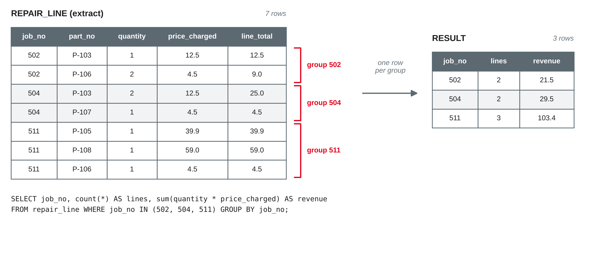

# SQL IV: Aggregation and Beyond {.title}

::: notes
Time plan for today (3 h): recap and loading the data 10 min · aggregate functions and NULL 10 min · GROUP BY 15 min · HAVING and pitfalls 10 min · mini exercise 10 min · break 10 min · subqueries 20 min · views 10 min · indexes 10 min · transactions and ACID 15 min · hands-on: business questions 40 min · team work: aggregate queries and a view for the project 15 min · wrap-up 5 min · ~10 min buffer.
Input is about 75 minutes in total (more than in earlier sessions, because the plan puts four topics into this block), hands-on about 65 minutes plus the mini exercise. Priorities if time runs short: aggregation and subqueries are the core of the exam; indexes and transactions are needed on a concept level. Set the optional slides (subqueries in FROM, concurrent writers) as self-study, shorten the hands-on to questions 1–6, but keep at least 10 minutes for the teams. Session 12 is the buffer for anything left over.
Every statement on these slides was run with Python's sqlite3 module (Python 3.13, SQLite 3.45.1) and, where stated, the sqlite3 command-line tool (SQLite 3.45.1) on a fresh database built from bikeshop-schema.sql, bikeshop-data.sql and bikeshop-data-session09.sql; all results, row counts and error messages are the ones SQLite returned.
:::

---

# Today's Agenda

1. Recap: the doubled revenue
2. Aggregate functions, `GROUP BY` and `HAVING`
3. Subqueries: queries inside queries
4. Views: saved queries with a name
5. Indexes: finding rows fast
6. Transactions and ACID
7. Hands-on: business questions answered with SQL
8. Team work: aggregate queries and a view for your project

::: notes
Time and format guide (not shown to students):
0:00 Recap and loading the data (plenary) · 0:10 Aggregate functions, GROUP BY, HAVING (input, live coding, predict first) · 0:45 Mini exercise (pairs) · 0:55 Break · 1:05 Subqueries and views (input, live coding) · 1:35 Indexes, transactions and ACID (input, short demos) · 2:00 Hands-on (groups of 3, same groups as before, each student on their own laptop) · 2:40 Team work on project queries · 2:55 Wrap-up · buffer.
:::

---

# Recap: The Doubled Revenue

```sql
SELECT l.quantity * l.price_charged AS line_total
FROM   repair_line AS l
WHERE  l.job_no = 511;                         -- 39.9, 59.0, 4.5

SELECT l.quantity * l.price_charged AS line_total
FROM   repair_line AS l
JOIN   job_mechanic AS jm ON jm.job_no = l.job_no
WHERE  l.job_no = 511;                         -- 6 rows
```

- Last session: a join returns **one row per matching pair** — job 511 has 3 repair lines × 2 mechanics
- So far, **we** added up the line totals by hand: 103.40 € — or 206.80 € after the join
- Today: let SQL **count and sum** — and learn to avoid the doubling

::: source
Own example based on the bike shop case from sessions 3–9.
:::

::: notes
Preparation from session 9: hands-on questions and worksheet 9 done, teams bring their join queries and one question that needs counting or summing (collected at the end of session 9). Write two or three team questions on the board — come back to them in the team work. Quick check: who remembers pitfall 2 (duplicates from 1:N)? Today's answer to it is aggregation on the right level, often in a subquery.
:::

---

# Loading Today's Data

```python
import sqlite3

con = sqlite3.connect("bikeshop.db")
con.execute("PRAGMA foreign_keys = ON")
for script in ["bikeshop-schema.sql", "bikeshop-data.sql",
               "bikeshop-data-session09.sql"]:
    with open(script, encoding="utf-8") as f:
        con.executescript(f.read())
```

- Same three scripts as last session, **no new rows** today: a **fresh start** undoes the changes from your experiments
- Row counts: customer 12, bike 15, repair_job 12, repair_line 16, employee 8, mechanic 5, spare_part 12, job_mechanic 14
- The views and indexes you create today are **not** dropped by the schema script — create them again with `IF NOT EXISTS` or drop them first

::: source
Own example based on the bike shop case from sessions 3–9.
:::

::: notes
Everyone runs this cell now. Observed: the schema script drops only the nine tables; a view created on top of them survives the reload (and works again once the tables are back), indexes on the dropped tables disappear with them. To avoid "view job_revenue already exists" when re-running a notebook cell, use `CREATE VIEW IF NOT EXISTS` or `DROP VIEW IF EXISTS` first. Command-line alternative as in session 9.
:::

---

# Aggregation {.section}

Counting, summing and grouping

---

# Aggregate Functions

```sql
SELECT count(*), count(price), count(DISTINCT brand),
       sum(price), avg(price), min(price), max(price)
FROM   bike;
```

| count(*) | count(price) | count(DISTINCT brand) | sum | avg | min | max |
|---|---|---|---|---|---|---|
| 15 | 13 | 8 | 28487 | 2191.31 | 299 | 5899 |

- An **aggregate function** turns **many rows into one value**
- `count(*)` counts **rows**; `count(column)` counts **non-NULL values**; `DISTINCT` counts **different** values
- `sum`, `avg`, `min`, `max` **ignore NULL**: the average is over the **13 known prices**

::: source
Based on SQLite (n.d.-a) and Elmasri and Navathe (2016, Chapter 7).
:::

::: notes
Observed (avg exactly 2191.3076…, shown rounded; use `round(avg(price), 2)`). Ask before running: how many rows? → one. Ask: what is the average price of our 15 bikes? The two bikes bought elsewhere (SCO640, CAN750) have price NULL and are left out: 28487 / 13, not / 15. Whether that is right depends on the question — "average known price" yes; "average value of all bikes" cannot be answered. count(customer_no) = 11: the 4 stock bikes have NULL. Link to session 8: NULL is "unknown", so it is not counted as 0.
:::

---

# Aggregates and NULL: Three Traps

```sql
SELECT sum(price), total(price), avg(price), count(*)
FROM   bike WHERE brand = 'Bianchi';       -- NULL | 0.0 | NULL | 0

SELECT sum(price) / count(*) FROM bike;    -- 1899  (integer division!)
SELECT avg(price)            FROM bike;    -- 2191.31
```

- **No rows** (or only NULLs): `sum`, `avg`, `min`, `max` return **NULL**, `count` returns **0**; SQLite's `total()` returns 0.0
- `sum / count(*)` is **not** the average: it divides by **all** rows — and in SQLite, integer / integer is an **integer**
- If "unknown" should count as 0, say so: `avg(coalesce(price, 0))`

::: source
Based on SQLite (n.d.-a, n.d.-c).
:::

::: notes
All observed. SQLite's documentation calls sum() returning NULL for no input "a design problem" of the SQL standard that total() works around; total() is SQLite-specific, the portable way is `coalesce(sum(x), 0)`. Integer division: 28487 / 15 = 1899 (the decimals are cut off), `* 1.0` or `avg()` gives decimals. Whether NULL should be 0 is a business decision, not a technical one: a missing price is not a free bike. Data quality (session 13) comes back to this.
:::

---

# GROUP BY: One Row per Group

{width=88%}

::: source
Own illustration based on SQLite (n.d.-b) and the course sample data.
:::

::: notes
GROUP BY splits the rows (after WHERE) into groups with equal values in the grouping columns; every aggregate is then computed once per group, and each group becomes one result row. Without the WHERE, the query returns 10 rows: one per job that has repair lines (jobs 506 and 512 have none and do not appear). Ask: why 3 result rows from 7 input rows? Ask: what would `count(*)` without GROUP BY return? → 7, one row.
:::

---

# GROUP BY: Anatomy

```sql
SELECT   brand, count(*) AS bikes, round(avg(price)) AS avg_price
FROM     bike
GROUP BY brand
ORDER BY bikes DESC, brand;
```

| brand | bikes | avg_price |
|---|---|---|
| Cube | 4 | 1599.0 |
| Gazelle | 3 | 2599.0 |
| Trek | 3 | 1016.0 |
| Brompton | 1 | 1749.0 |
| Canyon | 1 | NULL |
| … | … | … |

- `GROUP BY brand`: **one result row per brand** — 8 rows
- Rule: every column in `SELECT` is either in **`GROUP BY`** or inside an **aggregate**
- Business questions of the type "**how many / how much per …**" — the "per" names the `GROUP BY`

::: source
Based on Elmasri and Navathe (2016, Chapter 7), SQLite (n.d.-b) and Tanimura (2021).
:::

::: notes
Observed: 8 rows; Canyon's average is NULL because its only bike has no price. Grouping by expressions works, too: `GROUP BY strftime('%Y-%m', job_date)` gives jobs per month (2027-01: 2, 02: 3, 03: 5, 04: 2). GROUP BY on several columns: one group per combination (e.g. brand, model). Tanimura (2021), from the module literature, applies this pattern to business analyses such as time series and cohorts (Chapters 3 and 4); recommended for the project.
:::

---

# GROUP BY with Joins: Count Zero Correctly

```sql
SELECT    e.name, count(jm.job_no) AS jobs
FROM      mechanic AS m
JOIN      employee AS e ON e.employee_no = m.employee_no
LEFT JOIN job_mechanic AS jm ON jm.employee_no = m.employee_no
GROUP BY  m.employee_no, e.name
ORDER BY  jobs DESC;
```

| name | jobs |
|---|---|
| Deniz Arslan | 5 |
| Jan Hoffmann | 4 |
| Katrin Vogel | 3 |
| Sophie Lindner | 2 |
| Tim Krause | **0** |

- `LEFT JOIN` keeps Tim Krause, who has **no** repair job yet
- `count(jm.job_no)` counts his **NULL** as 0 — `count(*)` would count the added row and report **1**

::: source
Based on Elmasri and Navathe (2016, Chapter 7) and SQLite (n.d.-a).
:::

::: notes
Both versions observed: with count(*) Tim Krause gets 1. Same rule as session 9: test a column of the optional table that cannot be NULL (its key). Grouping by m.employee_no and e.name: the key makes groups unique even if two employees had the same name; the name is listed so that it may appear in SELECT in every DBMS. With an inner join, Tim disappears (4 rows) — "per mechanic" means all mechanics.
:::

---

# HAVING: Filtering Groups

```sql
SELECT   brand, count(*) AS bikes
FROM     bike
WHERE    customer_no IS NOT NULL      -- rows: only sold bikes
GROUP BY brand
HAVING   count(*) >= 2;               -- groups: brands with 2+ sold bikes
```

| | `WHERE` | `HAVING` |
|---|---|---|
| filters | **rows**, before grouping | **groups**, after grouping |
| aggregates allowed? | **no** | **yes** |
| result here | 11 sold bikes | Cube 4, Trek 2 |

- Logical order: `FROM` → `WHERE` → `GROUP BY` → `HAVING` → `SELECT` → `ORDER BY` → `LIMIT`
- `WHERE count(*) >= 2` → error: **misuse of aggregate: count()**

::: source
Based on SQLite (n.d.-b) and Elmasri and Navathe (2016, Chapter 7).
:::

::: notes
Observed: without the WHERE, HAVING count(*) >= 2 returns Cube 4, Gazelle 3, Trek 3; with WHERE the Gazelle drops out (two of its three bikes are in stock) and Trek has 2. The error message is the one SQLite returned. Extends the logical order from session 8 (FROM → WHERE → SELECT → ORDER BY → LIMIT) by two steps. Conditions that do not need an aggregate belong in WHERE: it is clearer and filters earlier. SQLite's documentation: HAVING "is evaluated once for each group of rows"; a group for which it is false is discarded (SQLite, n.d.-b, Section 2.4).
:::

---

# Pitfall: Bare Columns

```sql
SELECT   brand, model, count(*)
FROM     bike
GROUP BY brand;              -- Cube | Kathmandu | 4 ?
```

- `model` is neither grouped nor aggregated: Cube has **four** models — which one is shown?
- SQLite picks the value from **some row** of the group; most other DBMS (e.g. PostgreSQL) reject the query with an **error**
- Same trap without `GROUP BY`: `SELECT member_type, count(*) FROM …` returns **one** row with an arbitrary type

::: callout
Check every `SELECT` column: **grouped** or **aggregated**? If neither, the result is a guess.
:::

::: source
Based on SQLite (n.d.-b).
:::

::: notes
Observed: "Cube | Kathmandu | 4" — Kathmandu is just the value from one of the four Cube rows. SQLite calls these "bare columns" and documents them as an SQLite-specific extension; "most other SQL database engines disallow bare columns" (SQLite, n.d.-b, Section 2.5). Special case: with exactly one min() or max(), SQLite takes the bare columns from the row with that minimum or maximum — handy, but not portable, and not to be relied on in the exam. Fix: add model to GROUP BY (one row per brand and model) or remove it.
:::

---

# Mini Exercise: Count and Sum {.exercise}

Write one query per question. Predict the number of rows first.

1. Number of customers **per city**. Which cities have at least **3** customers?
2. Bikes with **more than one** repair job: frame number, number of jobs, first and last job date
3. The **three** spare parts that brought the most revenue (quantity × price charged)
4. Number of mechanics **per qualification**

::: notes
About 10 min in pairs. Expected answers (all observed):
1 `SELECT city, count(*) FROM customer GROUP BY city` → 6 rows: Heidelberg 4, Mannheim 3, Ladenburg 2, Schwetzingen 1, Weinheim 1, **NULL 1** (Felix Wagner: NULL values form one group of their own). With `HAVING count(*) >= 3` → Heidelberg, Mannheim.
2 `SELECT frame_no, count(*), min(job_date), max(job_date) FROM repair_job GROUP BY frame_no HAVING count(*) > 1` → WAX123, 2, 2027-01-12, 2027-04-07. min/max work on ISO dates stored as text.
3 join repair_line with spare_part, `GROUP BY p.part_no, p.name ORDER BY revenue DESC LIMIT 3` → E-bike battery 500 Wh 649, Brake pads (pair) 72.0, Cassette 11-speed 59.
4 `SELECT qualification, count(*) FROM mechanic GROUP BY qualification` → apprentice 2, the other three 1 each.
Ask in 3: why is the bell's revenue 0? → price_charged 0 in job 508 (given away); quantity is 1.
:::

---

# Subqueries {.section}

Queries inside queries

---

# Scalar Subquery: Compare with an Aggregate

```sql
SELECT   frame_no, brand, model, price
FROM     bike
WHERE    price > (SELECT avg(price) FROM bike)   -- 2191.31
ORDER BY price DESC;                             -- 6 rows
```

- A **subquery** is a `SELECT` in parentheses inside another statement
- A **scalar** subquery returns **one value**; it can stand wherever a value can stand
- Needed here because `WHERE price > avg(price)` is not allowed: `WHERE` works on rows, before any aggregate exists

::: source
Based on Elmasri and Navathe (2016, Chapter 7) and SQLite (n.d.-c).
:::

::: notes
Observed: 6 rows — RIE420, KTM530, CUB202, GZT885, GZT884, GZT886. The inner query runs first (logically), its result is used like a constant. SQLite quirk: if a "scalar" subquery returns several rows, SQLite silently uses the first row (SQLite, n.d.-c, Section 11); observed: `WHERE customer_no = (SELECT customer_no FROM bike WHERE brand = 'Cube')` returns Anna Berger only. PostgreSQL and others raise an error. Use IN when more than one row is possible.
:::

---

# Subqueries with IN and NOT IN

```sql
-- customers with a repair job from March 2027 on
SELECT name FROM customer
WHERE  customer_no IN (SELECT b.customer_no
                       FROM   bike AS b
                       JOIN   repair_job AS j ON j.frame_no = b.frame_no
                       WHERE  j.job_date >= '2027-03-01');      -- 6 rows

-- customers without a bike?
SELECT name FROM customer
WHERE  customer_no NOT IN (SELECT customer_no FROM bike);       -- 0 rows!
```

- `IN (subquery)`: the subquery returns a **list** of values (one column)
- The **NOT IN trap** from session 8: the stock bikes put **NULL** into the list, so `NOT IN` is **never TRUE**
- Fix: `… FROM bike WHERE customer_no IS NOT NULL` → Felix Wagner — or use `NOT EXISTS`

::: source
Based on SQLite (n.d.-c) and Elmasri and Navathe (2016, Chapter 7).
:::

::: notes
Observed: first query 6 rows (Anna Berger, Elif Demir, Lukas Brandt, Paul Richter, Selin Kaya, Tobias Krämer) — no duplicates, although we did not write DISTINCT: IN only asks "is the number in the list?". The same with a join would need DISTINCT if a customer had several jobs. Second query: 0 rows, observed. With the IS NOT NULL filter: 1 row, Felix Wagner. SQLite's documentation lists exactly this case: if the right-hand side contains NULL and the value is not found, NOT IN is NULL (SQLite, n.d.-c, Section 8). Exam-relevant.
:::

---

# Correlated Subqueries: EXISTS and NOT EXISTS

```sql
-- customers who never had a repair job
SELECT c.name
FROM   customer AS c
WHERE  NOT EXISTS (SELECT 1
                   FROM   bike AS b
                   JOIN   repair_job AS j ON j.frame_no = b.frame_no
                   WHERE  b.customer_no = c.customer_no);  -- Felix Wagner, Noah Fischer
```

- **Correlated**: the subquery refers to the outer row (`c.customer_no`) and is evaluated **per customer**
- `EXISTS` is TRUE if the subquery returns **at least one row**; the selected values do not matter (`SELECT 1`)
- `NOT EXISTS` is **not affected by NULL** — the safe way to ask "**… without …**"

::: source
Based on Elmasri and Navathe (2016, Chapter 7) and SQLite (n.d.-c).
:::

::: notes
Observed: 2 rows, ordered by name. Compare session 9: LEFT JOIN … WHERE key IS NULL gave the same answer here, but only because nobody owns two bikes; NOT EXISTS asks the question directly ("no bike of this customer has a job"), whatever the number of bikes. Another correlated example: bikes priced above the average of their own brand, `WHERE b.price > (SELECT avg(b2.price) FROM bike b2 WHERE b2.brand = b.brand)` → 4 rows (WAX123, CUB202, GZT885, TRK311). The DBMS does not necessarily run the subquery once per row — the optimizer may rewrite it — but that is the logical meaning.
:::

---

# Subqueries in FROM: Aggregate First, Then Join {.optional}

```sql
SELECT    j.job_no, r.revenue, count(jm.employee_no) AS mechanics
FROM      repair_job AS j
JOIN      (SELECT   job_no, sum(quantity * price_charged) AS revenue
           FROM     repair_line
           GROUP BY job_no) AS r ON r.job_no = j.job_no
LEFT JOIN job_mechanic AS jm ON jm.job_no = j.job_no
WHERE     j.job_no = 511
GROUP BY  j.job_no, r.revenue;            -- 511 | 103.4 | 2
```

- The result of a query is a table — so it can stand in **FROM** (derived table, needs an alias)
- The fix for the doubled revenue: **aggregate each 1:N path on its own level**, then join
- "Average revenue **per job**": `SELECT avg(revenue) FROM (… GROUP BY job_no)` → 94.14, not the average per line (58.84)

::: source
Based on Elmasri and Navathe (2016, Chapter 7) and SQLite (n.d.-b).
:::

::: notes
Self-study if time is short. All values observed. The repair lines are summed per job in the derived table before the mechanics are joined, so the 2 mechanics no longer multiply the lines. Granularity again: avg(quantity * price_charged) over repair_line is the average line (941.40 / 16), the average job needs a sum per job first (941.40 / 10 jobs with lines). Many people write the same with WITH (a common table expression): `WITH r AS (SELECT …) SELECT … FROM r` — same meaning, easier to read; SQLite supports it (SQLite, n.d.-b). Not exam content beyond the idea.
:::

---

# Views {.section}

Saved queries with a name

---

# Views: A Query with a Name

```sql
CREATE VIEW job_revenue AS
SELECT    j.job_no, j.job_date, j.frame_no,
          coalesce(sum(l.quantity * l.price_charged), 0) AS revenue
FROM      repair_job AS j
LEFT JOIN repair_line AS l ON l.job_no = j.job_no
GROUP BY  j.job_no, j.job_date, j.frame_no;

SELECT strftime('%Y-%m', job_date) AS month, sum(revenue)
FROM   job_revenue GROUP BY month;      -- 2027-03 | 733.2 …
```

- A **view** is a stored `SELECT` with a name; it is used like a table in `FROM`
- It stores **no data**: every query on the view runs the `SELECT` again — always **up to date**
- Uses: hide complex joins, define a business figure **once** ("revenue"), show users only some columns

::: source
Based on SQLite (n.d.-d) and Elmasri and Navathe (2016, Chapter 7).
:::

::: notes
Observed: the view has 12 rows (every job, 506 and 512 with revenue 0) and 941.40 in total; per month 28.4, 76.4, 733.2, 103.4. After `UPDATE repair_line SET price_charged = 7.50 WHERE job_no = 501`, the view shows 7.5 for job 501 immediately. "Revenue" is now defined in one place — if the definition changes (e.g. including labour), only the view changes. Views in the three-schema architecture: the external level (session 2/5) — different user groups see different views. Security: in server DBMS, users can get rights on a view but not on the base tables; SQLite has no user rights.
:::

---

# Working with Views

| Statement | Result in SQLite |
|---|---|
| `SELECT * FROM job_revenue ORDER BY revenue DESC LIMIT 3` | 507 (649), 511 (103.4), 510 (41.8) |
| `INSERT INTO job_revenue (job_no, revenue) VALUES (600, 10)` | **error**: cannot modify job_revenue because it is a view |
| `DROP VIEW job_revenue` | view gone, tables and data unchanged |
| `CREATE VIEW IF NOT EXISTS …` | no error if the view already exists |

- Views can be **built on views**: e.g. `job_overview` = job_revenue + bike + owner
- In SQLite, views are **read-only**; other DBMS allow changes through simple views
- A view is **not** a copy: for a frozen snapshot, use `CREATE TABLE … AS SELECT …`

::: source
Based on SQLite (n.d.-d).
:::

::: notes
All results observed; the error message is SQLite's. SQLite: "You cannot DELETE, INSERT, or UPDATE a view. Views are read-only in SQLite" (SQLite, n.d.-d); INSTEAD OF triggers can work around this — beyond this course. In PostgreSQL and others, a view on a single table without aggregates is usually updatable. A snapshot table is useful for a month-end report that must not change later; a view is right for "always the current figures". Materialized views (stored results, refreshed on demand) exist in PostgreSQL and Oracle — they come back in session 17 (data warehouse).
:::

---

# Indexes, Transactions and ACID {.section}

Speed and safety

---

# Indexes: Search Instead of Scan

```sql
EXPLAIN QUERY PLAN SELECT * FROM bike WHERE customer_no = 101;
-- SCAN bike

CREATE INDEX idx_bike_customer ON bike (customer_no);

EXPLAIN QUERY PLAN SELECT * FROM bike WHERE customer_no = 101;
-- SEARCH bike USING INDEX idx_bike_customer (customer_no=?)
```

- Without an index, the DBMS reads **every row** (scan) — like reading a whole book to find one word
- An **index** keeps the values of a column **sorted**, with pointers to the rows — like the index at the back of a book
- `EXPLAIN QUERY PLAN` shows whether SQLite **scans** or **searches**; the result of the query is the same

::: source
Based on SQLite (n.d.-e, n.d.-f, n.d.-h) and Elmasri and Navathe (2016, Chapter 17).
:::

::: notes
Both plans observed. SQLite: SCAN means a full-table scan, SEARCH that "only a subset of the table rows are visited" (SQLite, n.d.-e); an index "should never change the answer, only help SQLite to get to the answer more quickly" (SQLite, n.d.-h). Lookup cost grows with log N instead of N (binary search). Demo for the notes (not on the slide; 1,000,000 generated sales rows, our machine): sum for one customer 45 ms with scan, 0.02 ms with index; creating the index took 0.7 s and grew the file from 14.5 MB to 26.2 MB. With 15 bikes, there is no measurable difference — indexes matter for large tables. The EXPLAIN QUERY PLAN output format may change between SQLite versions (SQLite, n.d.-e).
:::

---

# When to Create an Index

| Index … | Why |
|---|---|
| **automatically** on `PRIMARY KEY` and `UNIQUE` | needed to check uniqueness |
| on **foreign key** columns, e.g. `repair_job (frame_no)` | joins and "all jobs of a bike" |
| on columns used often in `WHERE` or `ORDER BY` | frequent business questions |
| `CREATE UNIQUE INDEX` on a column | enforces a rule (e.g. one e-mail per customer) |

- Costs: **storage** and **slower writes** — every `INSERT`, `UPDATE`, `DELETE` must update each index
- Not useful for **tiny tables**, columns with **few different values**, or conditions like `lower(brand) = 'cube'`
- Indexes belong to **physical** design: they change speed, **never** the result

::: source
Based on Elmasri and Navathe (2016, Chapter 17) and SQLite (n.d.-f, n.d.-h).
:::

::: notes
Observed in the sample database: sqlite_autoindex_… exist for the primary keys of bike, spare_part, repair_line, job_mechanic and for customer.e_mail (UNIQUE); INTEGER PRIMARY KEY uses the rowid and needs none. SQLite does **not** index foreign key columns automatically: `SELECT * FROM repair_job WHERE frame_no = …` scans until we create an index on frame_no (observed). An expression like lower(brand) cannot use a plain index on brand (observed: SCAN). A composite index (job_no, part_no) helps for job_no, but not for part_no alone — worksheet 10 lets students discover this. Link to worksheet 7: a UNIQUE index was the workaround for "Cannot add a UNIQUE column".
:::

---

# Transactions: All or Nothing

```python
try:
    with con:                                    # one transaction
        con.execute("UPDATE bike SET customer_no = 106 "
                    "WHERE frame_no = 'GZT884'")              # sell the bike
        con.execute("INSERT INTO repair_job (job_no, job_date, "
                    "description, frame_no) VALUES (513, "
                    "'2027-04-15', 'Handover check', 'GZT889')")  # typo!
except sqlite3.Error as e:
    print(e)                     # FOREIGN KEY constraint failed
```

- A **transaction** is a sequence of operations that is executed **as one unit**
- The second statement fails → the whole block is **rolled back**: GZT884 is still **in stock**
- In SQL: `BEGIN;` … `COMMIT;` or `ROLLBACK;` — without `BEGIN`, each statement is its own transaction

::: source
Based on SQLite (n.d.-g), Python Software Foundation (n.d.) and Elmasri and Navathe (2016, Chapter 20).
:::

::: notes
Observed: error "FOREIGN KEY constraint failed", afterwards GZT884 has customer_no NULL and there are still 12 jobs; with the correct frame number GZT884 both changes are committed together (customer 106, 13 jobs). `with con:` commits when the block ends without error and rolls back on an exception; it does not close the connection (Python Software Foundation, n.d.). Link to session 8: Python's sqlite3 opens a transaction before a change; commit() / rollback(). In the sqlite3 CLI (observed): `BEGIN; DELETE FROM repair_line WHERE job_no = 511;` → 13 lines; `ROLLBACK;` → 16 again. Also a single statement is atomic: `UPDATE spare_part SET list_price = list_price - 30` fails on the CHECK for some parts and changes none (observed).
:::

---

# ACID: Four Guarantees of a Transaction

| Property | Meaning | Bike shop example |
|---|---|---|
| **Atomicity** | all or nothing | sale and handover job are stored together or not at all |
| **Consistency** | from one consistent state to another | no repair job for a bike that does not exist |
| **Isolation** | concurrent transactions do not see each other's unfinished work | the shop counter does not see the half-done sale |
| **Durability** | once committed, it survives crashes | after `COMMIT`, a power cut does not lose the sale |

::: callout
The term **ACID** was coined by Haerder and Reuter (1983): "atomicity, consistency, isolation, and durability".
:::

::: source
Based on Haerder and Reuter (1983) and Elmasri and Navathe (2016, Chapter 20).
:::

::: notes
Quote from Haerder and Reuter (1983, Section 1.1): "These four properties, atomicity, consistency, isolation, and durability (ACID), describe the major highlights of the transaction paradigm". Consistency is shared work: the DBMS checks the constraints (session 7), but the transaction logic must be correct, too — a transaction that books a payment to the wrong customer is "consistent" for the DBMS. Isolation in SQLite: a reader keeps seeing the old snapshot until the writer commits. Durability: SQLite writes a journal (rollback journal or WAL) so that a crash in the middle of a commit is undone on restart. NoSQL systems often relax these guarantees (BASE) — next session.
:::

---

# Isolation in Practice: Concurrent Writers {.optional}

| Step | Connection A | Connection B |
|---|---|---|
| 1 | `UPDATE spare_part SET list_price = 7.50 WHERE part_no = 'P-101'` (not committed) | |
| 2 | | `SELECT list_price …` → **6.9** (old value) |
| 3 | | `UPDATE … SET list_price = 8.00 …` → **database is locked** |
| 4 | `commit()` | |
| 5 | | `SELECT list_price …` → **7.5** |

- SQLite allows **many readers** but only **one writer** at a time; server DBMS lock finer (per row)
- Classic problem without isolation: the **lost update** — two people change the same row, one change is overwritten

::: source
Based on SQLite (n.d.-g) and Elmasri and Navathe (2016, Chapter 20).
:::

::: notes
Self-study. Observed with two Python connections to the same file and timeout=0; with the default timeout (5 s), B waits and then fails or succeeds once A commits. SQLite: "only one write transaction" at a time; a reader with an open read transaction sees "an historic snapshot" (SQLite, n.d.-g). Lost update example: two salespeople read stock 3, both sell one, both write 2 — the correct value is 1. Concurrency control (locking, MVCC) is Chapter 21 in Elmasri and Navathe — not exam content here. Relevance for teams: a notebook kernel that holds an open transaction blocks DB Browser from writing ("database is locked") — commit or close.
:::

---

# Hands-On: Business Questions {.section}

Answered with SQL

---

# Exercise: Business Questions on the Bike Shop {.exercise}

Fresh database with all three scripts. Predict the number of rows first.

1. Number of repair jobs and parts revenue **per month**
2. Parts revenue **per bike brand**, highest first
3. Customers with **at least two** repair jobs
4. Spare parts with a list price **above the average** list price
5. Bikes **in stock** that have already been **repaired**
6. **Per mechanic**: number of jobs and parts revenue of those jobs — Tim Krause too. Why is the column total larger than the shop's revenue?
7. Create a view **job_overview** (job, date, brand, model, owner, revenue) and list the March jobs, highest revenue first
8. Sell stock bike **GZT886** to Noah Fischer and record a handover job in **one transaction**; test it first with a wrong frame number

::: notes
Groups of 3, about 35 min + 5 min comparison. Expected answers (all observed):
1 repair_job LEFT JOIN repair_line, `GROUP BY strftime('%Y-%m', j.job_date)`, `count(DISTINCT j.job_no)` (plain count would count lines) → 2027-01: 2 jobs, 28.4 · 02: 3, 76.4 · 03: 5, 733.2 · 04: 2, 103.4.
2 bike → repair_job → LEFT JOIN repair_line, GROUP BY brand → KTM 649, Trek 125.4, Cube 53.3, Canyon 41.8, Brompton 29.9, Riese & Müller 29.5, Gazelle 12.5, Scott NULL (job 506 has no lines; coalesce gives 0).
3 customer → bike → repair_job, GROUP BY customer, HAVING count(*) >= 2 → Anna Berger 2.
4 `WHERE list_price > (SELECT avg(list_price) FROM spare_part)` → only P-109 E-bike battery (average 74.98, pulled up by the battery). Discuss: is the mean a good "typical price" here?
5 `WHERE customer_no IS NULL AND EXISTS (SELECT 1 FROM repair_job j WHERE j.frame_no = b.frame_no)` → KTM530.
6 mechanic → employee, LEFT JOIN job_mechanic, LEFT JOIN job_revenue (view) → Sophie Lindner 2 jobs 678.5, Deniz Arslan 5 / 187.1, Katrin Vogel 3 / 154.4, Jan Hoffmann 4 / 75.8, Tim Krause 0 / 0. Total 1095.8 > 941.4: jobs 502, 504, 511 have two mechanics, so their revenue (154.4) counts twice. Correct for "revenue of the jobs a mechanic worked on", wrong as a share of shop revenue (worksheet 10, optional challenge).
7 view on repair_job JOIN bike LEFT JOIN customer JOIN job_revenue → 507 (KTM, owner NULL, 649), 510 (41.8), 509 (29.9), 508 (12.5), 506 (0).
8 `with con:` UPDATE bike SET customer_no = 112 WHERE frame_no = 'GZT886'; INSERT INTO repair_job … VALUES (513, …, 'GZT886') — with a wrong frame number: FOREIGN KEY constraint failed, GZT886 still in stock; with the right one: both changes visible. Same pattern as on the slide (tested with GZT884).
:::

---

# Team Work: Aggregates and a View for Your Project {.exercise}

1. Take your team's **"how many / how much per …"** questions from last session
2. Write each as a query with `GROUP BY`; at least one with `HAVING` and one with a **subquery**
3. Define **one view** for a key figure of your case (e.g. revenue per order) and use it in a second query
4. Name **one business process** in your case that must be a **transaction**: which statements belong together?

::: callout
Aggregate queries, views and transactions are part of **milestone 3** (database and queries, after session 12).
:::

::: notes
About 15 min. Walk around with the checklist from session 9 plus two questions: what does one row of the result mean (granularity), and is every SELECT column grouped or aggregated? Teams with an order/order-line structure will meet the doubled revenue as soon as they join a second 1:N table — good teaching moment. For step 4, typical answers: placing an order (order + order lines + stock update), a booking with payment, a transfer between accounts. Index question for teams with larger test data: which foreign keys need an index?
:::

---

# Key Takeaways

- **Aggregate functions** turn many rows into one value; `count(*)` counts rows, the others **ignore NULL**
- `GROUP BY` gives **one row per group**; every `SELECT` column is **grouped** or **aggregated**; `HAVING` filters **groups**, `WHERE` filters **rows**
- **Subqueries**: scalar (one value), `IN` (a list), `EXISTS` (correlated); `NOT EXISTS` is safe with NULL, `NOT IN` is not
- A **view** is a named query: no stored data, always current
- An **index** speeds up searches and costs space and write time; a **transaction** is all or nothing — **ACID**

---

# Next Session: NoSQL Databases

- Limits of relational systems; CAP theorem and BASE (vs. ACID)
- Key-value, document, column-family and graph databases
- Choosing a data store for a use case
- Hands-on: the same case modelled relationally and as JSON documents

::: callout
**Preparation:** finish the hands-on questions and worksheet 10; bring your team's aggregate queries and view.
:::

---

# References {.references}

- Elmasri, R., & Navathe, S. B. (2016). *Fundamentals of database systems* (7th ed.). Pearson.
- Haerder, T., & Reuter, A. (1983). Principles of transaction-oriented database recovery. *ACM Computing Surveys, 15*(4), 287–317. https://doi.org/10.1145/289.291
- Python Software Foundation. (n.d.). *sqlite3 — DB-API 2.0 interface for SQLite databases*. Retrieved October 21, 2026, from https://docs.python.org/3/library/sqlite3.html
- SQLite. (n.d.-a). *Built-in aggregate functions*. Retrieved October 21, 2026, from https://www.sqlite.org/lang_aggfunc.html
- SQLite. (n.d.-b). *SELECT*. Retrieved October 21, 2026, from https://www.sqlite.org/lang_select.html
- SQLite. (n.d.-c). *SQL language expressions*. Retrieved October 21, 2026, from https://www.sqlite.org/lang_expr.html
- SQLite. (n.d.-d). *CREATE VIEW*. Retrieved October 21, 2026, from https://www.sqlite.org/lang_createview.html
- SQLite. (n.d.-e). *EXPLAIN QUERY PLAN*. Retrieved October 21, 2026, from https://www.sqlite.org/eqp.html
- SQLite. (n.d.-f). *CREATE INDEX*. Retrieved October 21, 2026, from https://www.sqlite.org/lang_createindex.html
- SQLite. (n.d.-g). *Transaction*. Retrieved October 21, 2026, from https://www.sqlite.org/lang_transaction.html
- SQLite. (n.d.-h). *Query planning*. Retrieved October 21, 2026, from https://www.sqlite.org/queryplanner.html
- Tanimura, C. (2021). *SQL for data analysis: Advanced techniques for transforming data into insights*. O'Reilly Media.
