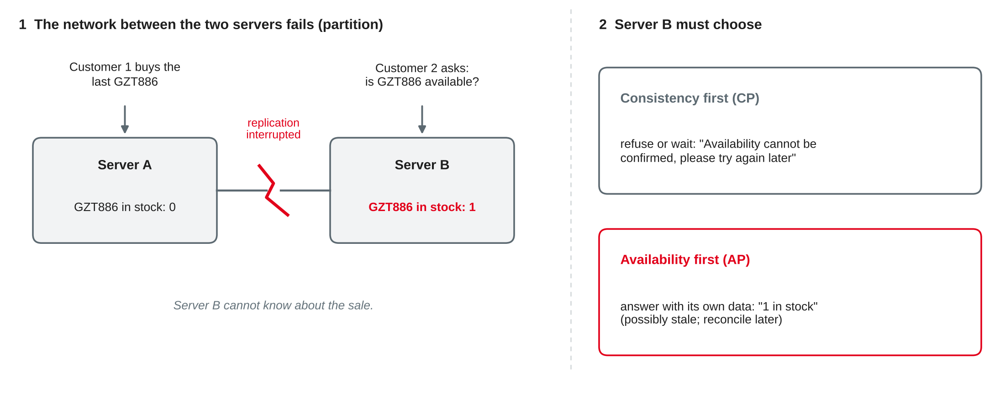
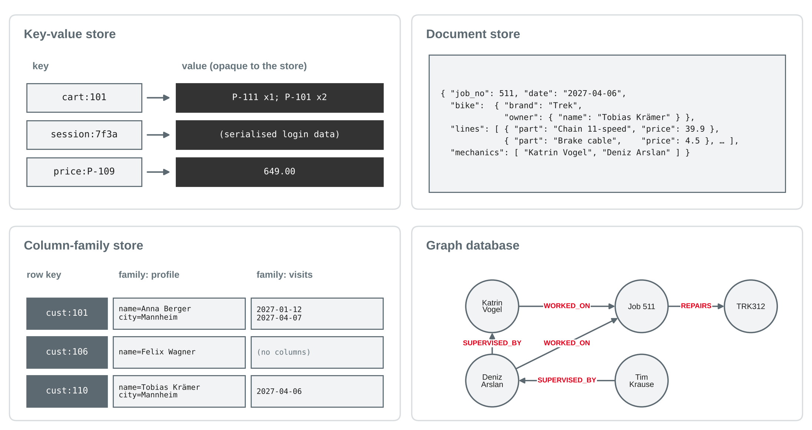

# NoSQL Databases {.title}

::: notes
Time plan for today (3 h): recap and loading the data 10 min · limits of relational systems 12 min · CAP and BASE 20 min · mini exercise CP or AP 10 min · break 10 min · four NoSQL families 22 min · relational vs. documents (live demo) 13 min · hands-on: the bike shop as JSON documents 40 min · choosing a data store and team step 15 min · wrap-up 5 min · ~20 min buffer.
Input is about 75 minutes, hands-on and exercises about 65 minutes. Priorities if time runs short: CAP, BASE vs. ACID and the four families with their typical use cases are the exam core; the SQLite JSON syntax is a tool for the hands-on, not exam content. The optional slide (tunable consistency, PACELC) is self-study. Shorten the hands-on to questions 1–5 if needed, but keep the data store choice: it is the transfer question of today. Session 12 is the buffer.
Every SQL and Python statement on these slides was run with Python's sqlite3 module (Python 3.13, SQLite 3.45.1) on a fresh database built from bikeshop-schema.sql, bikeshop-data.sql, bikeshop-data-session09.sql and the new bikeshop-documents-session11.sql; all results, row counts and error messages are the ones SQLite returned. The Cypher query on the graph slide is an illustration and was not run (no graph database in the course setup).
:::

---

# Today's Agenda

1. Recap: one repair job, seven tables
2. Limits of relational systems
3. CAP theorem and BASE
4. Four NoSQL families: key-value, document, column-family, graph
5. Hands-on: the bike shop as JSON documents
6. Choosing a data store for a use case

::: notes
Time and format guide (not shown to students):
0:00 Recap and loading the data (plenary) · 0:10 Limits of relational systems (input, discussion) · 0:22 CAP and BASE (input, figure) · 0:42 Mini exercise CP or AP (pairs) · 0:52 Break · 1:02 Four NoSQL families (input) · 1:24 Relational vs. documents (live demo in Jupyter) · 1:37 Hands-on (groups of 3, same groups as before, each student on their own laptop) · 2:17 Choosing a data store, team step · 2:32 Wrap-up · buffer.
:::

---

# Recap: One Repair Job, Seven Tables

```sql
SELECT    j.job_no, j.job_date, b.brand, c.name,
          p.name, l.quantity, l.price_charged, e.name
FROM      repair_job AS j
JOIN      bike AS b          ON b.frame_no = j.frame_no
LEFT JOIN customer AS c      ON c.customer_no = b.customer_no
LEFT JOIN repair_line AS l   ON l.job_no = j.job_no
LEFT JOIN spare_part AS p    ON p.part_no = l.part_no
LEFT JOIN job_mechanic AS jm ON jm.job_no = j.job_no
LEFT JOIN employee AS e      ON e.employee_no = jm.employee_no
WHERE     j.job_no = 511;                        -- 6 rows
```

- The workshop tablet wants to show **one** repair job: it needs **seven** tables and gets **6 rows** (3 lines × 2 mechanics)
- Normalisation (session 6) splits data **to avoid anomalies**; joins and aggregates (sessions 9–10) put it **back together**
- Today: what if we stored the job **as one piece**?

::: source
Own example based on the bike shop case from sessions 3–10.
:::

::: notes
Preparation from session 10: hands-on questions and worksheet 10 done, teams bring their aggregate queries and view. Quick check (2 min): which ACID property protects the sale + handover job? → atomicity. Then this query: observed 6 rows — the doubled revenue again. Ask: how does the app want to see a repair job? → as one object: the job with its bike, owner, lines and mechanics. That object is what document databases store. Keep the question "what does a row mean?" from session 10 alive — today it becomes "what does a document mean?".
:::

---

# Loading Today's Data

```python
import sqlite3

con = sqlite3.connect("bikeshop.db")
con.execute("PRAGMA foreign_keys = ON")
for script in ["bikeshop-schema.sql", "bikeshop-data.sql",
               "bikeshop-data-session09.sql",
               "bikeshop-documents-session11.sql"]:      # new
    with open(script, encoding="utf-8") as f:
        con.executescript(f.read())
```

- The new script builds a table **repair_job_doc**: one **JSON document** per repair job — **12 documents**
- Each document embeds the bike, its owner, the repair lines and the mechanics
- No new server: SQLite has **built-in JSON functions** — enough to try out the document idea

::: source
Own example based on the bike shop case; SQLite (n.d.).
:::

::: notes
Everyone runs this cell now. The script drops and rebuilds repair_job_doc from the current tables, so after experiments it is safest to run all four scripts again. Note: bikeshop-schema.sql does not drop repair_job_doc, so a fresh start without the fourth script keeps old documents — another small lesson in redundancy. SQLite stores JSON as ordinary text; the JSON functions are built in since SQLite 3.38.0, and the script uses ORDER BY inside json_group_array, which needs 3.44 or newer (SQLite, n.d.). Check: `SELECT count(*) FROM repair_job_doc` → 12. A real document database (e.g. MongoDB) would be a separate server with its own query language; the ideas are the same.
:::

---

# Limits of Relational Systems {.section}

Why "NoSQL" appeared

---

# Where Relational Databases Reach Their Limits

| Pressure | What happens in a relational DBMS |
|---|---|
| **Volume and traffic** of web-scale applications | one server has limits; spreading tables and joins over many servers is hard |
| **Changing or varied structure** | every new attribute needs `ALTER TABLE`; sparse data leaves many NULLs |
| **Objects vs. rows** ("impedance mismatch") | the app works with a nested object, the database with flat rows and joins |
| **Highly connected data** | many levels of relationships need many self joins |

- Relational systems remain the **default** for business data that needs **integrity and transactions**
- NoSQL systems trade some of this for **scale, flexibility or speed** in a specific use case

::: source
Based on Sadalage and Fowler (2013, Chapter 1) and Elmasri and Navathe (2016, Chapter 24).
:::

::: notes
Discussion question (3 min): where did you meet one of these pressures at your company? Typical answers: product catalogues with very different attributes per product type, logs and sensor data, social features. Link to session 9: the two-level supervisor hierarchy needed two self joins; a hierarchy of unknown depth cannot be written with a fixed number of joins. Sadalage and Fowler (2013, Chapter 1) describe the impedance mismatch and the move to clusters of many small machines as the main drivers of NoSQL. Important framing: this is not "SQL is old, NoSQL is new" — most of the data in the students' companies sits in relational systems, and many NoSQL systems now offer SQL-like query languages.
:::

---

# Scaling Up vs. Scaling Out

::: cards
### Scale up (vertical)
A **bigger server**: more CPU, memory, disks. Simple, keeps ACID and joins — but has an upper limit and a single point of failure.
### Scale out (horizontal)
**More servers** in a cluster. Cheap hardware, almost no upper limit — but the data must be **distributed**.
:::

- **Replication**: the same data on several servers → more reads, survives a server failure
- **Sharding** (partitioning): different data on different servers, e.g. customers A–K and L–Z → more writes and more storage
- Distribution brings the core question of today: what if the servers **cannot talk to each other**?

::: source
Based on Sadalage and Fowler (2013, Chapter 4) and Elmasri and Navathe (2016, Chapter 24).
:::

::: notes
Replication and sharding are usually combined: each shard is replicated. Ask: which one helps a shop that has many customers browsing (reads)? → replication. Which one helps when the data no longer fits on one machine? → sharding. Sadalage and Fowler (2013, Chapter 4) distinguish master-slave (primary-replica) and peer-to-peer replication; not exam content beyond the two basic ideas. A join across shards needs data from several servers — one reason many NoSQL systems avoid joins and store data together that is used together (aggregates, later today).
:::

---

# What "NoSQL" Means

- An umbrella term, usually read as "**not only SQL**": non-relational data stores
- Common characteristics (not all in every system):
  - **No fixed schema**: records of one collection may have different fields
  - Designed for **scale-out**: replication and sharding are built in
  - Data model fits an **access pattern**: key, document, column family, graph
  - **Relaxed consistency** in exchange for availability and speed
  - Simple APIs or own query languages instead of (full) SQL

::: callout
"Schemaless" does not mean "no structure": the structure moves **from the database into the application code** that reads the data.
:::

::: source
Based on Elmasri and Navathe (2016, Chapter 24) and Sadalage and Fowler (2013, Chapters 1 and 3).
:::

::: notes
Sadalage and Fowler call this the implicit schema: whoever reads the data must know which fields to expect (Chapter 3). Link to session 2: JSON is semi-structured — self-describing, structure can vary. Link to session 7: constraints such as NOT NULL, CHECK and FOREIGN KEY are exactly what a schemaless store does not enforce for you. Ask: who is responsible for data quality then? → the application (preview of sessions 13–14).
:::

---

# CAP Theorem and BASE {.section}

Consistency, availability, partitions

---

# The CAP Theorem

| Property | Meaning |
|---|---|
| **C**onsistency | every read returns the **most recent write** — all servers show the same data |
| **A**vailability | every request to a working server gets a **response** |
| **P**artition tolerance | the system keeps working when the **network between servers fails** |

- Brewer's conjecture (a keynote in 2000), proved by Gilbert and Lynch (2002) for distributed systems
- In a distributed system, partitions **will** happen — so during a partition, a system must give up **C or A**
- Careful: the **C** in CAP is **not** the C in ACID (constraints) — it is about **replicas agreeing**

::: source
Based on Gilbert and Lynch (2002), Brewer (2012) and Elmasri and Navathe (2016, Chapter 24).
:::

::: notes
Gilbert and Lynch (2002) formalise availability as "every request received by a non-failing node in the system must result in a response" and consistency as atomic (linearizable) consistency. Brewer's original conjecture was a keynote at PODC 2000; we do not list the talk itself as a reference, Brewer (2012) looks back on it. The mix-up of the two C's is a classic exam mistake: ACID consistency = constraints and business rules hold; CAP consistency = all copies show the same, latest value.
:::

---

# CAP in the Bike Shop

{width=92%}

::: source
Own illustration based on Gilbert and Lynch (2002) and Brewer (2012); fictional extension of the bike shop case.
:::

::: notes
Story: Velo Neckar opens an online shop that runs on two servers (e.g. two data centres), replicating the stock. The link breaks. Customer 1 buys the last GZT886 on server A. Customer 2 asks server B. Server B has two options: refuse/wait (consistent, not available) or answer "1 in stock" (available, possibly wrong). There is no third option while the partition lasts. Ask: what would you choose for the stock of the last e-bike? For the product reviews? → the answer depends on the business cost of a wrong answer versus no answer.
:::

---

# CP or AP: The Business Decides

| | CP: consistency first | AP: availability first |
|---|---|---|
| during a partition | some requests are **refused** or wait | all requests are answered, maybe with **stale** data |
| afterwards | nothing to repair | conflicting writes must be **reconciled** |
| suits | bank balance, stock of the last item, seat booking | shopping cart, product reviews, likes, session data |

- Without a partition, a system can be **both** consistent and available
- Brewer (2012): the "2 of 3" formulation "was always misleading" — the choice is made **per operation**, only when a partition occurs, and not all-or-nothing

::: source
Based on Brewer (2012), Vogels (2009) and Sadalage and Fowler (2013, Chapter 5).
:::

::: notes
Quote from Brewer (2012, p. 23): "The '2 of 3' formulation was always misleading because it tended to oversimplify the tensions among properties." Vogels (2009) describes Amazon's shopping cart as a "write-always" system: customers can always add items, and conflicting versions are merged later — the business prefers an extra item in the cart to a lost sale. A stock overbooking can also be fixed in the business process (apologise, deliver later) — sometimes that is cheaper than an unavailable shop. Classifying whole products as "CP" or "AP" is a simplification; many systems are configurable.
:::

---

# BASE: An Alternative to ACID

| ACID (session 10) | BASE |
|---|---|
| **A**tomicity, **C**onsistency, **I**solation, **D**urability | **B**asically **A**vailable, **S**oft state, **E**ventually consistent |
| pessimistic: block until the state is **safe** | optimistic: answer now, **converge later** |
| strong consistency after every commit | replicas may differ for a while |
| typical for relational DBMS | typical for many distributed NoSQL stores |

- **Eventual consistency**: if no new updates are made, all replicas will **eventually** return the last written value
- BASE is a **design philosophy**, not a precise standard — systems lie on a scale between the two

::: source
Based on Pritchett (2008), Vogels (2009) and Haerder and Reuter (1983).
:::

::: notes
Pritchett (2008) introduces BASE as "basically available, soft state, eventually consistent" and as the opposite end of the spectrum to ACID; his example is splitting a database by function and accepting a delay between the user table and the transaction table. Vogels (2009) defines eventual consistency as a specific form of weak consistency: if no new updates are made, eventually all accesses return the last updated value. "Soft state": the state can change over time even without input, because replicas catch up. Many document databases today offer ACID transactions within one document or even across documents — again, a scale, not two boxes.
:::

---

# Tunable Consistency and PACELC {.optional}

- **N** replicas; a write waits for **W** confirmations; a read asks **R** replicas
- **W + R > N**: read and write sets overlap → **strong** consistency (e.g. N = 3, W = 2, R = 2)
- **W + R ≤ N**: faster and more available, but a read may miss the latest write
- **PACELC**: if **P**artition, choose **A** or **C**; **E**lse, choose **L**atency or **C**onsistency — the trade-off exists even without failures

::: source
Based on Vogels (2009) and Abadi (2012).
:::

::: notes
Self-study. Vogels (2009): "If W+R > N, then the write set and the read set always overlap and one can guarantee strong consistency." Example: N = 3, W = 1, R = 1 is fast but may read a stale replica. Abadi (2012) argues that in normal operation the more relevant trade-off is latency vs. consistency, because waiting for replicas takes time. Not exam content.
:::

---

# Mini Exercise: CP or AP? {.exercise}

For each operation of a nationwide bike-rental app, decide: **consistency first** or **availability first** during a network partition? Give a reason and the business risk of your choice.

1. Showing the number of free bikes at a station on the map
2. Unlocking a bike and starting the paid rental
3. Charging the customer's credit card at the end of a rental
4. Adding a "favourite station" to the user profile
5. Reserving the **last** bike at a station for 15 minutes

::: notes
About 8 min in pairs, 2 min collection. Expected answers (accept other choices with a sound business reason):
1 AP — a slightly outdated number is acceptable; risk: user walks to an empty station.
2 Discussable: AP is common (let the user ride, sync later), CP if the lock must be sure that no one else has the bike; risk AP: two users unlock "the same" bike record — physically only one can take it, so AP is usually fine.
3 CP — money; risk of AP: double charging or no charge. Often solved asynchronously with idempotent payments, but the payment record itself must be consistent.
4 AP — low value, easy to merge later.
5 CP — two people must not get the same last bike; risk AP: double reservation and an angry customer.
Point out: one app, different choices per operation (Brewer, 2012).
:::

---

# Four NoSQL Families {.section}

Key-value, document, column-family, graph

---

# Four Data Models at a Glance

{width=74%}

::: source
Own illustration based on Sadalage and Fowler (2013, Chapters 8–11) and Elmasri and Navathe (2016, Chapter 24); examples from the bike shop case.
:::

::: notes
Overview first, details on the next slides. Ask for each panel: what is the "unit" the database stores and reads? → a value by key; a document; a row with column families; nodes and edges. Sadalage and Fowler (2013, Chapter 2) group the first three as "aggregate-oriented": they store a cluster of related data as one unit. Graph databases are the opposite: they make relationships first-class.
:::

---

# Key-Value Stores

- The simplest model: a **key** and a **value**; the store does **not look inside** the value
- Operations: `get(key)`, `put(key, value)`, `delete(key)` — very fast, easy to distribute by key
- Typical uses: **shopping carts**, **session data**, user preferences, **caches** of query results
- Weak at: queries on the content ("all carts with a bell"), relationships between values
- Examples: Redis, Amazon DynamoDB, Riak

::: callout
In Python terms: a key-value store is a **dictionary** that is shared, persistent and spread over many servers.
:::

::: source
Based on Sadalage and Fowler (2013, Chapter 8) and Elmasri and Navathe (2016, Chapter 24).
:::

::: notes
Bike shop: cart:101 → the items of customer 101's cart; the key is designed by the application ("cart:" + customer number). Key design matters: you can only find data by its key. Vogels (2009) and the Dynamo system are the classic background for key-value stores at Amazon (DynamoDB is the later cloud service). Many key-value stores keep data in memory (e.g. Redis) and are used as a cache in front of a relational database — a common combination in real systems.
:::

---

# Document Stores

```json
{ "job_no": 504, "date": "2027-02-02", "description": "Annual service",
  "bike": { "frame_no": "RIE420", "brand": "Riese & Müller",
            "owner": { "customer_no": 111, "name": "Clara Neumann" } },
  "lines": [ { "part_no": "P-103", "quantity": 2, "price": 12.5 },
             { "part_no": "P-107", "quantity": 1, "price": 4.5 } ],
  "mechanics": [ "Katrin Vogel", "Sophie Lindner" ] }
```

- A **document** (JSON or similar) holds a whole business object, with **nested** objects and **arrays**
- Documents are grouped into **collections**; the store **can query and index fields** inside the documents
- Typical uses: product catalogues, content management, user profiles, orders
- Examples: MongoDB, Couchbase, Apache CouchDB

::: source
Based on Sadalage and Fowler (2013, Chapter 9) and Elmasri and Navathe (2016, Chapter 24); document from bikeshop-documents-session11.sql.
:::

::: notes
The document is shortened from the course data (the part names and the model are left out here). Compare with the key-value store: here the database understands the content, so `find all jobs with a Trek` is possible. One document = one read; no joins needed for the typical screen. Elmasri and Navathe (2016, Chapter 24) use MongoDB as their example document store. JSON arrays have an order, relations do not — a small but real difference (the order of lines can carry meaning).
:::

---

# Embed or Reference?

::: columns
**Embed** (aggregate)

- Related data **inside** the document: lines and mechanics in the job
- One read for the whole object; changed **together**
- Copies of shared data (part names, customer) are **redundant**

|||
**Reference**

- Store a **key** and look it up: `"customer_no": 111`
- No copies, updates in one place
- The application does the "join", often with a second read
:::

- Rule of thumb: **embed** what belongs to one object and is read with it (1:few, owned); **reference** what is shared and changes on its own (N:M, large)
- Design starts from the **access pattern**: which screen or service reads what, how often?

::: source
Based on Sadalage and Fowler (2013, Chapters 2 and 9).
:::

::: notes
Sadalage and Fowler (2013, Chapter 2) call the embedded unit an aggregate: a collection of related objects treated as a unit for updates and consistency — DDD terminology. Our job document embeds repair lines (owned by the job, a weak entity in session 4 terms — natural to embed) and copies of customer and part names (shared — better referenced, or accepted as a snapshot). Ask: should the customer's address be embedded in the job? For an invoice snapshot yes (history, like price_charged in session 6), for the current address no. Link to session 6: embedding is deliberate denormalisation.
:::

---

# Column-Family Stores

- Data in **rows** with a **row key**; columns are grouped into **column families**
- Each row has **only the columns it needs** — sparse, new columns without schema change
- Rows are **sorted by key** and distributed over many servers: very large write and read volumes
- Typical uses: event logs, sensor data, time series, activity feeds
- Examples: Apache Cassandra, Apache HBase, Google Bigtable

::: callout
A table in Bigtable "is a sparse, distributed, persistent multidimensional sorted map" (Chang et al., 2008, p. 4:2).
:::

::: source
Based on Chang et al. (2008), Sadalage and Fowler (2013, Chapter 10) and Elmasri and Navathe (2016, Chapter 24).
:::

::: notes
The ACM article is paginated per article (4:1–4:26); the quote is from the data model section. Bigtable: the map is indexed by row key, column key and timestamp. Not the same as a "column store" in analytics (column-oriented storage in data warehouses, session 17) — a common confusion. Bike shop example in the figure: one row per customer, family "profile" and family "visits" with one column per visit date; Felix Wagner has no visit columns at all — no NULLs stored.
:::

---

# Graph Databases

```cypher
MATCH (m:Mechanic)-[:SUPERVISED_BY*]->(:Mechanic {name: 'Katrin Vogel'})
RETURN m.name
```

- Data as **nodes** (things) and **edges** (relationships), both with **properties**
- Queries **traverse** relationships: "everyone Katrin Vogel supervises, directly or indirectly" — any depth
- In SQL, each level is one more **self join** (session 9); in a graph database, depth is just `*`
- Typical uses: social networks, recommendations, fraud detection, networks and routes
- Examples: Neo4j (query language Cypher), Amazon Neptune

::: source
Based on Sadalage and Fowler (2013, Chapter 11) and Elmasri and Navathe (2016, Chapter 24).
:::

::: notes
The Cypher query is an illustration (not run; no graph database in the course setup) and would return Deniz Arslan, Jan Hoffmann, Sophie Lindner and — via Deniz — Tim Krause. Session 9: the two-level hierarchy needed two self joins; SQL can do arbitrary depth with recursive common table expressions (WITH RECURSIVE), which is beyond this course. Graph databases are not aggregate-oriented; many of them support ACID transactions. Recommendation example: "customers who bought this bike also bought …" = two hops in the graph.
:::

---

# Comparing the Families

| Family | Unit of storage | Query by | Strong at | Weak at |
|---|---|---|---|---|
| Key-value | value by key | key only | speed, simple scale-out | content queries |
| Document | JSON document | key and fields | nested objects, flexible fields | cross-document relationships |
| Column-family | row with column families | row key, key ranges | huge write volumes, sparse data | ad-hoc queries, joins |
| Graph | nodes and edges | traversals | deep relationships | bulk aggregation over all data |
| Relational | rows in tables | SQL, any column | integrity, ad-hoc queries, transactions | scale-out, changing structure |

::: source
Own summary based on Sadalage and Fowler (2013, Chapters 8–11) and Elmasri and Navathe (2016, Chapter 24).
:::

::: notes
This table is exam-relevant: students should be able to name the model, a typical use case and one strength and weakness per family. Generalisations — individual products blur the lines (e.g. document stores with joins, relational DBMS with JSON columns as in SQLite and PostgreSQL). Ask: which family would you pick for the bike shop's repair history? → relational or document; for the website's shopping cart → key-value.
:::

---

# Relational vs. Documents {.section}

The same case, two models

---

# Querying Documents in SQLite

```sql
SELECT doc ->> '$.job_no', doc ->> '$.bike.model'
FROM   repair_job_doc
WHERE  doc ->> '$.bike.brand' = 'Trek';            -- 503 | FX 3,  511 | Domane AL 2

SELECT   d.job_no,
         sum((l.value ->> 'quantity') * (l.value ->> 'price')) AS revenue
FROM     repair_job_doc AS d, json_each(d.doc, '$.lines') AS l
GROUP BY d.job_no
ORDER BY revenue DESC LIMIT 3;                     -- 507 649, 511 103.4, 510 41.8
```

- `->>` takes a value out of a document by its **path**: `$.bike.brand`
- `json_each` turns an **array** into rows — then `GROUP BY` works as in session 10
- Same results as the relational tables — but no joins: everything is **in the document**

::: source
Based on SQLite (n.d.); own example based on the bike shop case.
:::

::: notes
All results observed. `->` returns JSON text, `->>` an SQL value (SQLite, n.d.): `doc -> '$.bike.owner'` for job 511 gives the whole owner object as text. Precedence: put each `->>` in parentheses before multiplying. Ask: why does job 506 not appear in the revenue query? → it has an empty lines array, so json_each gives no rows — the comma join acts like an inner join (session 9!). `LEFT JOIN json_each(…)` keeps it. Python alternative: `json.loads(doc)` gives a dict, `job["bike"]["owner"]["name"]`.
:::

---

# The Same Change in Two Models

| Change | Relational | Documents |
|---|---|---|
| Rename spare part P-106 to "Brake cable, stainless" | **1 row** in spare_part | **2 documents** (jobs 502, 511) |
| Anna Berger moves to Heidelberg | **1 row** in customer | **2 documents** (jobs 501, 512) |
| New job for frame **GZT889** (typo) | **FOREIGN KEY constraint failed** | stored without complaint |
| Spare part P-112, never used | in spare_part | **in no document** |

- Embedded copies bring back the **update anomaly** of session 6 — forget one document and the data contradict each other
- Integrity rules (keys, foreign keys, CHECK) move into the **application**

::: source
Own example based on the bike shop case; SQLite (n.d.).
:::

::: notes
All observed. Document update for the part name: `UPDATE repair_job_doc SET doc = (SELECT json_set(doc, l.fullkey || '.part', 'Brake cable, stainless') FROM json_each(doc, '$.lines') AS l WHERE l.value ->> 'part_no' = 'P-106') WHERE EXISTS (…)` → 2 rows changed (correct only because each job uses P-106 at most once). The table repair_job_doc only has CHECK (json_valid(doc)): a broken JSON string fails with "CHECK constraint failed: json_valid(doc)", a document with "datum" instead of "date" is accepted, and `doc ->> '$.date'` then returns NULL — schema-on-read. Customers without jobs (Felix Wagner, Noah Fischer) do not appear in any job document: the job collection is a view for one access pattern, not the full truth. Is the copy always wrong? No — for an invoice, a snapshot of the name and price at the time is exactly right (history).
:::

---

# Choosing a Data Store

1. What does the **business** need: correct totals and transactions, or always-on answers?
2. What is the **access pattern**: by key, whole objects, ranges over time, relationships?
3. How **varied or changing** is the structure?
4. How large are **volume and traffic** — does one server suffice?
5. Which **skills and tools** does the organisation have — SQL, reporting, operations?

::: callout
**Polyglot persistence**: one application can use several stores — e.g. relational for orders, key-value for the cart, a graph for recommendations. Start relational unless a clear reason speaks against it.
:::

::: source
Based on Sadalage and Fowler (2013, Chapters 13 and 15).
:::

::: notes
Sadalage and Fowler (2013, Chapter 13) introduce polyglot persistence; Chapter 15 discusses choosing a database, including programmer productivity and data-access performance as the two main drivers. "Start relational" is the lecturer's rule of thumb for small and medium businesses and for the course project, not a quote. Every additional data store costs operations, backups, skills and data integration (sessions 16 and 18). Ask: which of the five questions is most often forgotten? → usually 5.
:::

---

# Exercise: The Bike Shop as JSON Documents {.exercise}

Fresh database with all four scripts. Predict the result first.

1. Read the document of job **504** in Python (`json.loads`): owner, number of lines, parts revenue
2. All jobs **Jan Hoffmann** worked on, with date and brand
3. Parts revenue **per brand** from the documents — compare with session 10. Which brand is missing, and why?
4. Customers who appear in **no** job document. What does this tell you about the collection?
5. Anna Berger moves to **Heidelberg**: update both models. How many rows, how many documents?
6. Insert a job document for frame **GZT889** — then the same job into `repair_job`. Explain the difference.
7. Design a second collection **customer** for a customer portal: what do you embed, what do you reference?

::: notes
Groups of 3, about 35 min + 5 min comparison. Expected answers (all observed):
1 `job = json.loads(con.execute("SELECT doc FROM repair_job_doc WHERE job_no = 504").fetchone()[0])` → Clara Neumann, 2 lines, 2 × 12.5 + 4.5 = 29.5.
2 `SELECT d.job_no, d.doc ->> '$.date', d.doc ->> '$.bike.brand' FROM repair_job_doc d, json_each(d.doc, '$.mechanics') m WHERE m.value = 'Jan Hoffmann'` → 502 Cube, 506 Scott, 508 Gazelle, 510 Canyon.
3 json_each over lines, GROUP BY brand → KTM 649, Trek 125.4, Cube 53.3, Canyon 41.8, Brompton 29.9, Riese & Müller 29.5, Gazelle 12.5 — same as session 10. Scott is missing: job 506 has an empty lines array, the comma join drops it; `LEFT JOIN json_each(…)` with total() gives Scott 0.0.
4 NOT EXISTS against customer → Felix Wagner, Noah Fischer. The collection only knows customers with jobs; it is built for one access pattern.
5 Relational `UPDATE customer SET city = 'Heidelberg' WHERE customer_no = 101` → 1 row. Documents: `UPDATE repair_job_doc SET doc = json_set(doc, '$.bike.owner.city', 'Heidelberg') WHERE doc ->> '$.bike.owner.customer_no' = 101` → 2 documents (501, 512).
6 Document: 1 row inserted (13 documents); relational: FOREIGN KEY constraint failed. The document store does not know that GZT889 does not exist.
7 Open: customer document with embedded bikes (few, owned) and a short list of recent jobs, or references (job numbers) to the job collection; discuss redundancy with the job documents.
:::

---

# Exercise: Which Data Store? {.exercise}

Choose a data store family for each use case and give **two reasons**. Name one thing that would be harder than in a relational database.

1. Velo Neckar's online shop: **shopping carts** of visitors who are not logged in
2. A bike **product catalogue** with very different attributes per product type (e-bikes, helmets, tyres)
3. **GPS and sensor readings** of 5,000 rental e-bikes, every 10 seconds
4. "Customers who bought this also bought …" **recommendations**
5. **Invoices and payments** of the bike shop

**Team step:** which part of your **project case** could use a document or key-value store — and why will you still build it relationally for milestone 3?

::: notes
About 10 min in pairs + 5 min team step. Expected answers: 1 key-value (access by session key, short-lived, high traffic; harder: reporting on cart contents). 2 document (flexible fields per product type, whole product read at once; harder: consistent attribute names, queries across types). 3 column-family (huge write volume, time-ordered by bike and time; harder: ad-hoc queries, joins with customer data) — a time-series database is also a good answer. 4 graph (traversals over customer–bike–product relationships; harder: totals over all sales). 5 relational (ACID, integrity, exact totals, audit; harder: nothing relevant — scale is small). Team step: milestone 3 (after session 12) is a relational SQLite database; the design project stays relational, the NoSQL reflection can go into the documentation as a short paragraph if the team wishes.
:::

---

# Key Takeaways

- Relational systems reach limits with **scale-out**, **changing structure** and **deeply connected data**; NoSQL stores trade integrity or query power for these
- **CAP**: during a network **partition**, a distributed system must choose **consistency or availability** — per operation, by business risk
- **BASE** (basically available, soft state, eventually consistent) is the optimistic counterpart to **ACID**
- **Key-value**, **document**, **column-family** and **graph** stores each fit a specific **access pattern**
- Embedding copies data: the **update anomaly** returns — choose the store by the use case, often **polyglot**

---

# Next Session: Project Workshop and Catch-Up

- **Buffer session**: no new content — catch up on Parts A and B (sessions 1–11)
- Team consultations: review of your **schemas and SQL queries**
- Extra SQL practice and a revision worksheet for Part B
- Feedback round on the course so far

::: callout
**Preparation:** finish the hands-on questions and worksheet 11; bring your team's database file and queries for **milestone 3** (database and queries, due after session 12) and your open questions.
:::

---

# References {.references}

- Abadi, D. J. (2012). Consistency tradeoffs in modern distributed database system design: CAP is only part of the story. *Computer, 45*(2), 37–42. https://doi.org/10.1109/MC.2012.33
- Brewer, E. (2012). CAP twelve years later: How the "rules" have changed. *Computer, 45*(2), 23–29. https://doi.org/10.1109/MC.2012.37
- Chang, F., Dean, J., Ghemawat, S., Hsieh, W. C., Wallach, D. A., Burrows, M., Chandra, T., Fikes, A., & Gruber, R. E. (2008). Bigtable: A distributed storage system for structured data. *ACM Transactions on Computer Systems, 26*(2), Article 4. https://doi.org/10.1145/1365815.1365816
- Elmasri, R., & Navathe, S. B. (2016). *Fundamentals of database systems* (7th ed.). Pearson.
- Gilbert, S., & Lynch, N. (2002). Brewer's conjecture and the feasibility of consistent, available, partition-tolerant web services. *ACM SIGACT News, 33*(2), 51–59. https://doi.org/10.1145/564585.564601
- Haerder, T., & Reuter, A. (1983). Principles of transaction-oriented database recovery. *ACM Computing Surveys, 15*(4), 287–317. https://doi.org/10.1145/289.291
- Pritchett, D. (2008). BASE: An ACID alternative. *ACM Queue, 6*(3), 48–55. https://doi.org/10.1145/1394127.1394128
- Sadalage, P. J., & Fowler, M. (2013). *NoSQL distilled: A brief guide to the emerging world of polyglot persistence*. Addison-Wesley.
- SQLite. (n.d.). *JSON functions and operators*. Retrieved October 21, 2026, from https://www.sqlite.org/json1.html
- Vogels, W. (2009). Eventually consistent. *Communications of the ACM, 52*(1), 40–44. https://doi.org/10.1145/1435417.1435432
