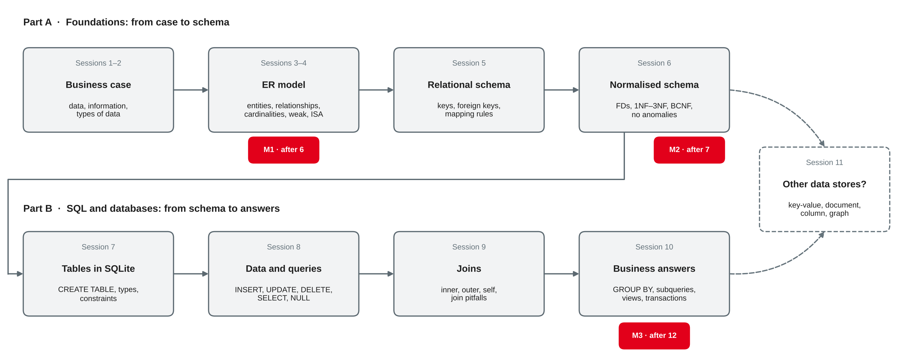

# Project Workshop and Catch-Up {.title}

::: notes
Buffer block: no new content. Time plan for today (3 h): recap and open-question round 10 min · Parts A–B in review 15 min · self-check 15 min · how today works, milestone 3 and checklists 15 min · break 10 min · common mistakes 10 min · team workshop with consultations 60 min · peer review between teams 15 min · feedback round 15 min · wrap-up 5 min · ~10 min buffer.
Input is about 55 minutes, hands-on, consultations and discussion about 105 minutes. If earlier sessions overran, this block absorbs it: e.g. let groups finish the session 10 hands-on (questions 6–8) or the session 11 exercise in the first part of the workshop, and skip the optional catch-up slide. The extra SQL practice slide is for teams that wait for their consultation or finish early; it is not needed by everyone.
Students need their team's database file (or the scripts that build it), their queries, and the bike shop scripts bikeshop-schema.sql, bikeshop-data.sql and bikeshop-data-session09.sql. Nothing new is installed today. Every SQL statement and result on these slides was run with Python's sqlite3 module (Python 3.13, SQLite 3.45.1) on a fresh database built from these three scripts; all results, row counts and error messages are the ones SQLite returned.
:::

---

# Today's Agenda

1. Recap: your open questions
2. Parts A–B in review: from business case to business answers
3. Self-check: one question per session
4. How today works: milestone 3 and the review checklists
5. Common mistakes so far
6. Team workshop with consultations
7. Peer review between teams
8. Feedback round on the course so far

::: notes
Time and format guide (not shown to students):
0:00 Open-question round (plenary, collect on the whiteboard) · 0:10 Parts A–B in review (input) · 0:25 Self-check (pairs, then plenary) · 0:40 How today works, milestone 3, checklists (input) · 0:55 Break · 1:05 Common mistakes (input, ask the class to spot each mistake first) · 1:15 Team workshop (teams; consultations at the tables, about 10 min per team) · 2:15 Peer review (two teams swap schema and queries) · 2:30 Feedback round (plenary) · 2:45 Wrap-up · buffer.
The order is flexible: with many teams, start consultations already during the self-check for the teams that have the most open questions.
:::

---

# Recap: Where Session 11 Left Us

- NoSQL stores trade integrity or query power for **scale, flexibility or speed** — chosen per **access pattern**
- Embedding copies data: the **update anomaly** of session 6 returns
- For the design project: **start relational** — milestone 3 is a **SQLite database with queries**
- Today: **no new content** — time to consolidate Parts A and B and to work on your project

::: callout
**Your preparation:** your team's database or scripts, your queries for milestone 3 and a list of open questions. Which question would you ask first?
:::

::: notes
Preparation from session 11: hands-on and worksheet 11 done, teams bring their database file and queries for milestone 3. Open-question round (10 min): ask each team for its most important open question and cluster them on the whiteboard by topic (modelling 3–4, mapping and normalisation 5–6, SQL 7–10, NoSQL 11). Use the clusters to decide which catch-up to show after the self-check and which team to consult first. "Start relational unless a clear reason speaks against it" is the lecturer's rule of thumb from session 11, not a quote.
:::

---

# Parts A–B in Review {.section}

From business case to business answers

---

# From Case to Query

{width=92%}

::: source
Own illustration based on sessions 1–11 of this course; milestones from session 4.
:::

::: notes
Walk through the map once. Part A works on paper: the business case names the things and facts (sessions 1–2), the ER model structures them (3–4), the mapping rules turn them into relations with keys (5), and normalisation checks that every fact is stored once (6). Part B builds and uses the database: DDL with constraints (7), data and single-table queries (8), joins that put the normalised pieces back together (9), and aggregation, subqueries, views and transactions that turn rows into business answers (10). Session 11 asked when a different data store would be better. The milestones follow the same path: M1 ER model, M2 relational schema, M3 database and queries (after today).
:::

---

# Part A at a Glance

| Session | Core idea | Typical mistake |
|---|---|---|
| 3 ER model | Entity types, relationships, cardinality and participation | Cardinality read from one side only |
| 4 ER model II | Weak entity types, M:N with attributes, recursive, specialisation | Price or date stored on the wrong entity type (history) |
| 5 Relational model | Keys, foreign keys, integrity; mapping rules | Foreign key on the "1" side of a 1:N relationship |
| 6 Normalisation | Functional dependencies; 1NF, 2NF, 3NF, BCNF | Lists in one cell; a fact about a non-key attribute |

::: source
Own summary of sessions 3–6, based on Chen (1976), Staud (2005) and Elmasri and Navathe (2016, Chapters 3, 4, 5, 9 and 14).
:::

::: notes
For each row, ask the class for an example from their own project before showing the "typical mistake" column. The mistakes are the ones the exercises and worksheets of sessions 3–6 were built around (e.g. worksheet 4 "Find the Pitfalls", worksheet 6 "Normalise a Messy Spreadsheet"). After the first run, replace them with the mistakes actually seen in the teams' milestones 1 and 2.
:::

---

# Part B at a Glance

| Session | Core idea | Typical mistake |
|---|---|---|
| 7 SQL I | `CREATE TABLE` with types and constraints | Foreign keys not switched on: `PRAGMA foreign_keys` |
| 8 SQL II | `INSERT`, `UPDATE`, `DELETE`; `SELECT` with `WHERE` | `= NULL` instead of `IS NULL`; `UPDATE` without `WHERE` |
| 9 SQL III | Inner, outer and self joins | Filter on the optional table in `WHERE` |
| 10 SQL IV | `GROUP BY`, `HAVING`, subqueries, views, ACID | Sum after joining two 1:N paths: doubled revenue |
| 11 NoSQL | Data store by access pattern; CAP and BASE | CAP's C confused with ACID's C |

::: callout
One question runs through Part B: **what does one row of the result mean?**
:::

::: source
Own summary of sessions 7–11, based on Elmasri and Navathe (2016, Chapters 6, 7 and 24), Sadalage and Fowler (2013) and SQLite (n.d.-d).
:::

::: notes
Granularity is the thread: a join returns one row per matching pair, GROUP BY one row per group, a view or a derived table one row per whatever it groups by. Most wrong results in the hands-on sessions were correct SQL on the wrong level. Same procedure as on the previous slide: ask for examples first.
:::

---

# Self-Check: One Question per Session {.exercise}

Answer briefly — without your notes.

1. **S3–4:** A bike belongs to at most one customer; some bikes are in stock. Cardinality and participation?
2. **S5:** How is the M:N relationship "mechanic works on repair job" mapped?
3. **S6:** Is `price_charged` in `repair_line` redundant, since `spare_part` has a list price?
4. **S7:** In a new notebook, a repair job for a bike that does not exist is accepted. Why?
5. **S8:** `WHERE description = NULL` returns no rows. Why, and what is the fix?
6. **S9:** A `LEFT JOIN` suddenly behaves like an inner join. What is the usual cause?
7. **S10:** `WHERE count(*) > 1` fails. What is the difference between `WHERE` and `HAVING`?
8. **S11:** Name one use case for a key-value store and one that should stay relational.

::: notes
Pairs 8 min, plenary 7 min. Expected answers:
1 Customer–bike 1:N; participation of bike partial (stock bikes have no owner, customer_no NULL), participation of customer partial (a customer without a bike, e.g. Felix Wagner, is possible).
2 New relation JOB_MECHANIC(job_no → REPAIR_JOB, employee_no → MECHANIC) with the composite primary key (job_no, employee_no).
3 No: it is a different fact — the price at the time of the repair, functionally dependent on (job_no, part_no). The list price can change later. History, not denormalisation (session 6).
4 Foreign key enforcement is off by default and must be switched on per connection: `PRAGMA foreign_keys = ON` (SQLite, n.d.-d).
5 Any comparison with NULL is UNKNOWN, and WHERE keeps only TRUE rows; use `IS NULL`.
6 A condition on a column of the optional (right) table in WHERE removes the rows that were added with NULLs; move it into ON.
7 WHERE filters rows before grouping and cannot use aggregates; HAVING filters groups after grouping (observed error: misuse of aggregate: count()).
8 Key-value: shopping cart, session data, cache. Relational: invoices and payments, the repair history — integrity, transactions and exact totals matter.
:::

---

# Today's Workshop {.section}

Milestone 3, checklists and consultations

---

# How Today Works

::: cards
### Team workshop
Work on your database and queries. Use the **checklists** on the next slides first — most problems show up there.
### Consultation
A short talk at your table. Come with **one concrete question** and the query or table it is about.
### Peer review
Swap schema and queries with **another team**. Review with the checklists; give **two strengths and two suggestions**.
:::

- Waiting for your consultation or done early? **Extra SQL practice** on the bike shop and **worksheet 12**
- Catching up on sessions 10–11? Finish the hands-on questions first — the workshop time is yours

::: notes
Consultation order: teams with the most open questions from the opening round first. Ask each team to show their schema (a diagram or the CREATE TABLE script) and one query they are not sure about. Use the checklists instead of giving answers: "go through point 3 with me". Note recurring problems on the whiteboard and discuss two or three of them with everyone before the peer review. Teams that are far ahead can start on the data they want to load in milestone 4 (sessions 14–16).
:::

---

# Milestone 3: Database and Queries

| Part | What it shows |
|---|---|
| **Schema script** | your normalised schema in SQLite: types, keys, foreign keys, `NOT NULL`, `CHECK`, referential actions |
| **Test data** | enough rows to test the queries — including **edge cases**: NULLs, rows without partners |
| **Business questions** | each question in words, the SQL query and the result |
| **SQL features** | joins (incl. an outer join), aggregation with `GROUP BY` / `HAVING`, a subquery, a view, a transaction |

::: callout
The exact deliverables, deadline and submission format are in the **project brief**.
:::

::: source
Milestones from session 4; SQL features from sessions 7–10.
:::

::: notes
Milestone 3 per session 4: "SQLite database with constraints; business questions answered in SQL". The SQL features listed are the ones the team-work steps of sessions 8–10 asked for (session 10: "aggregate queries, views and transactions are part of milestone 3"). Adjust the table to the project brief if it says something different. A scripted database (schema script + data script) is easier to review and to rebuild than a binary .db file alone — recommend handing in both.
:::

---

# Checklist: Schema and Data

1. **Model fit**: every entity type and relationship of your ER model has a home — and the tables match the **milestone 2** schema (or you documented why not)
2. **Keys**: every table has a primary key; weak entity types use **owner key + partial key**
3. **Foreign keys**: on the **N side** of 1:N; M:N as its own table; **referential actions** chosen on purpose
4. **Normal form**: no lists in a cell, no partial or transitive dependencies — or a **documented** reason
5. **Constraints**: `NOT NULL`, `UNIQUE`, `CHECK` for the business rules; dates as **ISO text** (`YYYY-MM-DD`)
6. **Switched on**: `PRAGMA foreign_keys = ON` in every connection; `PRAGMA foreign_key_check` returns **no rows**
7. **Rebuildable**: schema and data scripts run on an empty database **without errors**

::: source
Own summary based on Elmasri and Navathe (2016, Chapters 5, 9 and 14) and SQLite (n.d.-a, n.d.-d).
:::

::: notes
Point 6: `PRAGMA foreign_key_check` lists every row that violates a foreign key (SQLite, n.d.-a). Observed in a database that was filled without the pragma: a repair job for frame GZT889 was stored; after `PRAGMA foreign_keys = ON` new orphans are rejected, but the old one stays until `foreign_key_check` finds it. Also observed: the pragma is a no-op inside an open transaction (SQLite, n.d.-a) — in Python, commit first, then switch it on. Point 5: '12.01.2027' sorts before '28.01.2027' but after '03.02.2027' (observed) — text dates in German format sort by day.
:::

---

# Checklist: Queries

1. **Question first**: write the business question in words — what does **one row** of the answer mean?
2. **Path**: which tables, which foreign keys? n tables → **n − 1** join conditions
3. **Missing partners**: `LEFT JOIN` where a row may have no partner; filters on the optional table go into **`ON`**
4. **Grouping**: every `SELECT` column is **grouped or aggregated**; `count(column)` instead of `count(*)` after an outer join
5. **NULL**: `IS NULL`, `NOT EXISTS` instead of `NOT IN`, `coalesce` where "unknown" should count as 0
6. **Levels**: aggregate each 1:N path **on its own level** before joining
7. **Check**: predict the number of rows and one value — then compare

::: source
Own summary of sessions 8–10, based on Elmasri and Navathe (2016, Chapter 7) and SQLite (n.d.-b, n.d.-c).
:::

::: notes
Extends the join checklist of session 9 by the points from session 10. Point 7 is the most effective in practice: if a team cannot predict a result, it does not yet understand its own data. Recommend one small test case per query in the documentation (e.g. "customer 106 has no bike and must appear with 0").
:::

---

# Common Mistakes: Model and Schema

| Mistake | Symptom | Fix |
|---|---|---|
| A list in one cell: `parts = 'P-101, P-103'` | "all jobs with P-103" needs `LIKE` | own table for the M:N relationship (1NF) |
| Derived values stored: age, number of jobs | values go out of date | calculate in a query or view |
| Current price only | old invoices change | store the price **at the time** (history) |
| Partial key as primary key: `room_no` alone | room 1 exists only **once** in all houses | owner key + partial key |
| Name copied into a second table | update anomaly | foreign key only; join for the name |
| Dates as `'12.01.2027'` | wrong order, no date functions | ISO format `'2027-01-12'` + `CHECK` |

::: source
Based on Staud (2005), Elmasri and Navathe (2016, Chapters 9 and 14) and the course exercises of sessions 4–7.
:::

::: notes
Ask the class to name the symptom before revealing it. The partial-key example is from worksheet 12 (student housing office); observed with `room_no INTEGER PRIMARY KEY`: inserting room 1 of house 2 fails with "UNIQUE constraint failed: room.room_no". Derived data and missing history are pitfalls 2 and 3 from session 4. After the first run, replace or extend the rows with the mistakes seen in the teams' milestones.
:::

---

# Common Mistakes: SQL

| Query | Observed result | Why — and the fix |
|---|---|---|
| mechanics with `count(*)` after `LEFT JOIN job_mechanic` | Tim Krause: **1** job | counts the NULL row → `count(jm.job_no)` gives 0 |
| customers `WHERE customer_no NOT IN (SELECT customer_no FROM bike)` | **0** rows | stock bikes put NULL into the list → `NOT EXISTS` |
| bikes `LEFT JOIN repair_job … WHERE job_date >= '2027-04-01'` | **2** rows, not 15 | `WHERE` removes the NULL rows → condition into `ON` |
| `sum(quantity * price_charged)` after joining `job_mechanic` | **1095.8** instead of 941.4 | 2 mechanics double the lines → aggregate first |
| `SELECT brand, model, count(*) … GROUP BY brand` | Cube · Kathmandu · 4 | `model` is a bare column → group or remove it |

::: source
Own examples on the bike shop data; based on SQLite (n.d.-b, n.d.-c) and Elmasri and Navathe (2016, Chapter 7).
:::

::: notes
All results observed on the fresh bike shop database. Every row is a repeat from sessions 8–10 on purpose: these are the mistakes that keep coming back in team queries. Let the class predict the result of each query before showing the middle column. The NOT IN behaviour is documented: if the right-hand side contains NULL and the value is not found, NOT IN is NULL (SQLite, n.d.-c, Section 8). Bare columns: SQLite-specific, most other DBMS reject the query (SQLite, n.d.-b, Section 2.5).
:::

---

# Exercise: Peer Review Between Teams {.exercise}

Swap your schema script and three queries with another team.

1. Build the other team's database from their scripts. Does it run **without errors**?
2. Go through both **checklists**. Note every point that is not met — with the table or query
3. Pick one business question and **predict** the result before you run the query
4. Give feedback: **two strengths** and **two concrete suggestions**, written down for the other team

::: notes
About 15 min. Pair teams with different cases. Feedback rules: describe the observation ("repair_line has no foreign key to spare_part"), not the person; suggestions must be concrete ("add REFERENCES spare_part (part_no)"). Teams keep the written feedback and decide themselves what to change before handing in milestone 3. Likely findings: scripts that only run in a certain order, missing PRAGMA, missing test rows for edge cases, queries whose result nobody checked.
:::

---

# Extra SQL Practice: The Bike Shop {.exercise}

Fresh database with the three scripts. Predict the number of rows first.

1. Bikes **in stock** per brand: number and total value
2. Every mechanic with the **name** of their supervisor — Katrin Vogel too
3. Spare parts that were **never used** in a repair
4. Repair jobs **without a description**: date, brand, number of mechanics
5. **Per city**: number of customers and number of repair jobs of their bikes
6. Repair jobs whose parts revenue is **above the average job revenue**

::: notes
For teams that wait for a consultation or finish early. Expected answers (all observed):
1 `WHERE customer_no IS NULL GROUP BY brand` → Gazelle 2 / 4998, KTM 1 / 3599, Trek 1 / 1099.
2 mechanic JOIN employee e LEFT JOIN employee s ON s.employee_no = m.supervisor_no → 5 rows; Deniz Arslan, Jan Hoffmann, Sophie Lindner → Katrin Vogel; Tim Krause → Deniz Arslan; Katrin Vogel → NULL (inner join would drop her).
3 `NOT EXISTS (SELECT 1 FROM repair_line l WHERE l.part_no = p.part_no)` → P-112 Mudguard set.
4 repair_job JOIN bike LEFT JOIN job_mechanic, `WHERE description IS NULL`, GROUP BY job, `count(jm.employee_no)` → 506 (2027-03-01, Scott, 1), 512 (2027-04-07, Cube, 0).
5 customer LEFT JOIN bike LEFT JOIN repair_job, GROUP BY city, `count(DISTINCT c.customer_no)`, `count(j.job_no)` → Mannheim 3 / 4, Heidelberg 4 / 4, Weinheim 1 / 1, Schwetzingen 1 / 1, Ladenburg 2 / 1, NULL 1 / 0 (Felix Wagner). Without DISTINCT, Anna Berger's two jobs would count her twice.
6 derived table with sum per job, compared with `(SELECT avg(r) FROM (SELECT sum(…) AS r FROM repair_line GROUP BY job_no))` = 94.14 → 507 (649), 511 (103.4).
:::

---

# Catch-Up: Mapping and Normal Forms in One Slide {.optional}

| ER construct | Relation |
|---|---|
| Entity type | relation; key attribute → primary key |
| 1:N relationship | foreign key on the **N side** |
| M:N relationship | own relation; primary key = **both foreign keys** (+ attributes) |
| Weak entity type | owner key + partial key as primary key |
| Specialisation | one relation per subclass with the superclass key (or one table with a type column) |

- **1NF**: atomic values · **2NF**: no non-key attribute depends on **part** of the key · **3NF**: no non-key attribute depends on **another non-key** attribute

::: source
Based on Elmasri and Navathe (2016, Chapters 9 and 14).
:::

::: notes
Self-study or for teams that ask about mapping and normalisation. Recap of sessions 5 and 6; worksheet 12, tasks 2 and 3 practise both on a new example. BCNF (every determinant is a candidate key) is left out here; it is on the session 6 slides.
:::

---

# Feedback Round: The Course So Far {.exercise}

::: cards
### Keep
What helps you learn and should stay?
### Change
What should be different in Parts C and D?
### Pace
Input, hands-on, worksheets: too fast, right, too slow?
### Project
What would help your team most until milestone 4?
:::

- Write one sticky note per box — **anonymous** is fine
- We cluster the notes together and agree on **one or two changes** for the next sessions

::: notes
About 15 min: 5 min writing, 10 min clustering and discussion. Alternative for an online group: an anonymous poll with the same four questions. Close the loop: name the one or two changes in the next session and record the feedback in your own course notes. Ask explicitly about the depth of the decks (25–30 slides) and the time for hands-on — this is the timing feedback needed to plan the remaining decks.
:::

---

# Key Takeaways

- Parts A–B form one path: **case → ER model → relational schema → normal form → SQL tables → queries**
- A good schema has **keys, foreign keys and constraints** that express the business rules — and they are **switched on**
- A good query starts with the **business question** and the meaning of **one row**
- Most wrong results come from **NULL**, **missing partners** and **aggregating on the wrong level**
- Check before you trust: **predict, run, compare**

---

# Next Session: Data Quality I

- What is data quality? Definition and **quality dimensions**
- **Measuring** data quality: criteria, methods and metrics
- **Causes** and **business cost** of poor data
- Hands-on: assess the quality of a real dataset

::: callout
**Preparation:** finish worksheet 12 and milestone 3 as described in the project brief; bring your peer review feedback and one example of "bad data" you have met in your company.
:::

---

# References {.references}

- Chen, P. P.-S. (1976). The entity-relationship model—Toward a unified view of data. *ACM Transactions on Database Systems, 1*(1), 9–36. https://doi.org/10.1145/320434.320440
- Elmasri, R., & Navathe, S. B. (2016). *Fundamentals of database systems* (7th ed.). Pearson.
- Sadalage, P. J., & Fowler, M. (2013). *NoSQL distilled: A brief guide to the emerging world of polyglot persistence*. Addison-Wesley.
- SQLite. (n.d.-a). *Pragma statements supported by SQLite*. Retrieved October 21, 2026, from https://www.sqlite.org/pragma.html
- SQLite. (n.d.-b). *SELECT*. Retrieved October 21, 2026, from https://www.sqlite.org/lang_select.html
- SQLite. (n.d.-c). *SQL language expressions*. Retrieved October 21, 2026, from https://www.sqlite.org/lang_expr.html
- SQLite. (n.d.-d). *SQLite foreign key support*. Retrieved October 21, 2026, from https://www.sqlite.org/foreignkeys.html
- Staud, J. L. (2005). *Datenmodellierung und Datenbankentwurf: Ein Vergleich aktueller Methoden*. Springer. https://doi.org/10.1007/b137949
