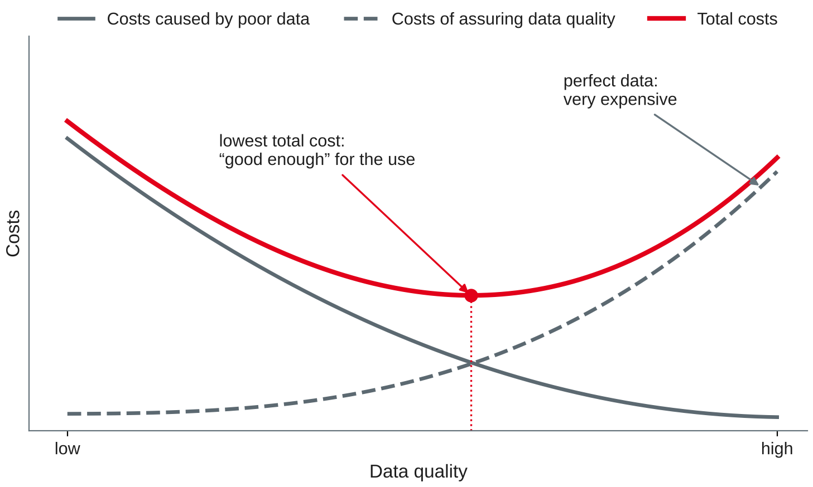

# Data Quality I {.title}

::: notes
Time plan for today (3 h): recap and warm-up 12 min · what is data quality 13 min · dimensions and rules 18 min · mini exercise which dimension 8 min · break 10 min · measuring data quality (live demo in Jupyter) 20 min · causes and business cost 14 min · loading today's data 5 min · hands-on: assess the web shop export 45 min · team step 12 min · wrap-up 5 min · ~18 min buffer.
Input is about 70 minutes, hands-on, exercises and discussion about 75 minutes. Priorities if time runs short: the definition (fitness for use), the six practice dimensions, the simple-ratio metric and the cost argument are the exam core; the SQL check patterns are tools for the hands-on and the project, not exam syntax. The ISO/IEC 25012 slide is optional (self-study). Shorten the hands-on to questions 1–5 if needed, but keep question 7 (fit for which use?): it is the transfer question of today.
Every SQL statement on these slides was run with Python's sqlite3 module (Python 3.13, SQLite 3.45.1) on a fresh database built from bikeshop-schema.sql, bikeshop-data.sql, bikeshop-data-session09.sql and the new bikeshop-dq-session13.sql; all results and row counts are the ones SQLite returned. The web shop export is fictional but built like a real export: its errors are typical of what students will meet in milestone 4.
:::

---

# Today's Agenda

1. Recap and warm-up: bad data you have met
2. What is data quality?
3. Dimensions and criteria: from dimension to rule
4. Measuring data quality: methods and metrics
5. Causes and business cost of poor data
6. Hands-on: assess the quality of the web shop export

::: notes
Time and format guide (not shown to students):
0:00 Recap and warm-up (pairs, then plenary) · 0:12 What is data quality (input, discussion) · 0:25 Dimensions and rules (input) · 0:43 Mini exercise which dimension (pairs) · 0:51 Break · 1:01 Measuring (input with live demo in Jupyter) · 1:21 Causes and cost (input, discussion) · 1:35 Loading today's data (everyone) · 1:40 Hands-on (groups of 3, each student on their own laptop) · 2:25 Team step (project teams) · 2:37 Wrap-up · buffer.
:::

---

# Recap: Where Session 12 Left Us

- Milestone 3: your database with **keys, foreign keys and constraints** — and queries that answer business questions
- Constraints are **quality rules** the database enforces: `NOT NULL`, `CHECK`, `UNIQUE`, `FOREIGN KEY`
- But data also arrives **from outside**: files, web shops, other systems — often without any rules
- Parts C and D: **data quality**, data access, pipelines and data storage

::: callout
**Your preparation:** one example of "bad data" from your company. What was wrong, who noticed it — and what did it cost?
:::

::: notes
Preparation from session 12: worksheet 12 and milestone 3 done, peer review feedback, one bad-data example. Name the one or two changes agreed in the feedback round of session 12 (see the private STATUS.md) before starting. Links to earlier sessions that this session picks up: NULL and three-valued logic (session 8), orphans found with a LEFT JOIN (session 9 and worksheet 9), "a missing price is not a free bike" (session 10), schemaless documents accept "datum" instead of "date" (session 11), the update anomaly (session 6).
:::

---

# Warm-up: Bad Data You Have Met {.exercise}

Compare your examples with your neighbour.

1. **What** was wrong with the data? Describe one concrete record
2. **Who** noticed it — a customer, a colleague, a report, nobody?
3. **Where** did the error come from: typing, an interface, an old system, a missing rule?
4. **What did it cost**: time, money, trust, a wrong decision?

::: notes
About 8 min in pairs, 4 min collection. Write the answers to question 3 on the left half of the whiteboard (causes) and question 4 on the right half (costs); come back to both lists in the section "Causes and business cost". Typical student examples from companies: duplicate customer or supplier master records in SAP, wrong delivery addresses, material numbers with two spellings, reports that disagree because two departments count differently, Excel lists with dates in three formats, outdated contact persons. If students have no example: the parcel that went to a previous address, the doctor's letter with a wrong date of birth.
:::

---

# What Is Data Quality? {.section}

Fitness for use

---

# Data Quality: Fit for Use

::: callout
"We define 'data quality' as data that are fit for use by data consumers." (Wang & Strong, 1996)
:::

- Quality is judged by the **users** of the data and their **task** — not by the data alone
- Correct is not enough: data can be correct but **incomplete**, **late**, **hard to understand** or **not accessible**
- Data quality management: the planning, measuring and improving of data quality across the **data lifecycle**

::: source
Wang and Strong (1996); DAMA International (2017, Chapter 13).
:::

::: notes
Wang and Strong (1996) asked data consumers what quality means to them and found that accuracy is only one of many aspects — hence the title "Beyond accuracy". The quote is from the introduction of the article (pp. 5–33); the exact page was not checked — add it from the library copy if the slide is used for a quote in an exam. The fitness-for-use idea comes from quality management in manufacturing (Juran); we do not cite it separately. DAMA International (2017, Chapter 13) treats data quality as a knowledge area of its own (session 1): defining quality requirements, measuring, finding root causes and improving. Link to session 2: the data lifecycle — quality problems arise mostly when data is created or moved.
:::

---

# One Dataset, Several Uses

| Use of the bike shop's customer table | What "good enough" means |
|---|---|
| E-mail newsletter | every recipient has a **valid e-mail** and has **agreed** — duplicates mean annoyed customers |
| Invoice by post | name, street, postcode and city **complete and correct** for **this** customer |
| Customers per city for a new branch | the city **spelt consistently**; a few missing streets do not matter |
| Reminder for the annual service | the **current** owner of the bike and a **current** contact |

- Same table, different requirements: quality is measured **for a use**
- Today in the bike shop: **9 of 12** customers have an e-mail address — good enough for invoices, not for an e-mail-only newsletter

::: source
Own example based on the bike shop case; fitness for use from Wang and Strong (1996).
:::

::: notes
Observed: `SELECT count(*), count(e_mail) FROM customer` → 12, 9. Street: 10 of 12, postcode and city: 11 of 12 (Felix Wagner has no address at all, Elif Demir no street). Ask: is Felix Wagner's missing address a quality problem? → for the invoice yes, for the city statistics a small one, for the newsletter no. The same NULL is a defect for one use and harmless for another. This is the key idea for the scorecard later today: a single "quality score" for a table without a use in mind is of little value.
:::

---

# Dimensions and Criteria {.section}

What exactly do we measure?

---

# Four Categories, Fifteen Dimensions

| Category | Dimensions (Wang & Strong, 1996) |
|---|---|
| **Intrinsic**: the data in itself | accuracy, objectivity, believability, reputation |
| **Contextual**: for the task at hand | value-added, relevancy, timeliness, completeness, appropriate amount of data |
| **Representational**: how data is presented | interpretability, ease of understanding, representational consistency, concise representation |
| **Accessibility**: how data is reached | accessibility, access security |

- Derived from a **survey of data consumers**, not from the view of IT
- Most dimensions are judged **by people**; only some can be measured **automatically**

::: source
Wang and Strong (1996); German-language overview in Hildebrand et al. (2025).
:::

::: notes
Wang and Strong collected a long list of quality attributes from data consumers and grouped them by factor analysis into 15 dimensions and four categories. For German readers: the book edited by Hildebrand and colleagues (module literature) presents the 15 dimensions in four categories in its chapter on definitions and dimensions (checked for the 4th and 5th editions; the 6th edition of 2025 is the current one). Not exam content: the full list by heart. Exam content: the idea of several dimensions and the four categories with one example each. Ask: which category do the warm-up examples fall into? Most are intrinsic or contextual.
:::

---

# Six Dimensions for Practice

| Dimension | Question | Bike shop example of a defect |
|---|---|---|
| **Completeness** | Is all data needed for the use there? | customer without e-mail for the newsletter |
| **Validity** | Does the value fit the format, type and range? | postcode `6811`, birth date `2031-04-01` |
| **Accuracy** | Does the data reflect reality? | bike shown "in stock", but already sold |
| **Consistency** | Do values agree within and across records and systems? | postcode of Heidelberg, city "Mannheim" |
| **Uniqueness** | Is each real-world thing recorded once? | Anna Berger with two web shop accounts |
| **Timeliness** | Is the data up to date and there when needed? | address last checked four years ago |

::: source
Government Data Quality Hub (2021), following DAMA UK; DAMA International (2017, Chapter 13); Batini et al. (2009).
:::

::: notes
The UK Government Data Quality Hub (2021) lists these six dimensions "as recommended by DAMA UK", e.g. "We have accuracy when data reflects reality" and "Validity is defined as the extent to which the data conforms to the expected format, type, and range." Batini et al. (2009) name accuracy, completeness, consistency and time-related dimensions as the basic set in the research literature. Important distinction for the exam: **valid is not accurate**. 1900-01-01 is a valid date but almost certainly not the true birth date (a default value); a correctly formatted e-mail address may still belong to somebody else. Validity can be checked with rules, accuracy needs a comparison with reality or a trusted reference.
:::

---

# ISO/IEC 25012: A Standard Data Quality Model {.optional}

- An international standard that defines **15 characteristics** of data quality for data in computer systems
- Two points of view:
  - **Inherent**: the data itself, e.g. **accuracy**, **completeness**, **consistency**
  - **System-dependent**: the system that holds the data, e.g. **availability**, **recoverability**
- Use it as a **checklist** when you write data quality requirements, e.g. in a tender or a project brief

::: source
ISO and IEC (2008).
:::

::: notes
Self-study. ISO/IEC 25012:2008 is part of the SQuaRE series (software product quality requirements and evaluation); it was last reviewed and confirmed in 2025 (ISO page). The 15 characteristics: accuracy, completeness, consistency, credibility, currentness, accessibility, compliance, confidentiality, efficiency, precision, traceability, understandability, availability, portability, recoverability. Some belong to both points of view. Not exam content; the standard itself is not freely available (the DHBW library or the ISO online browsing platform show the terms).
:::

---

# From Dimension to Rule

A dimension becomes measurable through a **rule** (criterion) for a column, a record or a table.

| Rule type | Example rule | Dimension |
|---|---|---|
| Mandatory | a newsletter subscriber has an e-mail address | completeness |
| Format, domain | a postcode has five digits; `newsletter` is `yes` or `no` | validity |
| Range, plausibility | a birth date lies between 1910 and today | validity |
| Cross-field, reference | the postcode belongs to the city (reference list) | consistency |
| Key, duplicate | one account per e-mail address | uniqueness |
| Age | an address was confirmed within the last 24 months | timeliness |

::: source
Own examples; rule types based on DAMA International (2017, Chapter 13) and Batini et al. (2009).
:::

::: notes
Business rules first, SQL second: the rule must come from the business ("the club needs a parent's phone for every youth member"), not from what is easy to check. Many of these rules are exactly the constraints of session 7: NOT NULL (mandatory), CHECK with length or GLOB (format, range), FOREIGN KEY (reference), UNIQUE (duplicates). Difference: a constraint **rejects** a bad row when it is written; a quality rule **measures** data that is already there — e.g. an import, a spreadsheet, a JSON collection (session 11) or a database without constraints. The 24 months are an example threshold; the business sets it.
:::

---

# Mini Exercise: Which Dimension? {.exercise}

Name the dimension that is violated first. Some cases fit two — say why.

1. A hotel booking contains the arrival date **2027-02-30**
2. The sales report shows **two customers** "Müller GmbH" and "Mueller GmbH" with the same VAT number
3. A patient's blood group in the hospital system is **wrong**, but the format is correct
4. **40 %** of the product records have no weight; the logistics partner needs it for shipping costs
5. The stock figures in the online shop are **updated once a night**; customers order items that sold out in the morning
6. The CRM says "**country: DE**", the invoice system "**Germany**" for the same customer

::: notes
About 5 min in pairs, 3 min collection. Expected answers: 1 validity (an impossible date; a rule with `date()` finds it). 2 uniqueness (one company, two records) — also consistency (two spellings of one name). 3 accuracy — the value is valid but does not reflect reality; only a comparison (lab test, patient record) finds it. 4 completeness — relative to the use: for the shop page the weight may not matter, for shipping it does. 5 timeliness — the data was correct at midnight; it is out of date for the use. 6 consistency across systems (representational consistency in Wang & Strong's terms) — both values may be correct, but they cannot be compared or joined without a mapping. Point out: classifying is not the goal; the dimension helps to find the right rule and the right measurement.
:::

---

# Measuring Data Quality {.section}

Methods and metrics

---

# Four Ways to Measure

::: cards
### Data profiling
Statistics per column: rows, NULLs, distinct values, min, max, frequencies. Finds the **unexpected**.
### Rule checks
Count the records that break a **business rule**. Repeatable, automatic — the basis of metrics.
### Comparison with reality
Check against a **trusted reference** or the real world: stock count, sample of customer calls. The only way to measure **accuracy**.
### Asking the users
A **survey** of the people who use the data: is it believable, understandable, useful? Subjective, but essential.
:::

::: source
Based on Pipino et al. (2002), Batini et al. (2009) and DAMA International (2017, Chapter 13).
:::

::: notes
Pipino et al. (2002) distinguish subjective assessments (surveys of data consumers) from objective ones (metrics computed on the data), and recommend comparing both: if users rate a dataset as poor while the metrics are good, either the metrics measure the wrong thing or the users have a different problem. Profiling is exploratory and comes first: you cannot write rules for problems you do not know yet. Rule checks turn the findings into numbers that can be repeated every month (monitoring, session 16). Comparison with reality is expensive and is usually done on a sample.
:::

---

# Metrics: From Count to Ratio

**Simple ratio**: share of records that satisfy the rule

```text
quality = 1 − (records that break the rule) / (records checked)
```

- e-mail completeness of the web shop export: 1 − 2/20 = **90 %**
- **Min** (or max): the weakest of several aspects, e.g. "usable for the newsletter" = min(completeness, validity)
- **Weighted average**: several metrics, weighted by their importance **for the use**
- Every metric needs a **threshold** set by the business: is 90 % good enough?

::: source
Based on Pipino et al. (2002); own example on the web shop export.
:::

::: notes
Pipino et al. (2002) describe three functional forms: simple ratio, min or max operation, and weighted average. Two decisions hide in every ratio: what counts as "checked" (the denominator) and what counts as a defect. Example: validity of e-mail addresses is measured on the 18 rows that have one (17/18 = 94.4 %), completeness on all 20 — otherwise a missing value would count twice. Ratios between 0 and 1 (or 0 % and 100 %) can be compared over time and between tables.
:::

---

# Profiling with SQL

```sql
SELECT count(*)             AS rows,       count(e_mail)   AS e_mail,
       count(DISTINCT city) AS cities,
       min(birth_date)      AS min_birth,  max(birth_date) AS max_birth
FROM   webshop_customer;          -- 20 | 18 | 6 | 12.06.1999 | 2031-04-01

SELECT city, count(*) FROM webshop_customer
GROUP  BY city ORDER BY 2 DESC;    -- Mannheim 8, Heidelberg 6, …, MANNHEIM 1, NULL 1
```

- Read a profile like a detective: **6 cities** — or 5 cities spelt in 6 ways?
- `min(birth_date)` = `'12.06.1999'`: text sorts **digit by digit** — a German date hides among ISO dates
- `max(birth_date)` = `2031-04-01`: a customer **not yet born**

::: source
Own example on the web shop export (bikeshop-dq-session13.sql); SQLite (n.d.-b).
:::

::: notes
Live demo in Jupyter, all observed. The profile uses only what students know from sessions 8 and 10: count, count(DISTINCT), min, max, GROUP BY. Ask before showing the comments: what do you expect for min(birth_date)? The German date is the "smallest" because '1' < '1' … '2' < '9': string comparison, not date comparison (session 7: dates as ISO text). Frequencies per value (GROUP BY) are the most useful profiling step for text columns with few values: city, newsletter, status codes. Tools such as data profiling features in ETL tools do the same for every column at once.
:::

---

# Rule Checks in SQL

```sql
-- validity: share of e-mail addresses with a plausible format
SELECT round(100.0 * sum(e_mail LIKE '%_@_%._%') / count(e_mail), 1)
FROM   webshop_customer;                              -- 94.4

-- uniqueness: e-mail addresses used by more than one account
SELECT lower(e_mail), count(*) FROM webshop_customer
WHERE  e_mail IS NOT NULL
GROUP  BY lower(e_mail) HAVING count(*) > 1;          -- anna.berger@example.org 2

-- consistency across systems: web shop vs. till system
SELECT w.account_id, w.e_mail, c.e_mail
FROM   webshop_customer AS w JOIN customer AS c ON c.customer_no = w.customer_no
WHERE  w.e_mail IS NOT c.e_mail;                      -- W05, W10
```

::: source
Own example on the web shop export; SQLite (n.d.-c).
:::

::: notes
All observed. A comparison is 1 or 0 in SQLite, so `sum(condition)` counts the rows that satisfy it. LIKE is case-insensitive for ASCII (SQLite, n.d.-c); the pattern only checks "something@something.something" — a format check, not proof that the address exists (that would be accuracy). `IS NOT` treats NULL as a value (SQLite, n.d.-c), so a NULL on one side also counts as a difference — with `<>` the comparison would be UNKNOWN and the row would be lost (session 8). W05: 'selin.kaya(at)example.org' vs. 'selin.kaya@example.org'; W10: 'noah.fischer@example.org' vs. 'noah.f@example.org' — which one is correct? Neither table can tell: only asking Noah can (accuracy). The join works although customer_no is TEXT in the export: the INTEGER column's affinity converts '101' for the comparison (session 7) — another thing to check when loading data.
:::

---

# Accuracy Needs a Reference

```sql
SELECT b.frame_no AS in_database, s.frame_no AS counted
FROM   (SELECT frame_no FROM bike WHERE customer_no IS NULL) AS b
FULL JOIN stock_count AS s ON s.frame_no = b.frame_no;
```

| in_database | counted |
|---|---|
| GZT884 | GZT884 |
| TRK311 | TRK311 |
| KTM530 | NULL |
| GZT886 | GZT886 |
| NULL | CUB204 |

- Accuracy of the stock records: **3 of 4** confirmed by the stock count = **75 %**
- KTM530 is "in stock" but not in the shop; CUB204 is in the shop but unknown to the database

::: source
Own example on the bike shop data and the stock count of 2027-04-30; SQLite (n.d.-b).
:::

::: notes
Observed. FULL JOIN needs SQLite 3.39 or newer (session 9 announced this use: comparing a stock list with an inventory count). Ask: what could explain KTM530? It had repair job 507 ("Battery does not charge") — maybe it was sold and handed over without updating customer_no, or it is at the manufacturer for a battery replacement. CUB204: a delivery that was never entered, or a customer's bike left for repair with no record. The database cannot answer these questions — someone has to look. That is why accuracy is expensive to measure and is usually checked on a sample or with an existing process (here: the yearly stock count).
:::

---

# A Data Quality Scorecard

| Rule (web shop export) | Dimension | Result | Threshold |
|---|---|---|---|
| e-mail present | completeness | 90.0 % | 95 % |
| e-mail has a valid format | validity | 94.4 % | 99 % |
| postcode has five digits | validity | 89.5 % | 99 % |
| one account per person (name + birth date) | uniqueness | 90.0 % | 100 % |
| changed within the last 24 months | timeliness | 80.0 % | 80 % |

- Weighted for the **newsletter**: 0.4 × 90.0 + 0.4 × 94.4 + 0.2 × 90.0 = **91.8 %** — postcode and timeliness do not matter here
- A scorecard is repeated **regularly**: the **trend** matters more than one value

::: source
Own example on the web shop export; metrics based on Pipino et al. (2002).
:::

::: notes
All results observed in SQLite (queries in the hands-on solutions). The thresholds and weights are examples the business would set, not facts. Only timeliness meets its threshold; the export is not ready to be merged into the customer table. Students compute the other values themselves in the hands-on — the slide shows only a part of the scorecard on purpose. Ask: which weights would you choose for the invoice by post? → postcode validity and completeness of the address high, e-mail low. In companies, scorecards often show traffic lights per rule and a trend line per month; DAMA International (2017, Chapter 13) describes this as ongoing monitoring and reporting.
:::

---

# Causes and Business Cost {.section}

Why data goes bad — and why it matters

---

# Where Poor Data Comes From

| Cause | Example |
|---|---|
| **Data entry** by people | typos, `(at)` instead of `@`, a default value 1900-01-01 left in the field |
| **Missing rules** in the system | no `CHECK`, free text instead of a list, foreign keys switched off |
| **Integration** of sources | web shop and till system with different keys, formats and spellings |
| **Data decay** | people move, change e-mail addresses, bikes are sold |
| **Processes and organisation** | nobody owns the data; errors are fixed downstream, not at the source |
| **Migration and conversion** | old system with other formats; dates `12.06.1999` copied as text |

::: source
Based on DAMA International (2017, Chapter 13) and Redman (2016); own examples from the web shop export.
:::

::: notes
Come back to the left half of the whiteboard from the warm-up and sort the students' causes into these rows. Key message: most data quality problems are created at the **source** (entry, interfaces, processes), but noticed **downstream** (reports, customers). Fixing the symptom downstream (cleaning the report every month) is what Redman (2016) calls the hidden data factory. Data decay is easy to forget: even perfect data becomes inaccurate over time without any error being made — which is why timeliness is a dimension of its own. Organisation: data owners and data stewards (session 19).
:::

---

# What Poor Data Costs

| | **Operational** effects | **Strategic** effects |
|---|---|---|
| **Direct** (visible) | parcel returned, newsletter bounces, wrong bike sold twice | wrong stock figures, so the shop orders too many e-bikes |
| **Hidden** (not visible) | staff check and correct lists by hand; customers wait | a new branch planned for the wrong city; lost customer trust |

- Redman calls the extra work to find and fix errors the **"hidden data factory"** — it creates no value
- His estimates are large (knowledge workers lose up to **half** their time) — **estimates**, not measurements, but the direction is clear

::: source
Classification based on Haug et al. (2011); Redman (2016); own bike shop examples.
:::

::: notes
Haug et al. (2011) classify the costs of poor data by two criteria: direct vs. hidden (is management aware of the cost?) and operational vs. strategic (day-to-day tasks vs. long-term decisions). The bike shop examples are ours. Redman (2016, HBR) quotes IBM's estimate of 3.1 trillion US dollars per year for the US economy and estimates that knowledge workers waste up to 50 % of their time in hidden data factories; treat these as indications of size, not as facts — the article does not show how IBM's figure was calculated. Come back to the right half of the whiteboard: which of the students' costs are hidden? Usually most of them.
:::

---

# How Much Quality Is Enough?

{width=66%}

::: source
Own illustration based on Haug et al. (2011); qualitative, no data.
:::

::: notes
Haug et al. (2011) argue that companies should not aim for perfect data: the first cleaning efforts bring the largest savings, while the cost of assuring quality keeps rising, so the total cost is lowest at a level below 100 %. In their model the assurance costs rise linearly; our curve rises more steeply near 100 % to show that the last errors are the hardest to find — an illustration, not a result. Link to the scorecard: the threshold is a business decision about where this optimum lies for one use. For the newsletter, 92 % may be fine; for the payment data of a bank, it is not.
:::

---

# Hands-On: Assess the Web Shop Export {.section}

Measure before you clean

---

# Loading Today's Data

```python
import sqlite3

con = sqlite3.connect("bikeshop.db")
con.execute("PRAGMA foreign_keys = ON")
for script in ["bikeshop-schema.sql", "bikeshop-data.sql",
               "bikeshop-data-session09.sql",
               "bikeshop-dq-session13.sql"]:              # new
    with open(script, encoding="utf-8") as f:
        con.executescript(f.read())
```

- **webshop_customer**: the customer export of the new web shop, **20 accounts**, all columns as text, no constraints
- **postcode_ref**: which postcode belongs to which town (the shop's area, 12 postcodes)
- **stock_count**: the frame numbers found in the shop on 2027-04-30

::: source
Own example based on the bike shop case; all data fictional.
:::

::: notes
Everyone runs this cell now. Check: `SELECT count(*) FROM webshop_customer` → 20. The export has no constraints on purpose: this is how data arrives from another system (a "staging" table). customer_no is the till system's customer number, entered by staff when a web shop customer also buys in the shop; NULL means "not linked" and is not a defect in itself. The export date is 2027-05-03 — use it as "today" for age and timeliness rules. Today we only measure; cleaning the export is the topic of session 14.
:::

---

# Exercise: Assess the Web Shop Export {.exercise}

Fresh database with all four scripts. Predict first, then query. Record each result as a ratio.

1. **Profile** every column: rows, values, distinct values, min, max. List what looks suspicious
2. **Completeness** per column. Which NULLs are defects, which are not?
3. **Validity**: postcodes, birth dates (ISO date, 1910 to today), newsletter codes
4. **Uniqueness**: which persons have more than one account?
5. **Consistency**: postcode vs. city (`postcode_ref`); web shop vs. till system (`customer`)
6. **Timeliness**: share of accounts changed in the 24 months before 2027-05-03
7. **Fit for use?** How many people may receive the newsletter? Should the export be merged into `customer` now?

::: source
Own example on the web shop export; SQLite (n.d.-a, n.d.-c).
:::

::: notes
About 40 min + 5 min comparison. Expected answers (all observed):
1 20 rows; name 20, e_mail 18, postcode 19, city 19 (6 distinct incl. MANNHEIM), birth_date 20 (min '12.06.1999', max '2031-04-01'), newsletter 19 with 5 codes (yes 8, no 9, Y 1, 1 1, NULL 1), last_changed 20, customer_no 11.
2 name 100, e_mail 90, postcode 95, city 95, birth_date 100, newsletter 95, last_changed 100, customer_no 55 %. customer_no NULL is not a defect (not every web shop customer buys in the shop); W13's missing postcode and city are defects for a delivery, not for the newsletter.
3 Postcodes `NOT GLOB '[0-9][0-9][0-9][0-9][0-9]'` → W11 '6811', W19 'D-69117': 17/19 = 89.5 %. Birth dates `birth_date IS NOT date(birth_date) OR NOT BETWEEN '1910-01-01' AND '2027-05-03'` → W08 '12.06.1999' (date() gives NULL), W13 1900-01-01 (a default), W14 2031-04-01 (future), W19 1991-02-29 (no such day; date() gives 1991-03-01): 16/20 = 80 %. Newsletter `NOT IN ('yes','no')` → W15 '1', W18 'Y' (W13 NULL): 17/20 valid if NULL counts as invalid.
4 GROUP BY lower(name), birth_date HAVING count(*) > 1 → W01/W03 Anna Berger (same e-mail, different case), W02/W17 Jonas Albrecht (different e-mail addresses!): 18 persons in 20 rows, 90 %. An e-mail check alone finds only Anna.
5 Join with postcode_ref → 17 rows checkable, 15 consistent (88.2 %): W06 'MANNHEIM' (only case; with COLLATE NOCASE 16/17), W12 69115 is Heidelberg, not Mannheim. Not checkable: W11, W13, W19. Till system: W05 and W10 differ in the e-mail (see slide), W06 in the city spelling; W18 refers to customer 199, which does not exist (orphan: 10 of 11 links valid).
6 `last_changed >= date('2027-05-03', '-24 months')` → 16/20 = 80 % (W03, W13, W15, W17 are older).
7 Valid e-mail and consent: with newsletter = 'yes' only → 7 accounts, 6 people; counting Y and 1 as yes → 9 accounts, 8 people. The answer depends on how the codes are interpreted — ask the business (and the legal side: what exactly did W15 and W18 agree to? session 19). Merge: not yet — duplicates, the orphan link, invalid dates and conflicting e-mail addresses must be resolved first (session 14), otherwise the till system's clean customer table gets worse.
:::

---

# Team Work: Quality Rules for Your Project Data {.exercise}

Milestone 4 loads **real or open data** into your database.

1. Which **data source** will you load? Who created it, how and when?
2. Write **five rules** for it — at least three different **dimensions**
3. For each rule: the **metric** (what is checked, what counts as a defect) and a **threshold** with a reason
4. Which rules can your **schema** enforce as constraints, and which must be **measured** after loading?

::: callout
Your rules and first measurements are the starting point for **milestone 4** (data loading and quality, after session 16).
:::

::: notes
About 12 min. Teams without a data source yet: use the hint that sessions 15 and 16 cover open data portals and APIs; let them write rules for the kind of data they expect (e.g. product list, opening hours, public transport stops). Walk around and ask: is the rule a business rule or only a technical check? Who in your case would set the threshold? A good team answer separates constraints that reject bad rows at load time (NOT NULL, CHECK, FOREIGN KEY) from quality metrics on the staging data before loading (session 16: ETL). The exact milestone 4 deliverables are in the project brief.
:::

---

# Key Takeaways

- Data quality means **fitness for use**: the same data can be good for one task and poor for another
- Quality has **several dimensions**: completeness, validity, accuracy, consistency, uniqueness, timeliness, …
- A dimension becomes measurable through a **business rule** and a **metric**, e.g. the simple ratio with a **threshold**
- **Valid is not accurate**: accuracy needs a comparison with reality or a trusted reference
- Poor data has **direct and hidden** costs; the goal is quality that is **good enough** for the use, fixed at the **source**

---

# Next Session: Data Quality II — Data Cleaning with Python

- **pandas** basics: DataFrames, reading data, selecting and filtering
- Missing values, duplicates, outliers and inconsistent formats
- Standardisation and validation rules in code
- Hands-on: clean a dataset in a notebook

::: callout
**Preparation:** finish the hands-on questions and worksheet 13; install pandas (`pip install pandas`) and test `import pandas` in Jupyter; bring your team's five quality rules.
:::

---

# References {.references}

- Batini, C., Cappiello, C., Francalanci, C., & Maurino, A. (2009). Methodologies for data quality assessment and improvement. *ACM Computing Surveys, 41*(3), 1–52. https://doi.org/10.1145/1541880.1541883
- DAMA International. (2017). *DAMA-DMBOK: Data management body of knowledge* (2nd ed.). Technics Publications.
- Government Data Quality Hub. (2021, June 24). *Meet the data quality dimensions*. GOV.UK. https://www.gov.uk/government/news/meet-the-data-quality-dimensions
- Haug, A., Zachariassen, F., & van Liempd, D. (2011). The costs of poor data quality. *Journal of Industrial Engineering and Management, 4*(2), 168–193. https://doi.org/10.3926/jiem.2011.v4n2.p168-193
- Hildebrand, K., Mielke, M., & Gebauer, M. (Eds.). (2025). *Daten- und Informationsqualität: Die Grundlage der Digitalisierung* (6th ed.). Springer Vieweg. https://doi.org/10.1007/978-3-658-47317-4
- ISO & IEC. (2008). *Software engineering — Software product Quality Requirements and Evaluation (SQuaRE) — Data quality model* (ISO/IEC 25012:2008). International Organization for Standardization. https://www.iso.org/standard/35736.html
- Pipino, L. L., Lee, Y. W., & Wang, R. Y. (2002). Data quality assessment. *Communications of the ACM, 45*(4), 211–218. https://doi.org/10.1145/505248.506010
- Redman, T. C. (2016, September 22). Bad data costs the U.S. $3 trillion per year. *Harvard Business Review*. https://hbr.org/2016/09/bad-data-costs-the-u-s-3-trillion-per-year
- SQLite. (n.d.-a). *Date and time functions*. Retrieved October 21, 2026, from https://www.sqlite.org/lang_datefunc.html
- SQLite. (n.d.-b). *SELECT*. Retrieved October 21, 2026, from https://www.sqlite.org/lang_select.html
- SQLite. (n.d.-c). *SQL language expressions*. Retrieved October 21, 2026, from https://www.sqlite.org/lang_expr.html
- Wang, R. Y., & Strong, D. M. (1996). Beyond accuracy: What data quality means to data consumers. *Journal of Management Information Systems, 12*(4), 5–33. https://doi.org/10.1080/07421222.1996.11518099
