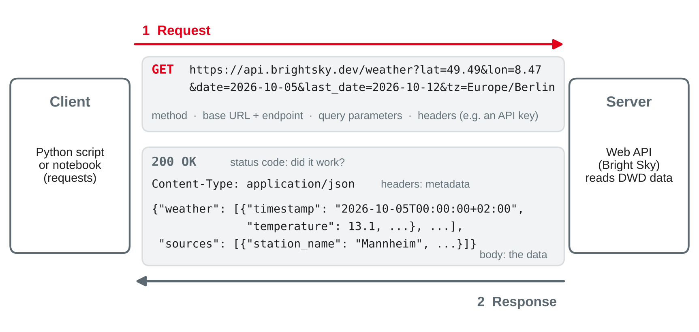

# Accessing Data: Files and APIs {.title}

::: notes
Time plan for today (3 h): recap 7 min · today's data 3 min · reading files: formats, CSV, Excel, JSON 27 min · mini exercise which reader 8 min · break 10 min · web APIs, REST, request and response 16 min · mini exercise read the documentation 7 min · calling an API from Python, JSON to DataFrame, pitfalls, fallback 17 min · authentication, rate limits, licences 11 min · hands-on: weather data for the bike shop 45 min · team step 12 min · wrap-up 5 min · ~12 min buffer.
Input is about 74 minutes, hands-on, exercises and discussion about 72 minutes. Priorities if time runs short: the read_csv options (separator, decimal, encoding, dtype for codes), the request–response model with status codes, "check the status before you parse", and the difference between an API key and no authentication are the exam core. Code syntax is a tool, not exam content: the exam may show short code to read and explain. The optional slide on other API styles is self-study. Shorten the hands-on to questions 1–5 if needed, but keep question 6 (save raw data and the daily table): session 16 builds its ETL pipeline on it.
How the results were produced: every Python statement was run with Python 3.13, pandas 3.0.6, requests 2.34.2, openpyxl 3.1.5 and SQLite 3.45.1. The authoring environment could not reach api.brightsky.dev directly (proxy). The Bright Sky responses were therefore retrieved on 21 October 2026 with a web fetch tool, saved as brightsky-mannheim-2026-10-05.json (all 169 records, trimmed to 9 of the about 20 fields per record) and checked against a second, independent retrieval of daily totals (all equal). All API results on the slides come from running the code on that file; status codes, headers, timeouts and the 401/429 behaviour of requests were observed against a small local test server. Students calling the live API get the same values plus more columns.
:::

---

# Today's Agenda

1. Recap: from cleaning to getting the data
2. Reading files: CSV, Excel and JSON with pandas
3. Web APIs: REST, requests and responses, status codes
4. Calling an API from Python — and what can go wrong
5. Authentication, rate limits and open data licences
6. Hands-on: weather data for the bike shop

::: notes
Time and format guide (not shown to students):
0:00 Recap (plenary) · 0:07 Today's data (everyone) · 0:10 Reading files (input with live demo) · 0:37 Mini exercise which reader (pairs) · 0:45 Break · 0:55 Web APIs and REST (input) · 1:11 Mini exercise read the documentation (pairs) · 1:18 Calling APIs from Python (live demo) · 1:35 Authentication, rate limits, licences (input) · 1:46 Hands-on (groups of 3, each student on their own laptop) · 2:31 Team step (project teams) · 2:43 Wrap-up · buffer.
Live demo: run the code slides in a notebook. Call the live API in class; if the network fails, switch to the local file — that is part of the lesson (slide "Plan B").
:::

---

# Recap: Where Session 14 Left Us

- Cleaning workflow: **profile → standardise → validate → treat → verify and load** — on a copy, in a script
- Many problems came from **how the data arrived**: a decimal comma read as text, dates in two formats, codes as numbers
- Today: get data **in** — from files and from web **APIs** — so that less cleaning is needed afterwards

::: callout
**Your preparation:** does `import requests` work? Which **open data source** did your team find — and in which format does it come?
:::

::: source
Session 14 of this course; Rahm and Do (2000).
:::

::: notes
Quick check (2 min): show of hands for `import requests`; if it fails, `python -m pip install requests openpyxl` during the break (openpyxl is needed for Excel today). Collect two or three open data sources from teams and write them on the board with their format (CSV download, API, Excel) — come back to them in the team step. Link: '64,50' in session 14 became text because read_csv was called without options; today's first part shows the options that prevent this.
:::

---

# Today's Data

| File | Content | Format |
|---|---|---|
| `bikeshop-pricelist-s1-session15.csv` | price list of supplier S1, Rad-Großhandel Süd | CSV, German export |
| `bikeshop-pricelist-s2-session15.xlsx` | price list of supplier S2, E-Motion Parts | Excel, two sheets |
| `repair_job_doc` in `bikeshop.db` | the 12 repair job documents of session 11 | JSON in SQLite |
| Bright Sky weather API | hourly weather in Mannheim, 5–11 October 2026 | JSON over HTTP |
| `brightsky-mannheim-2026-10-05.json` | saved copy of the API response (fallback) | JSON file |

::: source
Own example based on the bike shop case; supplier data fictional. Weather data: Deutscher Wetterdienst via de Maeyer (n.d.).
:::

::: notes
All files are in the course data folder next to worksheet 15. The suppliers are the ones from worksheet 12 (purchasing); their new price lists are fictional. The weather data are real DWD observations, retrieved through the Bright Sky API; the fallback file is a trimmed copy of the response (9 fields per record) so that the lab works without network. Students who do not have bikeshop.db with repair_job_doc rebuild it with the loading cell of session 11.
:::

---

# Reading Files {.section}

Every format has its own traps

---

# One Function per Format

| Format | pandas | Typical traps |
|---|---|---|
| CSV, TXT | `pd.read_csv` | separator, decimal comma, encoding, leading zeros, placeholders |
| Excel (.xlsx) | `pd.read_excel` | title rows, several sheets, footnotes, text in number columns |
| JSON | `json.load` + `pd.json_normalize` | nesting, missing keys, records hidden in a sub-object |
| SQL database | `pd.read_sql` | type affinity: a key with NULL becomes float (session 14) |
| Parquet | `pd.read_parquet` | needs `pyarrow`; types are stored — fewest traps |

- A reader **guesses** types — check `shape`, `dtypes` and `head()` after **every** load
- Excel needs the package **openpyxl**: `python -m pip install openpyxl`

::: source
Based on McKinney (2022, Chapter 6) and pandas development team (n.d.-a, n.d.-c).
:::

::: notes
McKinney (2022, Chapter 6) covers text formats, JSON, binary formats, Excel, web APIs and databases in one chapter — recommend it as reading for today. The table connects to session 2 (data formats) and session 11 (JSON). Parquet is mentioned for completeness; it matters for data lakes (session 18). The general rule: a file format is a contract between two systems, and most loading problems are broken or unspoken contracts. The quickest check after a load is three lines: shape (row count as expected?), dtypes (numbers numeric, codes text, dates datetime?), head() (do the values look right?).
:::

---

# CSV: One Format, Many Dialects

```text
Artikel-Nr.;Bezeichnung;Ihre Teile-Nr.;Preis netto;VPE;Gültig ab;Lagerbestand
004711;Schlauch 28" Dunlop-Ventil;P-101;3,05;10;01.04.2027;1.250
000815;Bremszug Edelstahl;P-106;1,65;25;01.04.2027;-
012041;"Kette 11-fach; mit Kettenschloss";P-105;21,40;5;01.04.2027;96
099017;Werkstattkoffer Profi;;1.189,00;1;15.04.2027;2
```

```python
pd.read_csv("bikeshop-pricelist-s1-session15.csv")
# UnicodeDecodeError: 'utf-8' codec can't decode byte 0xfc ...   ← 'ü' in Windows-1252
pd.read_csv("bikeshop-pricelist-s1-session15.csv", encoding="cp1252")
# shape (8, 1): the whole line is one column — the separator is ';', not ','
```

- No CSV standard fixes the **separator**, **decimal mark**, **encoding** or **date format** — German Excel exports use `;` and `,`
- A field with the separator inside must be **quoted**: `"Kette 11-fach; mit Kettenschloss"`

::: source
Own example (fictional supplier price list); Shafranovich (2005); McKinney (2022, Chapter 6).
:::

::: notes
Extract of the 8-row file; all outputs observed. The file was written as a German Windows Excel export would: Windows-1252 encoding, CRLF line ends, semicolon separator. RFC 4180 (Shafranovich, 2005) documents the common CSV format with commas and double quotes for fields that contain commas, quotes or line breaks — but it is informational, not a binding standard, and many exports ignore it. 0xfc is 'ü' in Windows-1252 and Latin-1, which is not valid UTF-8; the first 'ü' is in the header "Gültig ab". Ask: why does a German Excel use ';'? → because ',' is the decimal mark. The inch sign inside the unquoted field "Schlauch 28"" is harmless because quotes only matter at the start of a field.
:::

---

# read_csv Options That Prevent Cleaning Work

```python
s1 = pd.read_csv("bikeshop-pricelist-s1-session15.csv",
                 sep=";", encoding="cp1252",
                 decimal=",", thousands=".",
                 dtype={"Artikel-Nr.": str},        # keep '004711', not 4711
                 na_values=["-"],                    # '-' means: unknown stock
                 parse_dates=["Gültig ab"], date_format="%d.%m.%Y")
s1.dtypes    # Artikel-Nr. str · Preis netto float64 · Gültig ab datetime64 · Lagerbestand float64
s1["Preis netto"].sum()                             # 1258.95 — '1.189,00' read as 1189.0
```

| Without the option | Result |
|---|---|
| `dtype={"Artikel-Nr.": str}` | `004711` → **4711**: the supplier's article number is broken |
| `decimal=",", thousands="."` | prices and stock stay **text**; `'1.250'` would be 1.25 with `decimal` only |
| `na_values=["-"]` | `Lagerbestand` stays text because of two `'-'` |

::: source
Own example (fictional supplier price list); pandas development team (n.d.-a); McKinney (2022, Chapter 6).
:::

::: notes
All observed with pandas 3.0.6. Without dtype the article number column is int64 (4711, 815, …) — the leading zeros are gone and the number no longer matches the supplier's catalogue (same idea as postcodes in session 14: codes are text). Dates come back as datetime64[us] in pandas 3 (pandas 2: [ns]) — not important. Options instead of later cleaning: the earlier a problem is solved, the less code and the fewer silent errors (session 14: to_numeric with errors="coerce"). Not every problem can be solved at reading time: the empty "Ihre Teile-Nr." of the workshop case is a real gap (the shop does not stock it). Link to session 12: compare the new prices with purchase_line.unit_cost (P-101: 2.95 → 3.05). sep=None lets pandas guess the separator (csv.Sniffer) — convenient, but an explicit sep documents the contract.
:::

---

# Excel: Sheets, Title Rows and Footnotes

```python
pd.ExcelFile("bikeshop-pricelist-s2-session15.xlsx").sheet_names   # ['Price list', 'Discounts']
pd.read_excel("bikeshop-pricelist-s2-session15.xlsx").columns[0]
# 'E-Motion Parts GmbH · Price list 2027'   ← the title row became the header

s2 = pd.read_excel("bikeshop-pricelist-s2-session15.xlsx", sheet_name="Price list",
                   header=3, nrows=5)                # header in row 4, five products
s2.dtypes          # Price EUR object: one price is the text 'on request'
pd.to_numeric(s2["Price EUR"], errors="coerce")      # 449.0 559.0 89.9 14.5 NaN
```

- Excel files are made for **people**: titles, empty rows, notes under the table, formatting
- **Dates** and **numbers** usually arrive with the right type — **text in a number column** does not
- `sheet_name=None` reads **all** sheets into a dictionary of DataFrames

::: source
Own example (fictional supplier price list); pandas development team (n.d.-b); McKinney (2022, Chapter 6).
:::

::: notes
All observed. `header` and `skiprows` count from 0: header=3 means row 4 in Excel. With skiprows=3 and no nrows, the footnote "All prices subject to change …" becomes a data row (Item no = the sentence, everything else NaN) and an empty row before it — observed 7 rows instead of 5. skipfooter=1 removes only the footnote, not the empty row (observed 6 rows). nrows is the safest if the table length is known; otherwise drop rows without an item number. "on request" for EM-D28 is a real business fact, not an error: to_numeric with coerce makes it NaN — count the new NaN (here 1) and keep the information in a note column if it matters. Excel's displayed format ("449,00 €") is not what pandas reads: it reads the stored value 449.0. Sheet names: always check them first.
:::

---

# JSON: Objects, Arrays, Nesting

```python
import json
with open("brightsky-mannheim-2026-10-05.json", encoding="utf-8") as f:
    data = json.load(f)                  # JSON object → Python dict
data.keys()                              # dict_keys(['weather', 'sources'])
len(data["weather"])                     # 169 — a list of records (array of objects)
data["sources"][0]["station_name"]       # 'Mannheim'
```

| JSON | Python | pandas |
|---|---|---|
| object `{"a": 1}` | `dict` | one row, or nested columns `a.b` |
| array `[...]` | `list` | rows (records) |
| `"text"`, `1.5`, `true`, `null` | `str`, `float`, `True`, `None` | `str`, `float64`, `bool`, `NaN` |

- The **records** are often one level down: `pd.DataFrame(data["weather"])` → 169 rows, 9 columns
- `pd.read_json(...)` on this file: `ValueError: All arrays must be of the same length`

::: source
Based on Bray (2017) and McKinney (2022, Chapter 6); weather data: Deutscher Wetterdienst via de Maeyer (n.d.).
:::

::: notes
All observed on the fallback file. RFC 8259 (Bray, 2017) defines JSON's values: object, array, number, string, true, false, null — there is no date type, so dates arrive as text and must be parsed (as in CSV). read_json expects a table-like structure; here the top-level object has two arrays of different lengths (169 weather records, 1 source), hence the ValueError. The robust pattern for API responses is json.load (or r.json()) and then picking the list of records. Link to session 11: JSON is semi-structured — the structure is in the data, not in a schema, so a missing key is possible in any record.
:::

---

# Flattening Nested JSON: json_normalize

```python
docs = [json.loads(d) for (d,) in con.execute("SELECT doc FROM repair_job_doc")]
jobs = pd.json_normalize(docs)                    # 12 rows: one per job
jobs.columns    # job_no, date, …, lines, mechanics, bike.brand, bike.owner.name, …
lines = pd.json_normalize(docs, record_path="lines", meta=["job_no", "date"])
lines.shape     # (16, 6): one row per repair line, job_no and date copied in
```

- Nested **objects** become columns with dots: `bike.owner.name`
- An **array** of records needs `record_path`; `meta` copies fields of the parent
- Jobs **506** and **512** have no lines — they **vanish** from `lines`, like an inner join
- `meta=[["bike", "owner", "name"]]` fails with `KeyError` for job 507 (no owner) — `errors="ignore"` gives `NaN`

::: source
Own example based on the bike shop documents of session 11; pandas development team (n.d.-d).
:::

::: notes
All observed; bikeshop.db with the session 11 documents. Revenue per job from `lines` (quantity × price, groupby job_no) gives 507 649.0, 511 103.4, 510 41.8 — the same as the SQL with json_each in session 11. Two traps: (1) meta columns come back with dtype object (job_no is object, not int64) — convert before merging; (2) the 'lines' and 'mechanics' columns in `jobs` still hold Python lists — a DataFrame cell can hold a list, but SQL tables cannot (1NF, session 6). json_normalize is the pandas way of turning documents back into relations: one table per array. Students who know session 11 can say why: one row per order line = the repair_line table.
:::

---

# Mini Exercise: Which Reader, Which Option? {.exercise}

What do you write — and what goes wrong without it?

1. A bank export: `Datum;Betrag;IBAN` with `01.03.2027;-1.234,56;DE89…`
2. An Excel report from controlling: logo and two title lines above the table, a "Total" row below it
3. A JSON response `{"count": 312, "results": [{…}, {…}]}`
4. A CSV of customers with postcodes such as `01067` and the placeholder `unknown`
5. A file `export.csv` that shows `Müller` instead of `Müller` when you open it
6. A JSON list of orders, each with an array `items`; you need one row per item

::: notes
About 5 min in pairs, 3 min collection. Expected answers:
1 `read_csv(sep=";", decimal=",", thousands=".", parse_dates=["Datum"], date_format="%d.%m.%Y", dtype={"IBAN": str})`; without decimal/thousands the amount is text; without the date format the date is text (or parsed wrongly if guessed). The IBAN is text anyway (letters) — but say dtype=str for any code.
2 `read_excel(header=…, nrows=…)` or skiprows plus dropping the Total row; otherwise the title becomes the header and the total is counted as a data row — sums double.
3 `pd.DataFrame(r.json()["results"])` (or json_normalize with record_path="results"); "count" is metadata — and 312 results may mean several pages (pagination, later today).
4 `dtype={"postcode": str}, na_values=["unknown"]`; without: 1067 as a number (or the whole column text because of 'unknown').
5 The file is UTF-8 but was read as Windows-1252/Latin-1 — 'ü' is two bytes in UTF-8. Read with encoding="utf-8" (or "utf-8-sig" if it starts with a BOM).
6 `pd.json_normalize(orders, record_path="items", meta=["order_no", …])`; check orders with an empty items array — they disappear.
:::

---

# Web APIs {.section}

Data on request

---

# What Is a Web API?

::: cards
### Interface
An **application programming interface** lets one program use data or functions of another — over the web via **HTTP**.
### Contract
The **documentation** says which requests exist, which parameters they take and what the response looks like.
### Machine-readable
Responses are **structured data**, mostly **JSON** — not web pages for people.
:::

| File download | Web API |
|---|---|
| everything, as of the export date | **only what you ask for**, as of **now** |
| a person exports and sends it | a **program** asks — on a schedule if needed |
| format agreed once | format **documented**, versioned, can change |

::: source
Based on McKinney (2022, Chapter 6) and Fielding (2000, Chapter 5).
:::

::: notes
Business examples: payment providers, shipping status from a parcel service, exchange rates, weather, public statistics, the web shop platform of session 13 (instead of a monthly CSV export). For the bike shop: today weather, tomorrow maybe the web shop's orders directly from its API. Data management view (DAMA's knowledge area "data integration and interoperability", session 2): an API is an integration interface — it needs owners, documentation and monitoring like a database. Ask: what is the risk of an API compared with a file? → it depends on a system we do not control: it can be down, slow, changed or switched off.
:::

---

# REST in a Nutshell

- **Resources** with an address (**URI**): `/weather`, `/customers/101`, `/customers/101/orders`
- One **uniform interface**: the HTTP methods
- **Stateless**: each request carries everything the server needs — e.g. the API key
- The server sends a **representation** of the resource, usually JSON

| HTTP method | Meaning | SQL counterpart |
|---|---|---|
| `GET` | read a resource | `SELECT` |
| `POST` | create a new resource | `INSERT` |
| `PUT` / `PATCH` | replace / change a resource | `UPDATE` |
| `DELETE` | remove a resource | `DELETE` |

::: source
Based on Fielding (2000, Chapter 5) and Fielding et al. (2022).
:::

::: notes
REST (Representational State Transfer) was defined by Fielding (2000, Chapter 5) as an architectural style for the web; most "REST APIs" in practice are pragmatic: resources plus HTTP methods plus JSON. Stateless matters for scaling (session 11: scaling out) — any server can answer any request. GET is safe (does not change anything) and can be repeated; for data access we almost only use GET. The SQL mapping is a memory aid, not an exact equivalence. Self-study: other styles on the optional slide (GraphQL, SOAP, bulk downloads).
:::

---

# Anatomy of an API Call

{width=86%}

::: source
Own illustration based on Fielding (2000, Chapter 5) and Fielding et al. (2022); example request to de Maeyer (n.d.).
:::

::: notes
Read the URL together: base URL https://api.brightsky.dev, endpoint /weather, then after the ? the query parameters as key=value pairs joined with &. The request also has headers (not visible in the URL) — that is where API keys usually go. The response has three parts: the status code (did it work?), headers (metadata: content type, rate limit information, caching) and the body (the data). Only the body is "the data", but a client must look at the status first. The Content-Type line is shown as an illustration of a JSON API's typical header.
:::

---

# Status Codes: What the Server Tells You

| Code | Meaning | What the client should do |
|---|---|---|
| **200** OK | success; the body has the data | parse the body |
| **400** Bad Request | the request is malformed | fix the request |
| **401** Unauthorized | no or invalid credentials | check the API key or token |
| **403** Forbidden | known, but not allowed | ask for access; do not retry |
| **404** Not Found | no such resource | check endpoint and IDs |
| **422** Unprocessable Content | parameters invalid, e.g. `lat=500` | fix the parameters |
| **429** Too Many Requests | rate limit reached | wait (`Retry-After`), then retry |
| **500** / **503** | error / overload on the server | retry later, with a pause |

- **2xx** success · **4xx** the **client** must change something · **5xx** the **server** has a problem

::: source
Based on Fielding et al. (2022, Section 15) and Nottingham and Fielding (2012, Section 4).
:::

::: notes
RFC 9110 (Fielding et al., 2022) defines the status code classes and most codes, including 422 Unprocessable Content (15.5.21) and 503 (15.6.4, may include Retry-After). 429 comes from RFC 6585 (Nottingham & Fielding, 2012, Section 4): the response MAY include a Retry-After header. The Bright Sky API documents 422 for invalid parameters and 404 when nothing matches (de Maeyer, n.d.). Exam relevance: the class (2xx/4xx/5xx) and what to do — retrying a 4xx unchanged is pointless (except 429), retrying a 5xx later can help. A 200 with an empty list is also success — "no data" is not an error for HTTP.
:::

---

# Mini Exercise: Read the Documentation {.exercise}

Extract of the Bright Sky documentation for `GET /weather`:

| Parameter | Description |
|---|---|
| `date` | required; first timestamp, ISO 8601 (`2026-10-10`, optionally with time) |
| `last_date` | last timestamp; default: `date` + 1 day |
| `lat`, `lon` | position in decimal degrees; both needed unless a station ID is given |
| `tz` | time zone of the timestamps; default **UTC** |
| `units` | `dwd` (default: °C, mm, km/h) or `si` |

1. Write the URL for hourly weather at the bike shop (lat 49.49, lon 8.47) on Saturday **10 October 2026**, in German local time.
2. How many records do you expect for this call — and why?
3. You send `date=10.10.2026`. Which **class** of status code do you expect, and who must fix the problem?
4. A record says `"wind_speed": 20.5`. In which unit — and what changes with `units=si`?

::: source
Extract adapted from de Maeyer (n.d.).
:::

::: notes
About 4 min in pairs, 3 min collection. Expected answers:
1 https://api.brightsky.dev/weather?lat=49.49&lon=8.47&date=2026-10-10&tz=Europe/Berlin (requests writes the slash as %2F — both work). Without tz, "2026-10-10" means midnight UTC = 02:00 in Germany, and timestamps come back in UTC.
2 25: last_date defaults to date + 1 day and is included, so the call returns 00:00 on 10 October up to and including 00:00 on 11 October — 24 hours plus one record. Observed in our data: date 2026-10-05, last_date 2026-10-12 → 169 records, not 168.
3 A 4xx (the documentation lists 422 for validation errors): the client must send ISO 8601. Retrying the same request does not help.
4 km/h (DWD units); with units=si m/s (and temperatures in Kelvin). Always read the units section before comparing data from two sources.
:::

---

# Calling APIs from Python {.section}

requests, JSON and a plan B

---

# requests: Get, Check, Parse

```python
import requests

URL = "https://api.brightsky.dev/weather"
params = {"lat": 49.49, "lon": 8.47, "date": "2026-10-05",
          "last_date": "2026-10-12", "tz": "Europe/Berlin"}

r = requests.get(URL, params=params, timeout=10)   # never without timeout
r.status_code                  # 200
r.raise_for_status()           # raises HTTPError for 4xx and 5xx, else nothing
data = r.json()                # body → dict, as json.load
r.url    # …/weather?lat=49.49&lon=8.47&date=2026-10-05&last_date=2026-10-12&tz=Europe%2FBerlin
```

- `params` builds and **encodes** the query string — no string gluing
- Without `timeout`, a hanging server makes your script **wait forever**
- `r.json()` also works on an **error** body — check the status **first**

::: source
Based on Requests (n.d.) and McKinney (2022, Chapter 6); API: de Maeyer (n.d.).
:::

::: notes
r.url observed (prepared request). The requests documentation says: "If no timeout is specified explicitly, requests do not time out" (Requests, n.d.). Observed against a local test server: raise_for_status() gives "401 Client Error: Unauthorized for url: …" or "404 Client Error: Not Found for url: …"; a timeout raises requests.exceptions.ReadTimeout. Error bodies are often JSON too (e.g. {"detail": "…"}), so `r.json()` without a status check can make an error look like data. Encoding: "/" in Europe/Berlin becomes %2F; umlauts or spaces in parameters would be encoded as well. In class: run the call live; the live response has about 20 fields per record instead of the 9 in our saved copy.
:::

---

# From JSON Response to DataFrame

```python
w = pd.DataFrame(data["weather"])            # 169 rows
w["timestamp"] = pd.to_datetime(w["timestamp"])    # datetime64[us, UTC+02:00]
w["day"] = w["timestamp"].dt.date
w["wet"] = w["precipitation"] > 0
daily = w.groupby("day").agg(rain_mm=("precipitation", "sum"),
                             wet_hours=("wet", "sum"),
                             t_max=("temperature", "max"),
                             records=("timestamp", "size"))
```

| day | rain_mm | wet_hours | t_max | records |
|---|---|---|---|---|
| 2026-10-07 | 0.0 | 0 | 24.0 | 24 |
| 2026-10-08 | **11.9** | **10** | 18.0 | 24 |
| 2026-10-09 | 0.9 | 2 | 12.6 | 24 |
| 2026-10-12 | 0.0 | 0 | 8.0 | **1** |

::: source
Own example; weather data: Deutscher Wetterdienst via de Maeyer (n.d.), CC BY 4.0; McKinney (2022, Chapter 10).
:::

::: notes
All observed on the saved response (extract of 8 rows; 5, 6 October dry, 10 October 1.6 mm, 11 October 0.2 mm). The row for 12 October has only one record — the included last_date. Drop it or ask for last_date=2026-10-11T23:00. Precipitation is the amount over the previous 60 minutes (de Maeyer, n.d.), so the 00:00 record belongs to the hour before midnight: exact daily sums would shift by one hour; for a shop's planning this is irrelevant, for a weather report it is not. Timestamps carry the offset +02:00; a week across the end of October would mix +02:00 and +01:00 — then use `pd.to_datetime(..., utc=True)` and `.dt.tz_convert("Europe/Berlin")`. Groupby and agg are the pandas version of GROUP BY (session 10; McKinney, 2022, Chapter 10).
:::

---

# One Week of Weather at the Bike Shop

{width=92%}

::: source
Own illustration; data: Deutscher Wetterdienst via de Maeyer (n.d.), CC BY 4.0, station Mannheim, hourly values summed per day (local time).
:::

::: notes
Business question for the hands-on: do rainy days change walk-ins, test rides and repair jobs? With one week we cannot answer it — but we have a repeatable way to get the data; session 16 turns it into a pipeline that collects it daily and joins it with the shop's own data. Note the attribution under the chart — that is what CC BY 4.0 asks for (slide on licences).
:::

---

# Check Before You Trust: API Data

- **Row count**: 169, not 168 — `last_date` is **included**
- **Time zone**: without `tz`, everything is **UTC** — "Thursday" starts at 02:00 German time
- **Units**: wind in km/h (`dwd`) or m/s (`si`); precipitation over the **previous** hour
- **Consistency**: 22 hours have `condition` **'rain'** but **0.0 mm** precipitation
- **Lineage**: the `sources` part says which **station** measured — Mannheim, 6.6 km away
- **Stability**: recent values can be **corrected** later; store **when** you retrieved them

::: source
Own example; de Maeyer (n.d.); data quality dimensions after Wang and Strong (1996).
:::

::: notes
Observed: crosstab of condition and precipitation > 0 → dry 128 (all 0.0 mm), rain 41 (19 with precipitation, 22 with 0.0 mm). Possible reasons: rain below the 0.1 mm measuring resolution, or the condition derived from other observations — the documentation does not say, so do not "repair" it; decide per use which field you trust (for "rain hours" use precipitation > 0). Lineage and fitness for use (session 13): a value for "Heidelberg" may come from a different station (worksheet 15). Stability: Bright Sky marks records with an observation type (historical, recent, current, forecast) in the sources — data of the last days can still change. This slide is the session 13 checklist applied to an API.
:::

---

# Plan B: Save the Raw Response, Keep a Fallback

```python
import json, requests
try:
    r = requests.get(URL, params=params, timeout=10)
    r.raise_for_status()
    data = r.json()
    with open("weather-raw-2026-10-05.json", "w", encoding="utf-8") as f:
        json.dump(data, f)                         # keep the raw data
except requests.RequestException as e:             # no network, timeout, 4xx, 5xx
    print("API not available:", type(e).__name__, "– using the saved copy")
    with open("brightsky-mannheim-2026-10-05.json", encoding="utf-8") as f:
        data = json.load(f)
```

- `RequestException` catches **connection errors**, **timeouts** and **HTTP errors** from `raise_for_status()`
- Save the response **unchanged** before cleaning: repeatable, checkable, no second request
- Say in the output **which** data was used — live or saved copy

::: source
Based on Requests (n.d.); Rahm and Do (2000); own example.
:::

::: notes
Observed in the authoring environment: the proxy blocked the host, requests raised ProxyError (a subclass of ConnectionError and RequestException), and the except branch loaded the saved file. Keep raw data, as in session 14 ("raw stays untouched"): if the cleaning code has a bug, we repeat it on the saved response instead of calling the API again — fewer requests, and the data cannot have changed in between. In ETL terms (session 16) this is the landing or staging zone. Do not hide the fallback: a report built on an old copy must say so (timeliness, session 13).
:::

---

# Authentication and Rate Limits {.section}

Who may ask — and how often

---

# Authentication: Who Is Calling?

| Method | How it works | Example |
|---|---|---|
| **None** | anyone may call | Bright Sky, many open data APIs |
| **API key** | a secret string in a header or parameter | `headers={"X-API-Key": key}` |
| **OAuth 2.0 token** | a token from an authorisation server, often short-lived | `headers={"Authorization": "Bearer …"}` |

```python
import os
key = os.environ["CARSHARE_API_KEY"]           # not in the notebook, not in git
r = requests.get(URL, headers={"X-API-Key": key}, timeout=10)
# without a valid key: 401 Client Error: Unauthorized
```

- An API key identifies the **application**; OAuth lets a user give **limited** access without sharing the password
- Keys are **passwords**: environment variable or a local file in `.gitignore` — never in code, slides or repositories

::: source
Based on Hardt (2012) and Fielding et al. (2022, Section 11); own example.
:::

::: notes
The 401 was observed against a local test server with a fictional car-sharing endpoint; the header name X-API-Key is a common convention, each API documents its own. OAuth 2.0 (Hardt, 2012) separates the resource owner (the user), the client (our app) and the authorisation server; the client gets an access token with a scope and a lifetime instead of the user's password — typical for Google, Microsoft, social media APIs. The Authorization header with the Bearer scheme is how such tokens are usually sent; HTTP authentication framework: Fielding et al. (2022, Section 11). Real incident pattern: keys committed to public repositories are found by scanners within minutes. If it happens: revoke the key, do not just delete the commit.
:::

---

# Rate Limits and Paging: Be a Polite Client

- Providers **limit** requests per time: e.g. GitHub's REST API allows **60 per hour** without and **5,000 per hour** with a token
- Over the limit: **429 Too Many Requests**, often with `Retry-After: <seconds>`
- Large results come in **pages**: `?page=2` or a `next` link — loop until there is no next page

```python
page, rows = 1, []
while page:
    r = requests.get(URL, params={"page": page}, headers=h, timeout=10)
    if r.status_code == 429:
        time.sleep(int(r.headers.get("Retry-After", "60"))); continue
    r.raise_for_status()
    body = r.json(); rows += body["data"]; page = body["next_page"]
```

- Ask for **only what you need**, **cache** what you have, pause between requests, **back off** after errors

::: source
Based on Nottingham and Fielding (2012), GitHub (n.d.) and Requests (n.d.); own example.
:::

::: notes
GitHub (n.d.) documents 60 requests per hour for unauthenticated requests and 5,000 per hour with a personal access token, with headers x-ratelimit-limit, x-ratelimit-remaining and x-ratelimit-reset; when the limit is reached it answers 403 or 429 and advises waiting until the reset time and increasing the wait exponentially if requests keep failing. The loop was tested against a local test server (two items per page, three pages, a 429 with Retry-After: 2 on the third request) — it collected all 6 items. A production loop also needs a maximum number of retries. Bright Sky documents no rate limit; it is run by one person and donations — politeness applies even more: one request for a week, not 168 requests for single hours.
:::

---

# Open Data Is Not Licence-Free

- **Open data**: free to use, re-use and share — **under a licence**
- DWD data: **CC BY 4.0** — use, change, even commercially, **if** you name the source, link the licence and say what you changed
- Under a chart in the shop's newsletter: *"Data: Deutscher Wetterdienst, via Bright Sky, CC BY 4.0; daily totals computed by Velo Neckar"*
- **Terms of use** of an API (fair use, no resale, attribution) are separate from the data licence — read both

::: callout
Before you build on a source: **who** provides it, **which licence**, **how stable** is it, and **what if it disappears**?
:::

::: source
Based on Deutscher Wetterdienst (2024), Creative Commons (n.d.) and de Maeyer (n.d.).
:::

::: notes
The DWD's terms for its Climate Data Center (Deutscher Wetterdienst, 2024, status May 2024) state that CC BY 4.0 applies. The CC BY 4.0 deed (Creative Commons, n.d.) requires appropriate credit, a link to the licence and an indication of changes; it may not suggest that the licensor endorses the use. Bright Sky (de Maeyer, n.d.) is free to use; it states that the DWD's terms of use apply to the data. Legal details (database rights, personal data in "open" data, Data Act) are session 19 — today only the habit: write source and licence into the notebook and under every chart.
:::

---

# Beyond REST: Other Ways to Get Data {.optional}

| Style | Idea | When you meet it |
|---|---|---|
| **Bulk download** | one big file (CSV, Parquet, ZIP) per period | statistics offices, open data portals |
| **GraphQL** | one endpoint; the client describes **which fields** it wants | modern web platforms |
| **SOAP / XML** | strictly defined messages with an XML schema | banks, public administration, older ERP systems |
| **Streams, webhooks** | the server **pushes** new events | payments, IoT, order notifications |
| **Database connection** | SQL directly on the source system | internal systems (session 16) |

::: source
Own compilation based on McKinney (2022, Chapter 6) and Fielding (2000).
:::

::: notes
Self-study. Rule of thumb for the project: if a bulk download exists and the data changes rarely, download it once and document the date — simpler and kinder to the provider than thousands of API calls. Use an API when you need current data, a small part of a large dataset, or regular updates. Webhooks reverse the direction: instead of asking every minute "anything new?" (polling), the provider calls our endpoint.
:::

---

# Exercise: Weather Data for the Bike Shop {.exercise}

New notebook. Predict first, then run. Use the live API; if it fails, use the saved copy.

1. **Call**: request Mannheim, 5–11 October 2026, local time. Status code, top-level keys, number of records — why not 168?
2. **Table**: build the DataFrame; check `shape` and `dtypes`; parse the timestamps. Which station measured, and how far away is it?
3. **Daily summary**: rain, wet hours, maximum temperature and sunshine hours per day. Which days are "bad bike days" (at least 1 mm of rain **or** below 15 °C)?
4. **Quality**: compare `condition` with `precipitation`. How many hours disagree, and which field do you trust for "rain"?
5. **Errors**: call with `lat=500`, with the endpoint `/wetter` and without `timeout`. What does your code do?
6. **Save**: raw response as JSON with the retrieval date, daily table as CSV and as SQLite table `weather_daily` — with the source and licence noted

::: source
Own example; API: de Maeyer (n.d.); data: Deutscher Wetterdienst, CC BY 4.0.
:::

::: notes
About 40 min + 5 min comparison. Expected answers (on the saved copy; live data identical in these fields):
1 Status 200 (live; the fallback has no status); keys weather, sources; 169 records because last_date 2026-10-12 is included — use last_date=2026-10-11T23:00 for exactly 168.
2 Saved copy (169, 9), live about (169, 20); timestamp str → datetime64 with +02:00; precipitation, temperature, wind_speed float64, sunshine, relative_humidity, cloud_cover int64 (live sunshine etc. may come as float). Station Mannheim (DWD 05906), distance 6,644 m from the requested point.
3 rain_mm 0.0, 0.0, 0.0, 11.9, 0.9, 1.6, 0.2; wet hours 0, 0, 0, 10, 2, 5, 2; t_max 23.8, 24.3, 24.0, 18.0, 12.6, 17.8, 15.5; sunshine hours 10.7, 10.6, 9.4, 0.4, 0.6, 6.0, 4.0 (minutes / 60). Bad bike days: Thu 8 Oct (11.9 mm), Fri 9 Oct (12.6 °C), Sat 10 Oct (1.6 mm) — Sun 11 Oct is close (0.2 mm, 15.5 °C). The threshold is a business choice — discuss it.
4 22 hours 'rain' with 0.0 mm; no hour with rain > 0 and 'dry'. For "rain hours" use precipitation > 0 and document the choice.
5 lat=500 → a 4xx (documented: 422 validation error) → raise_for_status raises HTTPError; /wetter → 404; without timeout nothing visible changes today — the risk is a script that hangs forever when the server does not answer. Good groups wrap the call in try/except with the fallback.
6 weather_daily with 7 rows (12 October dropped); file names with the date; a note "Data: Deutscher Wetterdienst via Bright Sky, CC BY 4.0, retrieved …". `daily.to_sql("weather_daily", con, if_exists="replace")` is fine for this scratch table (session 14: constraints for target tables). Keep the notebook — session 16 starts from it.
:::

---

# Team Work: Data Sources for Your Project {.exercise}

1. Which **external data** would make your project case more useful (weather, holidays, prices, statistics, geodata)?
2. Find **one** concrete source: provider, **format** (file or API), **licence**, authentication, limits
3. Load a **sample** into a notebook: shape, dtypes, first quality check
4. Which **key** connects it to your own tables (date, postcode, product code) — and does it have the **same type and format** on both sides?

::: callout
Your data source, sample load and quality check are part of **milestone 4** (data loading and quality, after session 16).
:::

::: notes
About 12 min. Starting points (no endorsement): GovData (govdata.de) for German open data, data.europa.eu for the EU, the Federal Statistical Office's GENESIS database, DWD via Bright Sky for weather, OpenStreetMap for geodata. Walk around and ask: what happens to your pipeline if this source disappears? Who owns the data, and may you publish a chart with it? A good team answer names the join key and its format problem (e.g. dates as text vs. datetime, postcode as number vs. text). The exact milestone 4 deliverables are in the project brief.
:::

---

# Key Takeaways

- Every reader **guesses**: set separator, decimal mark, encoding, types and missing-value markers **explicitly** — and check `shape`, `dtypes`, `head()`
- Excel needs **header and row limits**; JSON needs the path to the **records** — `json_normalize` turns nesting into **tables**
- A REST API answers a **request** (method, URL, parameters, headers) with a **status code**, headers and a **body**
- **Check the status before you parse**; always set a **timeout**; save the **raw response**
- API keys are **secrets**; respect **rate limits**; open data still comes with a **licence**

---

# Next Session: ETL and Data Integration

- Extract–transform–load vs. **ELT**
- **Pipeline** design: from source to target table, step by step
- **Scheduling** and **monitoring**: what runs when, and how do we notice errors?
- Hands-on: a small pipeline **API → pandas → SQLite**

::: callout
**Preparation:** finish the hands-on questions and worksheet 15; keep your weather notebook with the raw JSON and `weather_daily`; load a sample of your team's data source.
:::

---

# References {.references}

- Bray, T. (Ed.). (2017). *The JavaScript Object Notation (JSON) data interchange format* (RFC 8259). RFC Editor. https://doi.org/10.17487/RFC8259
- Creative Commons. (n.d.). *Attribution 4.0 International (CC BY 4.0)*. Retrieved October 21, 2026, from https://creativecommons.org/licenses/by/4.0/
- de Maeyer, J. (n.d.). *Bright Sky: JSON API for DWD's open weather data* [API documentation]. Retrieved October 22, 2026, from https://brightsky.dev/docs/
- Deutscher Wetterdienst. (2024). *Terms of use for data on the CDC-OpenData area*. https://opendata.dwd.de/climate_environment/CDC/Terms_of_use.pdf
- Fielding, R. T. (2000). *Architectural styles and the design of network-based software architectures* [Doctoral dissertation, University of California, Irvine]. https://ics.uci.edu/~fielding/pubs/dissertation/top.htm
- Fielding, R., Nottingham, M., & Reschke, J. (Eds.). (2022). *HTTP semantics* (RFC 9110). RFC Editor. https://doi.org/10.17487/RFC9110
- GitHub. (n.d.). *Rate limits for the REST API*. GitHub Docs. Retrieved October 21, 2026, from https://docs.github.com/en/rest/using-the-rest-api/rate-limits-for-the-rest-api
- Hardt, D. (Ed.). (2012). *The OAuth 2.0 authorization framework* (RFC 6749). RFC Editor. https://doi.org/10.17487/RFC6749
- McKinney, W. (2022). *Python for data analysis: Data wrangling with pandas, NumPy, and Jupyter* (3rd ed.). O'Reilly Media.
- Nottingham, M., & Fielding, R. (2012). *Additional HTTP status codes* (RFC 6585). RFC Editor. https://doi.org/10.17487/RFC6585

---

# References (continued) {.references}

- pandas development team. (n.d.-a). *IO tools (text, CSV, HDF5, …)*. pandas 3.0.6 documentation. Retrieved October 21, 2026, from https://pandas.pydata.org/docs/user_guide/io.html
- pandas development team. (n.d.-b). *pandas.read_excel*. pandas 3.0.6 documentation. Retrieved October 21, 2026, from https://pandas.pydata.org/docs/reference/api/pandas.read_excel.html
- pandas development team. (n.d.-c). *pandas.read_csv*. pandas 3.0.6 documentation. Retrieved October 22, 2026, from https://pandas.pydata.org/docs/reference/api/pandas.read_csv.html
- pandas development team. (n.d.-d). *pandas.json_normalize*. pandas 3.0.6 documentation. Retrieved October 21, 2026, from https://pandas.pydata.org/docs/reference/api/pandas.json_normalize.html
- Rahm, E., & Do, H. H. (2000). Data cleaning: Problems and current approaches. *IEEE Data Engineering Bulletin, 23*(4), 3–13.
- Requests. (n.d.). *Quickstart*. Requests 2.34.2 documentation. Retrieved October 21, 2026, from https://requests.readthedocs.io/en/latest/user/quickstart/
- Shafranovich, Y. (2005). *Common format and MIME type for comma-separated values (CSV) files* (RFC 4180). RFC Editor. https://doi.org/10.17487/RFC4180
- Wang, R. Y., & Strong, D. M. (1996). Beyond accuracy: What data quality means to data consumers. *Journal of Management Information Systems, 12*(4), 5–33. https://doi.org/10.1080/07421222.1996.11518099
