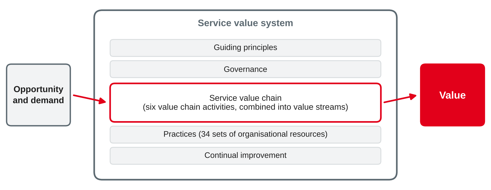
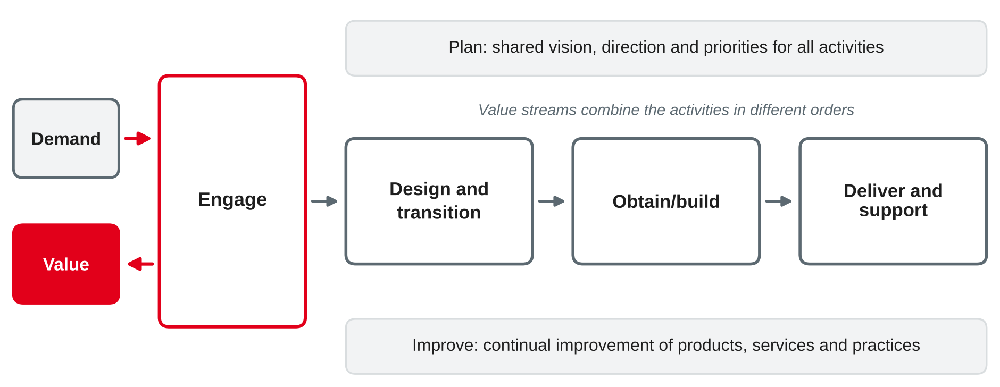

# IT Service Management I — ITIL 4 {.title}

::: notes
Time plan for today (3 h): recap and preparation task 10 min · why service management and ITIL 15 min · service concepts 25 min · mini exercise utility and warranty 10 min · break 10 min · four dimensions, service value system and value chain 25 min · guiding principles 10 min + sorting exercise 15 min · practices overview 5 min · case exercise 40 min · wrap-up 5 min · ~10 min buffer.
ITIL is a registered trademark of PeopleCert (AXELOS). All definitions on these slides are paraphrased; the diagrams are own illustrations. Do not copy figures or definitions from the ITIL book into the slides.
:::

---

# Today's Agenda

1. Recap: your IT service as a product
2. Why service management — and what ITIL is
3. Key service concepts: value, outcomes, utility and warranty, service relationships
4. The four dimensions of service management
5. The ITIL service value system and service value chain
6. Guiding principles and practices
7. Case exercise: define a service and its value chain

::: notes
Time and format guide (not shown to students):
0:00 Recap of preparation task (pairs + plenary) · 0:10 Why service management, ITIL (input) · 0:25 Service concepts (input) · 0:50 Mini exercise utility and warranty (pairs) · 1:00 Break · 1:10 Four dimensions, SVS, SVC (input) · 1:35 Guiding principles (input + sorting exercise) · 2:00 Practices overview (input) · 2:05 Case exercise (groups) · 2:45 Wrap-up · ~10 min buffer.
If the session runs long: the continual improvement model and "ITIL and other frameworks" are optional and move to self-study. Keep the case exercise.
:::

---

# Recap: Your IT Service as a Product

You were asked to describe an IT service you use at work as a "product".

- **What** do you get — and what does it allow you to do?
- What would a fair **price** be, and who pays it?
- What **quality promise** do you expect — and is it written down anywhere?

::: notes
Pairs for 3 min, then collect 3–4 examples in plenary (laptop workplace, e-mail, SAP access, VPN). Write two columns on the board: "what it does" and "how well it works". Do not name them yet — they become utility and warranty later in this session. Link to session 4: chargeback by service only works if services are defined like products with a price.
:::

---

# Why Service Management? {.section}

From IT department to service provider

---

# From Technology to Services

::: columns
**Technology view**

- IT is organised around systems: servers, network, SAP, databases
- Success = systems are running
- The business sees costs and technical jargon
|||
**Service view**

- IT offers **services** that support business outcomes, e.g. "mobile workplace" or "online ordering"
- Success = the business can do its work
- Each service has a **description, an owner, a price and agreed quality**
:::

::: callout
IT service management (ITSM) is the set of capabilities to plan, deliver, operate and improve IT services so that they create value for customers.
:::

::: source
Own summary based on Beims and Ziegenbein (2023) and Krcmar (2015).
:::

::: notes
Link back to the course: chargeback by service (session 4) and the IT balanced scorecard's user perspective (SLA compliance) both need defined services. Plan–build–run (session 3) organises IT along the service life cycle. The service view is the basis for service level agreements (session 6).
:::

---

# What Is ITIL?

- A **framework of good practice** for IT and digital service management — not a standard, not a law
- Developed from the late 1980s for the UK government; today owned by **PeopleCert** (AXELOS)
- **ITIL 4** (2019) moves from processes to **value co-creation**, a value system and flexible practices
- Organisations **adopt and adapt** ITIL; certification exists for people, not for organisations

::: callout
For **organisations**, the certifiable standard for service management is **ISO/IEC 20000-1**.
:::

::: source
Based on AXELOS (2019), Beims and Ziegenbein (2023) and ISO/IEC (2018).
:::

::: notes
Earlier versions: ITIL v2 (around 2000), v3 (2007) and the 2011 edition, built around a service life cycle with many processes. ITIL 4 Foundation was published in 2019. Before the first run in 2028: PeopleCert has been rolling out "ITIL (Version 5)" during 2026, with ITIL 4 continuing in parallel for a while. Check what the current version is and whether this session should be updated. The core ideas taught here (value, SVS, value streams, guiding principles) are described as continued in the new version.
:::

---

# Key Service Concepts {.section}

Value, outcomes, costs and risks

---

# Service and Value

::: callout
A **service** enables value co-creation: it helps customers achieve the **outcomes** they want, without the customer having to manage specific **costs and risks** themselves.
:::

| Term | Meaning in own words | Example: mobile workplace |
|---|---|---|
| Value | Perceived benefit, usefulness and importance | Sales staff can work at the customer's site |
| Output | Deliverable of an activity | Configured laptop, VPN access |
| Outcome | Result for a stakeholder, enabled by outputs | Offers are sent on the same day |
| Costs and risks | Removed from the consumer, or imposed on them | Removed: buying hardware; imposed: monthly fee |

::: source
Own wording based on AXELOS (2019).
:::

::: notes
Key idea of ITIL 4: value is **co-created** — the provider cannot create it alone; the consumer must use the service. Outputs vs. outcomes is a classic exam question: a laptop is an output, being able to work at the customer's site is the outcome. Costs and risks: the consumer no longer has to manage hardware and security patches (removed), but pays a fee and depends on the provider (imposed).
:::

---

# Utility and Warranty

::: columns
**Utility — fit for purpose**

- **What** the service does
- Functions that support the outcome or remove constraints
- Example: e-mail, calendar and file sharing on a laptop
|||
**Warranty — fit for use**

- **How well** the service performs
- Assurance that agreed conditions are met: availability, capacity, security, continuity
- Example: available 99.5 % in business hours, encrypted, replaced within one day
:::

::: callout
A service creates value only if it has **both**: useful functions that work reliably when needed.
:::

::: source
Own wording based on AXELOS (2019).
:::

::: notes
Go back to the two columns from the recap: "what it does" = utility, "how well it works" = warranty. Warranty requirements later become service levels in SLAs (session 6).
:::

---

# Service Relationships

::: columns
**Roles on the consumer side**

- **Customer:** defines requirements and is responsible for outcomes
- **User:** uses the service
- **Sponsor:** authorises the budget
- One person can hold several roles
|||
**A service offering can include**

- **Goods:** ownership is transferred, e.g. a headset
- **Access to resources:** granted under agreed terms, e.g. a mailbox or cloud storage
- **Service actions:** performed by the provider, e.g. user support, installing software
:::

Service relationship = **service provision** + **service consumption** + **service relationship management**.

::: source
Own wording based on AXELOS (2019).
:::

::: notes
Example for the mobile workplace: customer = head of sales (defines what sales needs), users = sales staff, sponsor = CFO or head of sales (approves the budget). Ask students for an example where the user is not the customer (e.g. a bank's online banking: customer and user are the same person; company e-mail: users are employees, customer is the business unit). Organisations are always both providers and consumers: the IT department consumes cloud services and provides services to the business.
:::

---

# Mini Exercise: Utility or Warranty? {.exercise}

Take the IT service you described for today. With your neighbour:

1. Write down **two utility** statements and **two warranty** statements
2. Make at least one warranty statement **measurable**
3. Which **cost** and which **risk** does the service remove from you — and which does it impose?

::: notes
Pairs, 10 min incl. 3 short reports. Typical mistakes: "fast" or "secure" without a measure; mixing utility and warranty ("the laptop has Teams" is utility, "Teams works on 98 % of working days" is warranty). Expected example for SAP access: utility — create purchase orders, see stock levels; warranty — available Mon–Sat 6:00–22:00 at 99 %, response time below 2 s for 95 % of transactions.
:::

---

# The Four Dimensions of Service Management

::: cards
### Organisations and people
Structures, roles, skills, culture and leadership needed to provide the service.

### Information and technology
Information and knowledge, applications, infrastructure and tools.

### Partners and suppliers
Other organisations involved: cloud providers, vendors, outsourcers.

### Value streams and processes
How the parts work together to create value: activities, workflows, controls.
:::

External factors (**PESTLE**: political, economic, social, technological, legal, environmental) influence all four dimensions.

::: source
Own wording based on AXELOS (2019).
:::

::: notes
The four dimensions are a checklist for a holistic view: many failed tool rollouts looked only at "information and technology". Example: a new ticket tool fails because nobody trained the service desk (organisations and people) and the outsourced second-level support was not connected (partners and suppliers). Legal factors: GDPR and NIS2 (session 7).
:::

---

# The Service Value System {.section}

Value chain, guiding principles and practices

---

# The ITIL Service Value System (SVS)

{width=95%}

::: source
Own illustration based on AXELOS (2019).
:::

::: notes
The SVS describes how all components and activities of an organisation work together to turn opportunities and demand into value. Five components: guiding principles, governance, service value chain, practices, continual improvement. Purpose: avoid silos — every team works as part of one system. Governance is the evaluate–direct–monitor cycle from session 3 (ISO/IEC 38500, COBIT EDM).
:::

---

# The Service Value Chain (SVC)

{width=95%}

::: source
Own illustration based on AXELOS (2019).
:::

::: notes
Six value chain activities: plan, improve, engage, design and transition, obtain/build, deliver and support. Important: the chain is **not a fixed sequence**. The figure shows one typical path, but each value stream combines the activities in its own order. Engage is the interface to stakeholders: demand comes in and value goes out through it.
:::

---

# The Six Value Chain Activities

| Activity | Purpose in own words |
|---|---|
| Plan | Shared understanding of vision, current status and direction for products, services and practices |
| Improve | Continual improvement of products, services and practices across all activities |
| Engage | Understand stakeholder needs, stay transparent and keep good relationships |
| Design and transition | Make sure products and services meet expectations on quality, cost and time to market |
| Obtain/build | Make sure service components are available when and where needed and meet specifications |
| Deliver and support | Deliver and support services according to agreed specifications and expectations |

::: source
Own wording based on AXELOS (2019).
:::

::: notes
Exam tip: students should name the six activities and explain each in one sentence. Point out the link to plan–build–run (session 3): design and transition and obtain/build ≈ build, deliver and support ≈ run, plan ≈ plan. ITIL adds engage and improve.
:::

---

# Value Streams: The Chain in Action

**Example value stream:** "An employee's e-mail stops working — and works again"

| Step | Value chain activity |
|---|---|
| Employee contacts the service desk via the portal | Engage |
| Service desk logs, diagnoses and tries a known fix | Deliver and support |
| Faulty laptop is replaced from stock | Obtain/build |
| New laptop is configured and handed over | Deliver and support |
| Employee confirms that e-mail works again | Engage |
| Repeated failures of this model are analysed | Improve |

::: source
Own example based on AXELOS (2019).
:::

::: notes
A value stream is a series of steps to create and deliver a product or service to a consumer. Each value stream is a specific path through the value chain. Mapping value streams helps to find waiting times and hand-overs — the same idea as in lean management. The in-class case uses a different value stream (introducing a change), where design and transition plays the main role.
:::

---

# The Seven Guiding Principles

| Principle | In short |
|---|---|
| Focus on value | Everything should link back to value for stakeholders |
| Start where you are | Assess and reuse what exists before building something new |
| Progress iteratively with feedback | Work in small, manageable steps and use feedback |
| Collaborate and promote visibility | Work across boundaries; make work and decisions transparent |
| Think and work holistically | Consider the whole system, including all four dimensions |
| Keep it simple and practical | Remove steps that do not add value; use as few steps as possible |
| Optimise and automate | Optimise first, then automate where it adds value |

::: source
Own wording based on AXELOS (2019).
:::

::: notes
The principles are universal recommendations that guide decisions in any situation, regardless of goals, strategy or structure. They interact: e.g. "optimise and automate" should not be applied without "focus on value" — automating a useless process only makes waste faster. Ask students which principle their training company violates most often.
:::

---

# Exercise: Which Principle? {.exercise}

Which guiding principle is **applied** or **violated**? Justify in one sentence.

1. A new change approval form has 40 fields "to be on the safe side".
2. Before buying a new monitoring tool, the team checks what the existing tool can do.
3. The new service portal is released to one department first; feedback shapes the next release.
4. The service desk automates password resets after first removing three unnecessary approval steps.
5. IT reports only server uptime — the business does not know what it means for them.

::: notes
Pairs, about 10 min + 5 min discussion. Expected answers: 1 keep it simple and practical (violated) · 2 start where you are (applied) · 3 progress iteratively with feedback (applied) · 4 optimise and automate (applied, in the right order) · 5 focus on value and collaborate and promote visibility (violated). Several principles can apply to one situation — accept well-justified alternatives.
:::

---

# Governance and Continual Improvement {.optional}

- **Governance** in the SVS: the governing body evaluates, directs and monitors — as in ISO/IEC 38500 and COBIT (session 3)
- **Continual improvement** happens at all levels, guided by seven questions:
  1. What is the vision?
  2. Where are we now?
  3. Where do we want to be?
  4. How do we get there?
  5. Take action
  6. Did we get there?
  7. How do we keep the momentum going?

::: source
Own wording based on AXELOS (2019).
:::

::: notes
Self-study. The continual improvement model is a simple improvement cycle; compare it with the Plan–Do–Check–Act cycle that comes up in quality management (session 9).
:::

---

# ITIL 4 Practices: Overview

A **practice** is a set of organisational resources (people, information, tools, processes, partners) for doing work or reaching an objective. ITIL 4 describes **34 practices** in three groups.

| Group | Number | Examples |
|---|---|---|
| General management | 14 | Strategy management, portfolio management, information security management, relationship management, supplier management, continual improvement |
| Service management | 17 | Service level management, service desk, incident management, problem management, change enablement, service request management, service catalogue management |
| Technical management | 3 | Deployment management, infrastructure and platform management, software development and management |

::: source
Based on AXELOS (2019).
:::

::: notes
Students do not need to know all 34 practices. Session 6 covers the core service management practices: incident, problem, change enablement, service level management and service desk. Point out that practices are not processes: a practice includes processes, but also roles, tools, information and suppliers — the four dimensions again. Several practices link to other sessions: portfolio management (4), information security (8), architecture management (10–18), supplier management (15).
:::

---

# ITIL and Other Frameworks {.optional}

| Framework | Focus | Relation to ITIL |
|---|---|---|
| ISO/IEC 20000-1 | Requirements for a service management system; organisations can be certified | ITIL practices help to meet the requirements |
| COBIT 2019 | Governance and management of enterprise IT | COBIT says **what** to control (e.g. DSS domain); ITIL describes **how** to run services |
| ITIL 4 | Good practice for service management | Adopt and adapt; no organisational certification |

::: source
Based on ISO/IEC (2018), ISACA (2018) and Beims and Ziegenbein (2023).
:::

::: notes
Self-study. Common criticism of earlier ITIL versions: bureaucratic, process-heavy, slow. ITIL 4 responded with value streams, guiding principles and links to agile and DevOps ways of working. Beims and Ziegenbein discuss the practical use of ITIL together with other frameworks.
:::

---

# Case Exercise: Define a Service and Its Value Chain {.exercise}

**Case:** *Rhein-Neckar Mobil Group* (sessions 3–4) has set up a federated IT. Group IT now offers the **on-board ticketing service** to the bus and rail unit: ticket devices on 400 buses, card payment, a back-end for fares and sales data.

**Tasks:**
1. Describe the service: **customer, users, sponsor**; two **outputs** and two **outcomes**; one **cost** and one **risk** that are removed and one that is imposed
2. Formulate two **utility** and two measurable **warranty** statements
3. What does the **service offering** contain (goods, access to resources, service actions)?
4. Value stream "**a new regional day ticket is sold on all buses from 1 March**": list the steps and map each to a **value chain activity**
5. Which two **guiding principles** matter most for this value stream? Justify.

::: notes
Groups of 4–5, about 30 min + 10 min discussion. Expected answers (several defensible):
1 Customer: head of the bus and rail unit; users: bus drivers (and indirectly passengers); sponsor: managing director or CFO of the unit. Outputs: working ticket devices, daily sales reports. Outcomes: passengers board quickly with a valid ticket, revenue is recorded correctly. Removed: buying and maintaining devices, risk of payment security breaches (PCI requirements). Imposed: service fee per device, dependency on group IT.
2 Utility: sell all fare types incl. card payment; transmit sales data to the back-end. Warranty: 99 % of devices working at shift start; faulty device replaced within 4 h; payment data encrypted and compliant.
3 Goods: none or spare cards/paper rolls; access to resources: devices, fare back-end, reporting dashboard; service actions: device swap, fare updates, driver support hotline.
4 Engage (unit requests new fare, requirements) → plan (prioritise against other changes, release date) → design and transition (design fare logic, test) → obtain/build (configure fare tables, update device software) → design and transition (deploy to 400 buses, train drivers) → deliver and support (first-day support, monitoring sales) → engage (confirm with unit) → improve (review problems, lessons learned).
5 e.g. progress iteratively with feedback (pilot on one route), think and work holistically (drivers, back-end, payment partner, tariff association), collaborate and promote visibility (unit and IT plan together). Same exam format as before: short case + application of concepts + justification.
:::

---

# Key Takeaways

- A **service** helps customers achieve outcomes without managing specific costs and risks; value is **co-created**
- Services need **utility** (fit for purpose) and **warranty** (fit for use)
- **Four dimensions** keep service management holistic: people, technology, partners, value streams
- The **service value system** turns demand into value; its **value chain** has six activities, combined into **value streams**
- **Seven guiding principles** and **34 practices** support every value stream

---

# Next Session: IT Service Management II — Core Practices

- Incident management and problem management
- Change enablement
- Service level management: SLAs and OLAs
- The service desk

::: callout
**Preparation:** think of the last time you reported an IT problem at work. What happened between your report and the fix — and were you told how long it would take?
:::

---

# References {.references}

- AXELOS. (2019). *ITIL Foundation: ITIL 4 edition*. TSO.
- Beims, M., & Ziegenbein, M. (2023). *IT-Service-Management in der Praxis mit ITIL®: Zusammenarbeit systematisieren und relevante Ergebnisse erzielen* (6th ed.). Hanser.
- ISACA. (2018). *COBIT 2019 framework: Introduction and methodology*. ISACA.
- ISO/IEC. (2018). *Information technology — Service management — Part 1: Service management system requirements* (ISO/IEC Standard No. 20000-1:2018). International Organization for Standardization.
- Krcmar, H. (2015). *Informationsmanagement* (6th ed.). Springer Gabler. https://doi.org/10.1007/978-3-662-45863-1

ITIL® is a registered trademark of PeopleCert group. Diagrams in this deck are own illustrations.
