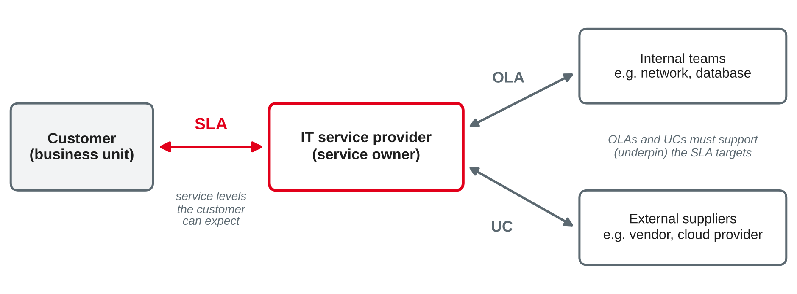

# IT Service Management II — Core Practices {.title}

::: notes
Time plan for today (3 h): recap and preparation task 10 min · service desk and incident management 20 min · mini exercise prioritisation 10 min · problem management and change enablement 20 min · break 10 min · incident vs. problem case 30 min · service level management, SLAs, OLAs and underpinning contracts 20 min · SLA case exercise 40 min · wrap-up 5 min · ~15 min buffer.
ITIL is a registered trademark of PeopleCert (AXELOS). All definitions on these slides are paraphrased; the diagrams are own illustrations. Do not copy figures or definitions from the ITIL book into the slides.
:::

---

# Today's Agenda

1. Recap: your last IT problem
2. The service desk and incident management
3. Problem management and change enablement
4. Case: incident or problem?
5. Service level management: SLAs, OLAs and underpinning contracts
6. Case exercise: draft an SLA for the on-board ticketing service

::: notes
Time and format guide (not shown to students):
0:00 Recap of preparation task (pairs + plenary) · 0:10 Service desk, incident management (input) · 0:30 Mini exercise prioritisation (pairs) · 0:40 Problem management, change enablement (input) · 1:00 Break · 1:10 Incident vs. problem case (groups + plenary) · 1:40 Service level management, agreements, availability (input) · 2:00 SLA case exercise (groups + plenary) · 2:40 Wrap-up · ~15 min buffer.
If the session runs long: "Root cause analysis techniques" and "Change enablement in agile and DevOps teams" are optional and move to self-study. Keep both case exercises; the SLA case is the session's exam-style exercise.
:::

---

# Recap: Your Last IT Problem

You were asked to think of the last time you reported an IT problem at work.

- **How** did you report it — phone, portal, e-mail, a colleague?
- What happened **between your report and the fix**?
- Were you told **how long** it would take — and was the promise kept?
- Did the same problem **come back** later?

::: notes
Pairs for 3 min, then collect 3–4 stories in plenary. Write the steps of one story on the board (report → ticket → first try → escalation → fix → closure). These steps become the incident flow later. Questions 3 and 4 lead to the two big topics of the day: promises about time are service levels (SLAs), and recurring failures are problems. Link to session 5: the value stream "an employee's e-mail stops working — and works again" and the 34 practices; today we look at five of them in detail.
:::

---

# Incidents and the Service Desk {.section}

Getting users back to work

---

# The Service Desk

::: callout
The **service desk** captures demand for **incident resolution** and **service requests**. It is the **single point of contact** between the service provider and all its users.
:::

::: columns
**What it does**

- Receives, records and classifies all calls and tickets
- Resolves as much as possible at the **first contact**
- Routes the rest to support groups and keeps users informed
- Links to all other practices
|||
**How users reach it**

- Phone, e-mail, chat, web portal
- Self-service and knowledge base, e.g. password reset
- Walk-in desk or on-site support
- Chatbots and automated routing
:::

::: source
Own wording based on AXELOS (2019) and Beims and Ziegenbein (2023).
:::

::: notes
First ITIL practice slide of the session. Reminder for the lecturer (decision 2026-10-20): sessions 5–6 teach ITIL 4; PeopleCert is introducing ITIL (Version 5) — check before the first run in 2028 whether the practice names and definitions here need an update.
ITIL 4 stresses that the service desk is not only a technical function: empathy, communication and understanding of the business matter as much as tool skills. Service requests (e.g. "I need access to SAP", "a new monitor") are handled by the service request management practice: they are normal, pre-defined requests, not failures. Ask: who in the room has worked at a service desk during a practice phase?
:::

---

# Incident Management

::: callout
An **incident** is an unplanned interruption of a service or a reduction in its quality. **Incident management** minimises the negative impact of incidents by **restoring normal service** as quickly as possible.
:::

| Step | What happens |
|---|---|
| Detect and log | User calls the service desk, or monitoring raises an alert; a ticket is created |
| Categorise and prioritise | Which service is affected? How bad is it, and how urgent? |
| Diagnose and resolve | Known fix or workaround first; otherwise escalate to a support group |
| Close | User confirms that the service works; the ticket is documented and closed |

::: source
Own wording based on AXELOS (2019) and Beims and Ziegenbein (2023).
:::

::: notes
The goal is speed of restoration, not finding the cause. A workaround (restart, use another printer, use the web version) is a perfectly good incident resolution. ITIL 4 does not prescribe a single process: organisations design their own workflow, often with different paths for different incident types. Major incidents get a separate procedure (next slide). Good documentation matters because problem management later uses the incident records to find patterns.
:::

---

# Prioritising Incidents: Impact and Urgency

**Impact:** how many users or how much business is affected? **Urgency:** how fast does the business need a solution?

| Impact ↓ / Urgency → | High | Medium | Low |
|---|---|---|---|
| **High** (whole unit, revenue, safety) | P1 | P2 | P3 |
| **Medium** (a team, one location) | P2 | P3 | P4 |
| **Low** (one user, workaround exists) | P3 | P4 | P5 |

Each priority gets **target times**, e.g. P1: response 15 min, resolution 4 h · P3: response 4 h, resolution 2 working days.

::: source
Own example based on Beims and Ziegenbein (2023).
:::

::: notes
The matrix and the target times are an example; every organisation defines its own (and agrees them in the SLA, see later). Response time = time until someone starts working on the ticket and contacts the user; resolution time = time until the service is restored. Students often mix them up — a classic exam point. Priority is not the same as "who shouts loudest": a board member's broken mouse is low impact, unless the organisation deliberately defines VIP rules.
:::

---

# Escalation and Major Incidents

::: columns
**Two kinds of escalation**

- **Functional:** the ticket moves to a group with more expertise, e.g. from the service desk (1st level) to the network team (2nd level) or the vendor (3rd level)
- **Hierarchical:** management is informed and decides, e.g. when a target time is at risk or extra resources are needed
|||
**Major incident**

- Highest impact, e.g. the whole ticketing back-end is down
- Separate procedure: incident manager in charge, fixed communication cycle, often a temporary team
- **Swarming:** experts work on the incident together instead of passing it on
:::

::: source
Own wording based on AXELOS (2019) and Beims and Ziegenbein (2023).
:::

::: notes
Functional vs. hierarchical escalation is a German exam classic (funktionale vs. hierarchische Eskalation). ITIL 4 mentions swarming as an alternative to the classic tiered model: instead of handing over the ticket from level to level, the people needed work on it together. After a major incident, a review should always lead to a problem record.
:::

---

# Mini Exercise: Prioritise These Incidents {.exercise}

Use the impact–urgency matrix. Give the **priority** and one sentence of justification.

1. The car-sharing app cannot open cars in all of Mannheim on a Friday evening.
2. One employee in accounting cannot print; the printer next door works.
3. The payroll system shows an error message; payroll must be sent to the bank tomorrow morning.
4. A user asks for a second monitor.
5. The intranet page with the canteen menu is not updated.

::: notes
Pairs, 10 min incl. short discussion. Expected answers: 1 P1 (high impact: revenue, customers stranded; high urgency) · 2 P5 or P4 (low impact, workaround exists; low or medium urgency) · 3 P2 (medium or high impact, high urgency because of the deadline; accept P1 with reasoning) · 4 not an incident but a **service request** — no priority from the incident matrix · 5 P5 (low impact and urgency). Point out item 4: many service desks mix requests and incidents, which distorts the statistics.
:::

---

# Problems and Changes {.section}

Removing causes safely

---

# Problem Management

::: callout
A **problem** is the cause, or potential cause, of one or more incidents. A **known error** is a problem that has been analysed but not yet resolved. A **workaround** reduces the impact of an incident or problem until a full fix is available.
:::

| Phase | What happens |
|---|---|
| Problem identification | Spot problems: trend analysis of incidents, recurring or major incidents, supplier information |
| Problem control | Analyse the problem, find the root cause, document workarounds and known errors |
| Error control | Manage known errors, assess fixes, raise a change for the permanent solution |

::: source
Own wording based on AXELOS (2019).
:::

::: notes
Problem management is reactive (after incidents) and proactive (before incidents happen, e.g. from vendor warnings or trend analysis). Known errors and workarounds go into a knowledge base so that the service desk can resolve future incidents faster — this is the main link back to incident management. The permanent fix usually needs a change, which is handled by change enablement.
:::

---

# Incident vs. Problem

{width=88%}

| | Incident management | Problem management |
|---|---|---|
| Goal | Restore service **fast** | Remove the **cause** |
| Time horizon | Minutes to hours | Days to months |

::: source
Own illustration based on AXELOS (2019).
:::

::: notes
The key exam distinction: incident = symptom, restore quickly; problem = cause, prevent recurrence. One problem can cause many incidents; an incident does not "become" a problem — a problem record is created and linked to the incidents. Common mistake: closing the incident only after the root cause is found, which makes users wait unnecessarily.
:::

---

# Root Cause Analysis Techniques {.optional}

::: columns
**Five whys**

- Ask "why?" repeatedly until you reach a cause that can be fixed
- Example: ticket devices fail at shift start → why? Software update fails → why? Update starts while the bus is still in the depot without network → why? …
|||
**Ishikawa (cause-and-effect) diagram**

- Collect possible causes by category, e.g. people, process, technology, supplier
- Good for group workshops
- Leads to hypotheses that are then tested
:::

::: source
Own summary based on Beims and Ziegenbein (2023).
:::

::: notes
Self-study. The five whys rarely need exactly five questions; stop when the cause is something the organisation can change. Root causes are often organisational (missing test, unclear responsibility), not only technical. The four dimensions from session 5 work well as Ishikawa categories.
:::

---

# Change Enablement

::: callout
A **change** is adding, modifying or removing anything that could affect services. **Change enablement** maximises the number of **successful** changes by assessing risks, **authorising** changes and managing the change schedule.
:::

- Balances two goals: **speed** for the business and **protection** against failures
- Each change is authorised by a suitable **change authority**: a person or group, depending on risk and type
- The **change schedule** helps plan changes, communicate them and avoid conflicts

::: source
Own wording based on AXELOS (2019).
:::

::: notes
In earlier ITIL versions the practice was called "change management" and was often equated with a weekly change advisory board (CAB). ITIL 4 renamed it "change enablement" to stress that the aim is to enable useful changes, not to block them. The change authority can be a single person (team lead), a board, or even an automated pipeline check for low-risk changes. Do not confuse with organisational change management, which is about people and culture.
:::

---

# Three Types of Change

| Type | Characteristics | Authorisation | Example |
|---|---|---|---|
| **Standard** | Low risk, well understood, documented procedure | **Pre-authorised**; no new assessment each time | New user account, standard software from the catalogue |
| **Normal** | Needs assessment and planning | By the change authority, depending on risk: team lead up to management board | New fare logic in the ticketing back-end |
| **Emergency** | Must be done as soon as possible, e.g. to resolve a major incident or close a security gap | Fast-track with a separate, smaller authority; documentation may follow later | Security patch against an actively exploited vulnerability |

::: source
Own wording based on AXELOS (2019).
:::

::: notes
Exam tip: students should name the three types, explain each and give an example. Ask: what happens if almost everything is an emergency change? (Then the change process is too slow or people avoid it.) Good practice: turn frequent, low-risk normal changes into standard changes. Emergency changes should still be tested as far as possible and reviewed afterwards.
:::

---

# Change Enablement in Agile and DevOps Teams {.optional}

- Frequent small releases (several per day) cannot wait for a weekly board meeting
- Authority is **decentralised**: the team or peer review decides for most changes
- **Automated checks** in the deployment pipeline (tests, security scans) act as controls
- Central review is kept for high-risk changes and for changes across many teams

::: source
Own summary based on AXELOS (2019) and Beims and Ziegenbein (2023).
:::

::: notes
Self-study. Links to the guiding principles (session 5): optimise and automate, keep it simple and practical. Control does not disappear — it moves into the pipeline and into the team. Auditors (session 7) still expect evidence that changes were tested and approved; automated pipelines provide this evidence as logs.
:::

---

# Case: Incident or Problem? {.exercise}

**Case:** The **car-sharing app** of *Rhein-Neckar Mobil Group*. On three Monday mornings in a row, customers cannot unlock cars between 7:00 and 8:30. The service desk receives about 250 calls each time. Restarting the API gateway restores the service; nobody knows why it fails.

**Tasks:**
1. What is the **incident**, and what is the **problem**? Give the incident a **priority** and justify it.
2. Is this a **major incident**? What should the service desk do in the first 15 minutes?
3. Which **workaround** exists? How should it be documented?
4. Problem control finds the cause: a weekly backup job overloads the gateway's database. Is this now a **known error**? Which **type of change** fixes it, and who authorises it?
5. Which **practices** are involved, in which order?

::: notes
Groups of 3–4, about 20 min + 10 min discussion. Expected answers:
1 Incident: customers cannot unlock cars (service interruption) — each Monday is a separate incident (or one major incident with hundreds of linked tickets). Problem: the unknown cause of the recurring gateway failure. Priority P1: high impact (all customers, revenue, reputation, people stranded), high urgency (rush hour).
2 Yes: high impact and many users. Inform users (status message in the app, recorded phone message), link calls to one master ticket, call in the incident manager, apply the known restart.
3 Restart the API gateway; document as a workaround in the knowledge base so the service desk or on-call team can trigger it at once; better still, proactive restart before 7:00 until the fix is in place.
4 Yes — once the root cause is known and documented but not yet fixed, it is a known error. Moving the backup job to Sunday night or out of the gateway database is a normal change (assessment: is the backup window still enough?) authorised by the responsible change authority, e.g. the platform team lead. If it is done in the same way often, it could become a standard change.
5 Service desk → incident management (and major incident procedure) → problem management (problem identification and control) → change enablement → deployment → problem record closed after monitoring shows no more failures.
:::

---

# Service Level Management {.section}

Agreeing and keeping promises

---

# Service Level Management (SLM)

::: callout
**Service level management** sets clear, **business-based targets** for service levels and makes sure that services are assessed, monitored and managed against them.
:::

- **Understand** what the customer needs: talk to customers, observe how the service is used
- **Agree** service levels and document them in a **service level agreement (SLA)**
- **Monitor and report** performance against the targets
- **Review** regularly: are the targets still the right ones?

::: source
Own wording based on AXELOS (2019).
:::

::: notes
SLM is the practice that turns the warranty statements from session 5 into agreed targets. ITIL 4 stresses that SLM is mainly about engagement: listening to the customer and understanding outcomes, not just negotiating numbers. Links: chargeback and IT balanced scorecard (session 4, SLA compliance as a user-perspective KPI), relationship management, supplier management (session 15).
:::

---

# What an SLA Contains

An **SLA** is a documented agreement between a service provider and a customer that describes the service and the expected service levels.

| Element | Example: mobile workplace |
|---|---|
| Service description and scope | Laptop, e-mail, VPN for 300 sales staff; excluded: private devices |
| Service hours and support hours | Service 24/7; support Mon–Fri 7:00–19:00 |
| Service level targets | Availability 99.5 % in support hours; response and resolution times per priority |
| Responsibilities of both parties | Customer reports defects via the portal and returns old devices |
| Reporting and review | Monthly report, quarterly review meeting |
| Escalation and consequences | Escalation path; service credits if targets are missed |

::: source
Own example based on AXELOS (2019) and Beims and Ziegenbein (2023).
:::

::: notes
Internal SLAs (IT department and business unit) are usually not legal contracts but management agreements; external SLAs are part of a contract. Service credits (price reduction) are typical for external providers; internally, missed targets lead to escalation and improvement plans. Point out the customer's duties: an SLA describes obligations on both sides.
:::

---

# Good Service Level Targets

::: columns
**Good targets are …**

- **Measurable** and clearly defined: what counts as "available"? when does the clock stop?
- **Business-based:** expressed in terms the customer understands, e.g. "orders can be placed"
- **Realistic** and affordable — 99.99 % costs much more than 99 %
- Combined with **user satisfaction** and outcome measures
|||
**The watermelon effect**

- Green on the outside, red on the inside: all SLA metrics are met, but users are unhappy
- Cause: metrics measure technical components or outputs, not the user's experience
- Remedy: measure outcomes and ask users
:::

::: source
Own wording based on AXELOS (2019).
:::

::: notes
Example: "server availability 99.9 %" is met, but the application is unusable because of slow response times — the report is green, the users are angry. Ask students for watermelon examples from their training companies. Link to session 5 principle "focus on value".
:::

---

# Making Targets Concrete: Availability

**Availability** = (agreed service time − downtime) ÷ agreed service time × 100 %

**Example:** support hours Mon–Fri 7:00–19:00, 21 working days per month

- Agreed service time: 12 h × 21 days = **252 h** per month
- Target 99.5 % → maximum downtime = 0.5 % × 252 h = **1.26 h ≈ 76 minutes** per month
- Actual downtime 3 h → availability = (252 − 3) ÷ 252 = **98.8 %** → target missed

::: callout
Always state the **time base** (service hours, month or year) and **what counts as downtime** (e.g. planned maintenance excluded).
:::

::: source
Own example based on Beims and Ziegenbein (2023).
:::

::: notes
Typical exam calculation. Show the difference: 99.5 % per year on a 24/7 basis allows 43.8 hours of downtime — possibly in one block. That is why the time base and the maximum length of a single outage matter. Planned maintenance windows are usually excluded from downtime, but must be agreed in the SLA.
:::

---

# SLA, OLA and Underpinning Contract

{width=72%}

| Agreement | Between | Example |
|---|---|---|
| **SLA** | IT service provider and customer | Group IT and the bus and rail unit |
| **OLA** (operational level agreement) | Provider and an **internal** team | Group IT service owner and the network team |
| **UC** (underpinning contract) | Provider and an **external** supplier | Group IT and the ticket device manufacturer |

::: source
Own illustration based on Beims and Ziegenbein (2023) and AXELOS (2019).
:::

::: notes
OLA and underpinning contract are terms from earlier ITIL versions that are still standard in practice and in German textbooks; ITIL 4 covers the supplier side mainly in the supplier management practice. Key rule: the SLA can only promise what OLAs and UCs make possible. Example: if the SLA promises device replacement in 4 h but the manufacturer's contract says 2 working days, the provider needs a spare pool or a new contract. Ask students to check this "underpinning" in the case exercise.
:::

---

# Case Exercise: Draft an SLA {.exercise}

**Case:** *Rhein-Neckar Mobil Group*, **on-board ticketing service** (session 5): 400 buses, operation daily 4:30–0:30. Group IT provides the devices and the fare back-end; the **device manufacturer** repairs hardware (next working day); an **external payment provider** processes card payments; Group IT's **network team** runs the mobile data connection.

**Draft an SLA between Group IT and the bus and rail unit:**
1. Service description and scope; **service hours** and **support hours**
2. **Availability** target with time base; calculate the maximum downtime per month (30 days)
3. **Priorities** with response and resolution targets; classify a failed device on one bus and a failed back-end
4. **Responsibilities** of the bus and rail unit
5. Which **OLAs** and **UCs** are needed? Does each one **underpin** your targets?
6. Three **KPIs** for the monthly report — at least one that avoids the watermelon effect

::: notes
Groups of 4–5, about 30 min + 10 min presentations of two drafts. This is the session's exam-style exercise. Expected answers (several defensible):
1 Scope: ticket devices on 400 buses, fare back-end, card payment, sales reports; excluded: paper tickets sold in shops. Service hours 4:30–0:30 daily (20 h); support hours: hotline during service hours, back-end on-call.
2 e.g. 99.5 % back-end availability in service hours: 20 h × 30 days = 600 h → max downtime 3 h per month. Device availability: 98 % of devices working at shift start.
3 P1 back-end down (all buses, revenue): response 15 min, resolution 2 h. P3 one device failed (one bus, driver can sell paper tickets or let passengers pay later): replacement at the depot before the next shift or within 4 h. P2 card payment fails on all devices.
4 Drivers report faults via the hotline or app; buses come to the depot for device swaps; the unit announces fare changes 8 weeks in advance; the unit names a contact person for the SLA review.
5 OLA with the network team (mobile data availability, response times), OLA with the back-end/database team; UC with the device manufacturer (repair next working day — does not underpin a 4 h replacement target → spare pool of e.g. 20 devices in the depots); UC with the payment provider (its availability must be at least as high as the SLA target, with the same time base).
6 Back-end availability; % of devices working at shift start; share of P1 incidents resolved in time; plus outcome/satisfaction: share of trips with successful ticket sales, driver satisfaction survey, passenger complaints about ticketing.
:::

---

# Key Takeaways

- The **service desk** is the single point of contact for incidents and service requests
- **Incident management** restores service fast; priority = **impact × urgency**
- **Problem management** removes causes: problem → known error → permanent fix via a **change**
- **Change enablement** balances speed and risk: **standard, normal and emergency** changes
- **Service level management** agrees business-based targets in **SLAs**, supported by **OLAs** and **underpinning contracts**

---

# Next Session: IT Risk and Compliance Management

- Governance, risk and compliance (GRC)
- IT compliance requirements, e.g. GDPR, NIS2, DORA
- The risk management process (ISO 31000)
- Ethical considerations in IT decisions

::: callout
**Preparation:** find one legal or regulatory rule that affects the IT of your training company. What does the company do to comply — and who checks it?
:::

---

# References {.references}

- AXELOS. (2019). *ITIL Foundation: ITIL 4 edition*. TSO.
- Beims, M., & Ziegenbein, M. (2023). *IT-Service-Management in der Praxis mit ITIL®: Zusammenarbeit systematisieren und relevante Ergebnisse erzielen* (6th ed.). Hanser.

ITIL® is a registered trademark of PeopleCert group. Diagrams in this deck are own illustrations.
