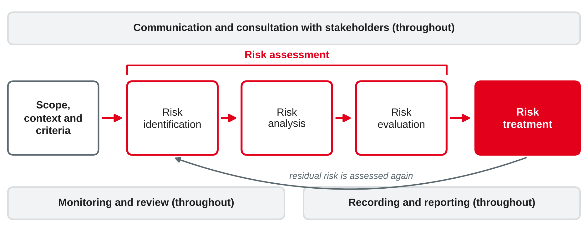
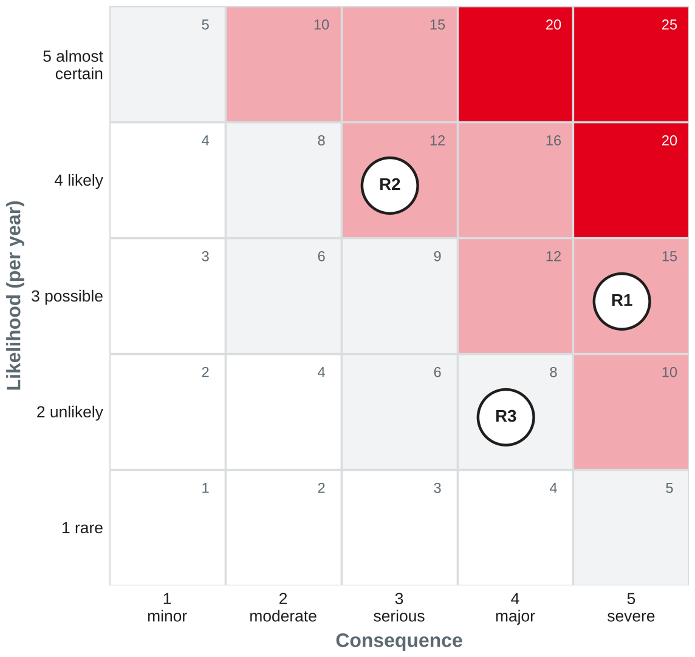

# IT Risk and Compliance Management {.title}

::: notes
Time plan for today (3 h): recap and preparation task 10 min · GRC, IT compliance and the three lines 20 min · regulation: GDPR, NIS2 and the German implementation, DORA 25 min · mini exercise "which rule applies?" 10 min · break 10 min · ISO 31000 risk management 20 min · mini exercise rate and treat 10 min · ethics 15 min incl. short discussion · compliance assessment case 40 min · wrap-up 5 min · ~15 min buffer.
Legal disclaimer for the lecturer: this session teaches what IT managers must know about the regulations, not legal advice. Article and section numbers on the slides were checked against EUR-Lex and the German federal law gazette in October 2026. Re-check the status before the first run in 2028 (NIS2 review, a possible revision of ISO 31000, see notes on the slides). Keep ISO/IEC 27001, protection goals and business continuity for session 8.
:::

---

# Today's Agenda

1. Recap: a rule that affects your company's IT
2. Governance, risk and compliance (GRC) and IT compliance
3. Who checks? The three lines model
4. IT compliance requirements: GDPR, NIS2, DORA
5. Risk management with ISO 31000
6. Ethics: legal is not always right
7. Case exercise: compliance assessment of Rhein-Neckar Mobil Group

::: notes
Time and format guide (not shown to students):
0:00 Recap of preparation task (pairs + plenary) · 0:10 GRC, IT compliance, three lines (input) · 0:30 GDPR, NIS2, German NIS2 act, DORA (input) · 0:55 Mini exercise "which rule applies?" (pairs) · 1:05 Break · 1:15 ISO 31000 (input) · 1:35 Mini exercise rate and treat (pairs) · 1:45 Ethics (input + discussion) · 2:00 Compliance assessment case (groups + plenary) · 2:40 Wrap-up · ~15 min buffer (the regulation part tends to trigger many questions — let it).
If the session runs long: "Compliance management in practice" and "Ethical dilemmas for discussion" are optional and move to self-study. Keep the compliance assessment case; it is the session's exam-style exercise.
:::

---

# Recap: Rules That Shape Your Company's IT

You were asked to find one legal or regulatory rule that affects the IT of your training company.

- **Which rule** did you find — law, regulation, standard, contract or internal policy?
- **What does the company do** to comply: a process, a tool, a role, a document?
- **Who checks** whether it works — and how often?
- What would happen if the company **ignored** it?

::: notes
Pairs for 3 min, then collect 5–6 rules on the board in three columns: "external law" (GDPR, tax and retention rules, NIS2, sector rules like banking supervision), "contracts and standards" (customer requirements, PCI DSS for card payments, ISO certificates), "internal rules" (IT security policy, password rules). The "who checks" answers lead to the three lines model; "what would happen" leads to risk. Link back to session 6: auditors expect evidence that changes were tested and approved.
:::

---

# Governance, Risk and Compliance {.section}

Three tasks, one integrated view

---

# GRC: An Integrated View

::: cards
### Governance
Sets direction, decision rights and accountability, e.g. who approves IT risks (session 3).

### Risk management
Identifies, assesses and treats uncertain events that affect objectives, e.g. a cyber attack on the ticketing back-end.

### Compliance
Makes sure the organisation follows external laws and regulations, contracts and its own internal policies.
:::

::: callout
**GRC** is an integrated, organisation-wide approach that aligns strategy, processes, technology and people so that the organisation acts **ethically**, within its **risk appetite** and in line with **internal policies and external regulations**.
:::

::: source
Own wording based on Racz et al. (2010).
:::

::: notes
Racz, Weippl and Seufert derived a scientifically grounded definition of GRC from the literature and a survey of practitioners; the callout paraphrases it. Point out the word "ethically" — we come back to it at the end of the session. Why integrated? Without integration, every department runs its own risk list, its own controls and its own audits: the same control (e.g. access reviews) is tested five times for five regulations, and nobody has the full picture. GRC tools (e.g. modules of ServiceNow, SAP GRC) try to provide one control catalogue and one risk register.
:::

---

# IT Compliance: Two Perspectives

::: columns
**Compliance of IT**

- IT systems and IT processes must themselves meet requirements
- Examples: access rights follow the need-to-know principle; personal data is encrypted; security incidents are reported in time
|||
**IT for compliance**

- IT supports the whole company in meeting its requirements
- Examples: tamper-proof archiving of invoices; logging and monitoring; workflows with a four-eyes principle; GRC tools
:::

::: callout
**Sources of requirements:** laws and regulations · supervisory rules · contracts and customer requirements · standards the company commits to · internal policies.
:::

::: source
Own summary based on Tiemeyer (2023).
:::

::: notes
In German literature: "IT-Compliance" covers both sides. Examples from German practice that students may know from their companies: GoBD (tax rules for digital bookkeeping and archiving), BDSG (German data protection act, supplements the GDPR), contractual requirements of large customers (e.g. TISAX in the automotive industry), PCI DSS for card payments. Do not list them all — the point is that requirements come from many sources and must be collected systematically (a "compliance register").
:::

---

# Who Checks? The Three Lines Model

| Role | Who | Task | IT example |
|---|---|---|---|
| **Governing body** | Board, supervisory board | Accountable for oversight; sets risk appetite | Approves the information security strategy |
| **First line** | Operational management | Owns and manages risks in daily work | Service owner applies patches and reviews access rights |
| **Second line** | Risk management, compliance, information security officer | Expertise, monitoring and challenge | Compliance team checks whether access reviews take place |
| **Third line** | Internal audit | Independent assurance to the governing body | Audit of the change process (session 6) |

External assurance (e.g. auditors, supervisory authorities) complements the three lines.

::: source
Based on The Institute of Internal Auditors (2020).
:::

::: notes
The 2020 model replaced the older "three lines of defence" and stresses cooperation rather than defence; the IIA describes six principles. The IIA published a refreshed statement of position on the model in July 2026; the three-line structure is unchanged — check the wording before the first run. Exam point: the first line owns the risk; the second line does not take over the risk but supports and challenges; the third line must be independent of management. COBIT 2019 (session 3) contains matching objectives: EDM03 Ensured Risk Optimization, APO12 Managed Risk and MEA03 Managed Compliance With External Requirements.
:::

---

# IT Compliance Requirements {.section}

GDPR, NIS2 and DORA

---

# Three EU Laws Every IT Manager Should Know

| | GDPR | NIS2 | DORA |
|---|---|---|---|
| Legal act | Regulation (EU) 2016/679 | Directive (EU) 2022/2555 | Regulation (EU) 2022/2554 |
| Protects | Personal data and the rights of individuals | Cybersecurity of important services for society and the economy | Digital operational resilience of the financial sector |
| Applies to | Anyone who processes personal data in the EU | Medium and large entities in listed sectors | Financial entities and their critical ICT providers |
| Applies since | 25 May 2018 | 18 Oct 2024 (via national law) | 17 Jan 2025 |

::: callout
A **regulation** applies directly in all member states; a **directive** must first be transposed into national law.
:::

::: source
Regulation (EU) 2016/679; Directive (EU) 2022/2555; Regulation (EU) 2022/2554.
:::

::: notes
Primary sources: EUR-Lex. GDPR: adopted 27 April 2016, applies from 25 May 2018 (Art. 99). NIS2: adopted 14 December 2022; member states had to transpose by 17 October 2024 and apply the rules from 18 October 2024 (Art. 41) — Germany was late (next slides). DORA: adopted 14 December 2022, applies from 17 January 2025 (Art. 64). Ask: which of the three affects your training company? Most students will say GDPR; banks and insurers DORA; energy, transport, health, digital infrastructure and many manufacturers NIS2.
:::

---

# GDPR: What It Means for IT

| Requirement | Article | IT consequence |
|---|---|---|
| Principles: lawfulness, purpose limitation, data minimisation, storage limitation, integrity and confidentiality, accountability | 5 | Collect only what is needed; delete on schedule; prove compliance |
| Lawful basis, e.g. consent, contract, legal obligation | 6 | Each processing purpose needs a documented basis |
| Data protection by design and by default | 25 | Privacy settings built into systems from the start |
| Records of processing activities | 30 | Inventory of applications that process personal data |
| Security of processing | 32 | Appropriate technical and organisational measures |
| Breach notification to the authority within 72 h | 33 | Incident process must detect and escalate data breaches |
| Data protection impact assessment for high-risk processing | 35 | Assess, e.g., tracking of location or driving behaviour |

Fines: up to €20 million or 4 % of worldwide annual turnover, whichever is higher (Art. 83).

::: source
Regulation (EU) 2016/679.
:::

::: notes
Not a law lecture: focus on what IT must deliver. Link to EAM (sessions 10–13): the record of processing activities is much easier with an application inventory. Link to session 6: the incident process must recognise a personal data breach and involve the data protection officer, because the 72-hour clock starts when the controller becomes aware of the breach. Data subjects must be informed when the breach is likely to result in a high risk to them (Art. 34). In Germany, the BDSG adds national rules, e.g. when a data protection officer must be appointed.
:::

---

# NIS2: Cybersecurity for Essential and Important Entities

- **Scope:** medium and large entities in **sectors of high criticality** (Annex I, e.g. energy, transport, banking, health, digital infrastructure) and **other critical sectors** (Annex II, e.g. postal services, food, manufacturing, digital providers)
- **Essential** entities (mostly large, Annex I) and **important** entities (the others), with different supervision
- **Management bodies** approve the risk management measures, oversee them, can be held liable and must be trained (Art. 20)
- **Risk management measures** (Art. 21), e.g. risk analysis, incident handling, business continuity, supply chain security, encryption, multi-factor authentication
- **Reporting** of significant incidents (Art. 23): early warning within 24 h, notification within 72 h, final report within one month
- **Fines** (Art. 34): at least up to €10 million or 2 % of turnover (essential) and €7 million or 1.4 % (important)

::: source
Directive (EU) 2022/2555.
:::

::: notes
Size thresholds come from the EU SME definition: medium = at least 50 employees or more than €10 million annual turnover and balance sheet; large = at least 250 employees or more than €50 million turnover and €43 million balance sheet. Some entities are in scope regardless of size (e.g. DNS providers, qualified trust service providers). Entities must check themselves whether they are in scope — there is no letter from the authority. Supply chain security (Art. 21) is why many suppliers that are not in scope themselves receive NIS2 clauses in their customer contracts. The detailed security measures (ISMS, ISO/IEC 27001, business continuity) are the topic of session 8.
:::

---

# NIS2 in Germany: The New BSI Act

- **Act:** *Gesetz zur Umsetzung der NIS-2-Richtlinie und zur Regelung wesentlicher Grundzüge des Informationssicherheitsmanagements in der Bundesverwaltung* of 2 December 2025, in force since **6 December 2025**
- Its Article 1 is a **new BSI Act (BSIG)**; the Federal Office for Information Security (BSI) supervises
- Categories: **besonders wichtige Einrichtungen** (essential) and **wichtige Einrichtungen** (important) (§ 28); operators of critical facilities (KRITIS) have additional duties
- **Risk management measures** (§ 30) · **reporting** to the BSI: 24 h, 72 h, one month (§ 32) · **registration** with the BSI within three months (§ 33)
- **Management** must implement and oversee the measures, attend regular training and is liable for culpable breaches (§ 38)

::: source
Gesetz zur Umsetzung der NIS-2-Richtlinie (2025).
:::

::: notes
Germany missed the October 2024 deadline; the act was published in the Bundesgesetzblatt on 5 December 2025 (BGBl. 2025 I Nr. 301) and entered into force the following day without a transition period. The shorthand "NIS2UmsuCG" was used for the draft. The BSI estimates around 29,500 entities in scope. Registration is via the BSI portal. Point out § 38: in German law, management cannot delegate the responsibility for cybersecurity to the IT department — a strong governance link to session 3. Check before 2028 whether the BSIG has been amended again (an amendment was already published in July 2026) and whether the EU review of NIS2 has led to changes.
:::

---

# DORA: Digital Operational Resilience in Finance

::: columns
**Who?**

- **Financial entities:** banks, payment and e-money institutions, investment firms, insurers, crypto-asset service providers and others
- **Critical ICT third-party providers**, e.g. large cloud providers, are overseen at EU level
- For financial entities, DORA is the **sector-specific** law that takes precedence over the NIS2 rules on risk management and reporting
|||
**Five pillars**

1. ICT risk management framework
2. ICT-related incident management, classification and reporting
3. Digital operational resilience testing, incl. threat-led penetration testing for some entities
4. Management of ICT third-party risk, incl. contract requirements and a register of information
5. Information sharing on cyber threats
:::

::: source
Regulation (EU) 2022/2554.
:::

::: notes
The five pillars correspond to Chapters II–VI of DORA. DORA is a regulation, so it applies directly without national transposition. Practical effect for IT management: financial entities must keep a register of all contracts with ICT providers and add DORA clauses (audit rights, exit strategies) — which also affects IT service providers who are not financial entities themselves. In Germany, BaFin supervises DORA compliance. Do not go into the detailed technical standards; one sentence is enough.
:::

---

# Mini Exercise: Which Rule Applies? {.exercise}

For each organisation, decide whether **GDPR**, **NIS2** (German BSIG) and **DORA** apply. Justify briefly.

1. A savings bank with 900 employees and an online banking app
2. A regional hospital with 1,200 employees
3. A bakery with 12 employees and an online shop for cakes
4. A municipal water utility with 300 employees
5. A software company with 80 employees that runs a cloud-based ticketing platform for bus companies

::: notes
Pairs, 10 min incl. discussion. Expected answers: 1 GDPR yes; DORA yes (credit institution); NIS2 banking is in Annex I, but DORA takes precedence as the sector-specific act for risk management and reporting. 2 GDPR yes (health data are special categories, Art. 9); NIS2 yes, health sector, large → essential (besonders wichtig); possibly also a critical facility (KRITIS). 3 GDPR yes (customer data); NIS2 no (too small, no listed sector); DORA no. 4 GDPR yes; NIS2 yes, drinking water is Annex I, large (≥250) → essential. 5 GDPR yes (as processor for the bus companies' customer data, Art. 28); NIS2: medium-sized and probably in scope as a cloud computing service provider (digital infrastructure, Annex I) → important entity; accept "needs a closer check of the category"; DORA no. Key learning: GDPR applies almost always; NIS2 depends on sector and size; DORA only for the financial sector.
:::

---

# Risk Management with ISO 31000 {.section}

From uncertainty to decisions

---

# ISO 31000: Risk and the Standard

::: callout
**Risk** is the effect of uncertainty on objectives. It can be negative (a threat) or positive (an opportunity).
:::

::: columns
**What ISO 31000 is**

- Guidelines for managing risk in **any organisation**, any sector, any type of risk
- Not certifiable — unlike ISO/IEC 27001 (session 8)
- Three parts: **principles**, **framework**, **process**
|||
**Principles (selection)**

- Risk management creates and protects **value**
- Integrated into all activities and decisions
- Based on the best available information
- Considers human and cultural factors
- Continually improved
:::

::: source
Own wording based on ISO (2018).
:::

::: notes
ISO 31000:2018 is the second edition (the first was 2009). The standard has eight principles around the purpose "creation and protection of value": integrated; structured and comprehensive; customised; inclusive; dynamic; best available information; human and cultural factors; continual improvement. The framework (leadership and commitment; integration, design, implementation, evaluation, improvement) describes how risk management is anchored in governance. Note for the lecturer: ISO has started a revision (committee draft stage in 2026). Check before the first run in 2028 whether a new edition has been published. ISO 31000 is the general risk standard; IT-specific guidance (e.g. ISO/IEC 27005 for information security risks) builds on it — session 8.
:::

---

# The Risk Management Process

{width=95%}

::: source
Own illustration based on ISO (2018).
:::

::: notes
Walk through the steps with the ticketing back-end: scope = the on-board ticketing service; context = 400 buses, card payments, NIS2 and GDPR; criteria = how we measure likelihood and consequence and what level of risk is acceptable. Identification = what can happen (ransomware, device failure, payment provider outage, data leak). Analysis = likelihood and consequence, existing controls. Evaluation = compare with the criteria: treat or accept? Treatment = choose and implement measures; then the residual risk is assessed again. The three bands are not steps but run throughout: communication with stakeholders, monitoring, documentation (risk register, reports to the board).
:::

---

# Analysing and Evaluating Risks

::: columns
{width=80%}
|||
**Risk level = likelihood × consequence**

- **R1** Ransomware stops the ticketing back-end: 3 × 5 = **15**
- **R2** Phishing hijacks car-sharing accounts: 4 × 3 = **12**
- **R3** Cloud provider exposes location data: 2 × 4 = **8**

**Risk criteria** say what is acceptable, e.g. level ≥ 10 must be treated.
:::

::: source
Own illustration based on ISO (2018).
:::

::: notes
The scales are examples; each organisation defines its own criteria (part of "scope, context and criteria"). Consequence should be defined in business terms: money, customers affected, safety, legal consequences, reputation. Critique to mention: multiplying ordinal scales is a simplification; scores look precise but rest on judgement. Still, the matrix makes discussion and prioritisation possible. The results go into a **risk register**: risk, owner (first line!), likelihood, consequence, level, treatment, residual risk, review date.
:::

---

# Treating Risks

| Option | Meaning | Example (R1 ransomware) |
|---|---|---|
| **Avoid** | Do not start or stop the activity that causes the risk | Not possible: ticketing is core business |
| **Reduce** | Remove the source, lower the likelihood or the consequence | Offline backups, network segmentation, multi-factor authentication, tested recovery plan |
| **Share** | Transfer part of the risk to others | Cyber insurance; contractual duties for the device supplier |
| **Accept** | Retain the risk by an informed decision | Accept the residual risk after treatment, signed by the risk owner |

ISO 31000 also names **taking or increasing a risk** to pursue an opportunity.

::: callout
**Residual risk** is the risk that remains after treatment. It must stay within the **risk appetite** that the governing body has set.
:::

::: source
Own wording and example based on ISO (2018).
:::

::: notes
ISO 31000 lists more fine-grained treatment options (avoid; take or increase to pursue an opportunity; remove the risk source; change the likelihood; change the consequences; share; retain by informed decision). The four-option version (avoid, reduce, share or transfer, accept) is common in practice and in exams — accept either. Point out: insurance shares the financial consequence, not the operational one — the buses still cannot sell tickets. Accepting a risk is a decision by the risk owner, not by the IT administrator who happens to notice it.
:::

---

# Mini Exercise: Rate and Treat {.exercise}

The joint **mobility app** of Rhein-Neckar Mobil Group goes live next year. For each risk, estimate **likelihood** and **consequence** (1–5), calculate the **risk level** and propose a **treatment option** with one measure.

1. The app's payment interface fails on a Monday morning
2. A developer copies real customer data into an unprotected test system
3. The app vendor goes bankrupt
4. A new competitor launches a cheaper app

::: notes
Pairs, 10 min incl. short discussion; several ratings are defensible — the justification matters. Expected answers: 1 likely (4) × serious (3) = 12 → reduce: redundant payment provider, monitoring, workaround (pay later). 2 possible (3) × major (4) = 12 → reduce: anonymised test data, access controls, policy; GDPR breach possible (Art. 33). 3 rare/unlikely (1–2) × severe (5) = 5–10 → reduce or share: escrow of source code, exit clause, financial monitoring of the vendor (link to supplier management, session 15). 4 This is a business or strategic risk, not an IT risk — and partly an opportunity; it belongs in enterprise risk management. Good discussion point: IT risk management is part of enterprise-wide risk management.
:::

---

# Ethics in IT Management {.section}

Legal is not always right

---

# Compliance Is Not the Same as Ethics

::: columns
**Four ethical issues of the information age (PAPA)**

- **Privacy:** what information about themselves must people reveal, and under what conditions?
- **Accuracy:** who is responsible for correct information, and who is accountable for errors?
- **Property:** who owns information, and what is a fair price for it?
- **Accessibility:** who has the right to access information, and on what terms?
|||
**Why it matters for IT managers**

- Laws lag behind technology; many decisions are legal but questionable
- Trust of customers and employees is a business asset
- The GRC definition explicitly includes acting **ethically**
- Ask: would we be comfortable if the decision were on the front page?
:::

::: source
Based on Mason (1986) and Racz et al. (2010).
:::

::: notes
Mason's four issues are 40 years old but still a useful checklist; ask students to map current topics: privacy → tracking and profiling; accuracy → errors in algorithmic decisions; property → who owns data from connected cars; accessibility → digital exclusion of people without smartphones (e.g. only app-based tickets). Link to the module's personal and social competence: taking ethical conditions into account when assessing IT topics. The "front page test" is a simple heuristic, not a theory.
:::

---

# Ethical Dilemmas for Discussion {.optional}

1. Car-sharing: use GPS and driving data to give **careful drivers a discount** — and raise prices for the others?
2. Bus drivers: use the vehicles' telematics data to **rank drivers** by fuel consumption and braking behaviour?
3. Ticketing: sell **only digital tickets** to save costs — what about passengers without a smartphone?
4. Sell **anonymised movement data** to city planners — and to advertisers?

For each: Is it legal? Who benefits, who is harmed? Which PAPA issue is affected? What would make it acceptable?

::: source
Own examples; categories based on Mason (1986).
:::

::: notes
If time allows, 8 min discussion in plenary with one or two dilemmas; otherwise self-study. Expected points: 1 privacy and accuracy (does braking data reflect careful driving?); GDPR needs a lawful basis, transparency and a DPIA (Art. 35); acceptable with consent, transparency, a real choice. 2 privacy at work; in Germany the works council has co-determination rights for technical monitoring of employees; acceptable for training feedback, problematic for individual ranking and sanctions. 3 accessibility; public transport has a public service role; keep alternatives. 4 property and privacy; anonymisation of movement data is hard (re-identification); sharing for public planning is easier to justify than advertising.
:::

---

# Compliance Management in Practice {.optional}

- **Identify** requirements: compliance register of laws, contracts, standards and policies
- **Assess** risks of non-compliance and assign **owners** (first line)
- **Implement controls:** policies, processes, technical measures — e.g. access reviews, logging, change approvals
- **Collect evidence** continuously: tickets, logs, reports — ideally automated
- **Monitor and audit:** second line checks, internal audit gives assurance
- **Report** to management and the board; **improve** after findings and incidents

::: source
Own summary based on Tiemeyer (2023) and The Institute of Internal Auditors (2020).
:::

::: notes
Self-study. One control often serves several requirements (e.g. multi-factor authentication helps with GDPR Art. 32, NIS2 Art. 21 and DORA). That is the argument for an integrated GRC approach with one control catalogue mapped to many regulations. Link to ITSM (sessions 5–6): change enablement, incident management and service level reports produce much of the evidence auditors ask for.
:::

---

# Case Exercise: Compliance Assessment {.exercise}

**Case:** *Rhein-Neckar Mobil Group* (sessions 3–6): 3,200 employees, €410 million turnover. Units: bus services and **regional trains** on the national rail network, a **car-sharing app** (120,000 customers), vehicle maintenance. Card payments are processed by an external **payment institution**.

**Findings of an internal review:**
- The car-sharing app stores GPS tracks of every trip for five years "in case they are useful"
- Marketing plans a "safe driver score" from braking and speed data
- Nobody has checked whether the group must **register with the BSI**
- Security incidents are handled by IT alone; legal and management learn about them weeks later
- The board says: "Cybersecurity is the CIO's job."

::: notes
Read the case together (2 min). Point out that the regional trains matter for the NIS2 assessment. Tasks and expected answers on the next slide.
:::

---

# Case Exercise: Your Tasks {.exercise}

Assess the compliance of *Rhein-Neckar Mobil Group* based on the case and the review findings.

1. Which of **GDPR, NIS2 (BSIG) and DORA** apply? Justify, incl. the NIS2 category.
2. Assess each finding: which **requirement** is violated or at risk?
3. Rate the two most important **risks** (likelihood × consequence) and propose a **treatment**.
4. Who should do what along the **three lines**?
5. Discuss the driver score from an **ethical** point of view.

::: notes
Groups of 4–5, about 30 min + 10 min discussion. This is the session's exam-style exercise. Expected answers (several defensible):
1 GDPR: yes (customers, employees, location data). NIS2/BSIG: yes — regional trains = railway undertaking, transport sector in Annex I; 3,200 employees and €410 m turnover = large → besonders wichtige Einrichtung (essential); bus services alone would not be covered by the NIS2 transport sector, but the entity as a whole is in scope; check whether facilities exceed the KRITIS thresholds. DORA: no — the group is not a financial entity; the payment institution is subject to DORA and may pass on contract requirements.
2 GPS storage "in case": violates purpose limitation, data minimisation and storage limitation (GDPR Art. 5) → define purposes and deletion periods. Driver score: profiling with possible effects on customers → lawful basis (Art. 6), transparency, DPIA (Art. 35), data protection by design (Art. 25). No BSI check: registration duty within three months (BSIG § 33) is probably already overdue → register now. Incident handling: reporting deadlines 24 h/72 h/one month (BSIG § 32) and GDPR 72 h (Art. 33) cannot be met → define an incident reporting process with legal, data protection officer and management. Board statement: contradicts § 38 BSIG / Art. 20 NIS2 — management must approve and oversee measures, attend training and is liable.
3 e.g. missed reporting deadlines/fines (likely × major) → reduce: reporting process, on-call roles, exercise. Ransomware on ticketing or rail IT (possible × severe) → reduce: backups, segmentation, MFA, recovery tests; share: cyber insurance. Data breach of location data (possible × major) → reduce: deletion, encryption, access control.
4 First line: service owners of the app and ticketing, IT operations implement controls and own risks. Second line: information security officer, data protection officer, compliance function set requirements, monitor and challenge. Third line: internal audit audits the NIS2 and GDPR measures and reports to the board/supervisory board. Governing body: approves measures, sets risk appetite, attends training.
5 Privacy (continuous monitoring), accuracy (does the score measure safe driving? context like traffic), accessibility/fairness (discount vs. penalty). Acceptable only with voluntary opt-in, transparency, no penalties, data minimisation; the GDPR may allow it with consent, but the question "should we?" remains.
:::

---

# Key Takeaways

- **GRC** integrates governance, risk management and compliance; IT compliance means compliance **of** IT and IT **for** compliance
- The **three lines**: management owns risks, risk and compliance functions support and challenge, internal audit gives independent assurance
- **GDPR** protects personal data; **NIS2** (in Germany: the new BSIG) sets cybersecurity duties for essential and important entities; **DORA** applies to the financial sector
- **ISO 31000:** set scope and criteria, identify, analyse, evaluate and treat risks — and keep communicating, monitoring and recording
- **Legal is not always right:** ethical questions (privacy, accuracy, property, accessibility) belong in IT decisions

---

# Next Session: IT Security and Business Continuity

- Information security management: ISO/IEC 27001 and BSI IT-Grundschutz
- Protection goals: confidentiality, integrity, availability
- Business continuity management (ISO 22301)
- Business impact analysis

::: callout
**Preparation:** which IT service of your training company could it not live without for a single day? What would happen after one hour, one day and one week without it?
:::

---

# References {.references}

- Directive (EU) 2022/2555 of the European Parliament and of the Council of 14 December 2022 on measures for a high common level of cybersecurity across the Union (NIS 2 Directive). (2022). *Official Journal of the European Union*, L 333, 80–152. http://data.europa.eu/eli/dir/2022/2555/oj
- Gesetz zur Umsetzung der NIS-2-Richtlinie und zur Regelung wesentlicher Grundzüge des Informationssicherheitsmanagements in der Bundesverwaltung vom 2. Dezember 2025. (2025). *Bundesgesetzblatt*, 2025 I, Nr. 301.
- ISO. (2018). *Risk management — Guidelines* (ISO Standard No. 31000:2018). International Organization for Standardization.
- Mason, R. O. (1986). Four ethical issues of the information age. *MIS Quarterly, 10*(1), 5–12.
- Racz, N., Weippl, E., & Seufert, A. (2010). A frame of reference for research of integrated governance, risk and compliance (GRC). In B. De Decker & I. Schaumüller-Bichl (Eds.), *Communications and multimedia security* (Lecture Notes in Computer Science, Vol. 6109, pp. 106–117). Springer. https://doi.org/10.1007/978-3-642-13241-4_11
- Regulation (EU) 2016/679 of the European Parliament and of the Council of 27 April 2016 on the protection of natural persons with regard to the processing of personal data and on the free movement of such data (General Data Protection Regulation). (2016). *Official Journal of the European Union*, L 119, 1–88. http://data.europa.eu/eli/reg/2016/679/oj
- Regulation (EU) 2022/2554 of the European Parliament and of the Council of 14 December 2022 on digital operational resilience for the financial sector (DORA). (2022). *Official Journal of the European Union*, L 333, 1–79. http://data.europa.eu/eli/reg/2022/2554/oj
- The Institute of Internal Auditors. (2020). *The IIA's three lines model: An update of the three lines of defense*. The Institute of Internal Auditors.
- Tiemeyer, E. (Ed.). (2023). *Handbuch IT-Management: Konzepte, Methoden, Lösungen und Arbeitshilfen für die Praxis* (8th ed.). Hanser.

Diagrams in this deck are own illustrations. This session is not legal advice.
