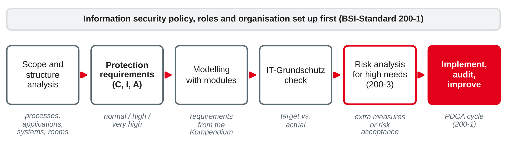

# IT Security and Business Continuity {.title}

::: notes
Time plan for today (3 h): recap and preparation task 10 min · protection goals and ISMS 15 min · ISO/IEC 27001 15 min · BSI IT-Grundschutz 20 min · mini exercise protection requirements 15 min · break 10 min · business continuity management and ISO 22301 15 min · business impact analysis and recovery parameters 20 min · BIA case exercise 45 min · wrap-up 5 min · ~10–15 min buffer.
Copyright note for the lecturer: ISO/IEC 27001, ISO/IEC 27002 and ISO 22301 are copyrighted. The slides describe their structure and ideas in own words; no control texts or definitions are copied. The BSI documents are freely available on the BSI website and are paraphrased too.
Status of the standards was checked in October 2026: ISO/IEC 27001:2022 with Amendment 1:2024 is current (no revision listed by ISO); ISO 22301:2019 with Amendment 1:2024 is current, but ISO lists it as "to be revised" and a committee draft is in progress; the IT-Grundschutz-Kompendium Edition 2023 is the last edition; Grundschutz++ becomes certifiable on 1 January 2027 (BSI website). Re-check all four before the first run in 2028. Session 7 covered NIS2 and ISO 31000; do not repeat them, only link.
:::

---

# Today's Agenda

1. Recap: a day without your most important IT service
2. Protection goals and information security management
3. ISO/IEC 27001 and BSI IT-Grundschutz
4. Business continuity management with ISO 22301 and BSI-Standard 200-4
5. Business impact analysis: MTPD, RTO, RPO and MBCO
6. Case exercise: business impact analysis for Rhein-Neckar Mobil Group

::: notes
Time and format guide (not shown to students):
0:00 Recap of preparation task (pairs + plenary) · 0:10 Protection goals, ISMS, ISO/IEC 27001 (input) · 0:40 BSI IT-Grundschutz (input) · 1:00 Mini exercise protection requirements (pairs) · 1:15 Break · 1:25 BCM, ISO 22301, BSI 200-4 (input) · 1:40 BIA and recovery parameters (input) · 2:00 BIA case exercise (groups + plenary) · 2:45 Wrap-up · ~10–15 min buffer.
If the session runs long: "The ISO/IEC 27000 family today" and "Grundschutz++: what is changing" are optional and move to self-study. Keep the BIA case; it is the session's exam-style exercise.
:::

---

# Recap: One Day Without It

You were asked which IT service your training company could not live without for a single day.

- **Which service** did you choose — and which business process depends on it?
- What happens after **one hour**, **one day** and **one week** without it?
- Is there a **manual fallback**, and has anybody ever tried it?
- How much **data** could the company afford to lose?

::: notes
Pairs for 3 min, then collect 4–5 services on the board with the three time columns (1 h / 1 day / 1 week). Typical answers: ERP and order processing, e-mail and collaboration, production control systems, web shop, payroll before the pay date. The table on the board is already a simple business impact analysis — say so and keep it for the second half. The last question (data loss) leads to the RPO. Link to session 7: the risk "ransomware stops the ticketing back-end" was rated there; today we ask what to do when it actually happens.
:::

---

# Information Security Management {.section}

Protection goals, ISMS and standards

---

# Protection Goals

::: cards
### Confidentiality
Only authorised people can access information, e.g. salary data, customer accounts.

### Integrity
Information and systems are correct and complete; unauthorised or accidental changes are prevented or detected, e.g. fares, bank details.

### Availability
Information and systems can be used when they are needed, e.g. the ticket device at 6:00.
:::

**Extended goals** (often treated as aspects of integrity): **authenticity** (the sender or source is genuine), **accountability** (actions can be traced to a person), **non-repudiation** (nobody can deny an action later).

::: source
Own wording based on BSI (2017a) and ISO/IEC (2022a).
:::

::: notes
The BSI calls confidentiality, integrity and availability the basic values ("Grundwerte") of information security; BSI-Standard 200-1 mentions that some organisations add further goals such as authenticity and accountability, and BSI-Standard 200-2 treats authenticity and non-repudiation as special cases of integrity. ISO/IEC 27001 states that an ISMS preserves confidentiality, integrity and availability. Distinguish three terms that students often mix up: information security (all information, also on paper and in people's heads), IT security (information in IT systems) and data protection (rights of persons whose data are processed; GDPR, session 7). Data protection needs information security (GDPR Art. 32), but is not the same. Ask for an example where the goals conflict: high availability of backups vs. confidentiality of the data in them.
:::

---

# What an ISMS Is

::: callout
An **information security management system (ISMS)** is the set of policies, processes, roles and resources with which management sets security objectives, manages information security risks and **continually improves** security — not a tool and not a project.
:::

::: columns
**Typical building blocks**

- Security policy approved by top management
- Roles: information security officer (CISO), asset and risk owners
- Risk assessment and treatment plan
- Controls, training, incident handling
- Audits, management review, improvement
|||
**Plan–do–check–act**

- **Plan:** scope, risks, objectives, controls
- **Do:** implement controls and train people
- **Check:** monitor, measure, audit
- **Act:** correct and improve
:::

::: source
Own wording based on ISO/IEC (2022a) and BSI (2017a).
:::

::: notes
BSI-Standard 200-1 describes the security process in the four PDCA phases and notes that ISO/IEC 27001 no longer prescribes PDCA explicitly — but its clauses still follow the logic. Link to session 3 (governance): the board is accountable, the CISO supports and challenges (second line, session 7), the service owners implement (first line). Link to session 5: ITIL 4 has an "information security management" practice; in many companies the ISMS and ITSM share processes such as incident and change management.
:::

---

# ISO/IEC 27001:2022 — Structure

| Clause | Topic | What the organisation must do (examples) |
|---|---|---|
| 4 | Context | Determine internal and external issues, interested parties, the **scope** of the ISMS |
| 5 | Leadership | Top management commitment, security policy, roles and responsibilities |
| 6 | Planning | **Risk assessment** and **risk treatment**, statement of applicability, security objectives |
| 7 | Support | Resources, competence, awareness, communication, documented information |
| 8 | Operation | Carry out the risk assessments and the treatment plan |
| 9 | Performance evaluation | Monitoring and measurement, **internal audit**, **management review** |
| 10 | Improvement | Nonconformities, corrective action, continual improvement |

::: source
Own summary based on ISO/IEC (2022a, 2024).
:::

::: notes
Clauses 4–10 follow the harmonised structure of all ISO management system standards (also ISO 9001, session 9, and ISO 22301, later today) — this makes integrated management systems easier. The 2024 amendment added climate change to clause 4: organisations must decide whether climate change is a relevant issue, and interested parties may have climate-related requirements. ISO/IEC 27001 is **certifiable** (unlike ISO 31000, session 7): an accredited certification body audits the ISMS; the certificate is valid for three years with yearly surveillance audits. The transition from the 2013 edition ended in October 2025, so all certificates now refer to the 2022 edition.
:::

---

# Annex A: 93 Controls in Four Themes

| Theme | Controls | Own examples |
|---|---|---|
| **Organisational** | 37 | Security policies, asset inventory, supplier relationships, incident management, ICT readiness for business continuity |
| **People** | 8 | Screening, awareness and training, confidentiality agreements, remote working |
| **Physical** | 14 | Secure areas, access to buildings, protection of equipment, clear desk |
| **Technological** | 34 | Access rights, malware protection, backup, logging, cryptography, secure development |

::: callout
**Statement of applicability (SoA):** for every Annex A control, the organisation states whether it applies, why, and whether it is implemented. **ISO/IEC 27002** gives guidance on how to implement the controls.
:::

::: source
Own summary based on ISO/IEC (2022a, 2022b).
:::

::: notes
The 2022 edition reduced the number of controls from 114 (2013) to 93 and introduced 11 new ones, e.g. threat intelligence, information security for the use of cloud services, ICT readiness for business continuity, data leakage prevention, secure coding. ISO/IEC 27002:2022 also gives each control attributes (e.g. control type, which protection goal it supports) so that organisations can filter them. Annex A is not a checklist to be ticked off: controls are selected based on the risk assessment, and organisations may add their own. Exam point: requirements (27001, certifiable) vs. guidance (27002, not certifiable).
:::

---

# The ISO/IEC 27000 Family Today {.optional}

- **ISO/IEC 27001:2022** + Amendment 1:2024 (climate action): requirements for an ISMS, certifiable
- **ISO/IEC 27002:2022:** guidance on implementing the controls
- **ISO/IEC 27000:2026:** overview of the family (6th edition, July 2026)
- Further guidance, e.g. on information security risk management and on sector-specific controls (cloud, energy, health)
- Sector schemes build on it, e.g. **TISAX** in the automotive industry

::: source
ISO/IEC (2022a, 2022b, 2024, 2026).
:::

::: notes
Self-study. ISO/IEC 27005 gives guidance on information security risk management and builds on ISO 31000 (session 7); it is not certifiable either. TISAX is the assessment scheme of the German automotive association (VDA) based on ISO/IEC 27001/27002 — students from automotive suppliers will know it. Check before 2028 whether ISO/IEC 27001 has been put under revision.
:::

---

# BSI IT-Grundschutz

| Document | Content |
|---|---|
| **BSI-Standard 200-1** | Requirements for an ISMS, compatible with ISO/IEC 27001 |
| **BSI-Standard 200-2** | IT-Grundschutz methodology: how to build an ISMS step by step |
| **BSI-Standard 200-3** | Risk analysis based on IT-Grundschutz, using a catalogue of elementary threats |
| **BSI-Standard 200-4** | Business continuity management (2023) |
| **IT-Grundschutz-Kompendium** | Modules ("Bausteine") with security requirements, e.g. for servers, e-mail, offices, ISMS |

Three approaches in 200-2: **basic protection** (quick start), **standard protection** (full method, basis for certification), **core protection** (start with the "crown jewels").

::: source
Own summary based on BSI (2017a, 2017b, 2017c, 2023a, 2023b).
:::

::: notes
The German names: Basis-Absicherung, Standard-Absicherung, Kern-Absicherung. IT-Grundschutz is free of charge, very concrete and widely used in the German public sector and by many medium-sized companies; it can lead to an "ISO 27001 certificate on the basis of IT-Grundschutz" issued by the BSI. The Kompendium Edition 2023 contains 111 modules in ten layers (e.g. ISMS, ORP organisation and personnel, CON concepts, OPS operations, APP applications, SYS systems, NET networks, INF infrastructure). BSI-Standard 200-3 uses 47 elementary threats (e.g. fire, malware, loss of personnel) and four risk treatment options — avoidance, reduction, transfer and acceptance — which match ISO 31000 from session 7.
:::

---

# The IT-Grundschutz Procedure

{width=100%}

**Protection requirements** per protection goal: **normal**, **high**, **very high**. A system inherits the highest need of the processes and applications that depend on it (**maximum principle**).

::: source
Own illustration based on BSI (2017b).
:::

::: notes
Walk through with the ticketing service: structure analysis lists the business process "selling tickets on board", the applications (fare back-end, device software, payment interface), the IT systems (devices, servers, mobile network) and rooms (depots, data centre). The protection requirements are assessed with damage scenarios (violation of laws, impairment of the ability to perform tasks, financial consequences, reputation, personal safety). Modelling assigns Kompendium modules to each target object; the IT-Grundschutz check compares required and implemented requirements. Only for high or very high needs, or objects without a suitable module, is a separate risk analysis (200-3) needed. Besides the maximum principle, 200-2 knows a cumulation effect (many small damages add up to a high need) and a distribution effect (redundancy lowers the need of a single system).
:::

---

# Grundschutz++: What Is Changing {.optional}

- The BSI is replacing the module-based Kompendium with **Grundschutz++**: an **asset- and process-oriented** approach
- Requirements in a **machine-readable** format (OSCAL/JSON) for tools and automation
- Methodology guide and user catalogue published in 2026 after a pilot phase
- **Certifiable from 1 January 2027**; certificates on the classic IT-Grundschutz remain possible until **30 November 2031**

::: source
BSI (2026).
:::

::: notes
Self-study; status as published on the BSI Grundschutz++ page in October 2026. The pilot phase ran from April to August 2026; the methodology is presented at it-sa in October 2026. The basic ideas taught today — protection goals, protection requirements, standardised requirements, PDCA — remain. Re-check before the first run in 2028 and update the IT-Grundschutz slides if Grundschutz++ has become the norm by then.
:::

---

# ISO/IEC 27001 or IT-Grundschutz?

| | ISO/IEC 27001 | BSI IT-Grundschutz |
|---|---|---|
| Origin | International standard | German federal office (BSI) |
| Approach | Risk-based: own risk assessment, then select controls | Standard requirements for typical objects; own risk analysis only for high needs |
| Level of detail | Generic controls | Very concrete requirements per module |
| Cost of the documents | Paid | Free of charge |
| Certificate | ISO/IEC 27001 by accredited bodies | ISO/IEC 27001 on the basis of IT-Grundschutz (BSI) |
| Typical users | International companies, IT service providers | German public sector, medium-sized firms, KRITIS operators |

::: source
Own comparison based on ISO/IEC (2022a) and BSI (2017a, 2017b).
:::

::: notes
Both lead to an ISMS that meets ISO/IEC 27001; the choice is mainly about effort, detail and the audience for the certificate. Link to session 7: NIS2 Art. 21 (§ 30 BSIG) requires risk management measures "according to the state of the art" but does not prescribe a standard — an ISMS based on either approach is the usual way to demonstrate them. Exam question type: "recommend an approach for company X and justify it".
:::

---

# Mini Exercise: Protection Requirements {.exercise}

Rate the protection requirements of these objects at *Rhein-Neckar Mobil Group* for **confidentiality**, **integrity** and **availability** (normal / high / very high). Justify one rating per object.

1. Fare database of the ticketing back-end
2. Customer accounts of the car-sharing app (incl. payment data and trip history)
3. Intranet with the canteen menu
4. Signalling interface of the regional trains to the national rail network
5. Server that hosts both the fare database and the intranet

::: notes
Pairs, 10 min + 5 min discussion. Several ratings are defensible; the justification matters. Expected answers: 1 C normal (fares are public), I very high (wrong fares → wrong revenue for thousands of trips, legal problems with tariff approval), A high (devices keep a local copy, so a short outage is bridged). 2 C high (personal and payment data, location history — GDPR), I high, A high (customers cannot open cars). 3 normal / normal / normal. 4 C normal, I very high and A very high (safety of passengers; in reality governed by railway safety rules — good discussion point). 5 Maximum principle: the server inherits the highest needs of both applications → C normal, I very high, A high — and the discussion question whether the intranet should run on a server with such high needs at all (separation). Link to the next part: availability ratings are the bridge to business continuity.
:::

---

# NIS2 Risk-Management Measures: Where They Are Covered

| NIS2 Art. 21 measure (session 7) | Covered today by |
|---|---|
| Risk analysis and security policies | ISMS: ISO/IEC 27001 clauses 5–6, BSI 200-1 to 200-3 |
| Incident handling | Annex A organisational controls; ITIL incident management (session 6) |
| **Business continuity**, backup, disaster recovery, crisis management | **BCM** with ISO 22301 or BSI 200-4 — next section |
| Supply chain security | Annex A supplier controls; supplier management (session 15) |
| Cryptography, access control, MFA, training | Annex A technological and people controls; Kompendium modules |

::: source
Own mapping based on Directive (EU) 2022/2555 and ISO/IEC (2022a).
:::

::: notes
Do not repeat session 7. The point: NIS2 says *what* must be achieved; ISO/IEC 27001, IT-Grundschutz and ISO 22301 describe *how* to organise it. The mapping is simplified; Art. 21(2) lists ten measures (a)–(j). Management approval and oversight (Art. 20 / § 38 BSIG) correspond to the leadership clause 5 of ISO/IEC 27001.
:::

---

# Business Continuity Management {.section}

Keeping the business running when things go wrong

---

# Disruption, Emergency, Crisis

::: columns
**Three levels of events**

- **Disruption:** handled by normal processes, e.g. one ticket device fails → incident management (session 6)
- **Emergency:** important processes stop longer than tolerable; normal processes are not enough → business continuity plans
- **Crisis:** an exceptional situation that threatens the organisation as a whole and needs a crisis team, e.g. a cyber attack on all systems
|||
**What BCM adds**

- Prepares the organisation for events that cannot be prevented
- Focus on **time-critical business processes**, not on single IT systems
- Covers all resources: people, buildings, IT, suppliers
- **IT service continuity** is the part that recovers IT
:::

::: source
Own wording based on BSI (2023a) and ISO (2019).
:::

::: notes
BSI-Standard 200-4 distinguishes Störung (disruption), Notfall (emergency) and Krise (crisis); the boundaries are defined by each organisation, e.g. via the tolerable downtimes from the BIA. Link to session 7: ISMS and risk management try to make events unlikely; BCM assumes they happen anyway and limits the damage — the classic example is ransomware: prevention (ISMS) and recovery (BCM) are both needed. In ITIL 4 the matching practice is "service continuity management" (session 5).
:::

---

# BCM with ISO 22301 and BSI-Standard 200-4

::: columns
**ISO 22301:2019** (+ Amd 1:2024)

- Requirements for a **BCMS**, certifiable; same clause structure 4–10 as ISO/IEC 27001
- Core of clause 8 (operation): **business impact analysis and risk assessment** → continuity **strategies and solutions** → **plans and procedures** → **exercise programme** → evaluation
|||
**BSI-Standard 200-4** (2023)

- Practical guide for building a BCMS, compatible with ISO 22301
- Three stages: **reactive BCMS** (quick start, emergency response for the most important processes), **build-up BCMS**, **standard BCMS** (full, ISO 22301-compatible)
- Replaces the former BSI-Standard 100-4 on emergency management
:::

::: source
Own summary based on ISO (2019, 2024) and BSI (2023a).
:::

::: notes
ISO 22301 was published in 2019 (second edition); the 2024 amendment, like for ISO/IEC 27001, added climate change to clause 4. ISO lists ISO 22301 as "to be revised" (committee draft in 2026) — check before 2028. BSI-Standard 200-4 was published in June 2023 after two community drafts; its stage model is aimed at organisations without BCM experience. The German names: Reaktiv-BCMS, Aufbau-BCMS, Standard-BCMS. Policy, roles (BCM officer), training and management review work like in the ISMS — many companies combine both systems.
:::

---

# The Business Impact Analysis (BIA)

::: callout
A **business impact analysis** examines how the **impact** of a disruption of business processes develops **over time**, in order to decide which processes are time-critical and how fast they — and the resources they need — must be recovered.
:::

1. **Identify** business processes or activities and their owners
2. **Assess impacts over time**, e.g. after 1 hour, 4 hours, 1 day, 1 week: financial, legal, reputation, safety
3. **Set recovery parameters:** MTPD, RTO, RPO, MBCO (next slide)
4. **Prioritise** processes and identify the **resources** and **dependencies** they need: IT, people, buildings, suppliers
5. Have the results **approved by management**

::: source
Own wording based on ISO (2019) and BSI (2023a).
:::

::: notes
The BIA is done with the process owners (business departments), not by IT alone — IT provides the resource view. The impact categories are similar to the damage scenarios of the protection requirements in IT-Grundschutz; the difference: the BIA asks how impact grows over time. BSI-Standard 200-4 recommends a pre-filter of processes in the reactive and build-up stages to keep the effort small. The resource view is where EAM helps (sessions 10–13): which applications and infrastructure support which process? The BIA is complemented by a risk assessment (which events could cause the disruption) — session 7's ISO 31000 process.
:::

---

# Recovery Parameters

{width=66%}

| Term (ISO) | BSI-Standard 200-4 (German) | Question |
|---|---|---|
| **MTPD** maximum tolerable period of disruption | MTA, maximal tolerierbare Ausfallzeit | When is it unacceptable? |
| **RTO** recovery time objective | WAZ, geforderte Wiederanlaufzeit | When must the fallback run? |
| **RPO** recovery point objective | maximal zulässiger Datenverlust | How much data may be lost? |
| **MBCO** minimum business continuity objective | Notbetriebsniveau | What minimum level is enough? |

::: source
Own illustration based on ISO (2019, 2025) and BSI (2023a).
:::

::: notes
Exam classic. Rules: RTO < MTPD (with a safety margin); RPO determines the backup or replication frequency (RPO 4 h → at least a backup every 4 hours, or replication); MBCO is the emergency level, e.g. "60 % of buses can sell tickets". Terminology: in ISO 22301 itself, MTPD and RTO appear in notes to the BIA clause; RPO and MBCO are defined in the vocabulary standard ISO 22300. Some companies use "maximum acceptable outage" (MAO) as a synonym for MTPD. BSI-Standard 200-4 also compares the required restart time with the actual one that can be achieved with today's resources; if the actual time is longer, there is a gap that needs a continuity solution. Many students know RTO and RPO from IT jobs — point out that in BCM they are set from the business side and then passed on to IT (and into SLAs and OLAs, session 6).
:::

---

# From BIA to Continuity Solutions

::: columns
**Continuity strategies and solutions**

- **Workarounds** and manual procedures, e.g. paper tickets
- **Redundancy:** second data centre, second payment provider
- **Backup and restore**, replication; offline copies against ransomware
- **Alternative sites** and staff, e.g. other depot
- **Supplier agreements** with recovery times that match the RTO
|||
**Plans and exercises**

- **Business continuity plans** per process: who does what in an emergency
- **IT recovery plans** (disaster recovery) per system
- **Crisis management:** crisis team, communication
- **Exercises and tests:** from desk-check and walkthrough to a full restore test — a plan that was never tested is a hope, not a plan
:::

::: source
Own summary based on ISO (2019), BSI (2023a) and Tiemeyer (2023).
:::

::: notes
Cost rises sharply as RTO and RPO approach zero (hot standby, synchronous replication) — the BIA justifies the spending, like a business case (session 4). Exercise types in increasing realism: plan review, tabletop exercise, technical restore test, simulation, full exercise. NIS2 explicitly names backup management, disaster recovery and crisis management (Art. 21(2)(c)). Classic failure: backups exist but nobody has ever restored the full system, or the backups are encrypted by the same ransomware. Tiemeyer (2023) treats availability and continuity management as part of IT system operations.
:::

---

# Case Exercise: Business Impact Analysis {.exercise}

**Case:** *Rhein-Neckar Mobil Group* (sessions 3–7), **on-board ticketing service**: 400 buses and the regional trains, operation daily 4:30–0:30. Ticket devices keep fares locally and upload sales every 15 minutes to the **fare back-end**; card payments go via an **external payment provider**; sales data feed the **revenue sharing** with the regional transport association once a month.

**Business processes to analyse:**
- **A** Sell tickets on board (cash and card)
- **B** Check tickets of passengers with app tickets
- **C** Report sales and revenue to the transport association
- **D** Update fares (twice a year)

::: notes
Read the case together (2 min). Hints if asked: on-board sales are about €150,000 per day (own example figure); the transport association contract requires the monthly revenue report by the 10th working day; drivers are allowed to let passengers ride without a ticket if the device fails ("goodwill"), but revenue is lost. Tasks on the next slide.
:::

---

# Case Exercise: Your Tasks {.exercise}

1. Assess the **impact over time** (1 h, 1 day, 1 week) for processes A–D: financial, legal or contractual, reputation, safety.
2. Set **MTPD**, **RTO**, **RPO** and **MBCO** for each process. Which processes are **time-critical**?
3. Which **resources** and **dependencies** does process A need?
4. Propose a **continuity solution** for process A and one **exercise** to test it.
5. Which **protection goal** does each process mainly depend on?

::: notes
Groups of 4–5, about 30 min + 15 min discussion. This is the session's exam-style exercise. Expected answers (several defensible, consistency matters):
1 A: 1 h → revenue loss (about €6,000 per hour at €150,000 per 20-hour day), annoyed passengers; 1 day → €150,000, press coverage, drivers overloaded; 1 week → about €1 m, contract problems with the association, reputation damage. B: 1 h → fare evasion slightly up; 1 day → noticeable loss, but trains run; 1 week → loss and abuse grows. C: 1 day → no impact; 1 week → none if the report deadline is not reached; after the deadline → contractual penalties, wrong revenue sharing. D: hardly any impact for weeks, unless the fare change date is missed (then legal problem: wrong fares charged).
2 Example: A MTPD 4 h, RTO 1 h (devices work offline; card payment fallback), RPO 15 min (upload cycle; better: devices store sales until confirmed, so RPO ≈ 0), MBCO cash and paper tickets on all buses, card on 60 %. B MTPD 1 day, RTO 4 h, MBCO visual check of the app ticket. C MTPD 5 working days (before the deadline), RTO 3 days, RPO 0 (all sales must be complete — integrity!). D MTPD 2 weeks before a fare change date. Time-critical: A (and B).
3 Ticket devices, fare data on the device, mobile network, fare back-end, payment provider, drivers trained in fallback, spare devices in the depots, depot power and Wi-Fi for uploads, cash handling.
4 E.g. offline mode for cash and paper tickets with local storage; card payments stored and forwarded later (risk of declined cards, accept up to a limit); second payment provider; spare device pool; manual sales booklet. Exercise: tabletop exercise "payment provider down on Monday morning" with drivers' dispatch and IT; technical test: switch a bus line to offline mode for one day and check whether all sales arrive.
5 A availability; B availability and integrity/authenticity (fake app tickets); C integrity (complete, correct sales data); D integrity (correct fares) and availability on the change date. Link back to the protection requirements exercise.
:::

---

# Key Takeaways

- **Protection goals:** confidentiality, integrity, availability — plus authenticity, accountability, non-repudiation
- An **ISMS** manages information security as a continual process; **ISO/IEC 27001** sets its requirements and lists 93 controls in four themes in Annex A
- **BSI IT-Grundschutz** (200-1 to 200-3 and the Kompendium) offers a concrete, free path to an ISMS; Grundschutz++ is its successor
- **BCM** (ISO 22301, BSI 200-4) prepares the business for emergencies that cannot be prevented
- The **BIA** sets MTPD, RTO, RPO and MBCO for time-critical processes; continuity solutions and tests follow from it

---

# Next Session: IT Quality Management

- Quality concepts and quality management in IT
- ISO 9001 in IT organisations
- Software quality with ISO/IEC 25010
- Maturity models, e.g. CMMI

::: callout
**Preparation:** think of a piece of software you use at work that annoys you. What exactly is wrong with its quality — and how would you measure it?
:::

---

# References {.references}

- Bundesamt für Sicherheit in der Informationstechnik. (2017a). *BSI-Standard 200-1: Managementsysteme für Informationssicherheit (ISMS)* (Version 1.0). BSI.
- Bundesamt für Sicherheit in der Informationstechnik. (2017b). *BSI-Standard 200-2: IT-Grundschutz-Methodik* (Version 1.0). BSI.
- Bundesamt für Sicherheit in der Informationstechnik. (2017c). *BSI-Standard 200-3: Risikoanalyse auf der Basis von IT-Grundschutz* (Version 1.0). BSI.
- Bundesamt für Sicherheit in der Informationstechnik. (2023a). *BSI-Standard 200-4: Business Continuity Management*. BSI.
- Bundesamt für Sicherheit in der Informationstechnik. (2023b). *IT-Grundschutz-Kompendium* (Edition 2023). BSI.
- Bundesamt für Sicherheit in der Informationstechnik. (2026). *Grundschutz++*. Retrieved October 20, 2026, from https://www.bsi.bund.de/DE/Themen/Unternehmen-und-Organisationen/Standards-und-Zertifizierung/Grundschutz-in-der-Informationssicherheit/Grundschutz-Plus-Plus/grundschutz-plus-plus_node.html
- Directive (EU) 2022/2555 of the European Parliament and of the Council of 14 December 2022 on measures for a high common level of cybersecurity across the Union (NIS 2 Directive). (2022). *Official Journal of the European Union*, L 333, 80–152. http://data.europa.eu/eli/dir/2022/2555/oj
- ISO. (2019). *Security and resilience — Business continuity management systems — Requirements* (ISO Standard No. 22301:2019). International Organization for Standardization.
- ISO. (2024). *Security and resilience — Business continuity management systems — Requirements — Amendment 1: Climate action changes* (ISO 22301:2019/Amd 1:2024). International Organization for Standardization.
- ISO. (2025). *Security and resilience — Vocabulary* (ISO Standard No. 22300:2025). International Organization for Standardization.
- ISO/IEC. (2022a). *Information security, cybersecurity and privacy protection — Information security management systems — Requirements* (ISO/IEC Standard No. 27001:2022). International Organization for Standardization.
- ISO/IEC. (2022b). *Information security, cybersecurity and privacy protection — Information security controls* (ISO/IEC Standard No. 27002:2022). International Organization for Standardization.
- ISO/IEC. (2024). *Information security, cybersecurity and privacy protection — Information security management systems — Requirements — Amendment 1: Climate action changes* (ISO/IEC 27001:2022/Amd 1:2024). International Organization for Standardization.
- ISO/IEC. (2026). *Information security, cybersecurity and privacy protection — Information security management systems — Overview* (ISO/IEC Standard No. 27000:2026). International Organization for Standardization.
- Tiemeyer, E. (Ed.). (2023). *Handbuch IT-Management: Konzepte, Methoden, Lösungen und Arbeitshilfen für die Praxis* (8th ed.). Hanser.

Diagrams in this deck are own illustrations. Standards are described in own words.
